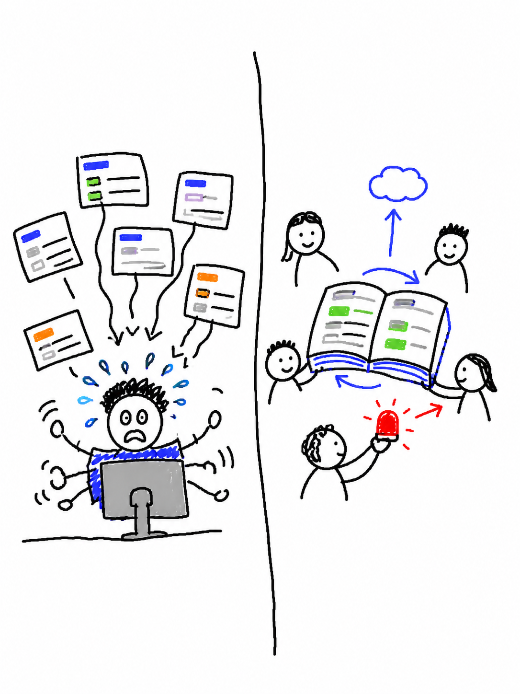
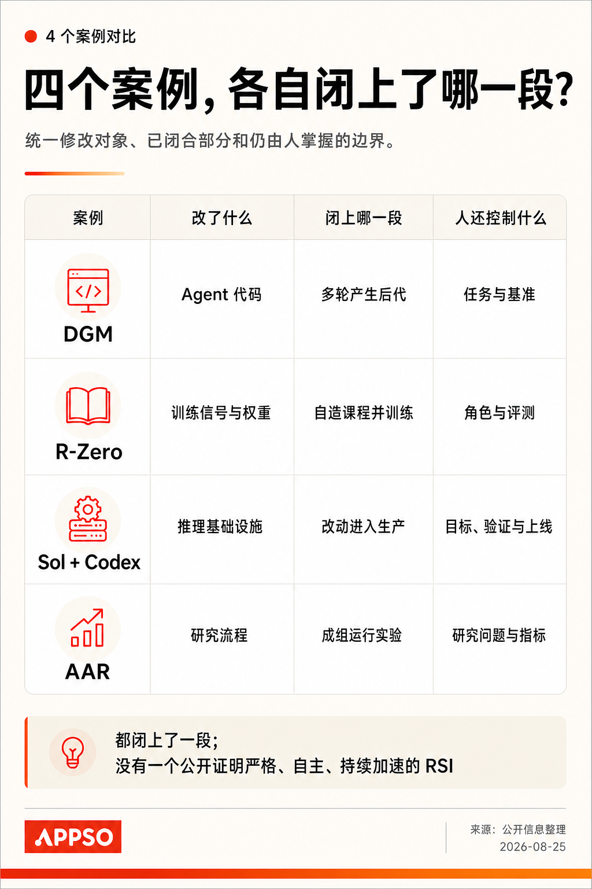

# APPSO 工作流

**把选题、写作、图片、视频和交付接起来。**

这套流程面向 APPSO 的日常内容工作：从一条新闻、一个产品或一份商单 brief 出发，完成选题、查证、写稿、配图、实际制作和编辑交接。资讯、深度解释、产品体验、Hunt Good 周报都能找到对应入口。

[先看作品](#先看已有产出) · [图片怎样做和配](#图片能画什么一篇怎样配) · [了解其他功能](#选题与资料从线索到值得写的题目) · [查看整体结构](#这些功能怎样接起来)

## 先看已有产出

下面两张图来自同一篇解释稿，均为 Image2 生成。点图可以查看原尺寸。

| 笨拙涂鸦：把工作方式画成一个场景 | APPSO 信息图：把案例差异放在一起比较 |
|---|---|
|  |  |

还可以直接看这些稿例与模板：

| 示例 | 能看到什么 |
|---|---|
| [一轮 APPSO 选题会候选](<微信公众号/选题/2026-08-18-APPSO-选题会.md>) | 候选题、为什么今天值得写、一手来源和继续取材的方向 |
| [AI 自我改进解释稿](微信公众号/内容/2026/08/tibo-codex-recursive-self-improvement/draft.md) | 围绕一个问题组织正文，搭配原始材料、笨拙涂鸦与信息图 |
| [Astra CLI 产品实测稿](微信公众号/内容/2026/09/astra-cli-review/draft.md) | 实际生成的网页与游戏、界面截图、操作 GIF 和案例对照 |
| [一期 Hunt Good 周报稿](微信公众号/内容/2026/08/hunt-good-2026-08-21/draft.md) | 资讯、工具、观点与趣味案例的栏目组织和图文节奏 |
| [图片与视频审阅模板](<APPSO-数字资产/04-模板/HTML/README.md>) | 图片网格、原图下载、视频播放器、制作过程图与离线打包方式 |

## 图片：能画什么，一篇怎样配

Image2 主要制作笨拙涂鸦和 APPSO 信息图，再与官方原图、真实截图及产品实测作品搭配。不同图片承担不同的阅读任务。

| 图片类型 | 具体做成什么样 | 适合解决什么问题 |
|---|---|---|
| **笨拙涂鸦** | 白底、像鼠标画出的歪线条、简单人物与少量色块。可以制作封面、场景比喻和正文解释图，一张图表达一个主体关系与段落判断 | 把抽象冲突、人的处境或一种工作方式画得直观、有趣 |
| **APPSO 信息图** | 暖白底、黑红文字、清楚的层次和 APPSO 品牌元素。可画流程、关系、时间线、概念地图、案例与功能比较 | 解释「怎么运作」「几件事是什么关系」「差别在哪里」 |
| **数据与成本图** | 用真实明细和绘图工具制作费用构成、方案对照或成本统计，保留单位与计算依据，归入信息图路线 | 让价格、积分、时长和实际消耗能够放在一起理解 |
| **原图与实测图** | 官方图片、完整原帖、真实界面、操作截图、被测产品生成的图像及视频抽帧，保留原貌与出处 | 让读者直接看见发生了什么、产品做出了什么 |

例如，讲协作方式可以用一张涂鸦表现「大家围着同一本手册工作」；讲视频制作可以用一张信息图串起「角色—分镜—生成—合成」；讨论费用则把本次作品的实际消耗做成成本图。官方宣传图和实际效果图各自保留来源。

### 一篇文章怎样搭配

普通长文可以先按 **正文 6–10 张图、封面另计**规划，围绕关键转折、核心机制、作者体验和结尾判断安排位置。现有要求是每篇实际采用的图片**至少覆盖三条视觉路线中的两类**：原图、笨拙涂鸦、信息图。

下面是两种可调整的正文配图方案：

| 稿型 | 配图示例 | 阅读作用 |
|---|---|---|
| 解释型长稿，7 张正文图 | 3 张原始材料 + 2 张笨拙涂鸦 + 2 张信息图 | 先看事实，再理解人的处境、机制与关系 |
| 产品体验稿，8 张正文图 | 4 张操作／界面图 + 2 张实际结果／关键帧 + 1 张涂鸦 + 1 张成本信息图 | 看清入口、制作过程、实际效果与花费 |

具体数量随篇幅和材料调整；Hunt Good 按栏目与条目选图，视频体验在相关段落加入可播放作品。完成时一起交付封面、正文图、原图、图注与来源记录，并检查手机宽度下的实际阅读效果。

## 选题与资料：从线索到值得写的题目

可以从一条新闻、一个关键词、产品链接或用户提供的材料开始。工作流结合官方公告、原始访谈、研究与公开讨论寻找线索，核对时间与出处，对照近期内容去重，同时寻找可用原图和演示。

选题会通常准备 1–2 个优先候选和少量备选。每个题目讲清暂定标题、5 秒事实、为什么今天值得看、普通读者最关心什么，以及一手来源和配图方向。拿到 PDF、Word brief 或导出的手册时，也会先整理其中的功能、要求与可用资产，形成后续写作或体验的材料底稿。

产出是可以带进选题会的候选题和资料包，供编辑决定这次写什么、从哪里切入、还需要补什么。

## 写作与审校：把材料组织成一篇能读下去的稿

同一组资料可以按任务写成不同稿型：

- **资讯快讯：** 先把事件、关键变化和对读者的影响讲清，再补必要背景。
- **解释与分析长稿：** 围绕一个读者问题确定主线，安排证据、场景和转折，把技术、产品或行业变化讲明白。
- **产品体验稿：** 用具体任务、真实结果和使用感受组织正文，让每个重要功能都有可看的案例。
- **多平台改写：** 共享已核事实，分别写公众号长文与 X 短帖，调整入口、篇幅和表达。

审校覆盖事实、引语、来源、结构、语气、节奏和图文衔接。已有稿件收到意见时，可以按小标题、段落或图片定位修改，再检查相关上下文。

交付包含正文、来源与配图；主编既能直接读稿，也能回看关键事实和素材。

## 产品体验与商单：把宣传要求变成真实案例

从 brief、产品手册和参考文章中整理必展功能、宣传口径与质量要求，再决定拍什么、测什么、怎样展示。比如，要展示表演控制，就设计带停顿和反应的对话；要展示镜头控制，就安排明确的站位、遮挡与移动；要展示转绘，就围绕同一段原片比较风格变化。

案例可以结合当时的电影、热门 IP、节日或网络梗。先说明创意与功能的关系，再完成实际制作。图像模型或同题产品比较会保留相同的创作要求、输入与结果，便于解释差异。

一篇完整体验稿会把几样东西放在一起：**功能对应的案例、实际作品、工作台过程图、体验正文，以及本次制作的成本。** 费用记录区分展示作品消耗与完整制作总消耗，官方套餐和活动价注明条件与日期，成本图使用本次可复算的明细。

## 视频与长片：从一个镜头做到完整作品

适合做对白、动作、运镜、角色连续性、风格转绘，以及多镜头短剧或长片。先确定故事、角色、服装、道具与场景，准备关键图和分镜，完成一条达到展示要求的样片，再展开其他镜头。

**CLI 和网页各有适合的任务。** 目标产品提供官方 CLI／API 时，可以批量提交同规格图像、视频或分镜任务，查询进度并下载结果；剧本、资产引用、分镜画布、3D 站位、转绘等工作台功能，在网页中实际操作。产品没有对应接口时，使用已登录浏览器完成。

长片按故事拆镜，衔接时检查人物、道具、动作和镜头连续性，也完整检查对白、音效与口型。主展示片段通常围绕 15–20 秒设计，完整片长由故事决定。提交任务后保留任务记录，等待超时时先查询已有结果，复用已完成素材。

过程图随操作一起保存。涉及工作台时，先给能看见导航、资产、分镜和预览关系的全局图，再用局部图补充细节。交付包括原始镜头、完整成片、精选展示片段、关键帧、过程图与制作记录，文章中可以直接观看对应作品。

## Hunt Good：按栏目完成一期周报

周报围绕四栏整理主池和备选池，默认是 **7 条资讯、3 个工具、3 个观点、1 个趣味案例**；本期结构按主编要求确定。

资讯交代发生了什么、为什么值得看；工具说明帮谁解决什么问题、怎么上手及实测情况；观点补齐提出者、依据与启发；趣味案例展示作品和做法。选题阶段同步去重与搜图，锁题后完成条目、目录和配图。

交付是一份栏目齐全、目录与正文对应、链接和素材可继续编辑的周报稿。

## 审阅与交付：让主编直接看内容、看作品

可以按本次用途选择交付形式：

| 形式 | 打开后能做什么 | 适合谁、什么场景 |
|---|---|---|
| **图像审阅 HTML** | 浏览候选图、看说明、打开原图并下载 | 编辑选封面、比较生成结果、查看角色与场景图 |
| **视频审阅 HTML** | 播放实际成片，查看模型／规格说明、制作过程图和原文件 | 多案例体验、长片片段、CLI 与网页结果审阅 |
| **图文阅读预览** | 连贯阅读正文、图片、GIF 与配套素材 | 主编通读、调整图文节奏、准备公众号排版 |
| **ZIP 素材包** | 解压后离线阅读与播放，带走对应原文件 | 发给主编、跨机器交接、保存一轮完整作品 |
| **飞书文档与公众号交接** | 在线协作修改，准备人工复制包，或使用公司扩展完成排版交接 | 团队协作、定稿进入公众号草稿 |

图像、视频和图文各有对应模板。审阅页保留清楚的作品说明，原片、原图与排版用导出文件一起管理；发布和账号写入按本次授权执行。

## 反馈与复用：改到成品，也为下次留下方法

「过程图要给全局」「这条视频节奏太短」「价格需要画清楚」这样的意见，会落实到对应图片、镜头、段落和交付包。需要长期沿用的品牌偏好进入 APPSO 配置，已确认的制作方法进入相应流程；案例、模板与可复用素材留下索引。

下一篇同类任务可以接着使用已确认的做法，局部修改也能找到具体对象。

## 这些功能怎样接起来

任务从选题、brief 或修改要求进入。资料、事实和素材构成共用基础，写作、图片与视频围绕同一个内容目标制作；完成后进入审阅和交付，编辑反馈再用于后续内容。

| 部分 | 负责什么 | 到哪里找 |
|---|---|---|
| 任务入口与共用流程 | 判断本次任务、组织资料、制作与审校 | [工作流入口](<共享/运营/SOP/工作流使用入口.md>) |
| APPSO 品牌与栏目 | 文风、视觉、选题会、Hunt Good 和产品体验要求 | [APPSO 数字资产](APPSO-数字资产/README.md) |
| 单篇内容包 | 保存本篇 brief、正文、来源、图片、视频与交付记录 | [内容包模板](共享/模板/微信公众号内容包/) |
| 审阅与交付模板 | 图像、视频、整篇图文和离线素材包 | [媒体 HTML 模板](<APPSO-数字资产/04-模板/HTML/README.md>) |
| 执行工具 | 取材、校验、预览、打包与平台适配 | [使用与技术附录](docs/appso-workflow/使用与技术附录.md) |

## 从哪里开始

直接给出目标、参考材料和交付要求即可，例如：

> 根据这份 brief，为 APPSO 做一篇产品体验稿。先整理必展功能，设计几个有区别的案例，完成实际制作并保存全局过程图，配好封面、解释图与成本图，最后交一份主编能直接阅读和播放的图文视频包。

[使用与技术附录](docs/appso-workflow/使用与技术附录.md)提供安装、命令、配置、CLI 制作步骤与维护说明；[APPSO 内容流程](<APPSO-数字资产/03-SOP/APPSO 内容生产 SOP.md>)保存各专项的具体要求。

本页封面、涂鸦、信息图与架构图均为 AI 生成，来源见[配图记录](docs/appso-workflow/assets/provenance.yml)。账号、登录态与未公开客户原件留在本机。
