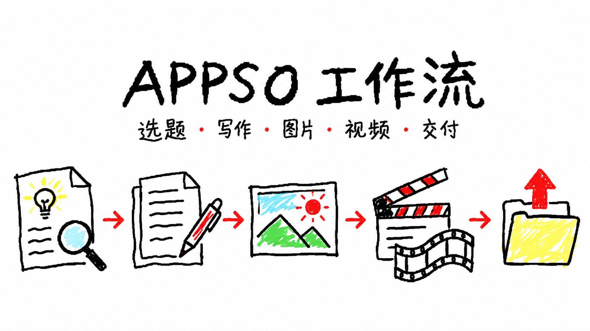
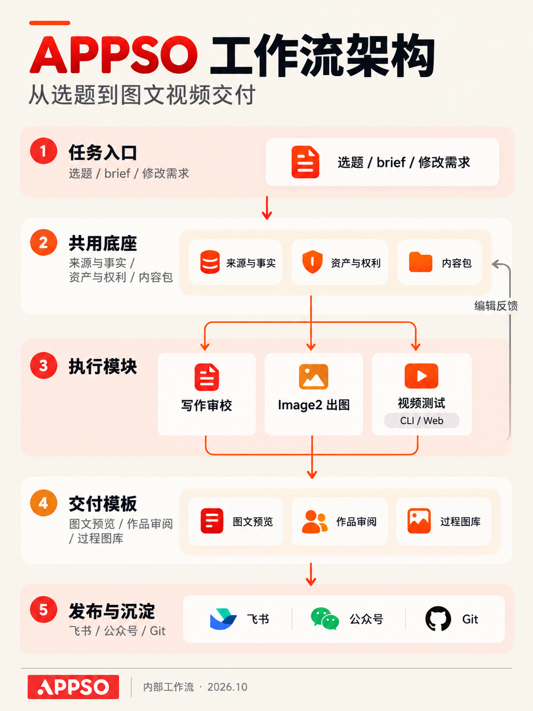

# APPSO 工作流

**把选题、写作、图片、视频和交付接起来。**

这是一套为 APPSO 内容工作整理的生产流程。它从一个选题或商单 brief 出发，帮助我们查清资料、设计体验、制作作品，再交出可以阅读、观看和继续修改的内容。

日常资讯、深度分析、产品体验和 Hunt Good 周报，都可以在同一套工作流里完成。每次按任务需要选择对应部分。

## 能做什么

**找选题，理资料。** 从一手来源、热点和真实讨论中寻找有价值的内容，明确读者为什么关心这件事，也把可用图片和素材一起找齐。

**写稿，也改稿。** 把资料组织成快讯、解释或分析长文，确定主线，核对事实，处理结构和表达。收到反馈后，直接修改对应段落、图片或案例。

**做真正的产品体验。** 读完 brief、手册和对标稿，再把需要展示的功能变成可拍、可看的案例。成片和过程图与正文一起准备，商单用实际结果承接产品卖点。

**制作图片和视频。** Image2 负责封面、解释图和架构图；精确统计使用真实数据。视频制作可以调用目标产品的官方 CLI，也可以在网页工作台里安排剧本、角色、分镜、运镜和转绘，再把多个镜头组成完整作品。

**交出方便审阅的作品。** 图片可以查看原图，视频可以直接播放，制作过程可以按步骤浏览。图文与视频分别有 HTML 模板，可连同原素材打包，也能进入飞书协作与公众号交接。

**把反馈留下来。** 单篇修改直接落实到成品，长期有用的方法进入对应流程，让下一次制作能接着用。

## 覆盖哪些业务场景

| 场景 | 可以得到什么 |
|---|---|
| 日常资讯、选题会与 Hunt Good | 候选题、已核资料、栏目内容与配图 |
| 深度分析与技术解释 | 有主线的正文、证据和审稿结果 |
| 产品体验与商单 | 功能对应的真实案例、作品、过程图与制作成本 |
| 图像模型、短视频与长片测试 | 候选图、实际成片、镜头对照、完整制作记录 |
| 主编审阅与内容交接 | 可读的图文、可播放的视频、HTML 与素材包 |

## 它怎样工作

任务从选题、brief 或修改要求进入。资料、事实与素材构成共同底座，写作、出图和视频制作围绕同一个内容目标推进；完成后进入审阅、协作与交付，编辑反馈再回到后续制作中。

整个结构分工清楚：

- **入口**决定这次要做什么、最后交什么。
- **内容与素材底座**保存正文、来源、参考和实际作品。
- **制作模块**分别处理写作、图片与视频，按任务组合。
- **审阅与交付模板**让主编能直接看内容、看效果、提修改。
- **流程与反馈记录**保存已确认的做法，支持后续复用。

## 视频测试怎样融入内容

一篇体验稿可以包含几种不同的创作任务：一场有反转的对话、一条有明确运镜的镜头、一段风格转绘，或由多个镜头组成的长片。

能通过官方 CLI 批量完成的生成任务交给 CLI；需要验证的网页功能，则在真实工作台里操作并留下全局截图。我们先完成一条达到展示要求的样片，再展开其他案例，最后把成片、关键图与制作过程放回文章。

这样，读者既能看见作品，也能理解产品在创作中具体做了什么。

## 从哪里开始

可以直接给出本次目标、参考材料和交付要求，例如：

> 根据这份 brief，为 APPSO 做一篇产品体验稿。先设计几个有区别的案例，完成实际制作并保存过程，最后交一份主编能直接阅读的图文视频包。

- [查看使用与技术附录](docs/appso-workflow/使用与技术附录.md)：详细功能、安装、命令、配置与维护。
- [查看图像与视频 HTML 模板](<APPSO-数字资产/04-模板/HTML/README.md>)：作品审阅和离线素材包。
- [查看 APPSO 内容流程](<APPSO-数字资产/03-SOP/APPSO 内容生产 SOP.md>)：品牌、栏目和专项入口。

封面与架构图由 Image2 制作，为 AI 生成。账号、登录态与未公开客户原件留在本机。
