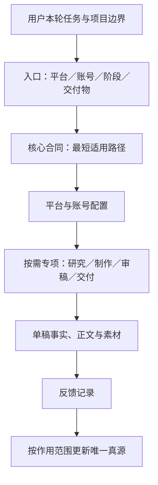

# SOP 架构与维护

更新日期：2026 年 10 月 27 日。

找当前任务怎么做，查[工作流使用入口](工作流使用入口.md)；助手从 [self-media-ops](../../../.agents/skills/self-media-ops/SKILL.md) 分流。本页定义文件职责和维护位置，不再维护另一份任务菜单。

## 规则放在哪里

| 层 | 负责什么 | 执行真源 | 不在这里新增什么 |
|---|---|---|---|
| 项目边界 | 保密、授权、Git 和内容／科研分流 | 根 [AGENTS.md](../../../AGENTS.md) | 单篇选题、具体厂商命令 |
| 入口 | 识别任务，找到需要加载的模块 | [人用导航](工作流使用入口.md)、[助手分流](../../../.agents/skills/self-media-ops/SKILL.md) | 完整 SOP 正文、第二份硬门 |
| 核心合同 | L0—L3、状态、事实与证据、共写、审稿和交付硬门；现有 PROJECT 规则保持 ID 可追溯 | [内容工作流](内容工作流.md) | 新增品牌 Prompt、厂商操作、单项工具试跑 |
| 平台与账号 | 平台表达、账号声音、品牌视觉及公司边界 | [公众号指令](../../../微信公众号/AGENTS.md)、[公众号上下文](../../../微信公众号/CONTEXT.md)、[X 指令](../../../X/AGENTS.md)、[APPSO adapter](<../../../APPSO-数字资产/03-SOP/APPSO 内容生产 SOP.md>) | 重复核心生命周期、把公司配置默认施加到个人号 |
| 专项执行 | 稿型制作、编辑生图、视频实测、排版、工具调用和交付方法 | 导航指向的专项 SOP／Skill、[工具注册](../../../tools/workflow-toolchain.json) | 改写上层授权、复制厂商账号和登录态 |
| 单稿记录 | 本篇 brief、正文、来源、输入、实际结果、费用、素材和反馈 | 目标内容包；结构见 [content-package](../../../.agents/skills/self-media-ops/references/content-package.md) | 把一个案例的角色、数量、价格变成全局默认 |

平台、账号和任务类型是可以组合的维度。例如「公众号 + APPSO + 视频产品体验 + HTML 审阅」使用对应配置与专项；「X + 已有视频的文案」不继承公众号排版与长稿制作要求。

## 新要求如何接入

先判断它改变什么对象。单句、单图和单篇结果留在内容包；账号声音放账号配置；某类稿的制作方法放专项；跨稿共用的状态、事实或授权合同才进入核心。用户明确采用的偏好可以作为项目配置生效，效果证据与配置采用分别记录，见 [feedback-to-system](../../../.agents/skills/feedback-to-system/SKILL.md)。

入口只补触发条件和链接。APPSO 专项由 APPSO adapter 维护目录，助手的品牌路由指向该 adapter，避免每增加一个专项就同步抄写多套菜单。原始 Prompt、风格 profile、工具版本和依赖各自保留原有真源。

执行顺序为本轮用户指令、适用范围明确的配置、通用默认；外部操作仍遵守根指令。专项只细化自己的任务，不能改写品牌默认或放宽事实、权利和发布门。发现两处正文规定同一行为时，保留所属层的完整合同，另一处改成指针；保留既有规则 ID 与可用入口，避免历史引用失去含义。

## 维护与检查

文档与路由变更检查目标差异、链接、适用正例和反例；工具、依赖或能力合同变更执行 `CORE-PORTABILITY-001`。只做文档整理时不运行安装或冷 clone。规则与校验器是否一致单独核实，文档修改不等于工具已实现。

每次维护在[变更台账](<../复盘/SOP 变更台账.yml>)或对应案例中记录来源、作用范围、修改位置和验证结果。普通任务不需要加载本页或重审全局 SOP。
