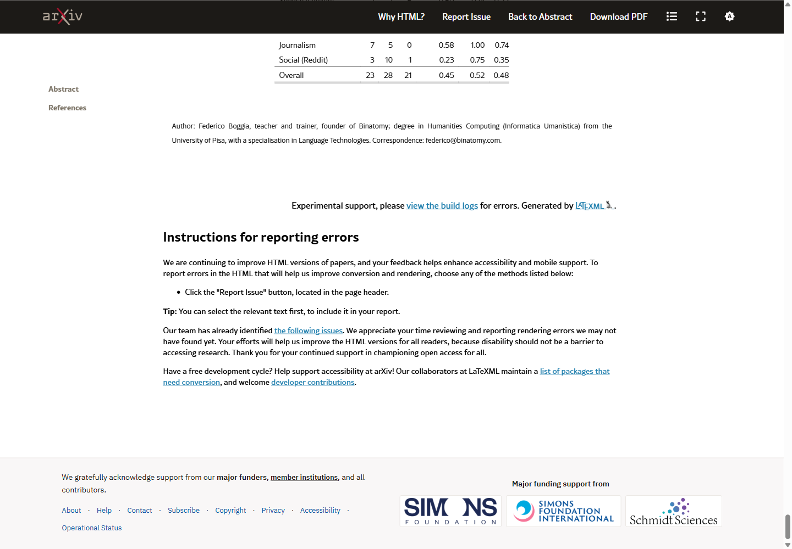
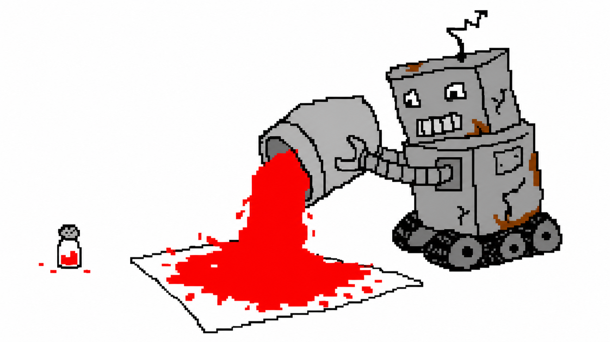
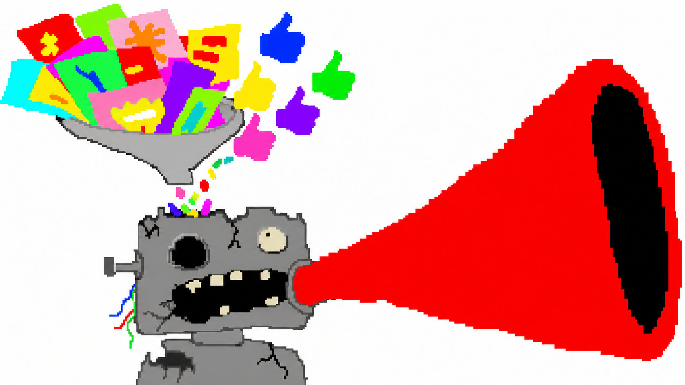
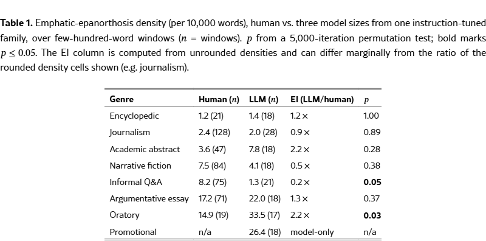
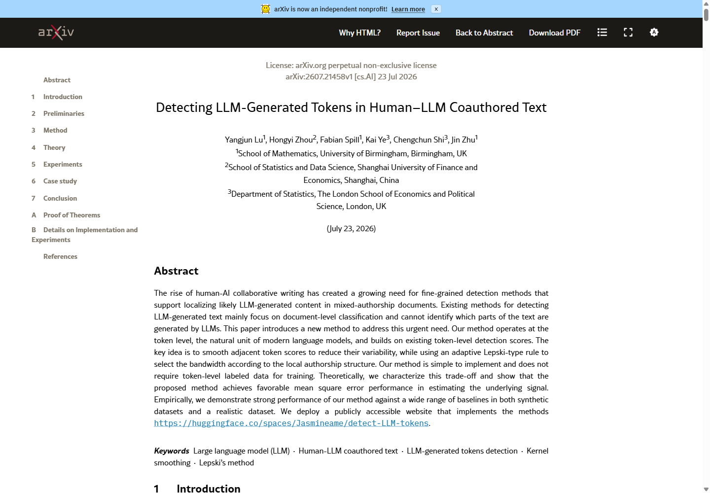
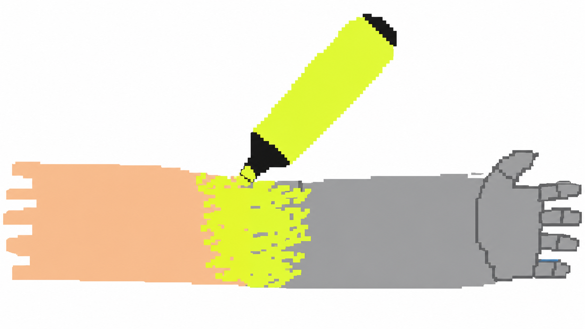

这不是一次产品更新。

这是一场关于未来的重新想象。

我们不只是在使用 AI。我们正在与另一种智能共同创造。

如果你最近看过几篇 AI 写的文章，眼睛大概已经开始自动跳过这几句话了。

它们的骨架几乎一样：先否定一个普通说法，再换上一个更大、更重、更像发布会灯光的词。工具变成「伙伴」，课程变成「旅程」，改版变成「革命」。一句话本来已经说完了，模型偏要把它举起来，再垫一层台阶。

现在，这种熟悉的「AI 味」有了一个两千多年前的名字。

## 一个古老修辞，成了机器口头禅

7 月 23 日，一篇题为《Artificial Epanorthosis》的论文上传到 arXiv。作者 Federico Boggia 把这类自我纠正式表达归到一个古典修辞概念下：epanorthosis。

*图：论文《Artificial Epanorthosis》的标题与摘要。来源：arXiv，Federico Boggia，CC BY 4.0。*

这个词可以暂且译作「回身修正」。说话的人先给出一种表达，随即觉得它不够准、不够重，转身换成另一个版本。

它并非机器发明的坏习惯。日常对话里的「准确地说」「或者应该说」，也在做同一件事。古典演说家使用这种修辞，是为了让听众感到：说话者正在现场思考，甚至愿意推翻自己刚才的话。

问题出在用量。

*图：稀少时有力的修辞，被整桶倒进每一句话。AI 生成。*

一句演讲里偶尔出现一次，它可以制造转折。几百字里接连出现，读者就会发现每个句子都在踮脚。内容没有变得更重要，语气却一直要求你鼓掌。

## 它为什么这么爱用？

最顺手的解释，是模型只能从左往右生成文字。一个词既然已经吐出来，就不能像人类写作者那样按下删除键，只能继续往前修正。

从左往右生成会放大问题。论文作者却把主要来源指向别处。

作者更怀疑模型「吃进去」和「被奖励」的文字：网页里有大量广告文案、励志帖子和产品落地页；在后续偏好训练中，听起来果断、完整、有气势的回答，也更容易获得好评。否定一个平淡词，再换成一个响亮词，正好符合这种审美。

*图：训练材料与偏好奖励可能共同放大高强调语气。该因果解释来自论文作者推断。AI 生成。*

这里必须踩一脚刹车：论文没有直接证明「广告文案加 RLHF 导致了这种句式」。作者自己也承认，这部分属于推断。它借用了其他词汇研究的发现，又结合了初步文本测量，但没有完成能够判定成因的对照实验。

论文的测量结果复杂得多。

它在不同文体之间出现了失准：在适合煽动和强调的文体里，模型更容易把修辞开得太大；到了人类会频繁犹豫、补充和自我修正的问答场景，模型反而可能显得过于平滑。新闻、议论文等部分文体里，初步结果没有显示出明确差距。

*图：论文按文体比较的初步测量表。实验限制见本文来源记录。来源：arXiv，Federico Boggia，CC BY 4.0。*

按论文的说法，问题更像是「用错地方」。模型学会了一个很有效的强调按钮，却不总能判断眼前这句话是否值得按下去。

## 别急着拿它当 AI 测谎仪

既然这种句式这么醒目，我们能不能看到「不是 A，而是 B」，就判断一段话来自 AI？

不能。

论文做的初步检测，在模型文本上比较容易抓到标准模板，到了人类文本里便会遇到大量误判。因为「但是」「准确地说」也可能只是普通转折和口语填充。一个词长得像修辞标记，不代表它真的承担了自我修正的功能。

同一天上传的另一篇论文，干脆把问题换了一种问法。它不再试图判断整篇文章是人写还是 AI 写，而是尝试定位混合创作文本中，哪些局部 token 更可能来自模型。

*图：论文《Detecting LLM-Generated Tokens in Human–LLM Coauthored Text》。来源：arXiv。*

*图：真实写作经常是人机混合，检测边界也会变得模糊。AI 生成。*

这个变化很符合今天的写作现实：人写提纲，AI 扩一段；AI 给出初稿，人再删改；一个句子里甚至同时保留双方留下的痕迹。继续追问「这篇到底是谁写的」，经常会得到一个虚假的二选一答案。

而且，局部检测也不是读心术。它仍要依赖统计分数和相邻词的平滑处理，恰好在人类文字与模型文字交界的地方最容易发生偏差。把它当编辑线索可以，把高亮区域当判决书就走远了。

## 真正值得删的，不是这个句式

我最想保留的一点是：epanorthosis 不该被整体消灭。

有内容的自我修正很重要。作者发现前一个说法不准确，收回来，换成边界更清楚的表达，这种句子应该留下。古典修辞能活两千多年，本来就因为它确实有效。

该删的是那些只负责把音量拧大的版本。

有个很简单的检查办法：删掉前半句，看看后半句损失了什么。如果事实、边界和判断都没有变化，只少了一次故作郑重的起跳，那它多半可以直接落地。

比如，与其写：

> 这不只是一次界面调整，而是对人机协作方式的重新定义。

不如先回答：界面改了什么？谁会因此改变操作？代价是什么？如果这些问题没有答案，「重新定义」只是给空位打了一束追光灯。

你也可以在改稿时给 AI 一条很具体的要求：删除只起强化语气作用的「不是 A，而是 B」；保留真正纠正概念和事实边界的句子。论文里的初步实验也提示，直接指令能够压低这种表达，不过效果是否适用于不同语言、模型和文体，仍需要更多验证。

*图：机器腔最稳定的传播方式，是人类开始觉得它「写得挺有力」。AI 生成。*

机器口吻会在人类主动采用它时留下来。

具体发生在这一刻：我们读完一句「不是……而是……」，觉得这话虽然没多说什么，但听起来确实挺像回事。
