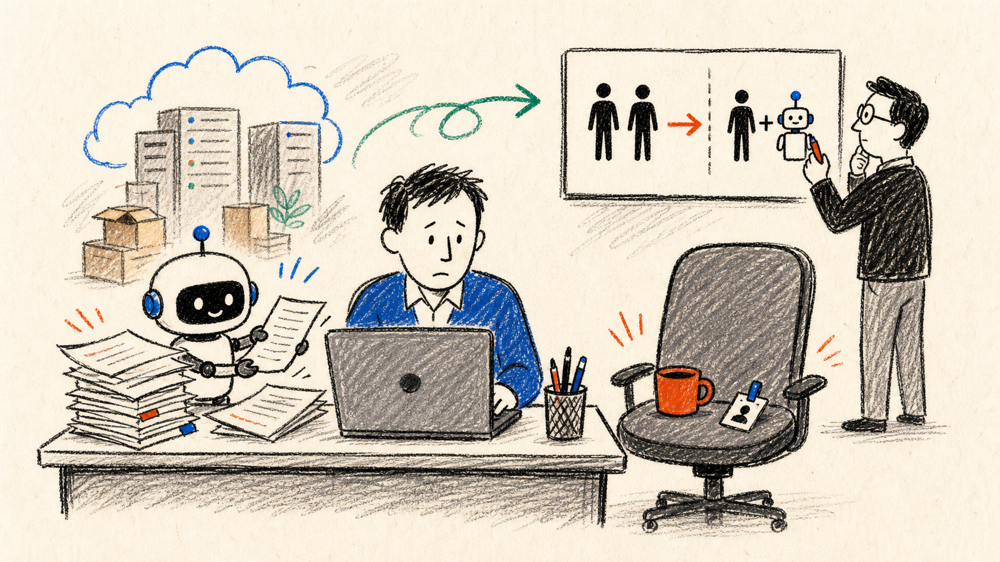

# 做 AI 的人也被裁了：公司还会不会招「第二个人」？

7 月 22 日，亚马逊裁减了 AGI（通用人工智能）团队中的一部分岗位。

这件事说起来有点好笑：当我们都在争论 AI 会不会抢走普通人的饭碗时，这次连造 AI 的人也被裁了。

*AI 生成涂鸦：当一名员工配合 AI 接下更多工作，公司会不会还招「第二个人」？*

亚马逊的公开回应里，反复出现的是几个词：聚焦、客户、提速、重要项目。

[Reuters 的报道](https://www.reuters.com/business/world-at-work/amazon-cuts-jobs-its-artificial-general-intelligence-group-2026-07-22/)没有给出具体人数，亚马逊也没有说这些岗位是否由 AI 直接替代。他们的回应是：仍把大型 AI 模型视为最重要的工作之一，但是要进一步聚焦「对客户最重要的项目」，因此取消 AGI 组织部分岗位。

AI 总体进步的大趋势不会因为这轮裁员改变。可亚马逊的这次调整提醒了我们：趋势还在，方向也还重要，并不代表和 AI 相关的每个项目、每支团队、每个岗位都重要。

热门方向的打工人，不会因为正在追逐和探索热点技术，就一定能够高枕无忧。

一家公司可能只要重排预算、收缩技术路线，或者把工作交给另一支团队，我们同样有可能收到那封不想收到的邮件。

如果 AGI 都不能给一个具体岗位发放免死金牌，普通打工人就不能只用「行业热不热」判断自己的处境。

别只问「AI 能不能完整做掉我的工作」，还要考虑：什么才是公司口中「对客户最重要的项目」？

## 同一天，GitHub 把「会用 AI」变成了一张表

就在亚马逊裁员的同一天，[GitHub 发布了新的 Copilot 影响力看板](https://github.blog/changelog/2026-07-22-new-copilot-usage-metrics-impact-dashboard/)。

根据官方描述，它本质上是一张企业内部的 Copilot 采用率和研发效能看板。公司可以用它查看：给 Copilot 花的钱有没有产生效果，团队的 AI 编程使用成熟到了哪一步。

这张看板把使用 Copilot 的开发者，按照过去 28 天的行为分成几个档位：「买了许可证却很少使用的开发者」「以代码补全为主的开发者」「以 Agent 为主的开发者」，以及「已经使用多 Agent 或 Copilot App 的开发者」。

*GitHub 官方展示的 Copilot 影响力看板。这张图展示看板如何划分采用阶段和比较研发指标；本文不把图中数字外推到其他团队。图源：GitHub。*

官方目前把这项功能定义为观察 Agent 采用程度、帮助团队培训的工具。

过去面试时，大家都能说一句「熟练使用 AI」，公司很难验证求职者到底有多么「熟练」。

现在，至少在软件开发领域，公司已经可以从后台看到：你是否在用、用到了哪一层、用在哪个项目，以及使用期间的工作流发生了哪些变化。

GitHub 这次推出的新功能是一个很典型的信号：管理设施已经不再满足于统计「有多少人在用 AI」，而是开始统计「大家把 AI 用到了什么深度」。

「会不会用 AI」正在从简历上的形容词，变成一串可以被观察的记录。

## 失业率没上升，AI 就没有替代工作吗？

在宏观数据里，暂时也看不到一场 AI 失业的巨大浪潮。

美国劳工统计局公布的 2026 年 6 月数据里，失业率是 4.2%，和前几个月相比变化不大。美联储 7 月发布的货币政策报告也把当前劳动力市场描述为总体稳定，裁员仍处在较低水平。

Anthropic 经济学负责人 Peter McCrory 在 7 月 22 日发布了一篇长文，标题就叫[「为什么 AI 还没有推高失业率？」](https://x.com/PeterMcCrory/status/2079979321607745905)。

他的文章里有两个主要关键词：「偏向高技能」和「增强劳动」。

他的判断很明确：到目前为止，AI 没有给美国失业率带来实质性抬升。即使只看那些工作任务高度暴露于 AI 的人，也没有发现异常上升的失业。

*红线为 AI 暴露最高四分位职业，蓝线为无 AI 暴露职业。Anthropic 的分析没有发现 ChatGPT 发布后，前者失业率出现明显的相对抬升。图源：Anthropic，Figure 6。*

结合这篇长文和 [Anthropic 之前的相关研究](https://www.anthropic.com/research/labor-market-impacts)，大致可以拆成三层解释。

第一层是能力不等于真实采用。

这中间隔着数据权限、审计责任、组织流程等现实问题。AI 能在测试里完成一项任务，不代表企业已经能完全放手，把它接入真实工作流。

第二层是，目前的人机关系仍以互补为主。

AI 可以写代码、分析数据、生成文本，但复杂任务通常还需要人来拆解、指导和验收。Peter McCrory 把当前阶段概括为：AI 依赖人类在环，尤其依赖人来指导和评估复杂工作。

第三层是，生产率提高不一定马上表现为裁员。

他提到，美国近年的劳动生产率增长相对强劲，而 AI 采用程度较高的行业，生产率增长往往也更快。企业可能先扩大产出、增加投资，或者重新分配员工，而不是立即裁人。

和前面的 GitHub 新功能放在一起思考，也许 AI 目前首先改变了谁能被招聘、一个人能承担多少工作，以及企业还需不需要继续扩充团队。大规模失业即便出现，也不会是最早的信号。

*AI 生成涂鸦：使用被测量，团队被重配，招聘先收紧。*

## 普通上班族应该关注什么？

有个信号很直接：隔壁工位空出来之后，公司补不补人。

项目在涨，团队人数却没跟着涨。如果是这样，AI 大概率已经算进了管理层的产能账。

后台的变化则更不容易察觉。

以前公司只看买了多少 AI 账号，现在看的是活跃率、采用阶段、周转速度和人均产出。GitHub 新出的功能就是个例子：企业软件的关注点，正从「鼓不鼓励大家试试」变成「比较谁在用、怎么用、产出有没有变」。

程序员只是先被看见的一批。客服、销售、运营、财务使用的软件同样会留下痕迹。这些岗位有没有出现类似的情况，值得留意。

最容易验证的信号在招聘端。

初级岗位在不在减少？招聘要求里有没有多出「能独立交付」「熟练使用 AI」「一人负责端到端流程」这类字眼？以前由两个新人分摊的资料整理、初稿、基础分析和跟进，现在可能由一个熟手配合 AI 接住。公司不需要先裁谁，只是不再招那两个新人。

「会用几个 Prompt」很快会变成最基本的要求，谈不上加分。真正有用的，是一条具体的工作流：用 AI 前后各花了多少时间，哪里容易出错，哪些情况必须自己处理，最后凭什么能够交付。

## 那个没有收到裁员邮件的人

*AI 生成概念图：那个从未坐下的「第二个人」。*

亚马逊、GitHub 和失业率数据，其实是同一场变化的三个视角：AI 使用先被测量，团队和资源随后被重新配置，等这条链条走到就业市场，招聘收紧往往比大规模裁员先出现。

这并不能证明 AI 会让岗位总量大幅萎缩。新工具也可能压低成本、撑大需求，反而催生新的岗位；现有数据也说明，人类的经验、判断和验收仍然在决定 AI 能发挥到什么程度。

但企业不需要等 AI 把一份工作做到满分，才会开始调整人数。

只要一名熟练使用 AI 的员工能稳定接下过去接近两个人的工作量，第二个人要不要招，可能就变成一个需要重新掂量的问题。

那个没有收到裁员邮件的人，可能就是原本应该坐在隔壁工位，最后却没有被招进来的「第二个人」。
