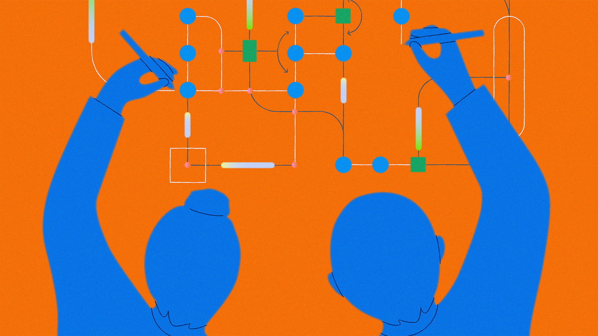
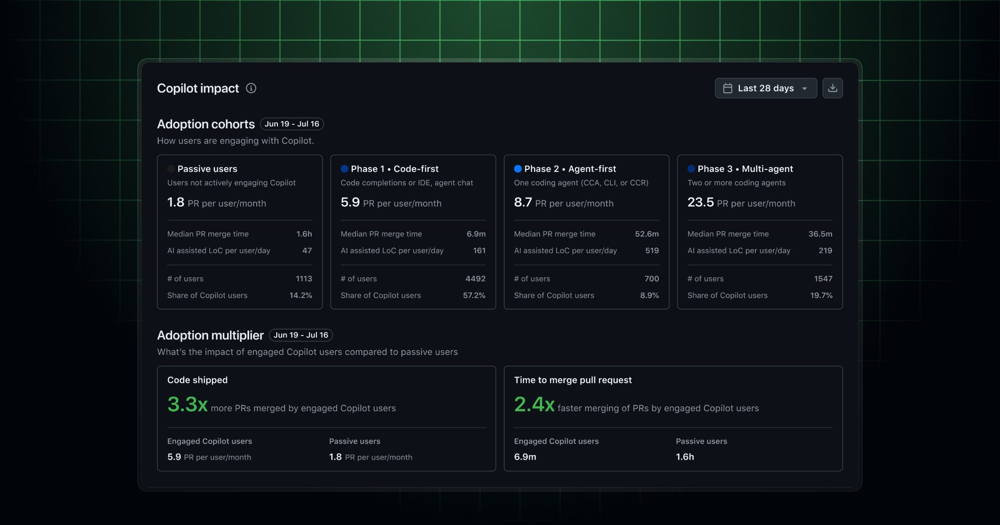
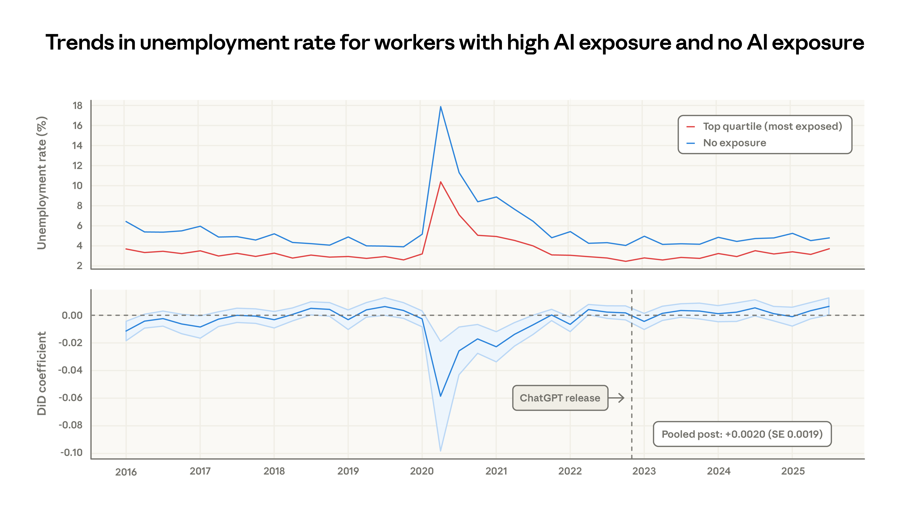
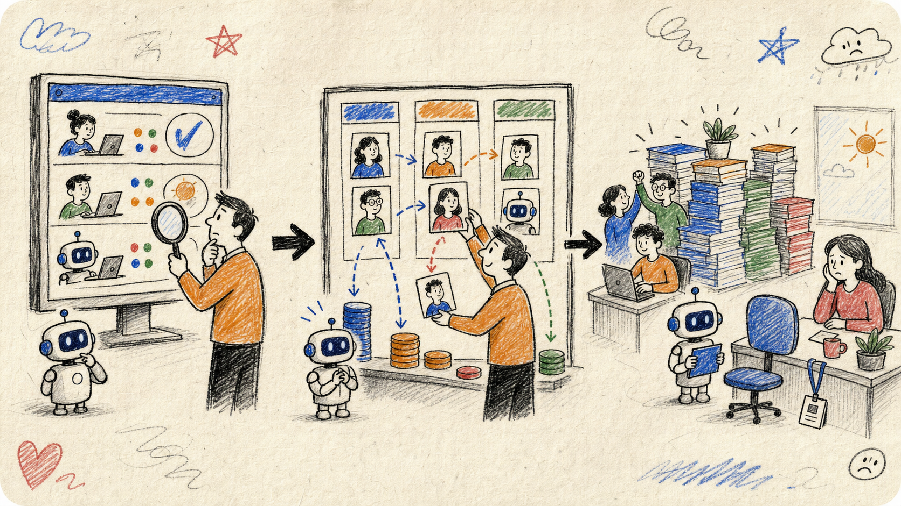

# 做 AI 的人也被裁了：公司还会不会招「第二个人」？

7 月 22 日，亚马逊裁减了 AGI（通用人工智能）团队中的一部分岗位。

这件事说起来有点好笑：当我们都在争论 AI 会不会抢走普通人的饭碗时，这次连造 AI 的人也被裁了。

*亚马逊官方 AGI 招聘页使用的 Agentic AI 协作主视觉。该图是概念插画，并非本次调整涉及团队的实拍照片。图源：Amazon Jobs。*

但这并不意味着 AGI 失宠了。亚马逊仍将大模型视为最重要的工作之一，只是要进一步聚焦「对客户最重要的项目」。相关报道中反复出现的词也很一致：聚焦、客户、提速、重要项目。

[Reuters 的报道](https://www.reuters.com/business/world-at-work/amazon-cuts-jobs-its-artificial-general-intelligence-group-2026-07-22/)没有给出具体人数，亚马逊也没有说这些岗位是否由 AI 直接替代。

亚马逊的方向没有变，但资源的落点变了。

趋势很重要，但不等于趋势中的每个项目、团队和岗位都重要。

热门方向可以抬高行业估值，却不能给具体岗位发放「免裁金牌」。预算重排、路线收缩，或者工作转交给另一支团队，都足以让一个岗位失去位置。

所以，与其担心「AI 能不能完整做掉我的工作」，更贴合实际的问题是：我的工作是否仍在公司的主线上？它离客户、收入、效率或公司的核心目标，究竟是否匹配？

## 同一天，GitHub 把「会用 AI」变成了一张表

就在亚马逊裁员的同一天，[GitHub 发布了新的 Copilot 影响力看板](https://github.blog/changelog/2026-07-22-new-copilot-usage-metrics-impact-dashboard/)。

根据官方的描述来看，它本质上是一个企业内部的 Copilot 采用率和研发效能看板。根据这个看板，公司可以查看：给 Copilot 花的钱有没有产生效果，以及团队的 AI 编程使用成熟到了哪一步。

这东西把使用 Copilot 的开发者，按照过去 28 天的行为分成了四个档位：「买了许可证却很少使用的开发者」「以代码补全为主的开发者」「以 Agent 为主的开发者」，以及「已经使用多 Agent 或 Copilot App 的开发者」。

*GitHub 官方展示的 Copilot 影响力看板。这张图展示了看板如何划分采用阶段和比较研发指标；本文不把图中数字外推到其他团队。图源：GitHub。*

官方目前把这个功能定义为观察 Agent 采用程度、协助团队培训的工具。

过去面试时，大家都能说一句「熟练使用 AI」，公司很难验证求职者到底有多「熟练」。

现在，至少在软件开发领域，公司已经可以从后台看到：你是否在用、用到了哪一层、用在哪个项目，以及使用期间的工作流发生了哪些变化。

GitHub 这次推出的新功能其实是一个很典型的信号：管理工具已经不再满足于统计「有多少人在用 AI」，而是开始统计「大家把 AI 用到了什么深度」。

「会不会用 AI」正在从简历上的形容词，变成一串可以被管理层衡量、观察的指标。

## 失业率没上升，AI 就没有替代工作吗？

在宏观数据里，似乎暂时看不到一场 AI 失业的巨大浪潮。

美国劳工统计局公布的 2026 年 6 月数据里，失业率是 4.2%，和前几个月相比变化不大。

Anthropic 经济学负责人 Peter McCrory 在 7 月 22 日发布了一篇长文，标题就叫[「为什么 AI 还没有推高失业率？」](https://x.com/PeterMcCrory/status/2079979321607745905)。

他的文章里有两个主要的关键词：「偏向高技能」「增强劳动」。

他的判断很明确：到目前为止，AI 没有给美国失业率带来实质性提升。

即使只看那些工作任务高度暴露于 AI 的人，也没有发现异常上升的失业。

*红线是最容易被 AI 改变的那批职业，蓝线是基本不受 AI 影响的职业。Anthropic 的分析没有发现 ChatGPT 发布后，前者失业率出现明显的相对抬升。图源：Anthropic，Figure 6。*

他给出了三个层面的解释。

第一层是能力不等于真实采用。

这中间隔着数据权限、审计责任等现实问题。

也就是说，AI 能在测试里完成一项任务，不代表企业已经能完全放手，把它接入真实工作流。

第二层是目前的人机关系仍以互补为主。

AI 可以写代码、分析数据、生成文本，但复杂任务通常还需要人来拆解。

作者把当前阶段概括为：AI 仍然依赖人类来闭环工作，尤其依赖人来指导和评估复杂工作。

第三层是生产率提高，不一定马上表现为裁员。

作者提到，美国近年的劳动生产率增长相对强劲，而 AI 采用程度较高的行业，生产率增长往往也更快。但企业可能先扩大产出、增加投资，或者重新分配员工，而不是立即裁人。

和 GitHub 的新功能放在一起看，AI 眼下首先改变的，或许不是谁会立刻失业，而是谁还能被招聘、一名员工与 AI 的组合能承接多少工作，以及业务增长是否需要团队同步扩张。

*AI 生成涂鸦：使用被测量，团队被重配，招聘先收紧。*

## 那个没有收到裁员邮件的人

同样是 AGI，在不同公司里，可能对应完全不同的组织动作。

根据 7 月 23 日公开流传的[一份投资人会议整理稿](https://finance.jrj.com.cn/2026/07/23130757880460.shtml)——文稿注明未经梁文锋本人确认——对 DeepSeek 来说，AGI 是终点。产品投入、视频生成、3D，甚至世界模型，都可以暂时让出主线；开源、低价和克制，也是在为「提高做成 AGI 的概率」服务。梁文锋说「后面还有西瓜，前面的可能都是芝麻」，强调的正是这种长期取舍。

但在亚马逊这样的商业组织里，AGI 再重要，同样也要继续回答另一个问题：它是否属于当下「对客户最重要的项目」。如果答案发生变化，预算、团队和岗位就会随之变化。

一个是在集中资源押注终局，一个是在既定业务中重新计算优先级。

方向相同，核心目标不同，取舍不同，结果也会完全不同。

这也解释了为什么，身处热门赛道并不能天然带来安全感。

真正决定一个项目能否继续、一支团队是否扩张的，不只是它是不是 AI、是不是 AGI，而是它在公司的核心目标中有多靠前。

GitHub 开始测量 AI 的使用深度，失业率却暂时保持平稳。这一系列故事或许在说明：当使用 AI 产生的效率可以被量化，资源配置随后会被重排，而就业市场往往最后才会显现变化。

公司不需要先大规模裁员，也可以降低对劳动力的需求。它可以不补离职岗位、不再扩充团队，也可以把过去交给两名新人的工作，交给一名熟练员工和 AI 的组合。

于是，最先消失的可能不是某个已经存在的岗位，而是一个原本会被创造出来的岗位。

那个没有收到裁员邮件的人，或许并不是幸存了下来。

他可能从未收到录用通知。

*AI 生成概念图：那个从未坐下的「第二个人」。*

因此，就像开篇提到的，对个人而言，与其思考「AI 能不能做掉我的工作」「我会不会使用 AI」这样的问题，不如认真考虑一下：

我做的事情，是否仍在公司的主线上？

有了 AI 之后，我还能让这套工作系统变得更快、更稳，甚至更接近最终结果吗？

当公司重新计算一支团队需要多少人时，能够留下来的理由不会单单是「我属于热门方向」。留下来的理由也许需要同时满足：这件事仍然是公司的主线，而且有我在，AI 才能真正把它做成。
