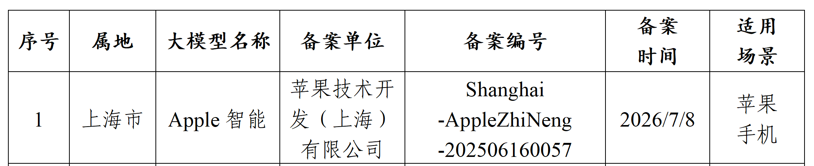
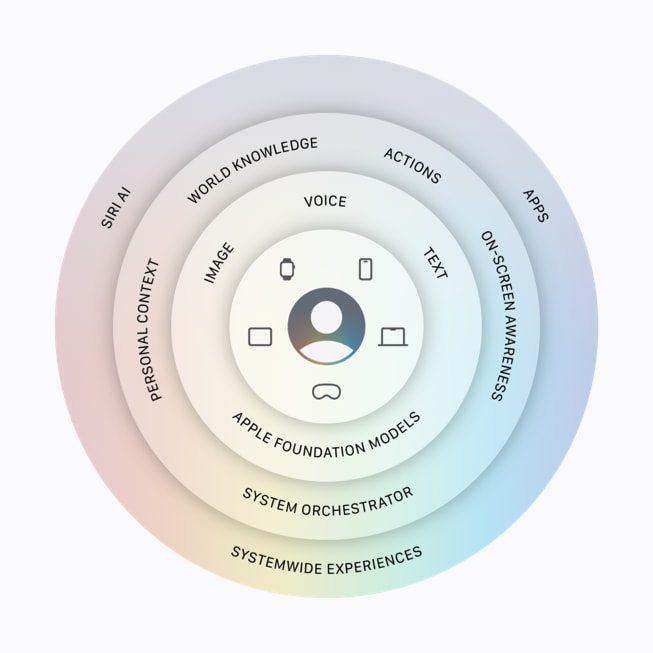
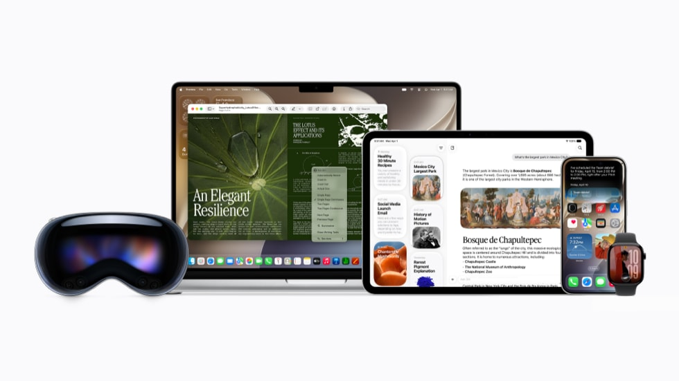
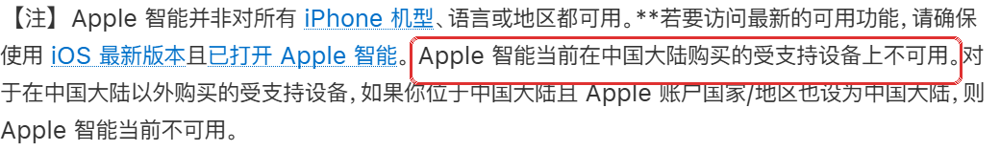

# Apple 智能过备案了，为什么国行 iPhone 还是没有？

7 月 15 日下午 4 点，中国网信网发了一则很短的公告：7 款手机端侧生成式人工智能服务完成备案，名单第一行就是“Apple 智能”。[^1]

备案表给得更具体：备案主体是苹果技术开发（上海）有限公司，适用场景是苹果手机，表内备案日期为 7 月 8 日。

看到这条公告，估计不少人第一时间打开了 iPhone 设置，去找那个等了很久的 Apple 智能开关。

现在还找不到。截至 7 月 15 日晚间，Apple 自己的支持页面仍然写着：“Apple 智能当前在中国大陆购买的受支持设备上不可用。”[^2]

于是就有了眼下这个微妙的局面：网信办的名单里已经有了，国行 iPhone 的设置里还没有。

这两件事并不矛盾。备案相当于拿到入场资格，门什么时候开、开多大，是另一回事。而比起“什么时候能用”，我更好奇另一件事：国行用户最后拿到手的，会是一套什么样的 Apple 智能？

## 备案表写了什么，没写什么

“备案”两个字，听起来像一份要读二十页的政策文件。其实这次公告确认的事情很简单：Apple 智能已经作为一项手机上的生成式 AI 服务，进入了正式备案名单。

这件事对 Apple 不算小。一个多月前，它还在中国官网注明，Apple 智能和新版 Siri AI 在中国大陆尚不可用，推出时间取决于监管审批。[^3] 如今，Apple 智能和华为、OPPO、vivo、小米、三星、中兴的端侧 AI 服务一起出现在名单里，那道最显眼的合规门槛，算是跨过去了。

但表格能告诉我们的，也就到这里。

它没有写上线日期，没有写需要哪个系统版本，也没有写写作工具、通知摘要、视觉智能和新版 Siri AI 会不会一起开放。表中的 7 月 8 日是备案时间，7 月 15 日是公告时间，两者都不是用户开机即用的时间。开关什么时候出现在设置里，还是要看 Apple 自己的更新节奏。

所以“Apple 智能能不能进中国”这个问题，今天有了答案。接下来的悬念是：进到国行的 Apple 智能，还会不会是大家在海外看到的那一套？

## Qwen 进了大名单，位置还没定

阿里董事局主席蔡崇信早在 2025 年就公开确认，Apple 在接触多家中国公司后选择与阿里合作。路透在今天的报道中进一步写道，阿里方面表示，Qwen 将进入面向中国用户的 Apple 智能体验。[^4]

这句话确认了合作伙伴，却没有给出分工表。

要判断 Qwen 会站在哪里，得先看 Apple 智能本身的结构。它不是一个住在手机里的聊天机器人，更像一支队伍：有些任务直接在 iPhone 上处理；系统负责翻联系人、照片和屏幕内容；需要更多算力的请求，交给云端；最后再调用各个 App，把事情真正办完。

Apple 给那套云端处理系统起的名字是“专用云计算”。名字很专业，作用不复杂：手机处理不了的复杂请求，交给更大的云端模型。Apple 声称，这些请求只用于完成当前任务，处理后不会保留。[^5]

Qwen 确定会加入这支队伍，但踢哪个位置，还没有宣布。它可能负责需要广泛知识的问答，可能接手部分云端请求，也可能参与中文理解和本地化处理；Apple 自己的设备端模型和专用云计算会保留到什么程度，同样没有说法。

所以在细节公布之前，“Qwen 替换 Siri”更像一种猜测：球员确实进了大名单，可他踢前锋还是守门，教练还没开口。

“加入”和“替换”的区别，不只是措辞问题。Qwen 进入哪一层，决定了中国版能做什么，也决定了一次请求在哪里处理、由谁处理；Apple 在全球版反复强调的隐私机制能不能照原样落到中国版，也要等产品说明来回答。

## 国行拿到的，会不会是一套“同名不同款”

Apple 最擅长的事，是把硬件、系统和服务揉成一套完整体验，让同一项功能在哪台设备上用起来，都像 Apple 自己做的。

中国版 Apple 智能，正好考验这种能力。

引入 Qwen 本身未必是坏事：本地模型可能更懂中文语境，也更容易满足本地服务和监管要求。但模型、云端处理方式和功能开放节奏一旦变化，同一个 Apple 智能图标下面，就可能装着一套“同名不同款”的能力。

用户看得见的，是功能差异：海外版能做的事，国行是否都能做？新版 Siri AI、视觉智能和跨 App 操作，会不会同步开放？

用户看不见的，是请求去向：哪些内容留在手机里，哪些进入云端，Qwen 和 Apple 的专用云计算各自负责什么。这些答案决定了中国版只是换了一个本地合作伙伴，还是从底层走出一条单独的路线。

备案回答的是“能不能进来”。接下来要看的，是 Apple 在引入本地模型之后，还能不能把它做成一套连贯、让用户清楚数据去向的产品。

## 什么时候才算真的上线

普通用户不用研究备案编号，也不用猜 iOS 小版本。真正上线时，会有几个很直白的信号：

- Apple 的可用性页面删掉“中国大陆不可用”的说明；
- 系统更新说明写清支持的版本、设备和功能；
- 国行设备的设置里出现可以正常激活的 Apple 智能入口。

在这些信号出现之前，改地区、切语言、反复刷新设置，多半都是白忙。

这份公告解决了一件事：Apple 智能有了明确的备案主体和备案编号，不再停留在“等待监管进展”的状态。

但名单上的那一行，离用户手里的真实体验还有一段距离。上线日期只是其中最容易回答的问题；功能差异、请求路径、隐私规则这些更难的部分，要等国行 iPhone 上那个开关真正出现的那天，才见分晓。

---

*本文信息截至北京时间 2026 年 7 月 15 日晚间。Apple 产品可用性页面可能继续更新，正式使用范围以 Apple 后续公告和系统说明为准。*

[^1]: 国家网信办：《关于发布 7 款提供手机端侧生成式人工智能服务已备案信息的公告》，2026 年 7 月 15 日。
[^2]: Apple 支持：《iPhone 上的 Apple 智能和隐私》，访问于 2026 年 7 月 15 日。
[^3]: Apple Newsroom：《Apple 推出新一代 Apple 智能、Siri AI 等新功能》，2026 年 6 月 8 日。
[^4]: Reuters, “Apple Intelligence AI service registered with China's cyberspace regulator,” July 15, 2026；The Information 对蔡崇信公开发言的转述。
[^5]: Apple：《Private Cloud Compute Security Guide》及 2026 年 Siri AI 官方架构说明。
