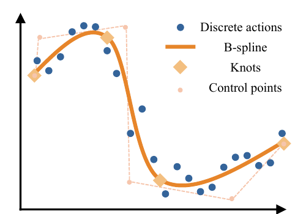
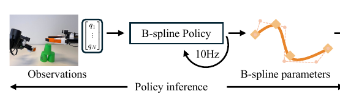
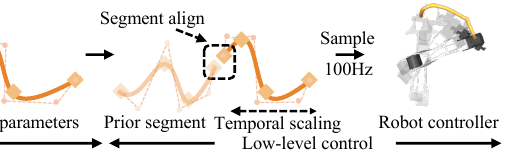
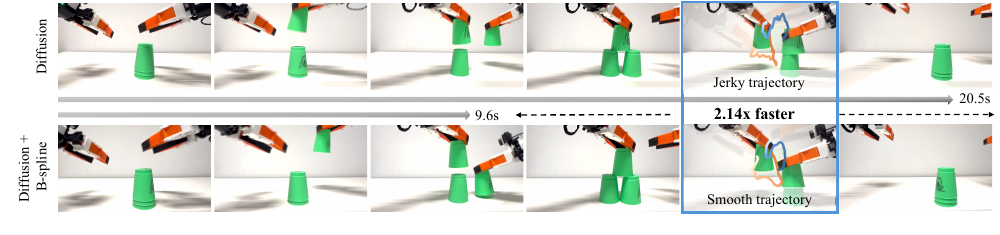
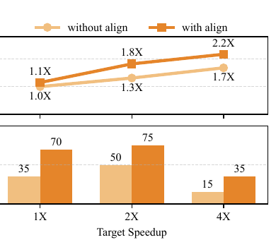

# 机器人不是不会干，是干得太慢：一条曲线如何给操作策略加速

看机器人叠杯，最折磨人的时刻往往不是它失败，而是它明明知道下一步要做什么，胳膊却还在一点点往前挪。

一篇新论文放出了一组很直观的对比。同一个双臂叠杯任务，一段代表性轨迹里，Diffusion Policy（一种通过逐步去噪生成机器人动作的策略）用了 20.5 秒。换成 B-spline Policy（以下简称 BSP，其核心是把动作表示成连续曲线）后，用时变成 9.6 秒。机械臂没有换，任务没有换，用来生成动作的主模型也还是 Diffusion Policy，图里标出的速度差是 2.14 倍。

这不是把视频按了 2 倍速。

研究团队改的是机器人表达动作的方式：原来，策略给出一串分散的动作点；现在，它给出一条连续、能按需要取出更密动作点、也能调节执行速度的曲线。

这篇论文最有意思的地方，不是又造了一个更大的机器人模型，而是提醒我们：模型已经想好的动作，怎么送到电机手里，本身也可能是一道瓶颈。

## 今晚读的是什么？

论文名是 **B-spline Policy: Accelerating Manipulation Policies via B-spline Action Representations**，作者来自 Harvard、MIT 和 UT Austin。

它在 arXiv（科研论文预印本平台）上的 v1 实际提交于北京时间 7 月 11 日凌晨，在 7 月 13 日的机器人分类最新批次中排在第一位。现在仍是一篇预印本，也就是尚未经过同行评审的公开稿。团队已经放出项目页、代码和 Colab——一份可以直接在浏览器里运行的实验笔记本。

如果只记一句话，可以记住这个判断：

> B-spline Policy 没有让机器人“想得更聪明”，它让机器人更顺畅地执行已经想好的动作。

## 机器人为什么会被一串动作点拖慢？

现在很多机器人策略不会只预测“下一步”，而是一次预测接下来的一小段动作。这个做法叫 **action chunking（动作分块）**，可以理解成一次发给机器人一小叠动作卡片。

这样做有好处。策略不用每执行一个微小动作就重新规划，长任务更容易保持连贯。

问题也藏在这叠卡片里。

假设机器人要拿起桌上的杯子。手臂从远处伸向杯子时，动作可以大一些、快一些；快碰到杯口时，动作必须细，速度也要慢。固定长度的动作块却往往给这两个阶段分配相同的时间分辨率，也就是把时间轴切得一样细。

该快的地方被切得太碎，该细的地方又未必足够细。

更麻烦的是，策略会不断预测新的动作块。上一块和下一块各自看起来都合理，接在一起时却可能出现一个小台阶。慢速执行时，这个台阶也许只会造成轻微抖动；速度一高，机械臂就可能越过目标位置、跟不上指令，甚至把杯子直接扫倒。

所以，直接把离散动作点播放得更快，并不能自动得到稳定的高速机器人。你只是让它更快地踩过一段不够平的路。

## B-spline 是什么？先别看公式

B-spline 是一种由多段低阶曲线拼接而成、接缝仍然保持平滑的数学曲线。它不是这篇论文新发明的工具。这类曲线早已广泛用于计算机图形学、轨迹规划和曲线拟合。

把它想成一根有弹性的尺子。

你不用规定尺子必须穿过每一个动作点，而是在旁边放置一些 **control points（控制点）**，把尺子拉成想要的形状。另一组叫 **knots（节点参数）** 的数值负责划分曲线的时间区段，决定哪里需要更多表达能力。曲线拐得急、原始动作难拟合的地方，就多插入一些节点参数；平直、简单的地方，少用一些。

*图 1：蓝点是演示中的离散动作；橙线是拟合后的 B-spline。菱形是节点参数（knots），负责划分时间区段；小圆点是控制点（control points），负责调整局部形状。论文会优先在难拟合、转折更剧烈的区段增加节点参数。图源：Xiaoshen Han 等，B-spline Policy，Fig. 2。*

这里的“曲线”首先是动作空间中的命令曲线。动作空间，就是机器人可以下达哪些动作命令的坐标系。在本文的真实机器人实验里，动作是各个关节的目标位置，因此这条曲线描述的是关节位置怎样随时间变化，而不是简单地把机械臂末端在桌面上走过的线画圆。

论文使用的是 cubic B-spline，也就是用三次多项式拼接的版本。对普通读者来说，公式可以先放一边，重要的是两个性质。

一是连续。机器人不再只拿到稀疏的动作点，而是拿到一条任意时刻都能取值的曲线。

二是局部。移动一个控制点，主要改变附近的一小段，不会把整条轨迹一起扯乱。

这就像把“第 1 帧手在这里，第 2 帧手在那里”的翻页动画，换成一条可以随时查询位置、速度和变化趋势的运动轨道。

## 一条曲线，为什么真的能提速？

只把动作点连成曲线还不够。论文真正的工程工作，是把这条曲线塞进训练和执行的完整流程。

### 先把人类演示改写成曲线

训练数据原本是一串离散动作。BSP 会先拟合一条 B-spline；如果某一段与原动作相差太大，就在误差最大的地方增加节点参数，直到误差落进设定范围。

于是，简单区段不用浪费参数，抓取、对齐和转弯等变化剧烈的区段能得到更细的描述。

### 让“思考频率”和“手脚频率”分开

论文流程图给出的典型设置是：策略以 10Hz 进行推理，也就是每秒根据当前画面预测 10 次未来动作片段；低层控制器——直接给电机发送关节指令的软件——再以 100Hz 从曲线上取点，每秒生成 100 次更密的指令。

*图 2a：策略读取图像和机器人自身状态，以 10Hz 预测未来一段 B-spline 的参数。图源：Xiaoshen Han 等，B-spline Policy，Fig. 3；为适配手机阅读拆分裁切。*

*图 2b：低层控制先对齐新旧片段，再调节执行速度，最后以 100Hz 采样成关节指令。图源：Xiaoshen Han 等，B-spline Policy，Fig. 3；为适配手机阅读拆分裁切。*

这个解耦很关键。负责看画面、生成未来动作的上层策略不用为了给电机高频发指令而跑到 100Hz；控制器也不必在两次策略推理之间干等。

曲线还可以做“时间缩放”。这个操作保持动作空间中命令轨迹的几何形状，同时让机器人用更短的时间走完它。时间缩放有点像压缩同一条导航路线的预计用时，但这里调整的是机器人关节随时间变化的命令。

请注意，命令曲线不变，不代表真实机械臂一定能原样跟上。速度越高，惯性、接触和控制误差越难忽略。论文后面的失败实验，正好说明了这条边界。

### 每次换新曲线，先把接缝对齐

长任务不可能靠一条曲线跑到底。策略会一边执行旧片段，一边预测新片段。

由于推理延迟、预测噪声和机械臂跟踪误差，新片段的开头未必刚好接上机器人此刻的位置。BSP 的做法很朴素：在新曲线前面的一小段里，找到与机器人刚刚执行的最后一个动作最接近的点，再从那里继续走。

像拉拉链之前，先把左右两边的齿对齐。

这一步不负责规划整条新路线，只负责别让两段曲线在接头处绊一跤。

## 实验结果到底有多好？

论文把 BSP 接到了两类常见的模仿学习策略上。模仿学习，就是让机器人照着人类示范学习动作。一类是 Diffusion Policy，另一类是 ACT 式回归策略。ACT 全称 Action Chunking with Transformers，用 Transformer 一次预测一段动作。

真实机器人实验有三个任务：抓起方块放进盒子、清理桌上的罐子和碗、用双臂叠杯。三个任务分别收集了 200、300、200 条演示数据。每种实验设置测试 20 次，并同时记录成功率和成功任务的平均完成时间。

先看一组最有代表性的定量结果。

在桌面清理任务、ACT 式回归策略、目标 4X（计划按原速度的 4 倍执行）的设置下，普通策略成功 13 次，成功任务平均用时 23.57 秒；加入 BSP 后成功 14 次，平均用时降到 11.80 秒。

时间少了一半，成功率没有下降。

按论文作者汇总，在 18 个真实实验设置中，BSP 有 14 个设置的成功率持平或提高。这说明它并非只会让机械臂莽得更快。

开头那组 20.5 秒对 9.6 秒的叠杯画面，则是一段代表性轨迹。它非常适合看动作差异，但不能当成全部实验的平均加速成绩。

*图 3：论文展示的一组代表性叠杯轨迹：Diffusion Policy 用时 20.5 秒，加入 BSP 后为 9.6 秒。蓝框中的轨迹显示，后者更平滑。注意：这是定性案例，不是全部实验的平均值。图源：Xiaoshen Han 等，B-spline Policy，Fig. 5。*

我更喜欢论文里的另一张图：片段对齐的消融实验。

在双臂叠杯任务中，目标设为 4X 时，不做片段对齐只能实现 1.7X，成功率 15%；加入对齐后，实现速度提高到 2.2X，成功率也升到 35%。

*图 4：叠杯任务的消融实验。深色为启用片段对齐：目标 4X 时，实现倍率从 1.7X 提高到 2.2X，成功率从 15% 提高到 35%。目标倍率仍没有被完全实现。图源：Xiaoshen Han 等，B-spline Policy，Fig. 6。*

这张图至少说明了两件事。

第一，连续动作表示并不是“拿 B-spline 把点连起来”这么简单。高速运行时，片段接缝会直接影响机器人能不能完整跑完任务。

第二，论文里写的 4X 是目标倍率，不是实际稳定达到的倍率。启用对齐后，机器人也只实现了 2.2X。

## 这项工作真正新在哪里？

B-spline 很老，用曲线表示机器人轨迹也不新。2025 年的 BEAST 已经用 B-spline 把动作序列编码成更紧凑的 token。这里的 token，可以理解成模型读写动作序列时使用的表示单元。BEAST 已被机器学习会议 NeurIPS 2025 接收。

BSP 的贡献更具体：它让视觉运动策略直接预测 B-spline 参数。这里的视觉运动策略，就是根据摄像头画面生成机器人动作的模型。论文再补上自适应拟合、高频取点、时间缩放和片段对齐，让这套表示真正进入高速执行流程。

可以对这两篇工作做一个粗略区分：BEAST 更关心“怎样让模型更高效地生成动作序列”，BSP 更关心“生成之后，怎样把动作连续、快速地送到控制器”。

这也是我觉得它值得读的原因。

具身智能最近最显眼的故事，往往是更大的 VLA、更强的世界模型、更多机器人数据。VLA 是 Vision-Language-Action model，也就是把视觉、语言和动作放进同一个模型；世界模型则学习环境如何变化，用来预测一个动作之后可能发生什么。它们都在提升机器人看懂场景、理解指令和选择动作的能力。

但机器人最终要动起来。模型负责决定往哪走，动作表示负责把这个决定交给执行器。发动机再强，传动系统一直打滑，整台机器还是快不起来。

BSP 解决的不是世界模型问题，也没有证明机器人更会处理陌生任务。它盯住的是一个经常被宏大叙事盖住的接口，而且实验说明，这个接口确实可能吃掉大量时间。

## 最后，别急着喊“四倍速机器人”

这篇论文仍有几条很硬的边界。

最明显的一条，是硬件跟不上。在双臂叠杯的 ACT 式回归策略实验中，目标速度推到 4X 后，普通策略和 BSP 都是 0/20，一次也没成功。论文作者认为，主要原因在于低成本机械臂的低层控制能力有限：系统刚度和跟踪精度不足，无法稳定执行过快的动作命令。

这也提醒我们，平滑轨迹不等于安全轨迹。曲线可以没有尖角，机械臂仍可能因为惯性、碰撞、负载和控制延迟而失败。

实验规模也不大，每种设置只有 20 次。论文只对成功样本计算平均完成时间，所以这个数字必须和成功率一起读：一个方法如果只在少数简单局面成功，平均用时可能很好看，却不代表整体更可靠。

还有，它现在是 arXiv v1 预印本，真实机器人只覆盖三类任务和同一类低成本机械臂，也没有独立团队的复现。把它看成一个扎实、聪明的动作接口方案是合适的；把它扩写成所有机器人都能无损提速，就超过了证据。

今晚这篇论文留下的，不是“机器人从此有了倍速键”。

它留下的是另一个更实在的问题：当模型能力不断上升，我们有没有给它一套足够连续、足够高频、又能被真实硬件接住的动作语言？

机器人真正快起来，不只是因为它想得更快，而是因为它终于能把“想好了”变成一条连续、可执行、硬件跟得上的动作。

---

**论文与项目**

- 论文：[B-spline Policy: Accelerating Manipulation Policies via B-spline Action Representations](https://arxiv.org/abs/2607.09648)
- 项目页：[B-spline Policy](https://b-spline-policy.github.io/)
- 代码：[B-spline-policy/bspline-policy](https://github.com/B-spline-policy/bspline-policy)

*本文为论文阅读与评论，不构成对预印本结果的独立复现。文中论文插图均经裁切用于解释，版权归原作者或权利人所有。*
