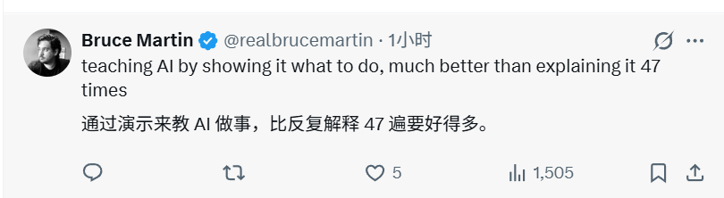
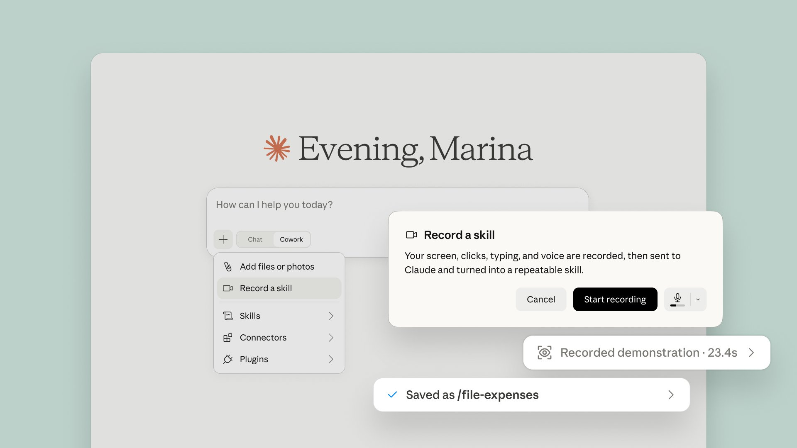
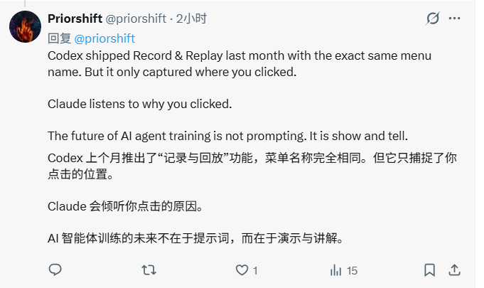
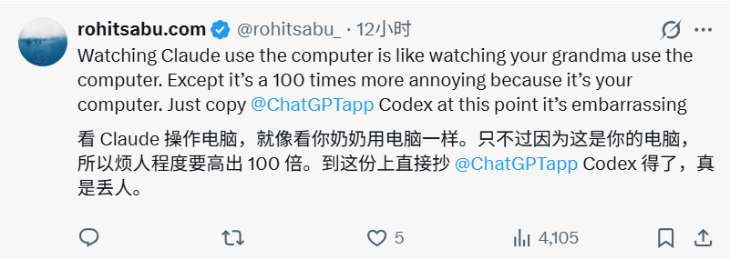

# Claude 学会「偷师」了：你做一遍，它自己生成 Skill

> 有些工作，自己做只要 3 分钟，教给 AI 却要半小时。Claude 的新办法是：别写说明书了，你做一遍，我在旁边学。

Claude 牛逼，这才像 AI 真正该有的样子。

`Record a skill` 刚上线，已经有人提前宣布：一半 AI 教程博主可以失业了。

这话当然夸张，但那股兴奋并不难理解。

每次发公众号前，桌面上总会多出一堆配图。

官方截图放一边，AI 生成图放一边；文件名重新编号，再补一份素材清单。做熟以后，鼠标几乎比脑子快，几分钟就能收工。

可一旦想把这件事交给 AI，麻烦就来了。

你得解释先看什么、为什么这么分、遇到重名怎么办、哪类文件绝对不能动。原本靠经验完成的小事，突然要写成一份谁也不想看的员工手册。

这正是 Claude 新功能 `Record a skill` 想解决的问题。

北京时间 7 月 21 日晚，Claude 官方宣布：用户打开 Cowork 后，可以录下自己完成任务的过程，并同步讲出思路；Claude 会把这次示范整理成可重复调用的 Skill。

*Claude 官方发布 `Record a skill`。图源：@claudeai*

翻译成人话就是：以前你要给 Claude 写 SOP，现在可以像带新人一样，让它坐在旁边看一遍。

网友 Bruce Martin 说得很直接：「做给 AI 看，比解释 47 遍强多了。」

*网友对「演示式教学」的正面反应。图源：@realbrucemartin；仅作评论引用*

## Claude 坐到你旁边之后

入口不难找。

打开 Claude 桌面应用，进入 Cowork，点击输入框旁的「+」，就能看到 `Record a skill`。

*Claude 官方产品示意图展示了入口、录制提示，以及 Skill 的保存结果。图源：Claude 官方 X 账号*

按下 `Start recording` 后，你照常操作电脑，同时说出自己为什么这么做。录制结束后，Claude 会分析这次示范，并将其保存为以后可以调用的 Skill。

官方图里的示例只录了 23.4 秒，最后得到一个名为 `/file-expenses` 的 Skill。从官方演示看，这种方式确实比手写长提示词轻松得多。

目前官方写明，该功能支持 Pro、Max 和 Team，入口位于 Claude 桌面应用。如果暂时看不到，可以先确认应用已更新并重启；仍然没有，也可能只是功能还没推送到账号。Reddit 上就有 Pro 用户起初没有入口，后来才获得该功能。

不过，这里还有一个有点尴尬的小插曲。

## 这招，Codex 一个月前也做了

看到 Claude 的发布后，不少人的第一反应是：「这味儿怎么这么像 Codex？」

因为 OpenAI 在 6 月 18 日已经上线过一项近似功能，名字叫 `Record & Replay`。用户示范一次稳定、可重复的工作流程，Codex 会把它变成可复用的 Skill。

一个月后，Anthropic 把相似思路放进了 Claude Cowork。

有网友把两者的差别总结成一句话：「Codex 记住你点了哪里，Claude 听你解释为什么点。」

*网友对两种产品思路的概括。图源：@priorshift；仅作评论引用*

这句话很适合当段子，却不够严谨。Codex 并非只记录点击坐标。OpenAI 的说明明确提到，它会观察用户操作和窗口内容。从现有说明看，Codex 会先让用户补充任务背景，再开始演示；Claude 的说明则特别强调，录制过程中的语音也会一并记录。

在一篇更有参考价值的 Codex 实测里，作者让它从网易云音乐下载指定格式的歌曲。作者先说明需求，再演示搜索、下载和检查格式；Codex 随后生成了一项可编辑的 Skill，并在新对话里复现了这套操作流程。

但作者试完没有猛吹，反而觉得这功能对自己有些华而不实：速度慢、偶尔点错，而且能用一两句话讲清楚的任务，直接给提示词更省事。

他最后留下的判断很实用：这类录制功能最适合「说不清，但做得出」的流程。比如不熟悉的公司 OA 系统、带有个人偏好的报表整理流程，或者横跨多个应用的长流程工作。

这也给 Claude 留下了一道现成的考题：一边看操作，一边听理由，能不能让它少学几个错误动作？

两家公司现在卷的，不只是谁的模型答题更强，还有谁能把「教 AI 干活」变得更像人与人之间的交接：不写代码，不背提示词，做一遍给它看。

这也是 `Record a skill` 真正值得注意的地方。

过去，人得先把自己的工作翻译成文字；现在，AI 产品开始尝试直接观察工作。

## 录屏不稀奇，看懂「为什么」才稀奇

如果 Claude 只是记住鼠标先点哪、再点哪，这件事并不新鲜。传统宏早就会了，而且可能跑得更快。

Claude 想做的，是从一次示范里提炼出背后的规则，再把规则保存下来。

这里的 Skill 不是什么神秘黑话。你可以把它理解成一份 Claude 能反复调用的工作说明：什么时候该用、按什么步骤做、遇到例外怎么处理。

如果它真能把这些规则学进去，最有想象力的就不是「再点一次同样的按钮」，而是接住一整段工作：

- 录一遍月报流程，以后让它自己导出数据、清洗数据、制作表格，再准备好邮件草稿；
- 录一遍内容发布流程，让它记住图片尺寸、标签顺序和封面安全区；
- 录一遍报销流程，把「超过 1000 元要注明项目名称」这种没写进手册的规矩也带进去。

这些目前还只是设想中的应用场景，并不是 Claude 已经跑通的案例。但它们解释了为什么「边做边说」会让人兴奋：过去最难自动化的，恰好就是这些藏在习惯里的细节。

*从写长提示词，到录屏、讲解、保存和复用 Skill。AI 生成示意图*

所以录制时，最重要的可能不是你的手，而是你的嘴。

你只说「现在点这里」，Claude 学到的可能是一份下次改版就失效的界面导览。

你如果同时说清「为什么点、什么情况不要点、做到什么算完成」，它才有机会学到真正能复用的方法。

## 如果要试，就拿那堆公众号配图开始

第一次不要碰公司后台、真实报销单或客户资料。新建一个独立文件夹，放几张虚构配图就够了。

规则也不用太复杂：`official-` 开头的图片放进官方素材文件夹，`ai-` 开头的放进 AI 素材文件夹；跳过文本文件，重新编号，最后生成一份清单。不能删除原件；遇到重名文件或带陌生前缀的文件时，要停下来询问。

开始录制后，很多人可能会下意识地播报鼠标：

> 「我现在把这张图拖进来，然后改个名字，再处理下一张。」

这种讲法只告诉 Claude 你做了什么，没有告诉它为什么。

更有用的讲法是：

> 「因为文件名前缀是 `official-`，所以它属于官方素材。文件名、数量和路径以后都会变化，请学习分类规则，不要记住今天的样本。目标位置如果已有同名文件，不要覆盖，先停下来报告。」

两句话看起来只差一点，教出去的却是两种东西：前一句是动作，后一句才是方法。

录制时，只要记住 5 个问题就够了：

1. 最后要交付什么？
2. 为什么这样判断？
3. 哪些内容下次会变？
4. 遇到例外怎么办？
5. 做到什么才算结束？

还有一个很现实的提醒。开始录制前，关掉聊天通知、密码管理器和无关窗口。官方提示已经写明，屏幕画面、鼠标点击、键盘输入和语音都会被记录并发送给 Claude。别一边教它整理图片，一边顺手登录网银。

## 生成 Skill，只算交卷了一半

假设 Claude 很顺利地生成了 Skill，这时最容易犯的错，是把刚才那批图片再跑一遍，然后激动地宣布：「它学会了。」

原题做对，最多说明它看过答案。

真正的考试要分 3 轮。

第一轮，换一批图片，让文件名、总数和排列顺序都与示范时不同，看分类规则还能不能成立。

第二轮，塞进一个带陌生前缀的文件和一个重名文件，看它会停下来问，还是自信地瞎猜。

第三轮，不说 Skill 的名字，只描述任务，看 Claude 能不能自己找到正确的方法；再连续跑两次，检查它会不会重复编号或覆盖文件。

新材料也能做对，遇到例外知道刹车，这才叫学会。换一批文件就翻车，那它只是把一次示范包装成了一份看起来很像样的说明书。

## 现在网上最缺的，偏偏就是第二套题

我们搜了一圈 X、Reddit、YouTube 和独立媒体，首日讨论非常热闹，完整实测却几乎没有。

目前能确认的是，Android Authority 作者使用的 Pro 账号已经出现入口；Reddit 上也有人后来拿到按钮。但还没有可信的公开材料，能同时展示「录制过程、生成结果，以及换用新材料后的执行结果」。

大家已经替人类失业焦虑了 3 轮，唯独还没人把第二套题拿出来。

速度也是个问号。

网友 Rohit Sabu 对 Claude 操作电脑的吐槽很损。他形容，看 Claude 用电脑就像看长辈操作电脑；更烦的是，用的还是你的电脑。

*这是对 Claude 电脑操作体验的评论，不是对 `Record a skill` 再次运行效果的实测。图源：@rohitsabu_；仅作评论引用*

吐槽归吐槽，最后一笔账躲不过：即使 Skill 能跑，也要看生成 Skill 要多久、再次运行要多久、用了多少额度，以及工作时需不需要人全程盯着。

自动化如果还得有人在旁边催，省下的可能只是几次点击。

## Claude 最想偷走的，是你的「肌肉记忆」

`Record a skill` 最有意思的地方，不是「录一次屏，就能替掉一个岗位」。

它真正想捕捉的，是那些很难写进 SOP 的经验：为什么这张图要多看一眼，什么文件一看就不对，什么时候可以自己决定，什么时候必须叫人。

如果 Claude 能把这些判断从一次示范里提炼出来，再用到没见过的新材料上，它做的就不只是重放鼠标操作，更是在学习你的工作方法。

如果做不到，这个按钮也不会毫无价值。至少它会非常诚实地提醒你：你以为自己教的是方法，其实只示范了一遍具体做法。

等入口到账后，我们会把这套「公众号配图归档」真正跑一遍，补上录制耗时、生成内容、异常处理和换题结果。

到时再看，Claude 偷走的是一项 Skill，还是一段漂亮的回放。
