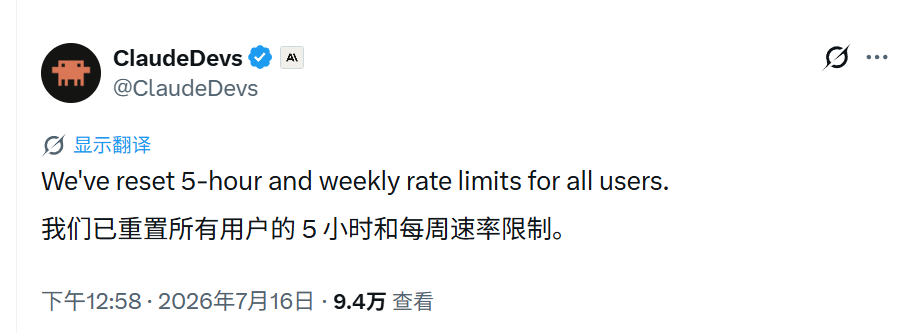
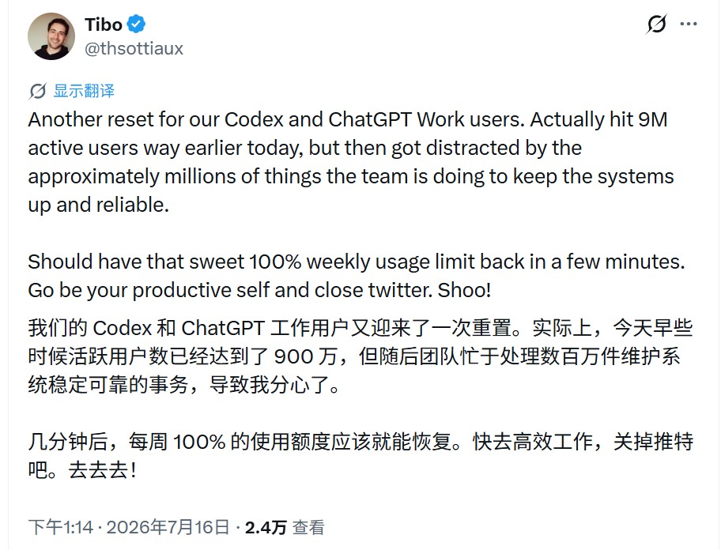

# Claude刚续杯，OpenAI 16分钟后跟上

今天中午，AI 圈上演了一场极其朴素的商战。

没有发布会，没有 benchmark 对轰，也没有谁写一篇万字长文证明自己更聪明。双方只做了一件事：**给用户把额度续上。**

北京时间 11:58，Anthropic 面向开发者的官方账号 ClaudeDevs 发了一条很短的通知：

> 我们已经重置所有用户的 5 小时和每周用量限制。

*图：ClaudeDevs 在 X 发布额度重置通知。截图由读者提供，用于事件评论。*

这句话没有前因，没有解释，连一张庆祝海报都懒得配。

翻译成人话就是：**都别省了，接着用。**

16 分钟后，北京时间 12:14，OpenAI 的 Codex 与 ChatGPT 团队成员 Tibo 也发帖了：Codex 和 ChatGPT Work 用户将再次迎来额度重置，每周用量很快恢复到 100%。他还顺手宣布，两项产品合计活跃用户已经达到 900 万。

最后，Tibo 催大家关掉 Twitter，回去好好工作。

*图：Tibo 宣布再次重置 Codex 与 ChatGPT Work 的每周额度，并自报合计活跃用户达到 900 万。*

一个刚说“全员重置”，另一个转头就说“恢复 100%”。

**商战就是如此朴实无华。**

## 他们到底送了什么

先别误会，这不是从此无限使用。

Claude 重置的是当期 5 小时和每周用量计数；OpenAI 这边说的是把 Codex 与 ChatGPT Work 的每周用量恢复到 100%。额度用完以后，该等下一个周期还是要等。

它更像游戏里突然有人给你回满了体力，而不是把体力条整个拆掉。

可对正在跑长任务的人来说，这已经很实在了。代码写到一半、资料读到一半、报告差最后两页，模型突然告诉你本周额度已用尽，那种感觉不是“能力稍弱”，而是同事干着干着下班了。

现在，两家公司都把这位同事从门口叫了回来：别走，继续干。

## Token 真的有一种推背感

我最近有个很明显的感受：**Token 有一种推背感。**

额度不够时，人会很理性：这个任务值不值得做？要不要省一点？是不是等明天再说？

额度一旦回满，想法马上变了：那篇论文顺手读了吧，那个小工具今晚搭了吧，拖了两周的数据也让 Agent 整理一下吧。

以前互联网商战送优惠券，券把人推向购物车；现在 AI 商战送 Token，Token 把人推向待办清单。

一边是“快去消费”，一边是“快去生产”。时代确实变了，催人干活的方式也升级了。

## 900 万，先别急着心算

Tibo 这条帖文里还有一个很容易被写错的数字：900 万。

7 月 9 日，OpenAI 官方发布 ChatGPT Work 时说，Codex 每周用户已经超过 500 万。今天 Tibo 说的 900 万，则是 **Codex 与 ChatGPT Work 合计活跃用户**，而且没有给出统计周期。

所以两组数字不能直接相减，更不能把标题写成“Codex 周活突破 900 万”。能确定的是，OpenAI 正在把用户里程碑和额度重置绑成一场增长活动：数字涨了，大家一起续杯。

这招很直接，也很懂 AI 用户。模型能力很难在十分钟内讲明白，额度恢复 100% 却人人都看得懂。

## 瓜可以吃，剧情别硬编

16 分钟的时间差确实很有节目效果，但它不能证明 OpenAI 是看到 Claude 的帖文后才临时按下按钮。

Anthropic 没解释这次为什么重置；Tibo 只说团队一直在忙着维持系统稳定可靠。扩容、运营、用户增长和竞争气氛，大概都混在这场“续杯”里，公开信息还不够把它还原成一场会议室谍战。

不过，两家公司对一个问题的判断显然一致：当 AI 开始接手越来越长的任务，额度就不再只是套餐小字，而是产品体验的一部分。

模型再聪明，干到一半没体力，用户也只会换人。

所以今天这场商战的逻辑非常简单：

**你让用户多用一点，我就让他马上再多用一点。**

至于我们，刚刚还在围观，额度一回满，又得回去干活了。

---

> 注：文中时间统一为北京时间。900 万为 Tibo 在 X 的团队自报口径；额度重置不等于永久提额或无限使用。信息截至 2026 年 7 月 16 日 12:30。
