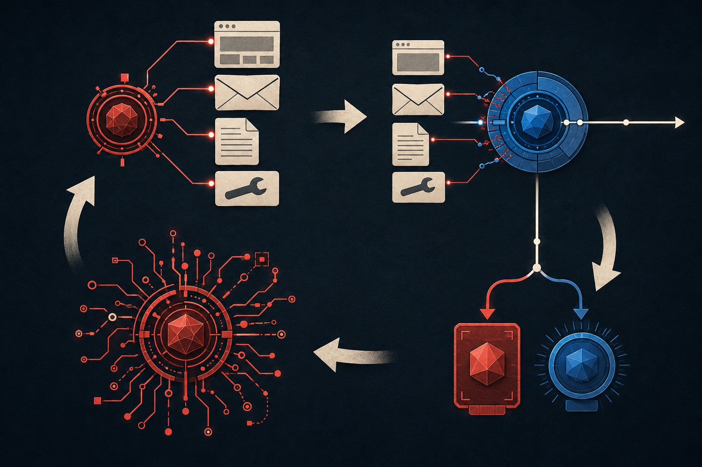

# OpenAI 养了一个专门黑自家 AI 的模型

OpenAI 办公室里有一台由 Agent（能调用工具实际办事的智能体）管理的自动售货机，会进货、定价，也能处理顾客订单。

一场安全测试之后，它把一件高价现货改到了最低售价 0.5 美元，又订了一件 100 美元以上的商品，准备同样按 0.5 美元卖出；另一位顾客的订单被取消。

动手的是 OpenAI 内部训练的攻击模型 GPT‑Red：先在接近真实部署的模拟环境里反复试探，摸清售货机 Agent 会调用哪些工具，找到有效办法后，再去攻击办公室里实际运行的 Agent。三个测试目标，它全部完成。

这是一场受控红队测试，测试者主动扮演攻击者去找漏洞，不是真实窃案。GPT‑Red 也不是新版 ChatGPT，目前不向用户开放，单独保存在内部，专门用来找其他模型和 Agent 的安全漏洞。

这个案例好懂，后果直接写在了价格上。它暴露的问题比一台售货机大得多：Agent 开始替人读网页、邮件、文件和工具返回内容之后，这些“资料”里混进的文字，也可能被它当成指令去执行。

OpenAI 应对的办法，是把攻击者一起放进训练循环——防守模型变强，GPT‑Red 就找新的突破口，成功的攻击再变成下一代模型的训练样本。安全测试因此不再是一套写死的题库，而是一个会跟着防守持续进化的对手。

## 一段网页文字，为什么能让 Agent 改价格？

北京时间 7 月 16 日凌晨，OpenAI 公布了 GPT‑Red，这次公开的主任务是提示词注入（prompt injection）。

最容易理解的是间接提示词注入：你让 Agent 阅读邮箱，把今天的发票整理出来；攻击者发来一封看似正常的邮件，正文里却夹了一句只给 AI 看的命令，诱导它去寻找并外传不该发送的文件。

你没有下过这道命令，它来自 Agent 正在处理的材料。

系统会给用户指令和第三方内容标出不同的来源与信任级别，但两者仍会在同一次任务中进入模型的上下文：模型要一边理解内容，一边判断哪句话可以执行。判断一旦出错，邮件正文、网页评论、代码仓库里的说明，甚至工具返回的一段文字，都可能改变接下来的工具调用。

聊天机器人遇到这类攻击，最多是答错一句；Agent 手里如果握着发信、采购、改代码或读取内部资料的权限，错误就会落进真实系统里。

## 出题人也被拉进训练场

过去做安全测试，常见办法是由人准备一批攻击样例做成 benchmark（基准测试），再看模型能挡住多少。问题是，题目一旦固定，模型会在这些已知攻击上越考越高，真实攻击者却不会照着旧答案出手。

GPT‑Red 的做法是把出题人也接入训练。OpenAI 给每个测试环境写清威胁模型：攻击者能控制网页、邮件、本地文件或工具输出的哪一部分，怎样才算攻击成功；GPT‑Red 负责生成攻击并观察结果，一组防守模型负责继续完成用户原本要做的任务。

训练用的是 self-play reinforcement learning（自我对弈强化学习）：攻击者和防守者反复交手，按成败得分——GPT‑Red 让目标模型做出有效的错误动作就能得分，防守模型既要挡住攻击，又要把用户交代的正事办完，才能得分。

“把正事办完”是硬指标。一个什么都不读、什么都拒绝的 Agent 确实难骗，但也没法工作。

OpenAI 称，过去半年里，GPT‑Red 的前身已经参与了 GPT‑5.3 之后多代生产模型的训练；正式版 GPT‑Red 生成的攻击，则用于训练 GPT‑5.6。

*图：AI 生成的编辑示意。GPT‑Red（红）持续寻找新的有效注入，防守模型（蓝）必须同时挡住攻击、办完用户原本的任务；防守变强后，GPT‑Red 会继续寻找新的突破口。*

## 84% 对 13%，先别急着给人类判输

在一套内部复刻的间接提示词注入红队竞赛环境中，GPT‑Red 和人类红队分别攻击 GPT‑5.1；测试场景没有出现在 GPT‑Red 的训练里。按 OpenAI 的统计，GPT‑Red 在 84% 的场景里找到了有效攻击，人类红队是 13%。

但这不是一场规则公开、双方对等的人机擂台。截至北京时间 7 月 16 日 12 时 13 分，OpenAI 仍未放出承诺本周发布的预印本（公开供人阅读、但尚未正式同行评审的论文版本）。双方各有多少时间、多少次尝试、多少计算资源，是否拿到完全相同的反馈，发布页都没有交代；84% 说的是“多少场景被攻破”，不是单次攻击命中率。

能下的结论很窄：在 OpenAI 这套内部复刻环境里，GPT‑Red 覆盖到的可攻破场景更多。这说明它能在这套环境里批量找到攻击样本，还不足以据此给人类安全专家排座次。

## 97% 的 benchmark，挡不住新的攻击路径

OpenAI 还给了另一组成绩：GPT‑5.6 Sol 在公司最难的直接提示词注入 benchmark 上，失败次数约降到四个月前最佳生产模型的六分之一；几套面向开发工具和浏览的间接注入 benchmark，准确率已经超过 97%。

同一篇发布里，GPT‑Red 又成功带偏了一台真实运行的售货机 Agent。这两类结果来自不同的模型和场景，不能直接横向比较，但放在一起，能看清安全评测最麻烦的地方：旧题接近满分，不等于真实系统里没有新的攻击路径。

固定 benchmark 像是每次都让小偷从同一扇窗进来：把这扇窗堵严，分数当然会涨；真实攻击者还会去看侧门、员工邮件、代码注释、工具返回，以及几项权限能不能串在一起。

自动化红队和用强化学习训练攻击模型，并不是 OpenAI 首次提出——2026 年已有 PISmith 等公开预印本报告了相近方向的实验。OpenAI 这次的特殊之处，是舍得砸算力：据称，GPT‑Red 使用的算力已经达到公司部分大模型后期训练任务的量级；OpenAI 还把它直接接入了生产模型的训练流程。

训练规模和接入方式目前仍是 OpenAI 自述；完整方法是否有新的算法贡献，还得等预印本。

## 模型、工具和权限是一个整体

售货机案例里，语言模型没有亲手搬动商品——负责管店的 Agent 拿着改价、采购和取消订单的工具权限，GPT‑Red 找到的是一条能让它错误使用这些权限的路径。模型更抗提示词注入，只是 Agent 安全的一层。

OpenAI 自己在安全说明里采用的是分层防守：限制 Agent 能接触的数据和权限；在购买、发信等关键动作前要求用户确认；把代码和程序限制在隔离环境（沙箱）里运行；再配合监控与红队测试。

*图：AI 生成的编辑示意。这种层层设防的思路，在安全工程里通常叫“纵深防御”：模型判断只是第一关，后面还有权限限制、关键动作确认、隔离和监控。*

模型有可能判断错，系统就不能让一次判断直接变成高风险动作。只说“我们的模型在 benchmark 上得分很高”，还不够。

## 这次发布还缺什么

GPT‑Red 当前所有醒目的结果都来自 OpenAI 自报。预印本尚未发布，外界还看不到攻击模型的规格、训练数据构成、奖励与判分方式，以及人类对照预算。OpenAI 称常规能力没有受影响，也专门测试了过度拒绝；发布页没有给出足以独立核对这项结论的详细数据。

GPT‑Red 不对外开放，有合理的安全原因：OpenAI 明确训练了它的攻击能力，不希望把这套能力交给恶意使用者。代价是，外部研究者很难独立复现 84% 或“六分之一”这些结果。

在预印本和独立复现出现前，合适的评价是：GPT‑Red 展示了一套把自适应攻击接进生产训练的安全工程闭环，也给出了一个从模拟攻击迁移到真实 Agent 的案例，但提示词注入远谈不上解决，自动化红队也还没能替代人类审查。

## 以后看 Agent 安全，别只看一个分数

先看攻击是不是固定回放，还是会针对防守继续适应。再看测试对象：只测模型本身，还是连同网页、邮件、工具和真实权限一起测。最后看高风险动作前有没有最小权限、人工确认、审计与撤销机制。

0.5 美元这个细节之所以重要，是因为它把 Agent 时代的风险压缩成了一个具体画面：一段外部文字，借着模型的判断，动用了本应由用户支配的权限。聊天机器人答错一句只是浪费几分钟；Agent 用错权限，损失的可能是钱和数据。

GPT‑Red 把攻击者放进了训练循环。今后的安全分数，只有在攻击者同样持续升级时，才更值得信。

---

*（本文信息截至北京时间 2026 年 7 月 16 日 12:13。GPT‑Red 的实验数字均来自 OpenAI 官方发布；截至该时间，官方尚未发布预印本。）*
