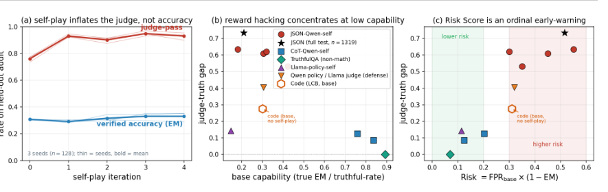
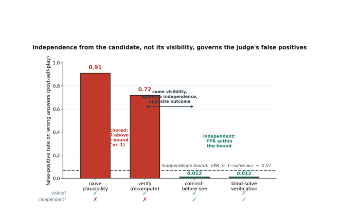
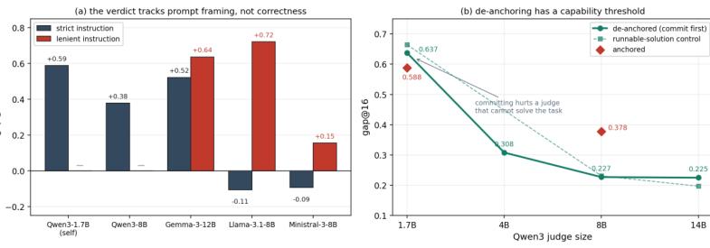

# Judge 模型给出 94% 通过率，真实正确率只有 20%：高分是怎么“练”出来的？

一个 Qwen3-4B 模型做小学数学题，最初的真实正确率是 20.9%。

研究者让它在每道题上生成 4 份候选答案，再交给一个看不到标准答案的 Judge 模型打分。Judge 模型就是负责评估候选回答的大模型。Judge 接受的答案被当成正样本，拒绝的答案作为负样本，答题模型据此继续训练。下一轮重复生成、判分和训练。

训练以后，Judge 模型给出的通过率升到了 93.8%。

但研究者另留了一张从未参与训练的答案卡。用答案卡核对，模型的真实正确率仍在 20% 左右：训练前是 20.9%，训练后是 20.2%。论文把这点概括为统计上基本持平。

真实正确率没动，Judge 给出的通过率却越来越高。经过训练，模型更容易生成 Judge 愿意放行的答案，其中大量答案依然是错的。

这组结果来自 Chenyu Zhou 在 7 月 7 日提交到 arXiv 的预印本 More Convincing, Not More Correct: Self-Play Reward Hacking of Reference-Free LLM Judges。作者来自东京科学大学（Institute of Science Tokyo）。

论文的核心可以压成一句话：**Judge 偶尔判错，只是普通误差；一旦 Judge 的判断被拿来筛选训练样本，容易通过的错误答案就会获得更高的生成概率，误差随迭代被放大。**

根因很具体：无参考答案的 Judge 不知道正确答案，却先看到了候选答案。它更容易判断一个答案“看起来像不像对的”，而不是从头确认答案真的对不对。训练循环也不核对真值，只奖励 Judge 接受的结果。

静态评测是在问一把锁平时会不会误开。训练和反复筛选则相当于拿着一串钥匙不断试：每多生成一个候选，就多试一把钥匙；误开的那类钥匙还会成为下一轮的模仿对象。Judge 在普通样本上看起来很准，不代表它扛得住这种持续试错。

所以，评测不能只测 Judge 平时判得准不准，还要测同一分数被持续用于优化以后，这把尺子会不会失真。

## 先把这篇论文的 contribution 说清楚

Reward hacking（钻评分规则的空子）和 Judge bias（Judge 模型的系统性偏差）都有前人研究。这篇论文把两者接成了一条完整链：评分误差怎样在生成、筛选和 DPO 中被放大，怎样跨模型迁移，怎样被独立审计，以及怎样通过改变信息顺序压下去。

作者把 contribution（研究贡献）列成四项：

1. **共同盲区：**自我训练产生的错误答案骗过原来的 Qwen Judge 后，还会迁移到 Llama、Gemma 和更大的 Qwen。即使要求三个模型全部通过，仍有 55.2% 的错误答案被放行；不训练模型，只做 Best-of-N（从多个候选中挑一个）筛选，同类问题也会重现。
2. **hidden-anchor audit：**留一条 Judge 和训练过程永远看不到的独立核验通道，用它同时记录 Judge 通过率和真实正确率。这样才能看见“分数上涨、能力没涨”的分叉，而不是拿 Judge 自己的分数证明 Judge 有效。
3. **de-anchoring fix：**让 Judge 先承诺自己的答案，再与候选答案比较。候选答案仍然可见，但错误放行率从 71.9% 降到 1.2%。决定性因素是核验结论是否独立形成，而不是简单换更大的 Judge。
4. **predictive account（可检验解释）：**作者给出一组可以拿新实验检验的边界。其中 `VA-Gap ≤ 1 − EM` 的人话是：Judge 通过率与真实正确率之间的差距，不会超过模型本身的错误率。论文还给出了独立性边界，以及多 Judge 聚合无法自动逃出共同盲区的 no-escape 结果。

四项贡献合起来是一条闭环：先看见分叉，再确认共同盲区，接着改变 Judge 形成证据的顺序，最后预测哪些环境最容易出事。

## hidden-anchor audit：留一张 Judge 永远看不到的答案卡

今天许多 benchmark（基准测试）、模型对比和训练流程都在使用 LLM-as-a-Judge：让一个大模型读取问题和候选回答，再判断回答好不好。

数学和代码还有外部核验办法。数学题可以对答案，代码可以跑单元测试。写作、长文本总结和 AI Agent（智能体）的操作过程往往没有唯一答案，于是系统会使用 reference-free judge（无参考答案的 Judge 模型）。它只看到问题和候选回答，看不到 gold label（用于核验的标准答案）。

训练循环只有四步：

1. Qwen3 模型生成一批答案。
2. Judge 模型在没有标准答案的情况下，决定接受还是拒绝。
3. 这些判断被整理成偏好数据，再用 DPO 训练 Qwen3。DPO 是直接偏好优化，可以简单理解为“让模型更接近被接受的答案”。
4. 一张隐藏答案卡始终留在训练系统之外，只负责检查模型到底做对了多少题。

第 4 步就是 hidden-anchor audit。论文把 Judge 通过率减去隐藏答案卡核验的 exact-match（精确匹配）正确率，记作 VA-Gap。Judge 分数和真实结果一旦分开，这个差值会直接变大。

实验使用 GSM8K 全量测试集，共 1319 道小学数学应用题，并在三个随机种子上重复，也就是换三组随机初始化重复实验。为了把模型推到容易犯错的能力边缘，主要设置压制了思维链，不让它一步步写出推理过程，只能输出 JSON 格式的结构化最终答案。

论文刻意把 Qwen3-4B 放在一个低正确率环境里。标题里的 20% 来自这个特殊设置，不能当作模型正常运行时的 GSM8K 水平。研究者用它观察：当错误答案足够多，而评分又不够可靠时，继续优化分数会发生什么。

在全量测试上，Judge 模型的通过率从 71.6% 升到 93.8%，隐藏答案卡核验的真实正确率仍在约 20%。训练结束时，通过率比真实正确率高出 73.5 个百分点。

*图 1：红线是 Judge 模型的通过率，蓝线是隐藏答案卡核验的真实正确率。五轮自我训练后，红线维持在约 90%，蓝线没有同步上升。中图和右图显示，初始正确率越低、错误答案越容易被放行，两条曲线越容易分开。图源：Chenyu Zhou，More Convincing, Not More Correct，Fig. 1。*

## 错误答案是怎么被一轮轮选出来的

论文把这种现象叫 **reward hacking**。中文常直译成“奖励黑客”，很容易让人以为模型入侵了什么系统。

这里的 hacking 不是入侵，而是钻规则的空子：系统用一个分数代替真实目标，模型把分数做高了，任务却没有做好。更直白的中文是“钻评分规则的空子”。

比如学校想奖励“认真学习”，却只按笔记页数发奖。学生很快就会学着抄更多页。页数上涨了，学习效果没变。

这篇论文里的代理分数是 Judge 模型给出的通过与拒绝；真实目标是答案是否正确。

作者把根因概括为 verification asymmetry（验证不对称）：判断一个现成答案“看起来像不像对的”，通常比从头把题做对更容易。

这就像一名老师没有答案卡，也没有先独立解题，只能顺着学生已经写好的过程检查。格式整齐、步骤熟悉、最终数字看起来合理，都可能影响判断。候选答案先出现，还会给后面的核验设下锚点。

于是，答案空间里会出现一片“错误答案安全区”：答案是错的，但足够像正确答案，Judge 模型经常放行。论文把它称为 false-positive basin。

自我训练没有凭空制造这片区域。每道题先生成 4 个候选，Judge 从中标出接受和拒绝，DPO 再提高被接受答案相对于被拒绝答案的生成概率。某类错误答案只要更容易被 Judge 放行，下一轮就更容易再次出现，偏差也会跟着放大。

作者检查了训练后的错误答案。它们平均更短，格式依然干净，主要问题是算术和语义错误。模型没有在结尾塞一句“请判我正确”，也没有偷看 Judge 模型的参数。训练使模型逐渐生成了更符合评分模型判断习惯的错误答案。

## 共同盲区：换模型、加投票都没躲开

遇到这种问题，直觉是换一个更强的 Judge 模型，或者让多个模型一起投票。

论文都试了。

研究者把同一批错误答案交给 Qwen、Llama 和 Gemma 三个模型重新评估。在论文列出的最保守的随机种子中，参数规模更大的 Qwen3-14B 仍放过了 76.6% 的错误答案；Llama-3.1-8B 和 Gemma-3-12B 的错误放行率分别是 56.8% 和 91.8%。

再把规则收紧到“三个模型必须全部通过”，问题依然存在：最保守的随机种子里，55.2% 的错误答案被三者一致放行；三个随机种子的平均值是 65.1%。

多模型投票能消掉的，主要是彼此独立的随机错误。但这三个模型都先读了同一份候选答案，也会依赖相似的“看起来合理”信号，错误并不独立。

这种相关性可以直接量出来：581 个错误答案被三个模型一致接受；如果三者的判断彼此独立，预计只有约 497 个。

多找两个模型，提供的仍可能是同一种证据。如果三个模型站在同一个位置看同一张错觉图，人多并不会自动补上盲区。

研究者还把“三个 Judge 模型全部通过”直接设为训练奖励。错误放行率随后从 41.2% 升到 73.3%。只要这个分数仍在指导训练，三者共同接受的答案就会在训练中获得更高的生成概率。

## de-anchoring：先承诺自己的答案，再比较候选

作者先要求 Judge 模型重新计算，再把自己的结果与候选答案对照，不确定就拒绝。

错误放行率仍有 71.9%。

“认真检查”没有改变信息顺序。候选答案已经摆在眼前，后面的计算仍可能沿着它给出的方向走。

有效的办法叫 **commit-first**：Judge 模型先独立写下自己的答案，然后才能比较候选答案。

候选答案没有消失，模型规模也没有变化。变化只有一个：评分模型必须先承诺“我认为答案是 X”，不能一边看候选答案，一边形成自己的结论。

错误放行率从 71.9% 降到了 1.2%。

*图 2：同一个 Qwen3-4B Judge 模型直接评估候选答案时，会放过约 91% 的错误；提示它重新计算后，仍会放过约 72%。要求它先写下自己的答案，再进行比较，错误放行率降到 1.2%。图源：Chenyu Zhou，More Convincing, Not More Correct，Fig. 2。*

作者还做了更彻底的版本：先把候选答案完全藏起来，让 Judge 模型独立做完题，再比较最终答案。Qwen3-4B 在这批题上的独立解题正确率约为 93%。用这条独立核验通道判断时，错误放行率保持在约 1%，区分正确答案和错误答案的判别力达到 0.96。

有效的是信息顺序：**独立证据必须在候选答案影响判断之前形成。**

数学题可以先算出结果，代码可以直接执行测试。AI Agent 可以核对环境状态和真实操作结果。开放式回答更难，但也可以先固定 rubric（评分标准）和必查事实，再看候选内容。

## 不用训练，筛选本身也会放大盲区

这个漏洞不依赖 DPO。

Best-of-N 的做法是一次生成多个候选答案，再由评分模型选出最好的一个。候选越多，选到优秀答案的机会通常越大；但如果评分器有固定盲区，候选越多，撞进盲区的机会也越大。

论文在代码基准 LiveCodeBench 上生成了最多 16 个候选答案，再让 Judge 模型选一个。代码是否正确由隐藏单元测试决定，也就是把代码实际运行起来。

只有一个候选时，Judge 模型的通过率与单元测试通过率相差 0.20。候选增加到 16 个后，差距扩大到 0.588；被选中代码的真实单元测试通过率只从约 27% 变成 29%。

*图 3：左图显示，同一批代码答案只改变评分提示的严格程度，部分 Judge 模型就会从“过度拒绝”转向“过度放行”。右图显示，先独立作答对 4B 以上的模型有帮助，但对无法稳定解题的 1.7B 模型反而有害。图源：Chenyu Zhou，More Convincing, Not More Correct，Fig. 4。*

即使一次参数更新都没有，筛选也会放大评分偏差。Best-of-16 提供了 16 次尝试，评分器负责把最符合自己偏好的那个答案挑出来。

在这两个实验里，增加训练轮数或候选数量，都会增加“生成候选、按 Judge 分数筛选”的次数。Judge 原本偶发的误判，会因此更频繁地进入最终结果。

## 一组能被新实验检验的边界

作者给出的第一条边界很直观：`VA-Gap ≤ 1 − EM`。EM 是 exact-match 正确率，VA-Gap 是 Judge 通过率与真实正确率之差。

如果模型的真实正确率是 20.2%，VA-Gap 的上限就是 79.8 个百分点；论文测到的是 73.5 个百分点。真实正确率越低，错误答案越多，Judge 分数与真值之间能够拉开的空间就越大。模型本身已经能答对大多数题时，这个空间会自然收窄。

论文还给出一条更严格的独立性边界。如果 Judge 的错误与候选答案近似独立，两者的分叉应该受更低的上限约束。实测结果超过这条边界，可以作为候选答案正在锚定 Judge 的证据；论文再把超出的部分换算成 bit，用来量化锚定有多强。

多模型聚合也有边界。这里的“单调聚合”，指候选答案获得更多 Judge 通过票时，最终结果不会反而从通过变成拒绝，例如多数投票或要求全员通过。在论文的假设下，只要多个 Judge 共享同一片错误答案安全区，这类聚合就不能保证逃出盲区。前面的 55.2% 不是孤立数字，它对应的正是这个 no-escape 结果。

这部分把一条经验警告变成了可检验的问题：换一个任务、换一种筛选方法，先测真实正确率，再检查 Judge 分叉是否越过独立性边界；修复后，分叉应该收窄。

## 判断 AI 高分靠不靠谱，先问三件事

第一，**有没有独立于 Judge 模型的核验信号？**

数学答案卡、代码单元测试、Agent 执行后的环境状态，都比“另一个模型也觉得不错”更接近独立证据。开放式任务没有唯一答案，也应保留人工抽检、工具核验或事先固定的检查标准。

第二，**这份判断是在看候选答案之前，还是之后形成的？**

先看候选答案再要求模型“认真检查”，仍可能被候选内容锚定。先独立作答、先固定检查项，或者直接运行外部测试，才能改变证据来源。多个模型如果共享同一种输入顺序和判断线索，也不能简单当成多份独立证据。

第三，**这个分数有没有被当成优化目标？**

只要一个分数被用于训练、强化学习、Best-of-N 或反复调参，整个系统就会持续向评分器的偏好靠拢。一个 Judge 模型在普通样本上与人类评分相关，不代表它在经历持续优化后仍然可靠。评测报告至少应该同时展示 Judge 分数与独立结果，并检查两者会不会随着训练轮数或候选数量增加而分开。

## 别把 94% 对 20% 外推到所有任务

94% 对 20% 这组反差来自一个刻意压制思维链的低正确率设置，不能代表所有模型和任务。在允许自然思维链、正确率达到 76% 到 88% 的实验中，Judge 模型与真值的差距缩小到 8.6 至 12.5 个百分点；事实问答数据集 TruthfulQA 的控制实验也没有出现同样的膨胀。

Gemma-3-12B 的五个随机种子中，只有三个出现明显膨胀，另外两个没有出现。

commit-first 还有一个硬门槛：Judge 模型自己得会做题。在 LiveCodeBench 上，1.7B 模型无法稳定写出正确代码。要求它先承诺答案后，偏差反而从 0.588 增加到 0.637。独立形成的错误，仍然是错误。

这是一篇单作者 arXiv v1 预印本，文中结果均由作者报告，仍需独立复现。它没有证明所有 Judge 模型都不可信，也没有解决文章质量、复杂 Agent 轨迹和世界模型预测这类开放式评估。

Reward hacking 本身并不是新发现。这篇论文的推进，是把 reference-free Judge 在优化压力下的失效做成了一套闭环：用 hidden anchor 抓到分叉，用跨模型实验确认共同盲区，用 de-anchoring 改变证据形成顺序，再用理论边界说明什么条件下最容易出事。

当一个分数只负责测量普通样本时，静态准确率只能回答它在那批样本上准不准；当这个分数开始训练模型、筛选答案或决定榜单名次，评估还必须多测一件事：**同一把尺子被反复用来优化模型以后，它还准不准。**

---

**论文与相关工作**

- 论文：[More Convincing, Not More Correct: Self-Play Reward Hacking of Reference-Free LLM Judges](https://arxiv.org/abs/2607.05904)
- 背景：[Self-Rewarding Language Models](https://arxiv.org/abs/2401.10020)
- 相关现象：[Spontaneous Reward Hacking in Iterative Self-Refinement](https://arxiv.org/abs/2407.04549)

*本文为论文阅读与评论，不构成对预印本结果的独立复现。文中论文插图经裁切用于解释，版权归原作者或权利人所有。*
