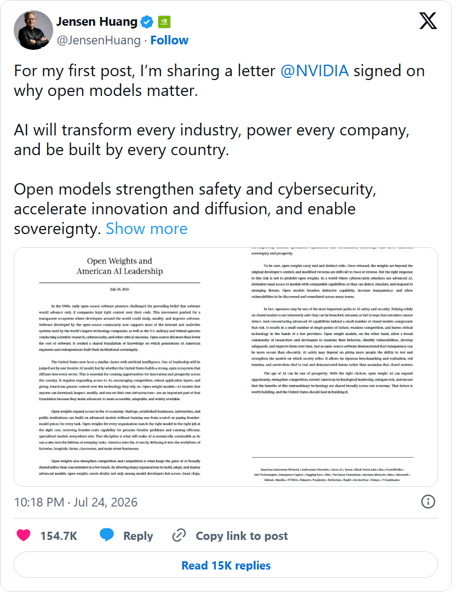
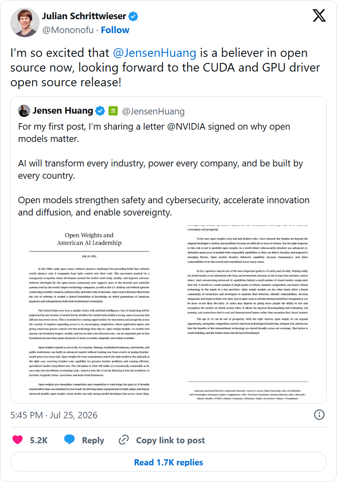
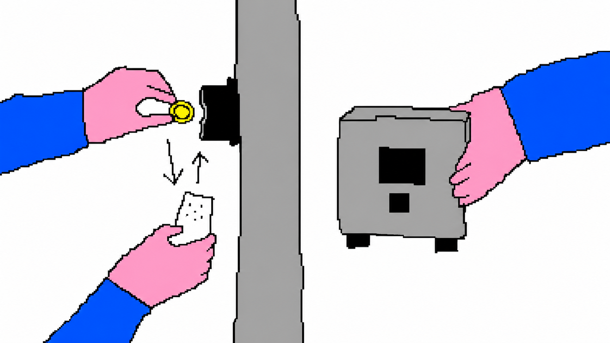
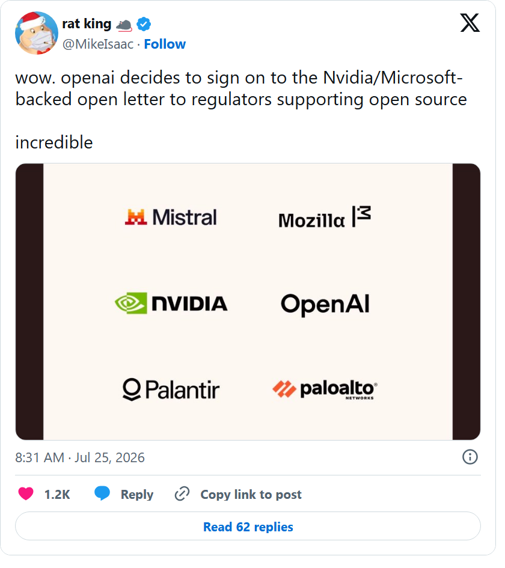
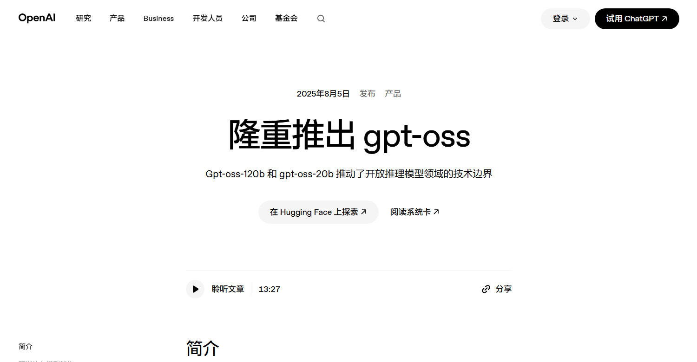

# 黄仁勋力挺开放权重，OpenAI 也在争模型「学习权」

黄仁勋入驻 X 后，发出的第一条帖子没有介绍新芯片，而是转发了[《开放权重与美国 AI 领导力》](https://www.microsoft.com/en-us/corporate-responsibility/topics/open-weight/)公开信。

*Jensen Huang 用自己的第一条 X 帖分享了这封公开信；图源：Jensen Huang / X。*

最初只有 25 家公司和机构签名。几天后，[名单扩到了 70 多家](https://www.microsoft.com/en-us/corporate-responsibility/topics/open-weight/)，最终连 OpenAI 都出现了。

[舆论很快把 Anthropic 推成了「最后一个没签的」](https://x.com/beffjezos/status/2080858083472146656)。

同一封公开信下，卖芯片的 NVIDIA 和依靠闭源模型收费的 OpenAI 站到了一起，Anthropic 却留在门外。

它们争的真是「开源还是闭源」吗？

更值得追问的是：为什么 NVIDIA 和 OpenAI 都不愿意让模型之间的学习被一概限制？

## 黄仁勋先算了一笔账

A 社没有发官方声明，但曾参与 AlphaGo Zero、也是 MuZero 论文第一作者的技术人员 [Julian Schrittwieser](https://x.com/Mononofu/status/2080937562739531837) 先开麦了。

*Julian Schrittwieser 转发黄仁勋首帖并反问 CUDA 与 GPU 驱动何时开放；图源：Julian Schrittwieser / X。*

他转发黄仁勋的帖子，意思很直白：黄哥既然这么信开源，CUDA 和 GPU 驱动什么时候开？

这只是员工个人发言，不代表 Anthropic。但它点中了黄仁勋立场里最现实的一面：公开信不要求 NVIDIA 开放 CUDA，它争取的是模型层继续开放。而模型层越开放，部署和算力层的市场越大。

对黄仁勋来说，这首先是一笔算力生意。

公开信替两种做法争取空间：企业可以把开放模型下载到自己的服务器，也可以让小模型从强模型的回答中学习。后一种训练方法，业内叫「蒸馏」。

问题恰恰出在第二件事上。

2 月，[Anthropic 称](https://www.anthropic.com/news/detecting-and-preventing-distillation-attacks)，有人使用大量账号和代理，规避 Claude 的访问限制，再把收集到的回答用于训练其他系统。A 社把这类行为称为「蒸馏攻击」。这是 Anthropic 一方的主张，并非司法结论。

4 月，[白宫把类似行为纳入国家安全备忘录](https://www.whitehouse.gov/wp-content/uploads/2026/04/NSTM-4.pdf)。文件针对未经授权的大规模提取和绕过访问限制，没有禁止蒸馏。但[一项尚未通过的法案](https://www.govinfo.gov/content/pkg/BILLS-119hr8283ih/html/BILLS-119hr8283ih.htm)又往前走了一步：如果服务条款禁止用模型输出训练另一个模型，违反这项约定，也可能被纳入「模型提取攻击」的判断。

争议就这样从「怎样拿到回答」，走向了「拿到回答以后能做什么」。

如果正常的能力迁移也被笼统视为风险，开放模型会更难追上，企业也会更依赖少数公司的接口。

他对 [Axios](https://www.axios.com/2026/07/22/nvidia-jensen-huang-china-open-source-ai) 说得很直白：「免费 AI 对硬件、芯片和数据中心都应该是好事。」

模型便宜、能下载，企业才更愿意把它装进自己的环境，用在客服、编程和内部问答里。

模型跑得越多，推理芯片、服务器和配套软件的需求就越大。

*AI 生成笨拙涂鸦：左边按次调用闭源 API，右边把开放权重模型放进自己的环境。自托管仍然需要支付 GPU、存储和运维成本。*

NVIDIA 也不用押中唯一赢家。

闭源模型继续冲能力上限，开放模型把能力带进更多企业和设备。只要 AI 的部署继续扩散，底层都需要计算。

蒸馏正是开放模型常用的追赶办法。[Meta 就公开说明](https://ai.meta.com/blog/llama-3-2-connect-2024-vision-edge-mobile-devices/)，它让小模型学习自家大模型，把能力装进更便宜、更容易运行的模型里。

黄仁勋要保住的，不只是「开源」这个口号，而是一个模型足够多、部署足够广、算力需求不断增长的市场。

## OpenAI 后来为什么签

OpenAI 一补签，名字里的「Open」自然又被网友翻了出来。

可它的处境没有这个段子那么简单。

公开信发布当天，OpenAI CEO [Sam Altman](https://x.com/sama/status/2080683363174945065) 已经表态支持开放模型与闭源模型并行，公司却没有出现在首批名单里。

不久后，页面变了。

*纽约时报记者 Mike Isaac 记录了 OpenAI 后来出现在签署名单中的页面变化；图源：Mike Isaac / X。*

官方没有解释为什么后来补上签名。

但 OpenAI 本来就同时站在开放和封闭两种模式里。

*OpenAI 官方 gpt-oss 发布页；图源：OpenAI，页面截图未改动原文。*

2025 年，它发布了可以下载、自行部署的 gpt-oss。另一边，最核心的模型仍通过 API 收费。

它的[商业协议](https://openai.com/policies/services-agreement/)说得很直白：企业客户原则上拥有输出，却不能拿这些输出开发与 OpenAI 竞争的模型。

说白了，拿到模型的输出，不等于获得了训练任何模型的许可。

OpenAI 也卖过[官方蒸馏工具](https://openai.com/index/api-model-distillation/)：开发者可以在它的平台内，用强模型的回答训练成本更低的小模型，并为训练付费。

这个旧产品不能代表今天的全部政策，却已经展示出一种生意——蒸馏不必被禁止，也可以被授权、划定范围，然后收费。

这正是 OpenAI 的双重位置。它需要开放模型参与开发者市场，也需要保护闭源模型最值钱的能力，不被直接拿去培养竞争者。

设想一家企业付费调用前沿模型，攒下几万条回答，再用这些回答训练一个只服务内部业务的小模型。它已经付过 API 费用，这些回答算不算它的？内部使用可以，对外出售还可以吗？

如果新模型做得越来越像「教师模型」，又从哪一步开始变成「蒸馏攻击」？偶尔生成几条训练样本，和用大量账号持续提取一项能力，显然不同。二者之间却没有一把公认的尺子。

于是同一批输出，可能因为用于内部工具、商业小模型或直接竞争，而落入不同的规则框架。

*AI 生成笨拙涂鸦：平台尝试为模型输出的后续使用划定授权范围。示意图不代表已经生效的法律或统一行业标准。*

OpenAI 没有公布一套完整的分级收费方案。但它现有的商业协议和蒸馏工具已经说明，调用模型是一种权利，积累输出再训练另一个模型，可能是另一种。

所以，OpenAI 补签不等于转向完全开放。

它既要保护自家的闭源模型，也不愿把「合法蒸馏」的定义权让给别人。它加入的是规则制定的牌桌。

## 最后争的是：谁能向谁学习

最终，大厂要回答的还是三件事：谁能学，能学到什么程度，以及该向谁付费。

黄仁勋希望学习的门尽量开着。模型越多、部署越广，NVIDIA 的市场越大。

OpenAI 则希望门可以开，但钥匙和价格不能由别人单方面决定。

两家公司因此站到同一封公开信下，却没有成为同一个阵营。

这封信形成的共识其实很薄：不要把蒸馏整项封死。Anthropic 仍然缺席，什么叫正常学习、什么叫「蒸馏攻击」，还在争论。

公开信从开放权重说起，最后把问题推向了模型输出的使用权。

当 AI 开始成为 AI 最重要的老师，下一轮行业竞争就不只是「谁的模型更聪明」，而是「谁有资格当老师，以及谁有权向它学习」。

*注：签署名单与政策状态截至 2026 年 7 月 27 日。OpenAI 的加入时间和动机没有官方说明；Anthropic 的调查为公司公开主张，文中法案仍是提案。*
