# Patreon 裁掉 93 人，却说 AI 没有替代人

2026 年 7 月 23 日，Patreon 联合创始人兼 CEO Jack Conte 发了一封公开信。公司要裁减 93 人，占团队的 20%。

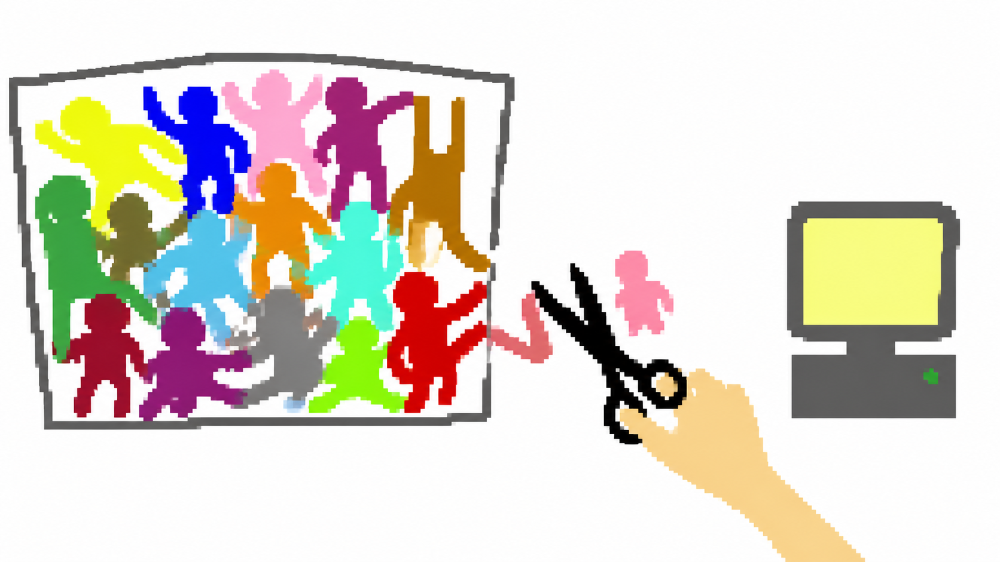

*AI 生成涂鸦：团队少掉五分之一。画面不表示 AI 是裁员原因。*

信里有两句话挨得很近。

一句是：「我们做出上述调整，并不是因为我们认为 AI 可以替代人。」

接着 Conte 又说，AI 已经改变科技行业，也在改变 Patreon 怎么工作、怎么做产品、怎么沟通。「这确实会影响我们的运营和组织方式。」

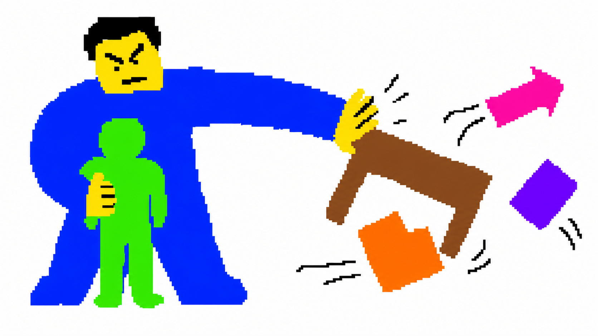

*AI 生成涂鸦：一张说「没有替代人」，另一张说工作和组织已经受到影响。图中不使用可读文字。*

这很容易被读成「Patreon 因为 AI 裁员」。现有信息支持不了这个结论。公开信还提到过去 6 个月的市场变化、成本结构和长期转型。裁员是管理层的决定，不能倒过来只算到 AI 头上。

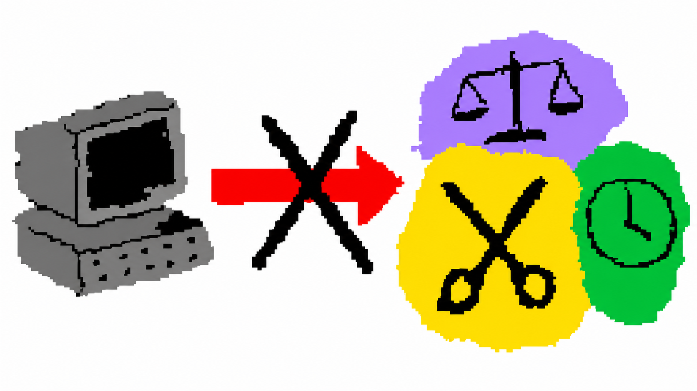

*AI 生成涂鸦：现有材料不支持「AI 导致这次裁员」这条直接因果。*

我在意的是另一件事。AI 还没接走整份工作，公司组织人和任务的方式已经开始动了。

## 很多职业在用，用得还没那么深

同一天，Google 发布了 ATLAS v1.0。它想看的是，人们到底在用 AI 做哪些工作。

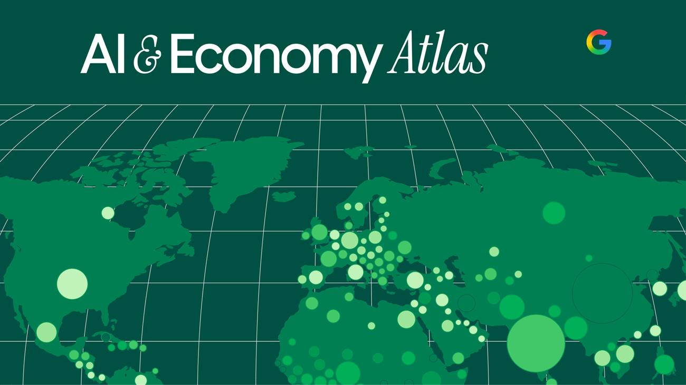

*图：Google AI Blog*

报告分析了 2026 年 4 月 6 日到 4 月 19 日的 14,653,926 条去掉身份信息的交互。这是全球样本，来自 Gemini App、Google AI Mode 和 Gemini API。

Gemini API 的细粒度主分析只纳入免费请求。付费 API 的请求与响应文本没有被记录，企业签约日志也没进入这部分分析。前面那个 14,653,926 是交互条数，不是用户数。

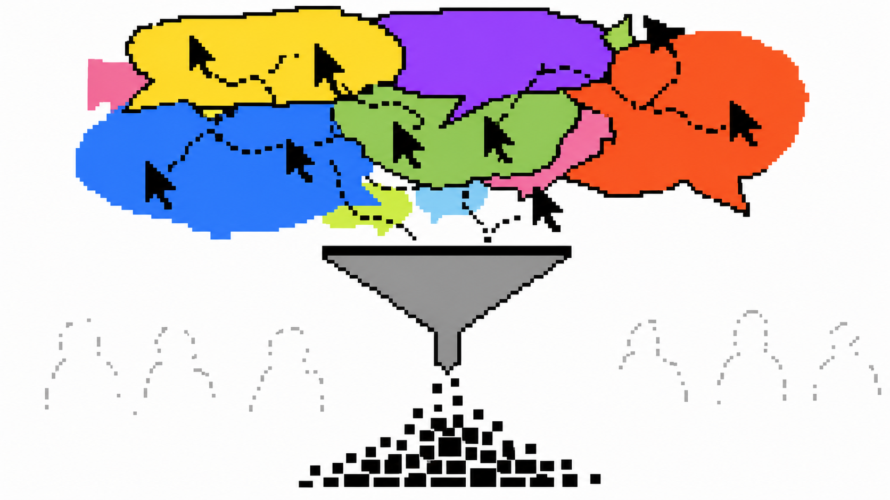

*AI 生成涂鸦：ATLAS 看到的是经过筛选的交互样本，不是 1465 万名用户。*

数字有点绕。我自己是这样读的。

广度上，Google 给细分职业设了一个门槛：至少有 50 名用户。跨过这道门槛的细分职业占 68%，它们对应 88.4% 的美国受雇平民。后一个数字说的是职业覆盖面，不是说 88.4% 的美国人都在用 Gemini。

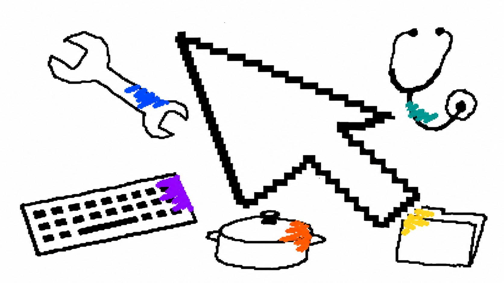

*AI 生成涂鸦：覆盖的职业很多，但这个数字不等于对应人口都在使用 Gemini。*

到任务这一层，口径又变了。报告先排除那些没有任务达到至少 25 名用户门槛的职业。在这些职业里，报告再去看 O*NET 职业数据库列出的各项任务，有多少达到了门槛。各职业这个比例的中位数是 21%。这个 21% 不是某个人交给 AI 的工作占比，也不是省下的工时。

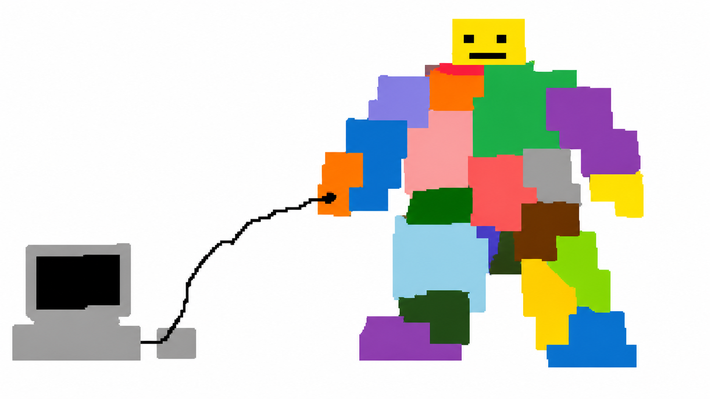

*AI 生成涂鸦：一个职业包含许多任务，AI 目前只触及其中一部分。*

还有一个「少于 10%」。它只针对被归为「非例行认知工作」的 AI 对话，指其中被分类为「任务自动化」意图的部分。这里的自动化，是把核心任务或一个主要子任务端到端地交给 AI。报告没有看到离开 Gemini 之后发生了什么，任务有没有做成也不知道。它不等于「少于 10% 的工作已经自动化」。

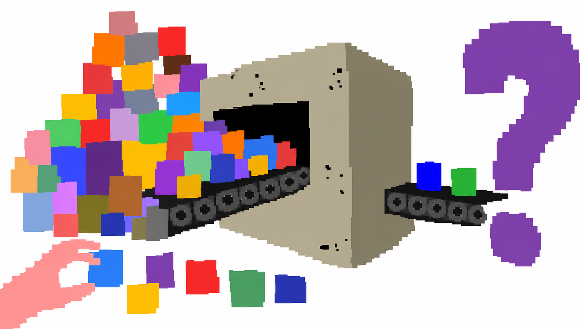

*AI 生成涂鸦：端到端委托只占很小一部分，最终有没有做成仍然未知。*

这份报告只看到了 Google 自家几类产品在两周内的交互。Google Workspace 和 Gemini Enterprise 等场景没进来。一次对话结束后有没有产出、到底省了多少时间，报告也看不到。它更不能推出工资、裁员或净就业会怎么变。

结果就是这样：在 ATLAS 观察到的这批交互里，Gemini 已经出现在很多职业的部分任务中。要说整份工作被它接走，还差得远。

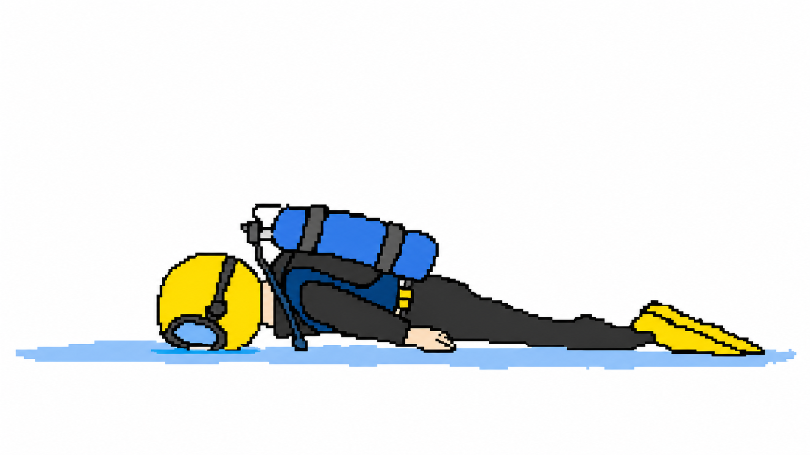

*AI 生成涂鸦：用得很广，但还不深。*

## 我的工作量没少

这和我自己的体感很接近。

AI 给我省时间最多的地方，是资料整理和调研。它可以很快去找一个领域里的相关论文，先总结，再通过对话给我讲。刚进一个陌生领域时，这个帮助很大。我不用一开始就在几十个搜索结果里乱翻。

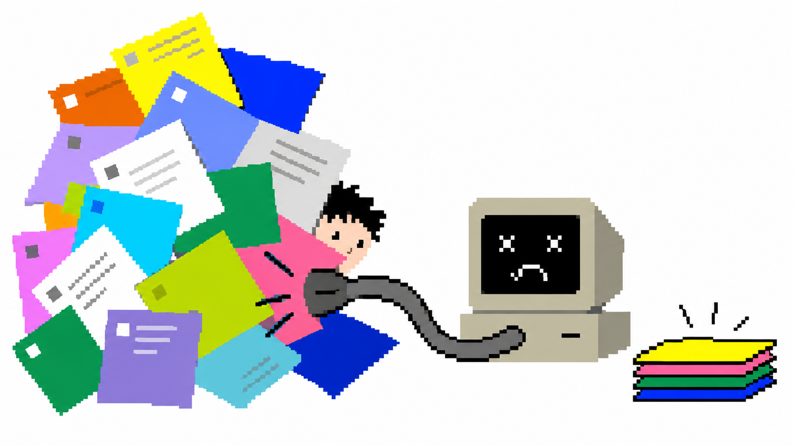

*AI 生成涂鸦：陌生领域里，搜索和粗读的起步时间最先被压缩。*

可它讲完了，事情并没结束。

我还是要回到论文原文。AI 漏了哪个条件，哪篇论文只能支持一个很窄的结论，两组数据到底能不能比，都需要我自己看。我还要不停地和 AI 讨论。它给一个说法，我问反例；它再改，我再看有没有新的问题。

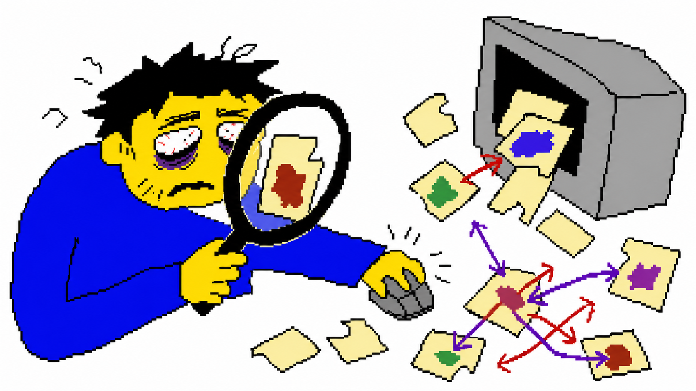

*AI 生成涂鸦：AI 讲完以后，人还得回原文、找遗漏、问反例。*

工作量没少。原来花在搜索和粗读上的时间，现在更多花在追问、核对和做判断上。工作方式确实变了。

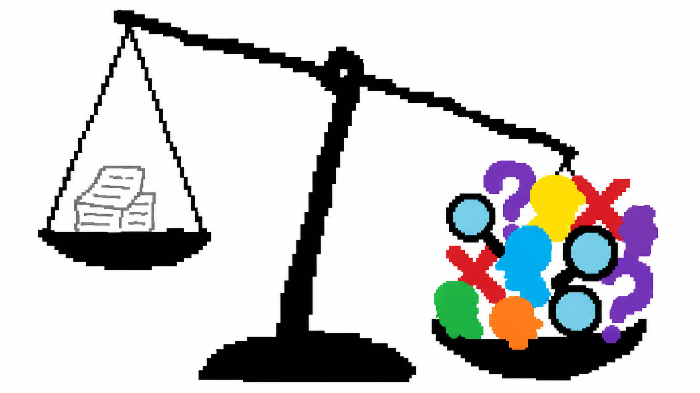

*AI 生成涂鸦：总工作量未必减少，只是从搜索粗读转向追问、核对和判断。*

作图也是这样。Image2 可以快速给我一张视觉草稿，用来看方向是不是对的。但要把草稿变成可发布的图，审美取舍、事实核对、细节修改和版权确认一样都在。至少我现在不觉得完整作图时间被压缩了很多。它是一个不错的草稿工具。

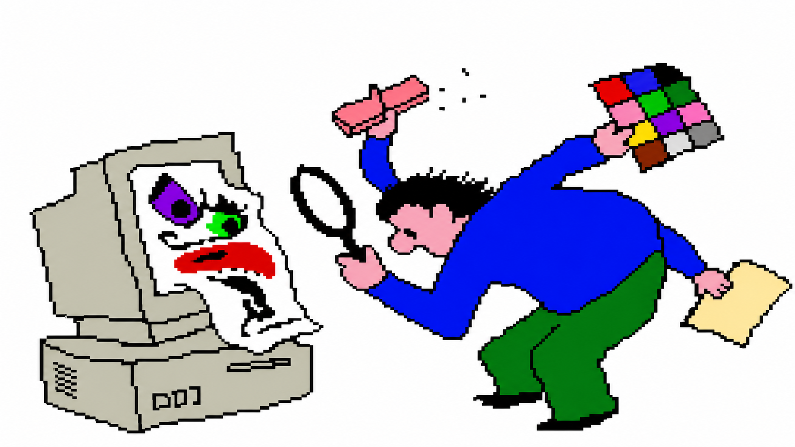

*AI 生成涂鸦：Image2 能很快给草稿，但可发布图片仍要经过审美、事实、细节和版权处理。*

## 公司可能会重新分工作

我对 AI 和就业的理解，也是从这种日常摩擦里慢慢形成的。

拿资料整理来说。以前一个岗位里，可能同时塞着搜索、粗读、核对和写结论。现在前两步快了，公司就可能重新问：这些活还要不要捆在一个岗位里？同样的产出，原来要几个人，现在又要几个人？

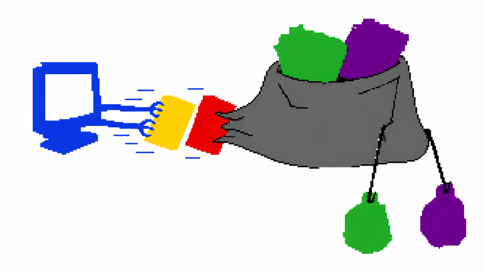

*AI 生成涂鸦：搜索和粗读变快后，原来捆在一个岗位里的任务可能被重新拆分。*

AI 不用把整份工作做完，这些问题也会出现。只要一个环节变快，后面的分工、人数和预算就可能跟着变。

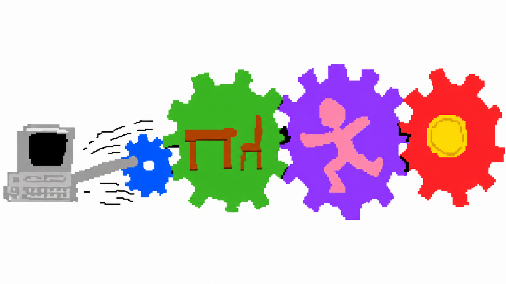

*AI 生成涂鸦：一个环节变快，后面的分工、人数和预算也会跟着重新计算。*

这是我的推断。Patreon 的公开信没有证明它，Google ATLAS 也没有。两份材料彼此独立：ATLAS 没有测量 Patreon，Patreon 也没有公开每项任务里到底用了多少 AI。

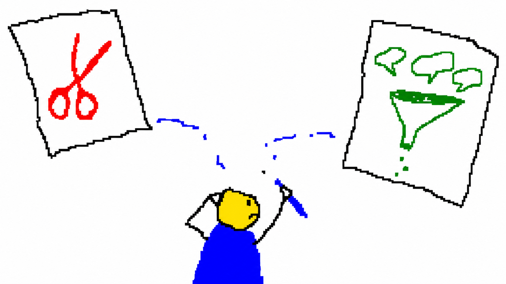

*AI 生成涂鸦：Patreon 与 Google ATLAS 是两份独立材料，不能互相证明。*

沿着旧流程设计、主要工作又刚好是这些环节的岗位，可能会先受影响。这时，公司可能不再愿意为原来的工作组合付同样的钱。

我说的「重新定价」，就是这么回事。公司花在搜索、搬运和转写上的钱可能变少。更多钱可能花在另外几件事上：问题怎么定，来源能不能信，出了问题谁处理。

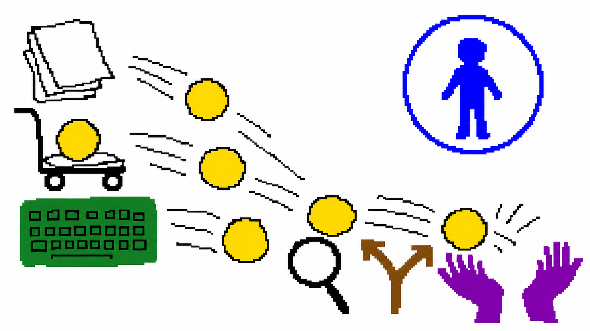

*AI 生成涂鸦：公司可能改变钱花在哪些工作上，但这不是给人的价值定价。*

这和一个人有没有价值，是两回事。一个岗位被取消，不能说明岗位上的人能力变差，更不能替管理层的决定开脱。

## 判断还是得我自己做

至少我不会把判断交给 AI。沟通也一样。

AI 可以帮我起草一段话。但为什么要说、要对谁说、哪些背景不能省、对方的疑问要怎么接，还是人和人之间的事。

它也可以给我十个选项。最后选哪个，选错了怎么办，还是我自己负责。

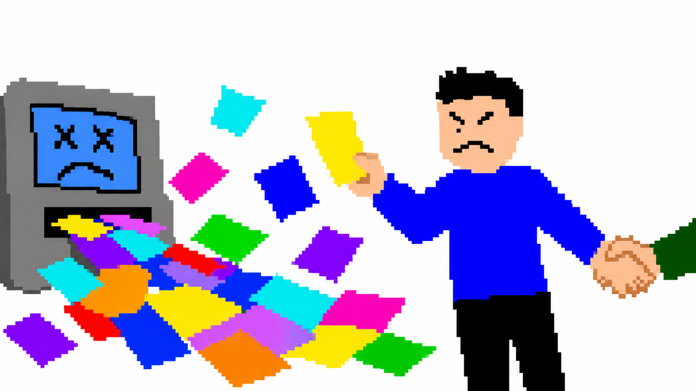

*AI 生成涂鸦：AI 可以给选项，选择、沟通和后果仍由人负责。*

回头再看 Patreon 的两句话，我觉得它们可以同时成立。Patreon 可以认为 AI 还替代不了人，同时承认工作方式已经在变，组织也会受到影响。

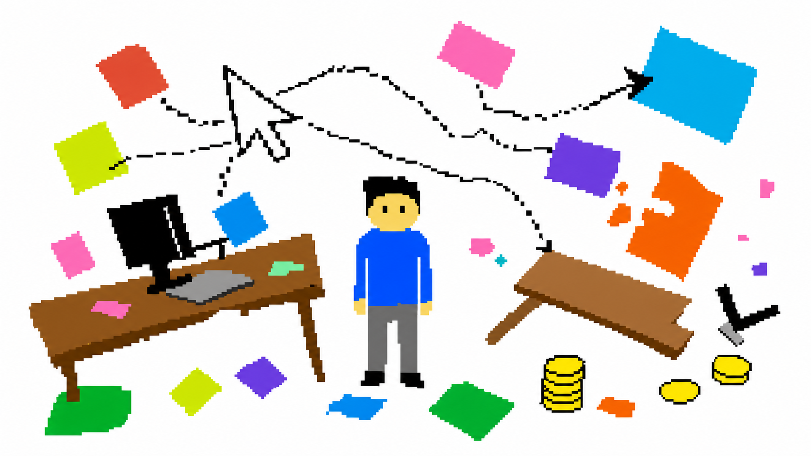

*AI 生成涂鸦：AI 尚未替代完整的人，与职位内部工作已经变化，可以同时成立。*

Patreon 没有给出「AI 导致这次裁员」的证据。可职位名称还在，也说明不了里面的工作一点没变。

我想做的，是让 AI 多接一点找资料、整理资料的活。省下来的时间，我还是会拿去追问、核对，也会拿去和人沟通。可能总工作量并没有少，但做法已经变了。

至于怎么判断、怎么解释、出了问题谁负责，不能跟着交出去。

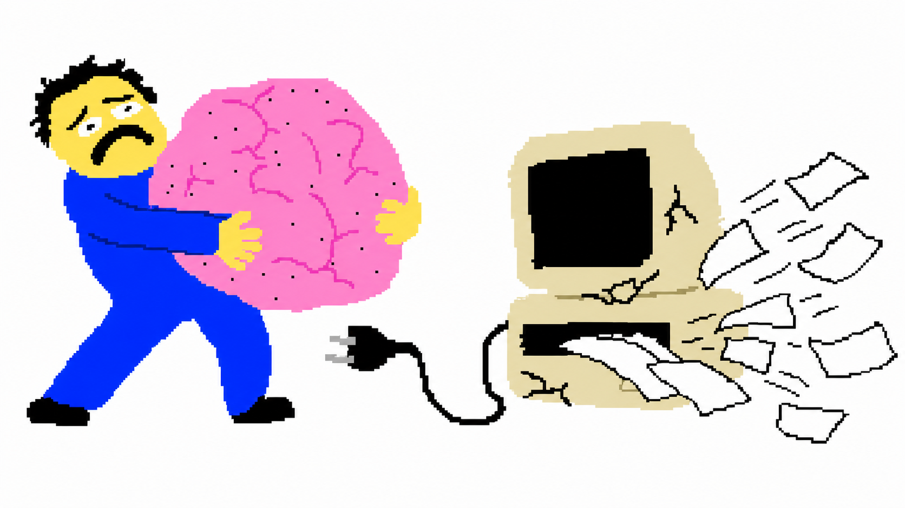

*AI 生成涂鸦：效率可以外接，判断、解释和责任不能一起外包。*

效率可以外接，不可能把脑子外包出去。
