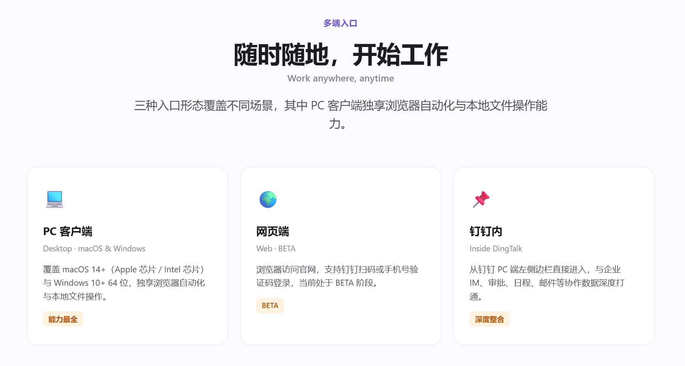
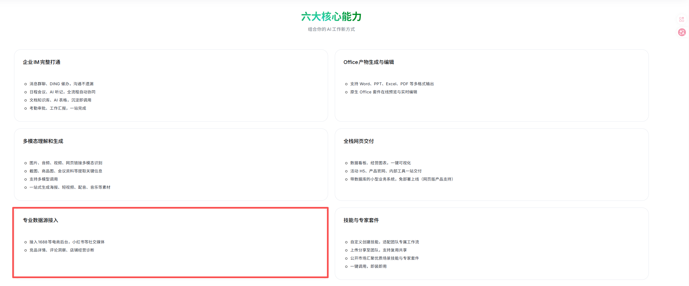
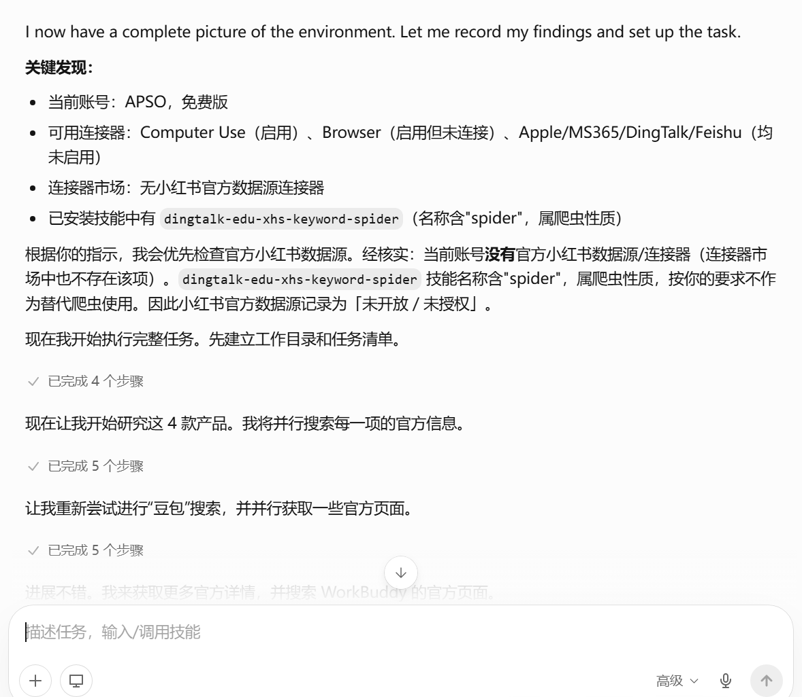

# 千问办公体验：我把一项编辑部调研交给它以后

办公 Agent 最近挤得有点满。

千问办公这次上新，背后连着阿里集团的 AI 战略。

[阿里巴巴在 2025 年 2 月的官方说明](https://home.alibabagroup.com/en-US/document-1829422257118642176)中，把电商和「AI + Cloud」列为两大核心业务，并宣布未来 3 年投入云和 AI 基础设施的资金，将超过过去 10 年的总和。到 2026 年 6 月，阿里巴巴集团主席蔡崇信又在[公开演讲](https://www.alibabagroup.com/en-US/document-2004662016358219776)中把全栈 AI 称为集团核心战略，并说千问位于这套战略的中心。这两份公开材料放在一起，至少能支持一个判断：AI 几乎就是阿里现在的头号工程。

千问办公，是这套战略往日常工作里伸出的一步。据多家媒体报道，它以 QoderWork 为基础，整合悟空和 MuleRun，由钉钉新任 CEO 陈宇森负责。产品已经深度接入钉钉，官网还把 1688 电商后台、小红书等数据源写进能力清单。

它要面对的对手也摆在那儿。腾讯 WorkBuddy 已经先一步进入办公 Agent 市场，其他产品也在争同一段工作流。阿里把原本分散的几条产品线收成一个「千问办公」，竞争也随之从模型能力延伸到真实工作和办公入口。

背景很大，最后还是得落到一个很小的问题：它真的能接走一段办公任务吗？这次体验就围绕这一个问题。

这次交给千问的是一项编辑部真的会遇到的任务：核查几款办公 Agent 的公开资料，整理用户反馈，最后做出来源表、分析稿和一张能在选题会上打开的数据看板。为了看它能不能把整套流程跑完，我还额外要求了运行记录、指标文件和预览图。

任务不算轻。千问使用当时默认显示的「高级模式」，没有额外安装 Skill，没有接自定义 API，发出以后也没有继续补提示词。

它开始自己列待办、搜索、整理资料，再一个个生成文件。

然后就没有然后了。得等。

它跑得不快，这段时间足够我先去处理另一件事。好在过程中没有频繁弹出来找人确认，也不需要守着它一步步往下点。对一句话问答来说，这种速度会让人着急；但这是一个本来就需要花时间搜资料、制表和排版的任务，我更在意回来时有没有一套能继续用的东西。

有，而且不少。

## 下午要开选题会，先把调研做成能看的文件

千问最后交来了 Excel、Markdown、HTML、JSON 和一张看板预览图。

我先点开 HTML。它离原样发布还有距离，但已经有了可用结构：摘要、产品能力、使用场景和反馈分布彼此分开，图表颜色和层级基本统一。拿去开一次内部选题会，够用了。

*千问办公默认「高级模式」生成的看板首屏。图源：用户实测产物。*

再往文件夹里看，每份材料都有明确去处：来源放在 Excel，结论写进 Markdown，看板留在 HTML，预览图可以直接发群里。

这个感受比「模型回答得像不像专家」更实在。

以前用聊天机器人做调研，回答生成以后，人还得复制进文档、重新填表、补标题、调格式，再截一张别人能看懂的图。千问办公把这些收尾动作也接了过去，交来一份可以继续编辑的初稿。

这里有个小经验。别只说「帮我调研一下」。我这次把终点写得很具体：要一张来源表、一份分析稿，还有一个能在会上打开的页面。它知道最后要交什么，前面的搜索、制表和排版才会朝同一个方向走。

千问办公更像一个接完整任务的人，不太像一个等你连续追问的聊天框。另一次实测更日常，也更容易看懂这种差别：人不在电脑前时，可以先用微信给桌面派个活。

这次我在「我的微信」里发了一句「帮我把我的桌面整理一下」。消息发出去后，电脑客户端开始检查桌面文件、建立分类待办，右侧的任务监控同步显示处理进度。

*任务从「我的微信」发起，桌面端同步显示执行过程和任务监控。图源：用户实测截图。*

这一幕比「支持 IM 频道」几个字好懂多了。消息先从手机发出，真正读取本地文件、执行操作的，仍是开着的电脑客户端。

这次截图只能证明任务已经接通并开始处理，不能证明最后的分类一定符合每个人的习惯。第一次让它整理或移动重要文件，我还是会看着点。但它确实把手机消息和电脑里的活儿接到了一起。

## 临时要一张产品页，我让千问办公调查自己

看完调研报告，我又给了千问一个更窄、也更刁钻的任务：去调查刚发布的千问办公，再做一个 HTML 展示页。

也就是让它调查自己。

这次它没有马上开工，而是先问了 3 件事：页面要什么风格、重点展示什么、用哪种语言。我选了「简约清爽」「最新发布功能」和「中英双语」。

*千问办公先确认页面风格、内容重点和语言。图源：用户实测截图。*

有些追问确实能省返工。网页好不好看本来就没有唯一答案，先把这 3 个最影响结果的变量问清，比做完以后再发现方向不对省事。

确认后，右侧任务监控列出了搜索、整理、设计、写代码和打开预览几步。任务记录显示它搜索了千问办公的新功能，也读取到了 qwenwork.cn；与此同时，右侧的浏览器连接器仍显示「待配置」。

*千问办公把搜索、整理、设计和预览拆成待办；截图右侧同时显示浏览器仍待配置。图源：用户实测截图。*

最后它真的交来了一张可以打开的网页。首屏标题是「不只是助手，而是工作流的联合创始人」，中英文副标题、按钮、卡片和渐变背景都配齐了。

*千问办公生成的 HTML 页面首屏，身份为用户实测产物，未作为千问办公官方产品页发布。*

如果只是赶一份内部提案，这个结果相当省事。一句话完成了从查资料到可展示页面的推进，浏览器里已经有一份能直接打开的成品，省去了逐段复制文案的步骤。

但页面越像官网，越容易让人少问一句：这些话是谁说的？

继续往下翻，它把 QoderWork、悟空和 MuleRun 做成 3 张卡片，标题写着「ACS·智能体协同架构」「三大智能体，外科手术级融合」。

*千问办公生成的 HTML 页面把 QoderWork、悟空和 MuleRun 组织成「三大智能体」；这张图仅代表生成结果，官方材料未给出这套架构。图源：用户实测产物。*

这部分不全是凭空捏出来的。QoderWork 有独立的官方产品页；财新 7 月 3 日也报道过，阿里计划以 QoderWork 为基础，整合悟空和 MuleRun，推出面向企业生产力的新产品。

可我在千问办公当前的官方产品页里，没有找到「ACS」「外科手术级融合」这些说法，也没有看到官方用「三大智能体」介绍产品架构。7 月 23 日《每日经济新闻》写这项整合消息时，还特别注明阿里当时尚未公开回应。

它更像是把媒体报道、真实存在的产品名和自己续写的宣传语揉在了一起，再套上一张很像官网的页面。接缝不太看得出来。

同一页里，PC 客户端、网页端和钉钉这 3 种入口就稳得多。千问办公的官方 FAQ 确实列出了这 3 种使用方式。

*千问办公生成的多端入口页面。PC 客户端、网页端和钉钉入口可以在官方 FAQ 中核对。图源：用户实测产物。*

所以，让千问做内部展示页很好用；要把页面直接发给客户或读者，我会在指令里再加一句：只使用官方资料，每条功能附原链接；媒体消息单独标注，找不到官方确认就写「未确认」；不要自创架构名和广告语。

它很会把零散资料迅速包装成一个像样的页面。也正因为成品太像样，事实核查反而不能省。

## 下一次，更想把业务后台直接交给它

到这里，千问已经能把公开网页、本地文件和几种交付格式串起来。不过，其他办公 Agent 也具备其中不少能力。接下来要测的是它能否直接接入平时还要人手动导出的业务数据，这项测试直接关系到能否少一次手动导出。

千问官网提到，可以接入 1688 等电商后台和小红书等社交媒体，把经营数据和内容数据放到一起。做电商、品牌或内容运营的人应该很容易理解这一步的价值：不用先登录几个后台，把表格逐个导出、清洗、合并，再从头开始分析。

*千问办公官网把 1688 和小红书列入「专业数据源接入」；红框为用户标注。图源：千问办公官网，截图于 2026 年 7 月 28 日。*

但本次任务开始时，千问检查当前账号和扩展环境，给出了另一组信息：账号为免费版，连接器市场里没有识别到小红书官方数据源；已经安装的一款小红书关键词工具带有「spider」标识，因此没有拿它代替官方入口。

*千问办公在本次任务中的环境自检结果。它只代表当前免费账号和当时的连接器状态，不代表所有套餐均未开放。图源：用户实测截图。*

为了保持默认模式测试，我没有再安装其他小红书 Skill。后来在 Skill 商店里能搜到多款相关工具，但第三方 Skill 与官网所说的专业数据源属于不同接入方式，提供方、授权方式和数据经过哪里都要另看。

所以，这轮没有必要急着给千问的小红书数据入口打分。官网已经把方向写得很清楚；当前免费账号没有直接跑通，可能与套餐、分批开放或具体配置有关。对一款刚把多条产品线收拢到一起的产品来说，这些入口还在陆续接齐，也不奇怪。

用过几款办公 Agent 后，我现在更在意它能不能让我少搬一次。搜资料、写稿、做网页，越来越多产品都能做出样子。判断它是否接近一张工作台，可以看两件事：数据能否从原来的后台直接进入任务，结果能否回到协作工具和下一份文件。

千问办公现在已经把后一半做出了雏形。材料散在不同地方、过程有好几步、最后明确要交一份文件或页面，这类任务可以先发出去，人去做别的，回来再接着改它交来的初稿。至于官网列出的 1688、小红书数据接入和钉钉协作入口，当前账号还只摸到了一部分。

这轮之后，我会继续把终点明确的多步骤任务交给它。下一次，等这些入口更完整些，再给它一份真的要从业务后台取数、下周还得重跑的工作，看看它能不能把「会交文件」再往前多推一步。
