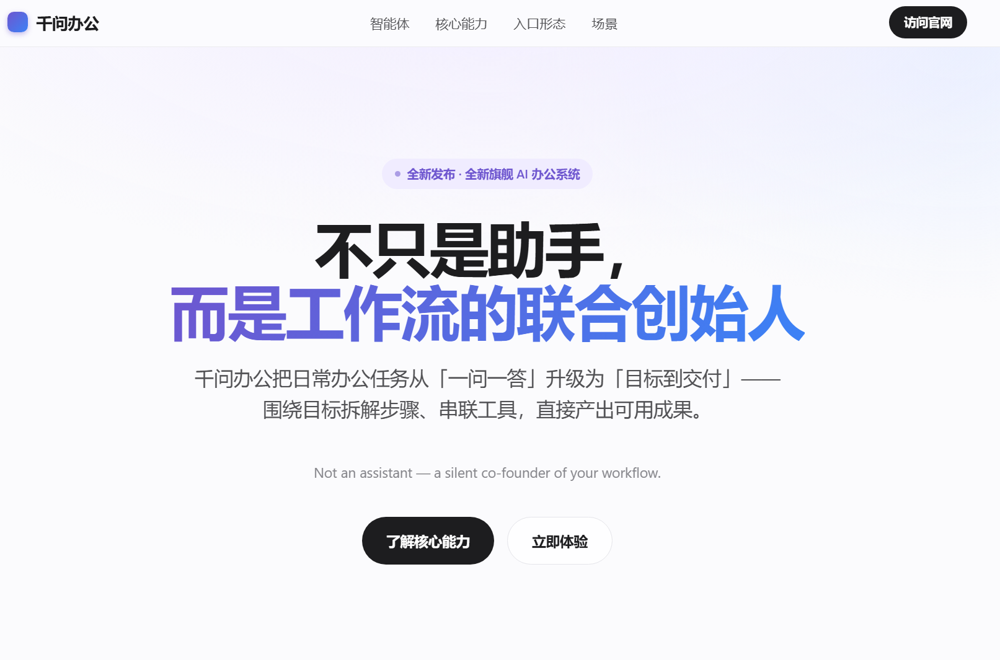

# 千问办公体验：一项编辑部调研，最后交回了什么

任务结束后，千问办公在工作区留下了 Excel、Markdown、HTML、JSON 和一张看板预览图。

我没有先看它在对话框里写了多少字，直接逐个打开文件。来源表能筛选，分析稿能继续改，看板能在浏览器里运行，预览图可以发到选题群。几份材料各有用途，放在一起才算完成了这项调研。

办公 Agent 已经会写文案、做表格、生成网页，产品介绍看起来也越来越接近。把一件编辑部的活完整交出去，回来时能拿到什么，差别会清楚一些。

我给千问办公的任务是：核查几款办公 Agent 的公开资料，整理用户反馈，做一张来源表、一份分析稿和一个选题会上能直接打开的数据看板。为了便于验收，我还要求它保留运行记录、指标文件和预览图。

测试使用当时默认显示的「高级模式」，没有安装额外 Skill，没有接自定义 API。任务发出后，我也没有追加提示词。

千问先列待办，再搜索、整理资料、写文件、做页面。之后就得等。

它跑得不快。这段时间足够我去处理另一件事，回来时任务还在继续。好处是过程中很少找人确认，也没有要求我守着每一步操作。用它问一句简单问题会显得拖沓；这类搜资料、制表、排版都要做的长任务，等待还能接受，前提是结束后确实留下可用产物。

## 文件已经能进选题会

我先打开 HTML 看板。页面离公开发布还有距离，但摘要、产品能力、使用场景和反馈分布已经分开，图表颜色和信息层级也能看。拿去做一次内部讨论，基本够用。

*千问办公默认「高级模式」生成的看板首屏。图源：用户实测产物。*

文件夹里的分工也很直接：Excel 保存来源，Markdown 承载分析，HTML 用于展示，预览图方便快速转发。以往在聊天机器人里做完调研，后面还要复制到文档、重新填表、补标题、调格式。千问办公把这些收尾动作放进了同一个任务，交来一组可以继续修改的初稿。

任务指令要写清终点。我没有只说「帮我做调研」，而是列明来源表、分析稿和可打开页面。交付形式固定下来后，搜索、制表和排版才有同一个去向。

千问办公的[官方帮助中心](https://qwenwork.cn/docs/getting-started/basic-workflow)也建议把目标、输入、要求和交付形式写进指令，并提醒用户验收数字、日期、人名、来源以及文件可编辑性。这个建议和本次体验对得上。

## 手机发出的消息，电脑开始干活

另一次实测更短。我在「我的微信」里发了一句：「帮我把我的桌面整理一下。」

消息送达后，电脑客户端开始检查桌面文件、建立分类待办，右侧任务监控同步显示进度。

*任务从「我的微信」发起，桌面端同步显示执行过程和任务监控。图源：用户实测截图。*

这张截图能证明微信与桌面任务已经接通。它还不能证明最后的分类符合用户习惯，也不能替代移动重要文件前的检查。第一次让它整理工作目录，我仍会盯住目标文件夹和移动范围。

千问办公当前的[官方 IM 文档](https://qwenwork.cn/docs/desktop/im-channels)列出了钉钉、飞书、Lark、微信、企业微信、Slack 和 WhatsApp。任务从哪个聊天窗口发出，结果会回到同一窗口；桌面端保留进度查看、配置和人工接管。对临时取文件、跑一份固定报告、把结果发回群里等任务，这种配合方式有明确用途。

## 页面做得越完整，来源越要逐句看

调研任务结束后，我又让千问办公调查刚发布的千问办公，并生成一张中英双语的 HTML 展示页。

它先问了页面风格、内容重点和语言。我选择「简约清爽」「最新发布功能」和「中英双语」。这 3 个问题都直接影响页面结果，提前确认确实减少了后续改版。

随后，任务监控列出搜索、整理、设计、写代码和打开预览。最终页面可以在浏览器里运行，首屏有渐变背景、按钮和内容卡片，标题写着「不只是助手，而是工作流的联合创始人」。

*千问办公生成的 HTML 页面首屏。它是用户实测产物，没有作为官方产品页发布。*

用它赶一份内部提案很省步骤。资料搜索结束后，浏览器里已经有了一张能展示的页面，不需要再把文案逐段搬进网页模板。

页面第二屏开始介绍 QoderWork、悟空和 MuleRun，把它们写成 3 张卡片，还用了「ACS·智能体协同架构」「三大智能体，外科手术级融合」等名称。

QoderWork 有官方产品页。媒体也报道过阿里计划以 QoderWork 为基础整合悟空和 MuleRun。可在本次核查的千问办公官方产品页里，我没有找到「ACS」或「外科手术级融合」两种说法，也没看到官方使用「三大智能体」介绍当前架构。

生成页面把真实产品名、媒体报道中的整合线索和自行续写的宣传文案放在了一起。页面样式很完整，几类信息的接缝却不显眼。

因此，对外使用时还要加一轮来源约束：功能只取官方材料并附原链接；媒体消息单列；没有官方确认的内容明确标成「未确认」；产品架构名和广告语不得自行补写。千问能省掉页面制作时间，事实责任仍留在发布者手里。

## 官网写了业务数据，当前账号还没跑通

千问办公官网目前把 1688 电商后台、小红书等社交媒体列入「专业数据源聚合与接入」，并把竞品详情、评论洞察和店铺经营诊断列为使用方向。对电商、品牌和内容运营来说，这项能力很具体：业务数据若能直接进入任务，人工导出、清洗和合表会少一轮。

本次免费账号没有完成这项验证。环境自检没有识别到身份明确的小红书官方数据源；Skill 商店虽然能搜到相关工具，其中一款来自第三方并需要本地服务、扫码登录和 Cookie。它与官网所称专业数据源的提供方、授权和数据路径都不同。

目前只能确认两件事：官网已经公开宣传这类数据入口；当前账号和默认环境没有直接用上。套餐、分批开放和配置要求仍需后续核查。

经过这几项任务，我会把千问办公先用在终点明确、步骤较多、最后需要交文件或页面的内部工作。它可以把搜索结果继续做成表格、文字和网页，人在等待期间去处理别的事。材料准备对外发送时，来源表和页面文案仍要逐项复核。

下一轮测试会更贴近日常业务：从一个已经授权的数据后台取数，生成固定报告，再把同一任务安排到下周重跑。数据能否直接进入、失败后能否看见原因、结果能否回到协作工具，决定了这套流程可以省下多少手工搬运。

<!--
candidate_meta:
  route: "交付物路线；按任务发出、等待、打开文件、核查页面、寻找数据入口的时间顺序推进"
  observed_evidence:
    - "用户实测生成文件与截图"
    - "2026-08-03 复核的千问办公官网、Web 使用指南和 IM 文档"
  author_inference:
    - "终点明确的多步骤内部任务更适合当前产品形态"
  preserved_unknowns:
    - "长期稳定性"
    - "当前免费账号以外的专业数据源开放范围"
    - "桌面整理最终质量"
  pragmatic_selfcheck:
    inspected_locations: ["首屏判断", "页面事实转折", "结尾"]
    repaired_sentence: "千问办公把这些收尾动作放进了同一个任务，交来一组可以继续修改的初稿。"
    repair_reason: "直接交代被减少的复制、填表和排版动作，删除抽象价值宣告。"
    result: pass
  lexicon_scan:
    result: pass_with_narrow_waiver
    waiver:
      entry_ids: ["WX-EXPR-014", "WX-EXPR-015"]
      sentence: "不只是助手，而是工作流的联合创始人"
      type: "用户实测生成页原文"
      information_task: "展示生成页面如何使用宣传性文案，为随后核查官方来源提供具体对象"
      approval_basis: "qwenwork-hands-on:FB-032"
  full_human_voice_pass: not_run_candidate_stage
-->
