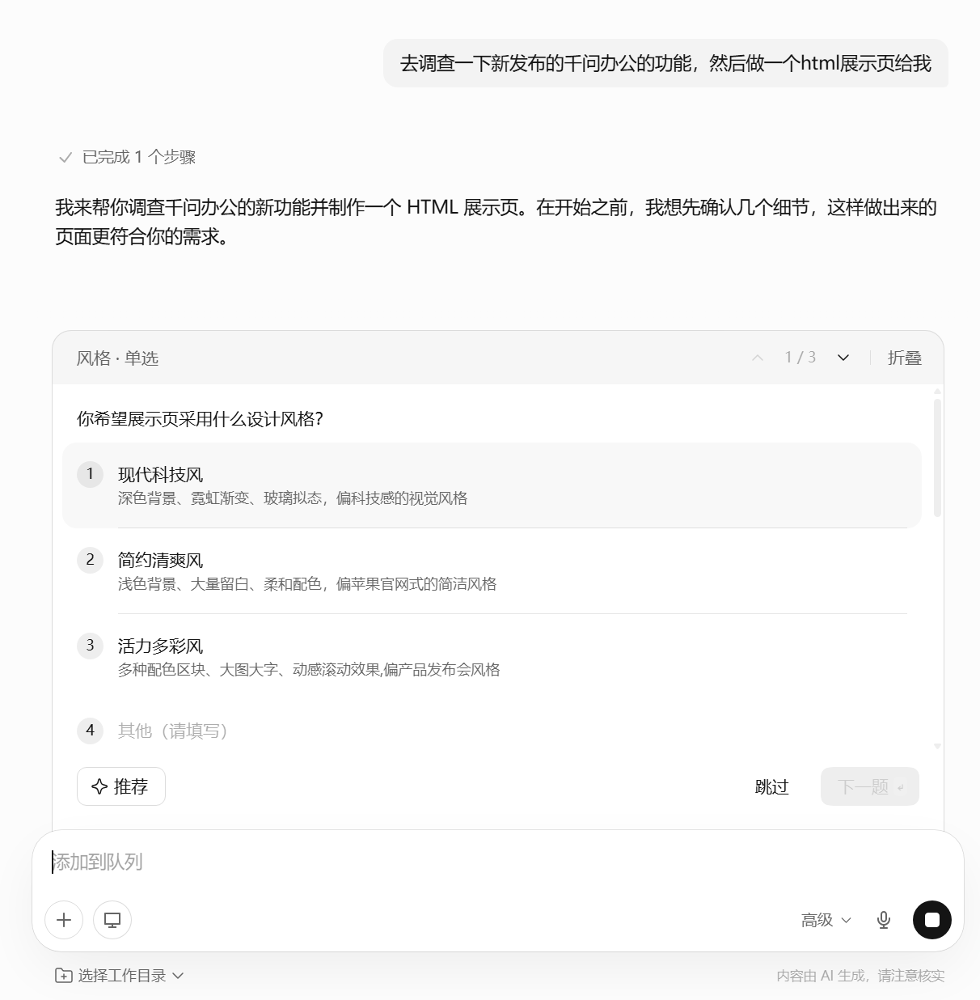
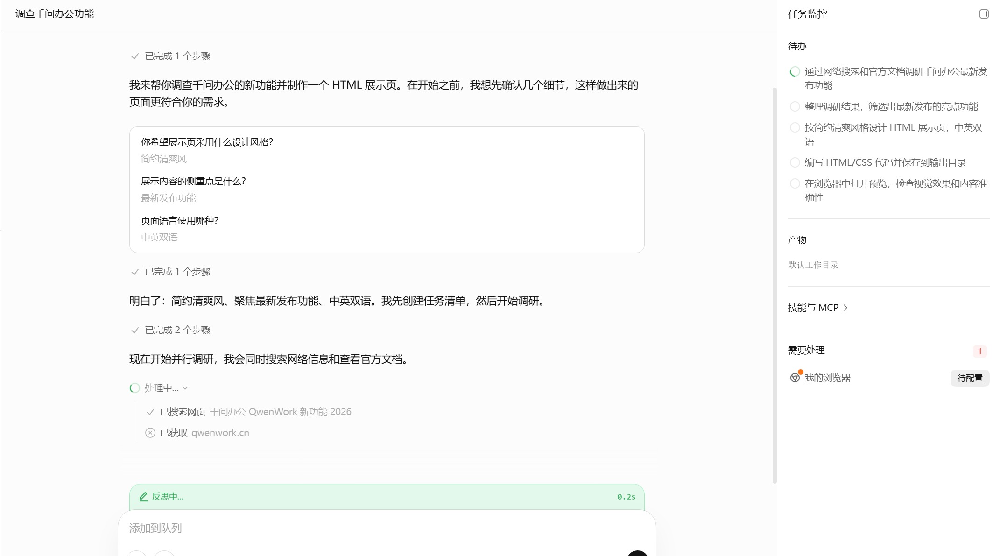
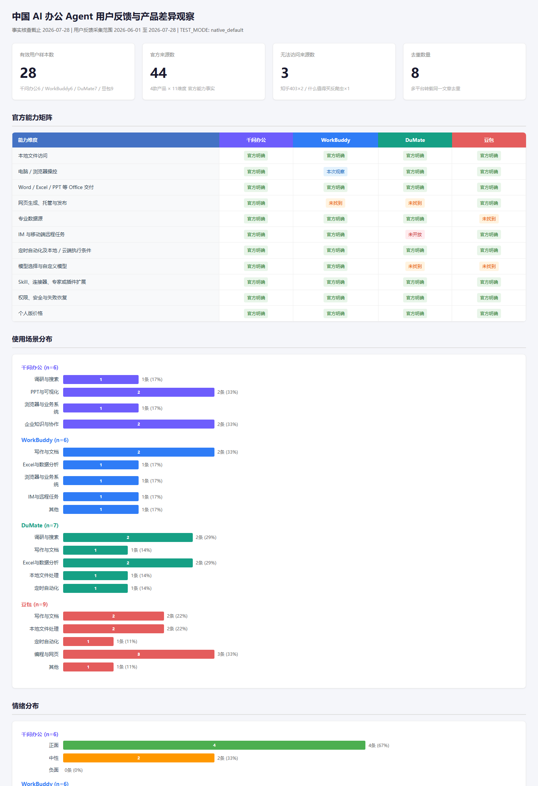

# 千问办公做了一张很像官网的网页，我先查了它的文案

千问办公把页面交回来时，首屏已经配好了渐变背景、按钮、卡片和中英文副标题。

标题也很像一条成熟的产品口号：「不只是助手，而是工作流的联合创始人。」

再往下翻，QoderWork、悟空和 MuleRun 被放进 3 张产品卡片。页面给这组关系起了两个名字：「ACS·智能体协同架构」「三大智能体，外科手术级融合」。

我看到这里，先停下网页预览，打开了千问办公和 QoderWork 的官方产品页。

QoderWork 确实存在。财新在 7 月 3 日报道过，阿里计划以它为基础，整合悟空和 MuleRun，推出面向企业生产力的新产品。《每日经济新闻》后来也报道了这条整合消息，并注明阿里当时尚未公开回应。

可是，本次核查的千问办公官方页面没有出现「ACS」和「外科手术级融合」，也没有用「三大智能体」解释当前产品架构。

生成页面使用了几块可靠材料：真实存在的产品名、媒体报道中的整合线索、官方列出的电脑端、网页端和钉钉入口。它又补上了产品架构名和宣传文案。全部内容被同一种视觉包在一起，读者很难只凭页面样式看出哪句话来自哪里。

千问把零散资料做成了可以展示的页面。它进入对外环节前，发布者还要逐句确认来源层级。

## 做网页前，它先问了 3 个问题

这项测试的指令很短：调查刚发布的千问办公，做一张 HTML 展示页。

千问没有立刻开始写代码。它先问页面风格、展示重点和语言。我选择「简约清爽」「最新发布功能」和「中英双语」。

*页面制作前，千问办公确认风格、内容重点和语言。图源：用户实测截图。*

这几次追问有用。网页的配色、信息密度和语言版本都没有唯一答案，提前确认能省掉一次整体返工。

确认后，右侧任务监控出现了搜索、整理、设计、写代码和打开预览等步骤。任务记录显示它访问过 qwenwork.cn；同一界面里的浏览器连接器仍显示「待配置」。

*任务监控列出搜索、整理、设计和预览步骤；浏览器连接器当时仍显示待配置。图源：用户实测截图。*

页面最终可以直接在浏览器中打开。内部提案如果临时缺一张产品页，这套流程能省去搜索资料、写文案、搭结构和调样式之间的多次切换。

样式越接近正式官网，越容易让人默认文案也经过了同等级别的确认。本次生成结果已经给出一个具体反例：几条可核事实旁边，出现了官方页中没有找到的架构名称。

若要把这类页面发给客户或读者，我会把来源规则直接写进任务：产品能力只引用官方材料，每一项附原链接；媒体报道放在单独区域；没有官方回应的消息标明状态；页面不得补写架构名和广告语。

## 同一套能力，也能交回一整组调研文件

网页测试之前，我还给千问办公做过一项更完整的编辑部任务。

输入是一组公开资料，目标是核查几款办公 Agent、整理用户反馈，并生成来源表、分析稿和数据看板。我还要求保留运行记录、指标文件和预览图。测试用默认显示的「高级模式」，没有额外安装 Skill，也没有接自定义 API。

任务发出后，千问自己拆待办、搜索和写文件。它花的时间不短，期间很少要求人工确认。我可以去做别的工作，过一阵再回来查看。

结束时，工作区里有 Excel、Markdown、HTML、JSON 和看板预览图。

*千问办公生成的数据看板首屏。图源：用户实测产物。*

HTML 已经能用于内部选题会。Excel 里放来源，Markdown 里放分析，预览图可以快速发给同事。过去在聊天框里完成研究后，复制到文档、填进表格、整理成页面的工作仍要自己做；这次几个交付格式在一个任务里生成。

任务写法会直接影响这部分体验。只说「调研一下」，千问可能交来一篇长回答。明确写出来源表、分析稿和可打开网页，它的搜索与整理才围绕可验收文件展开。官方的[Web 端使用指南](https://qwenwork.cn/docs/getting-started/basic-workflow)也把目标、输入、要求和交付形式列为一条清楚指令的组成部分。

文件生成后仍有两层工作留给人。先检查能否打开、编辑和下载，再核对数字、日期、人名、来源与结论。千问官方帮助中心也把这几项写进验收建议。产品自己承认需要验收，使用者就不该把精致页面当作核查证明。

## 手机入口把任务送到桌面，结果质量仍需验收

千问办公还有一段很直观的配合方式。我从「我的微信」发送「帮我把我的桌面整理一下」，电脑客户端随即开始检查文件、建立分类待办，任务监控同步显示进度。

这个画面证明手机消息已经触发桌面任务。当前证据没有覆盖最终分类结果。涉及移动、覆盖或删除的重要文件时，用户仍应限定目录和操作范围，并在执行前后检查。

官方 [IM 文档](https://qwenwork.cn/docs/desktop/im-channels)目前列出钉钉、飞书、Lark、微信、企业微信、Slack 和 WhatsApp。消息从某个窗口发出，结果会回到同一窗口；桌面客户端还能查看进度和人工接管。

对于临时取文件、生成固定报告或把结果回传群聊的工作，手机入口减少了回到电脑前重新描述任务的步骤。任务准确性和文件安全没有因此自动提高，两件事仍要分别验收。

## 官网宣传的数据入口，本次账号没有跑通

千问办公官网把 1688 电商后台、小红书等社交媒体写进专业数据源能力，并列出竞品详情、评论洞察和店铺经营诊断等方向。业务数据如果能直接进入报告，运营人员可以少做一次导出、清洗和合表。

本次免费账号没有跑通这项能力。环境自检没有找到身份明确的小红书官方数据源；Skill 商店中的相关工具带有第三方提供方和独立授权要求。它们不能替代官网所称入口的实测。

目前可以确认的是官网主张和当前账号状态，两者之间还有套餐、开放范围和配置步骤需要核查。

这一轮之后，我仍会把内部调研、提案页面和多格式材料交给千问办公。任务的终点要写清，来源层级也要同时写清。它交来的文件可以缩短整理时间；公开发送前，编辑仍要打开来源表，把页面上每句像官方文案的话查一遍。

下一次测试会直接使用一份已经授权的业务数据，让千问生成固定报告并在下一周重跑。到那时，评价对象会从「页面做得是否完整」转到更朴素的几件事：数据有没有进来，失败位置能不能看见，第二次执行还要不要重新搬文件。

<!--
candidate_meta:
  route: "事实接缝路线；从生成网页中的未确认架构文案进入，再倒查页面生成过程与产品适用范围"
  observed_evidence:
    - "千问办公自我调研页面与任务过程截图"
    - "用户实测调研文件"
    - "官方产品页、Web 使用指南与 IM 文档"
  author_inference:
    - "视觉完成度会提高公开材料的来源核查成本"
  preserved_unknowns:
    - "专业数据源的套餐与开放范围"
    - "周期任务稳定性"
  pragmatic_selfcheck:
    inspected_locations: ["首屏停顿", "来源核查判断", "结尾"]
    repaired_sentence: "全部内容被同一种视觉包在一起，读者很难只凭页面样式看出哪句话来自哪里。"
    repair_reason: "写清视觉一致性造成的具体辨别困难，不宣布抽象张力或洞察。"
    result: pass
  lexicon_scan:
    result: pass_with_narrow_waiver
    waiver:
      entry_ids: ["WX-EXPR-014", "WX-EXPR-015"]
      sentence: "不只是助手，而是工作流的联合创始人"
      type: "用户实测生成页原文"
      information_task: "作为本篇事实核查起点，展示生成页面使用的原始宣传文案"
      approval_basis: "qwenwork-hands-on:FB-032"
  full_human_voice_pass: not_run_candidate_stage
-->
