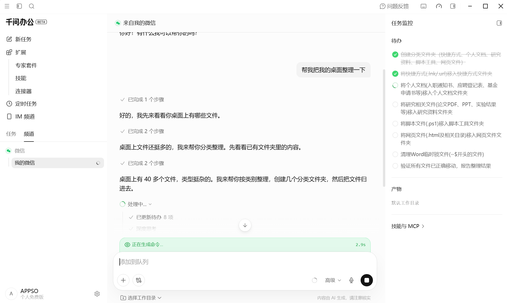
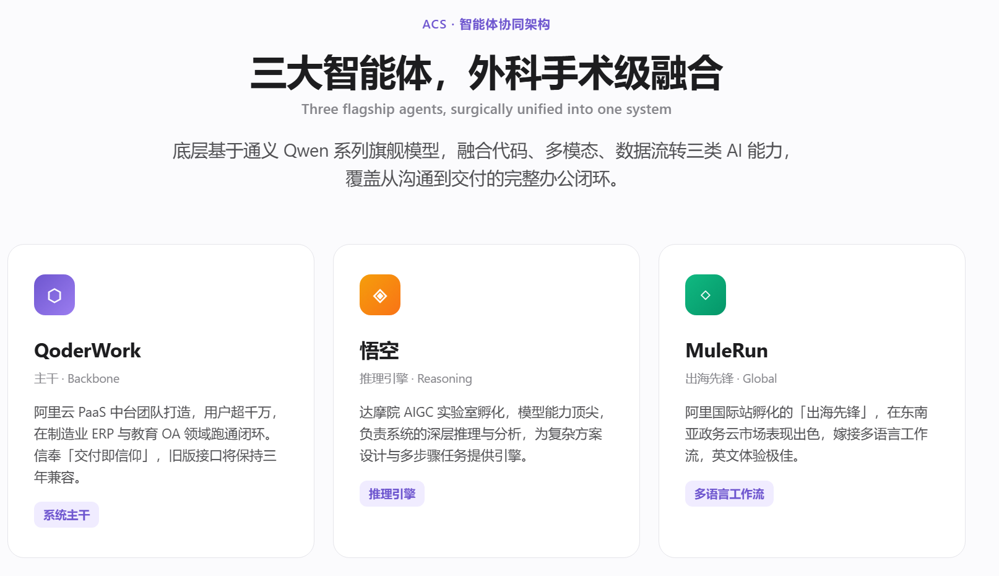

# 千问办公值不值得装，先看它能让你少搬几次文件

我在微信里发了一句：「帮我把我的桌面整理一下。」

消息发出后，电脑上的千问办公开始检查桌面文件，右侧任务监控列出分类待办。指令来自手机入口，任务已经到了电脑客户端。

*任务从「我的微信」发出，桌面端开始执行并显示监控信息。图源：用户实测截图。*

这次截图记录到任务启动，没有记录最终整理结果。我还不能说它把桌面收拾好了。涉及重要文件时，我也不会让任何 Agent 在没有限定目录和操作范围的情况下随便移动。

工作里浪费时间的地方，经常发生在两个环节之间：手机收到消息，再回电脑找文件；网页查完资料，再复制进表格；表格做完分析，再搬进汇报页面；下周重做时，又把前面的动作走一遍。

一款办公 Agent 能省多少事，可以沿着这些交接点去看。

## 从手机到电脑，任务已经能传过去

千问办公的[官方 IM 文档](https://qwenwork.cn/docs/desktop/im-channels)列出钉钉、飞书、Lark、微信、企业微信、Slack 和 WhatsApp。消息从哪个聊天窗口发出，处理结果会回到同一个窗口；桌面端仍能查看任务进度、调整配置或人工接管。

这套设计很适合临时发生的工作。人在外面，突然需要电脑里的最终版文件；开会期间，想让电脑先整理一批附件；群里来了固定格式的数据，希望生成一份报告再发回去。消息入口和执行端分开，用户少了一次坐回电脑前重新描述任务的动作。

它没有消除权限和安全问题。微信端发出一句模糊指令，桌面端可能面对几百个文件。第一次使用时，目录、允许的动作和禁止覆盖的文件都要写清。现有证据也只支持「任务已接通」，最终分类仍需验收。

本次测试证明手机入口已经接通。文件处理能走多远，要看更重的任务。

## 从公开资料到一组文件，少了复制和排版

我交给千问办公一项编辑部调研：核查几款办公 Agent 的公开资料，整理用户反馈，生成来源表、分析稿和一个选题会上能打开的数据看板。为了检查过程，我还要求运行记录、指标文件和预览图。

测试使用默认显示的「高级模式」，没有额外安装 Skill，也没有接自定义 API。指令发出以后，我没有继续补充要求。

千问自己列待办、搜索、整理、制表和写页面。执行时间不短，但过程中很少打断我。等它运行时，我可以处理另一件事。

回来后，工作区里有 Excel、Markdown、HTML、JSON 和一张看板预览图。HTML 可以直接在浏览器里打开，摘要、产品能力、场景和反馈分布已经分区；Excel 保存来源；Markdown 承载分析；预览图能快速发进选题群。

*千问办公默认「高级模式」生成的看板首屏。图源：用户实测产物。*

这组文件离公开发布还有距离，用于内部选题会已经省掉不少整理工作。聊天框里的研究结果通常还要复制到文档、重建表格、补图表、搭页面。千问把这些格式放在同一项任务里生成，人从「搬材料」转到「检查材料」。

任务终点要写得足够具体。我列明了来源表、分析稿和可打开页面，它才知道搜索结果要分别进入哪里。千问官方的 [Web 端指南](https://qwenwork.cn/docs/getting-started/basic-workflow)也把目标、输入、要求和交付形式列为指令要素，并要求用户验收事实和可编辑性。

到这一段，千问确实少了一轮复制、制表和排版。下一处交接更难：文件做得很完整，里面的事实能否直接使用？

## 从资料到展示页，页面完成了，来源还要人来分

我又让千问办公调查刚发布的千问办公，并制作一张简约清爽、聚焦新功能的中英双语 HTML 页面。

它先确认页面风格、展示重点和语言，然后把搜索、整理、设计、写代码和打开预览列成待办。最后交回的页面有渐变背景、按钮、卡片和双语文案，浏览器打开后已经接近一份内部提案。

页面往下介绍 QoderWork、悟空和 MuleRun，并给三者加上「ACS·智能体协同架构」「三大智能体，外科手术级融合」等名称。

QoderWork 有官方产品页。媒体也报道过以 QoderWork 为基础整合悟空和 MuleRun 的计划。可在本次核查的千问办公官方页面里，没有找到「ACS」和「外科手术级融合」，官方也没有用「三大智能体」解释当前架构。

*生成页面使用了媒体报道中的产品整合线索，也加入了本次未在官方页找到的架构文案。图源：用户实测产物。*

资料、文案和网页样式已经被搬到一起，来源层级没有随之自动整理好。真实产品名、媒体报道和自行生成的宣传语共用一套卡片设计，打开页面的人很难快速识别边界。

内部提案可以继续用这份初稿，对外页面需要加一项明确约束：官方能力附原链接，媒体消息单独标注，没有官方确认的内容保留状态，产品架构名和广告语不自行补写。页面制作交给千问，来源判断由编辑验收。

## 从业务后台到报告，本轮还没有省下导出步骤

千问办公官网目前宣传可接入 1688 等电商后台和小红书等社交媒体，聚合经营与内容数据。数据分散在几个后台时，人要登录、导出、清洗、合表，分析才刚开始。

本次免费账号没有直接使用到身份明确的小红书官方数据源。环境自检未找到对应连接器；Skill 商店里能搜到第三方工具，其中一款需要安装本地服务、扫码登录并保存 Cookie。第三方工具有自己的提供方、授权方式和数据路径，不能记作官网专业数据源已经跑通。

当前测试停在官网主张和账号状态之间。套餐、分批开放和配置方式都有可能影响结果，还要拿一份经过授权的业务数据继续测。

目前，千问办公已经减少了两种手工搬运：手机消息可以触发桌面任务，调研资料可以直接变成几种可编辑文件。它还没有替编辑完成来源分层，本次账号也没有省掉业务数据的人工导出。

我会继续把终点明确的长任务交给它，比如内部调研、选题材料、带表格和网页的阶段汇报。公开材料在发送前查来源，文件操作先限定范围。

下一次，我会给它一份真实授权的数据，让它从后台取数、生成固定报告，并在下一周执行同一任务。第二次还能跑通，错误位置能看见，结果能回到原来的协作窗口，这项工作才算少搬了完整的一趟。

<!--
candidate_meta:
  route: "手工搬运路线；持续检查手机、桌面、调研文件、展示页和业务数据之间减少了哪次人工转交"
  observed_evidence:
    - "微信触发桌面任务截图"
    - "编辑部调研产物"
    - "千问办公自我调研页面"
    - "官方 IM、Web 使用与专业数据源页面"
  author_inference:
    - "以交接动作衡量办公 Agent，比功能菜单更贴近日常使用选择"
  preserved_unknowns:
    - "桌面整理最终质量"
    - "专业数据源实际开放范围"
    - "周期任务复跑稳定性"
  pragmatic_selfcheck:
    inspected_locations: ["首屏动作", "贯穿全文的搬运尺度", "末段下一轮测试"]
    repaired_sentence: "资料、文案和网页样式已经被搬到一起，来源层级没有随之自动整理好。"
    repair_reason: "同一句交代已完成动作和遗留责任，删去抽象价值标签。"
    result: pass
  lexicon_scan:
    result: pass
    inspected: ["标题", "小标题", "全部作者正文", "结尾"]
    unresolved_ban_hits: []
    waivers: []
  full_human_voice_pass: not_run_candidate_stage
-->
