# 英伟达押注 SSI：Ilya 想造一个会长大的 AI

据科技媒体 The Information 报道，Ilya Sutskever 透露，他的新公司 SSI 正在琢磨人脑运作里一些「被忽视的角落」。

这话听着玄，指向的差别却很具体。今天的大模型更像参加完一场超长培训才上岗的成品，上线时会什么，主要由出厂前的训练决定；人脑走进真实世界以后还能继续长本事，也不用每晚把自己推倒重练。

Ilya 没说那些「角落」具体是什么，SSI 也没公布技术路线。自从他离开 OpenAI 创办 SSI（Safe Superintelligence），这家公司就成了 AI 圈里最受关注的黑盒之一。截至 2026 年 7 月底，它没公开过模型，没发表过论文，也没拿出能让外界测一测的成绩单。

就在外界摸不清方向时，NVIDIA 先下注了。7 月 27 日，NVIDIA 宣布投资 SSI，还要把下一代 Vera Rubin 计算平台敞开给它用。彭博率先披露，路透社随后援引知情人士报道称，这笔股权投资约 50 亿美元。

双方的联合公告还透露，NVIDIA 是在获准接触 SSI 严格保密的研究后，才建立这项合作。SSI 自己也放话，未来 12 个月算力要翻 10 倍；Ilya 更是直说，这项研究已经「值得扩大规模」了。

真金白银和下一代算力都摆上了桌，可外界依然不知道，这只黑盒里到底藏着什么。

大家之所以死死盯着它，无非是因为掌舵的人是 Ilya。他是把深度学习推向主流视野的 AlexNet 共同作者，也是 OpenAI 的联合创始人和前首席科学家。说得粗暴点，如果今天那些会写代码的 AI 是一群聪明孩子，那 Ilya 就是「爸爸辈」的人物。

而他描述下一代 AI 时，用的恰好也是一个孩子的形象：「15 岁的超级智能少年」。

这个少年刚起步时未必无所不知，可怕之处在于特别会学。你把它扔进真实世界，让它当程序员、当医生，它能一边干活，一边长出过去没有的本事。重点不在「15 岁」，而在「少年」：它不是出厂即巅峰的成品，进入世界以后还会继续长大。

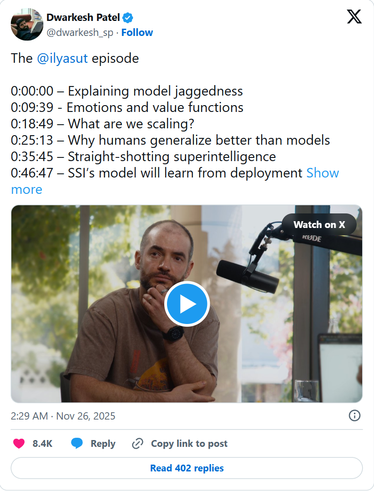

*采访者发布的完整访谈目录。图源：采访者官方 X 账号。*

官方透露的线索，到这里就停了。外界看得到 SSI 想去的方向，却看不到它准备怎么走。

一位名叫 @imjustnewatai 的 X 用户于是把访谈和公开公告拼在一起，做了一次「逆向 SSI」。他先说明这只是个人猜测，随后反过来问：一个真正会长大的 AI，究竟应该表现出哪些能力？

他把答案拆成了 5 件事。刚接触一项任务，看过少量范例后得真学会；事情还没彻底做砸，得能察觉哪里不对；学新规矩时，不能顺手把旧本事擦掉；换到一个相近的问题，过去的经验还得带得过去；连续工作很多年以后，也不能把自己练僵，仍要学得进新东西。

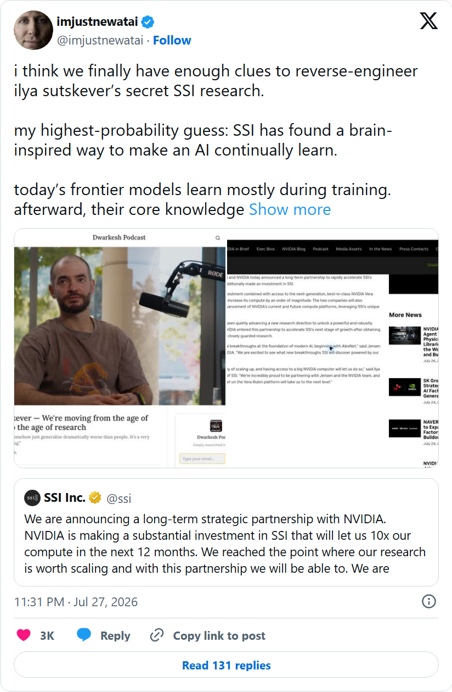

*X 用户 @imjustnewatai 根据公开访谈和公告所做的个人推演。*

这 5 件事，最后都能落到一个很普通的场景里：你刚招了个 AI 同事。

## 它会照着做，不等于它长了本事

入职第一天，你随手扔给 AI 3 封旧邮件。它扫了一眼，摸准公司语气，写邮件、改方案、查数据，快得像已经干了半年。

你指出一个错误，它马上回答：「明白了，下次注意。」

可第二天换个对话框，同样的错误又回来了。

你给它接上「记忆」、连进公司资料库，它确实能翻旧账、查档案。但如果真要共事 3 年，问题就不再是它存了多少记录，而是这些经历有没有在它身上长出实打实的本事。

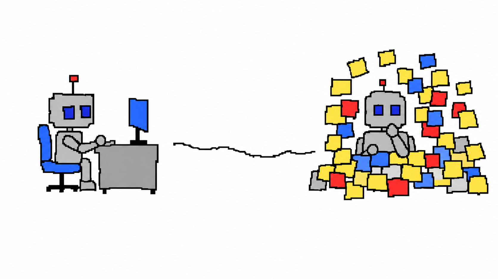

*本文笨拙涂鸦均为 AI 生成示意图。*

我们总习惯把几个示例塞进当前对话，让 AI「照着做」。这类用少量范例临场完成任务的方式，常被叫作少样本学习。但 AI 是真学会了，还是只是照猫画虎？

研究人员故意把示范里的标签随机替换。结果，在论文测试的一些分类和多选任务中，不少模型的表现只受到有限影响。这当然不代表答案不重要，只说明在这些任务里，AI 也会看「脸色」行事：标签有哪些、题目长什么样、整体格式怎么排，都可能帮它完成任务。

这就像团队里新来的同事，把范本摊在桌上照着写。活交得挺漂亮，但你真问他懂不懂，脑子里还真没留下多少真本事。

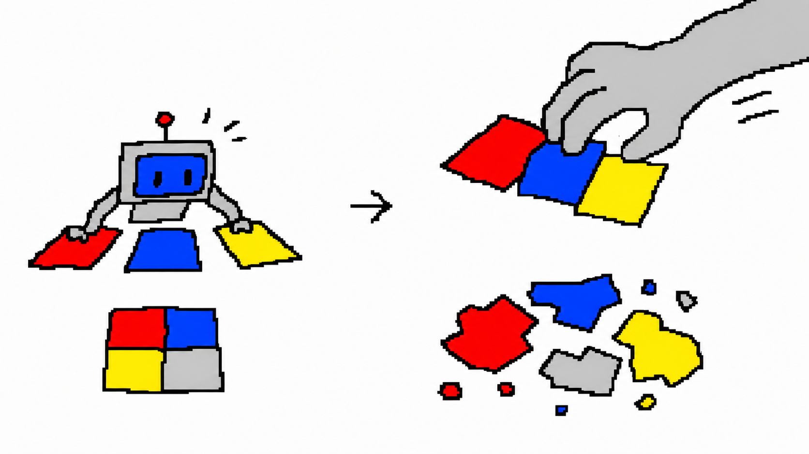

这种「照猫画虎」的临时适应，有个行话叫「上下文学习」。说白了，它并没有真正改动模型内部的参数。所谓参数，你不用去抠那些复杂的数值和连接权重，只要把它理解成模型骨子里「长期影响判断的习惯」就行。

你把偏好、规则和旧文件一股脑喂给它，就像给同事配了个档案柜，随用随查，但人其实还是那个人；而真正去更新参数，则像是那些真实的共事经历，一点一滴重塑了这个人的长期习惯。

前者，能让 AI 在当下记住你交代的事；后者，才意味着它真正从这段经历里长出了新本事。

## 一句「不错」写进模型，麻烦才刚开始

假设 AI 刚交出一份方案，客户随口说了句「不错」。

这句话要不要被它学进去？客户可能只是客气，项目最后也可能一塌糊涂。更糟的是，攻击者还可以故意喂给它一批看似合理的「毒经验」。

让 AI 自己「再检查一遍」也不够。2024 年的一项研究发现，在所测模型、任务和提示方式下，只靠模型自己提出意见并反复修改，表现没有稳定提高；在论文测试的多组实验配置中，整体分数反而下降。

在这项研究里，只有当实验者用标准答案判断「答对就停，答错再改」时，整体表现才得到改善。放到真实工作里，代码能不能通过测试、计算结果能不能复核，通常都比 AI 自己说「我觉得没问题」更可靠。

这项实验至少说明，在它测试的这些任务里，可靠纠错离不开可核验的外部信号。

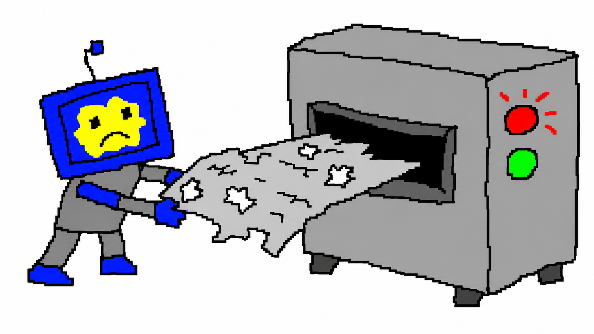

这时候，问题已经不是 AI「能不能学」，而是「谁有资格教」：什么能记在小本本上？什么能写进脑子里？学错了怎么撤回？

不妨把这套规矩叫作「学习治理」。这不是 SSI 公布的技术名词，只是把一组工程问题拢在一起。

只要你想让模型「边干边学」而不是上线就定型，就绕不开它。毕竟，反馈就算是对的，改猛了也会出事。

比如周一老板说邮件要短，周二财务要求风险要细。模型转头就把周一的指令当普遍真理，顺手把周二的风险报告也砍成三行。而且学了新的，还容易丢旧的，这叫「灾难性遗忘」：新本事挤进来，旧本事被挤出去了。

就算旧本事没丢，经验还得能「举一反三」。比如做方案时学到「嘴上说好没用，用户真买单才行」，去检查代码时能领悟到「代码漂亮没用，测试跑通才行」，这就叫「迁移」。当然，迁移不是变戏法，处理过发票不代表会修发动机，两件事底子得相近，旧经验才搬得过去。

最后，哪怕反馈对、旧本事也保住了，长期的修修补补仍可能让模型变僵化，慢慢失去继续学习的灵气。

## 它甚至可能越练越学不动

2024 年的一项实验，让电脑里模拟的四足机器人 Ant 在同一个环境里反复练习走路。

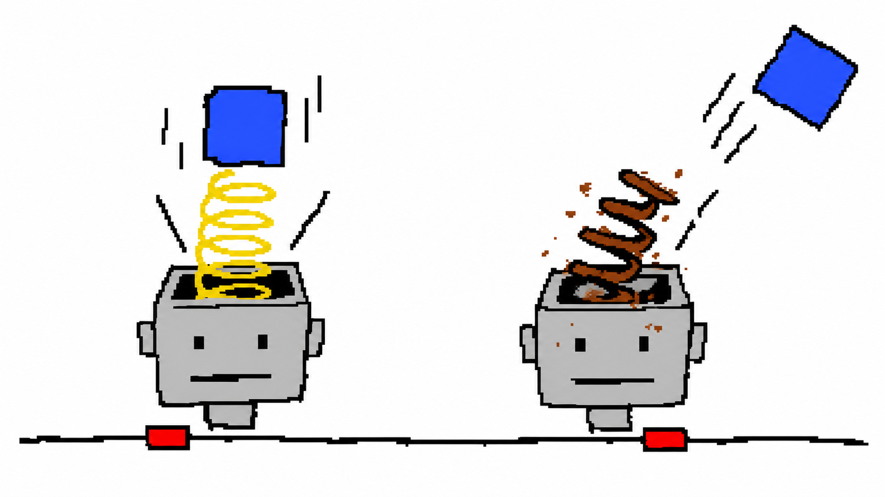

任务没换，地也没换。实验用一套叫 PPO 的常见强化学习算法训练它：走得好就强化当前做法，走得差就继续调整。Ant 一共跑了 5000 万个训练时间步，研究者统计了 30 次独立实验的平均结果。

按理说，练久了就算不再进步，也不至于越练越差。结果，用标准 PPO 训练的 Ant 大约在 300 万步前后达到较好成绩，随后开始下滑；到约 2000 万步以后，每轮尝试都失败了。

研究中还发现了一个有意思的现象：在标准的训练法下，控制 Ant 的神经网络里，很多计算单元慢慢「休眠」了。经验还在往里喂，但它却越来越吸收不进去。

不过，论文还测试了另一套训练法：持续替换低效单元，同时加上一点约束，防止网络权重越长越大。这个版本的 Ant 不但没崩，还在继续进步。这说明，Ant 不是练久了就一定会废，换一种保持可塑性的训练法，它还能继续进步。

这就叫「可塑性丧失」。它跟前面说的「灾难性遗忘」不一样：遗忘是学新的把旧的挤走了；而可塑性丧失，是旧本事可能还在，但脑子转不动了，越来越难学进新东西。

当然，Ant 不是今天的大模型，这不能直接证明通用 AI 将来一定会这样。但它像个温柔的提醒：以后考核一个在岗多年的 AI，不能光看它还记着多少旧知识，还得临时甩给它一份新活儿，看看它现在还学不学得动。

## 人脑不会因为一句话，连夜重写员工手册

想想也是，人脑确实会忘事、会有偏见、会变轴，但人再怎么着，也不会因为客户随口一句吐槽，连夜重写整本员工手册。人的习惯是：先记下来，慢慢看，这事儿是偶尔发生，还是会天天碰上？是今天管用，还是半年后依然重要？

SSI 没有说明那些「被忽视的角落」具体指什么，更没说自己采用了下面这套理论。这里不是在猜 SSI 的架构，只借用一个关于人脑的计算假说，帮大家理清「到底该怎么控制 AI 学习」这件事。

在这套假说里，那个 AI 同事身后，仿佛坐着 4 个「审核员」，对应着大脑里的 4 种神经调质。在这个比喻里，它们不是某段具体记忆本身，更像给许多神经回路发送调节信号：「现在该怎么学？」

客户说「不错」，多巴胺像个核对预期与结果的记分员。在人体里，它参与传递「实际结果和预期差了多少」的信号。在强化学习里，相近的计算概念叫「奖励预测误差」：结果比预想好，就加强刚才的做法；比预想差，就提醒系统赶紧换方向。

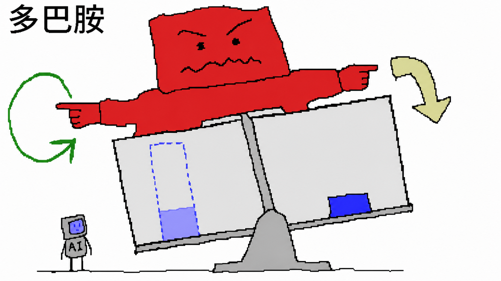

但眼前得分高，不代表半年后还有用。血清素像个翻日历的审核员，它影响算奖励时要把眼光放多远。模型里有个对应的词叫「折扣因子」：要是只看眼前，AI 就会死盯着客户当下那句「不错」；只有看得够远，它才会在意方案半年后到底有没有用。

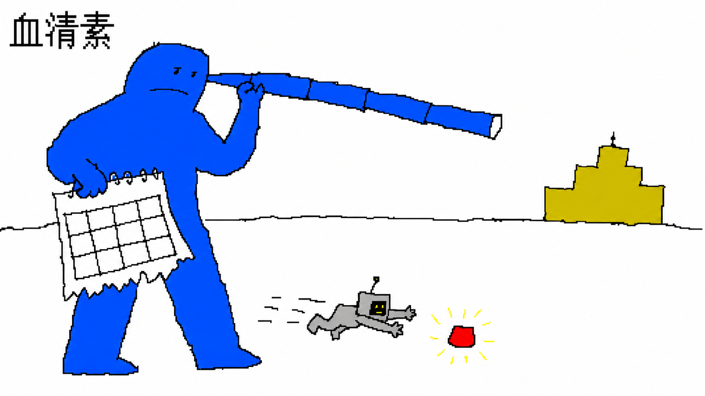

如果环境突然变了，去甲肾上腺素就出场了，像个探路员。人遇到变化时，它参与警觉和应对不确定性。在模型里，它对应「探索随机性」：是继续走熟路，还是偶尔试条新路？完全不探索，AI 只会车轱辘话来回转；探索过头，又成了没头苍蝇乱撞。

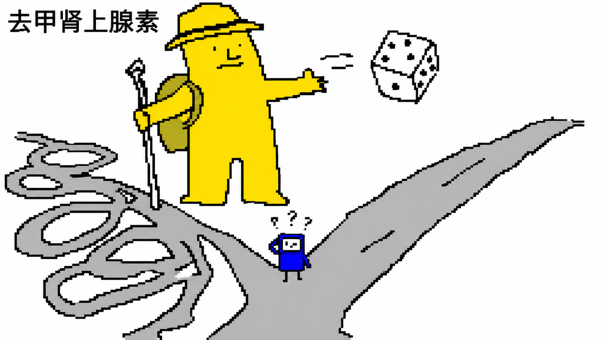

最后是乙酰胆碱，像个更新员。它在人体里参与注意力和记忆变化；对应到模型里就是「学习率」，决定每次发现错误后要改多少。学习率太大，一次投诉就能改掉整本手册；太小，你教十遍它也像没听见。

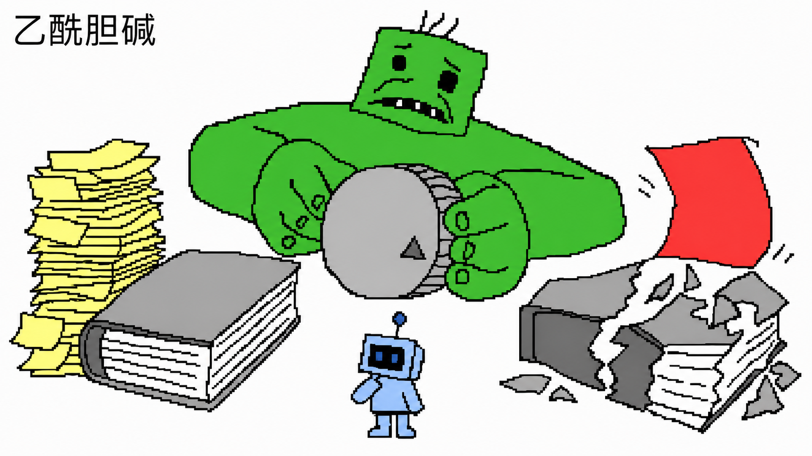

当然，这种一一对应只是一种计算假说，不是大脑里真实的岗位表，更不是实际的技术方案。

但它给了个很好的启发：在强化学习里，奖励预测误差可以指导更新；而折扣因子、探索强度和学习率，往往由训练过程或工程设置决定。人脑的这套假说恰恰提示我们，这些调节方式，也许该随着处境的变化而变化。

在这个比喻里，4 个审核员参与调节「怎么学」；突触层面的变化则更接近「怎么留下」。突触是神经细胞间的连接，粗略点说，就相当于 AI 神经网络里的权重：连接变了，系统以后处理问题的方式也就变了。

一些突触理论还会把变化分了层：好改的叫「快变量」，稳定的叫「慢变量」。用办公室的道理讲就是：一次投诉先记在便签上（快变量）；等同类问题反复出现，且后续结果证明这条经验靠谱了，再去改写员工手册（慢变量）。

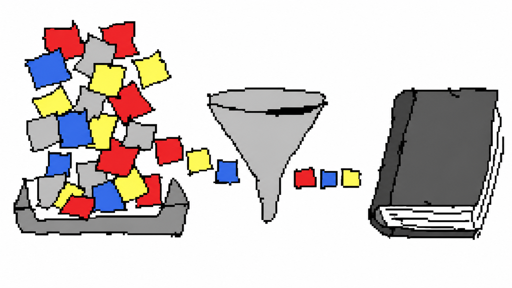

先记便签、再慢慢验证、少改手册、改完复测、错了能退。

所谓「学习治理」，管的就是一段经验到底该怎么一步步走进 AI 的脑子里。

## 10 倍算力之后，真正难的是怎么长大

今天挑一个 AI，我们看的是它入职第一天会多少。Ilya 的「超级智能少年」把考核时间往后推了：上岗 3 年以后，它还学不学得动？

NVIDIA 可以给 SSI 更多算力和更先进的平台，却不能替那个少年决定该相信谁。

它走进世界，会听到好建议，也会遇到客套话、偶然噪声和恶意陷阱。它得学会把好经验留下，又不能让一次错误改写全部过去；学错了要能退，遇到新工作还得继续学。

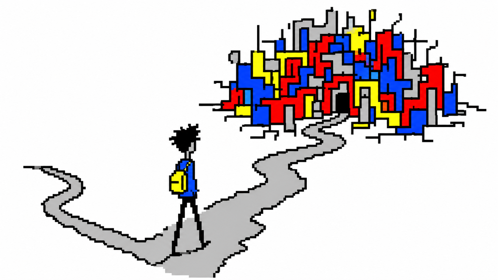

多年以后，我们真正关心的，不是它记住了多少数据，而是这些经历到底把它变成了谁。
