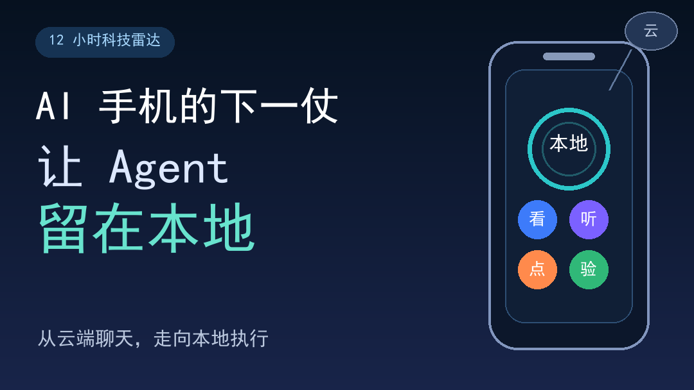
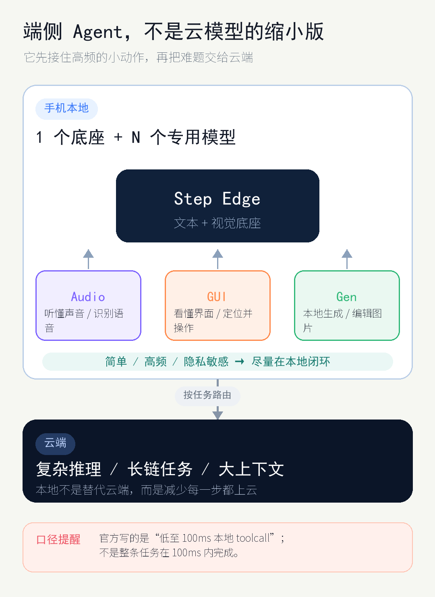
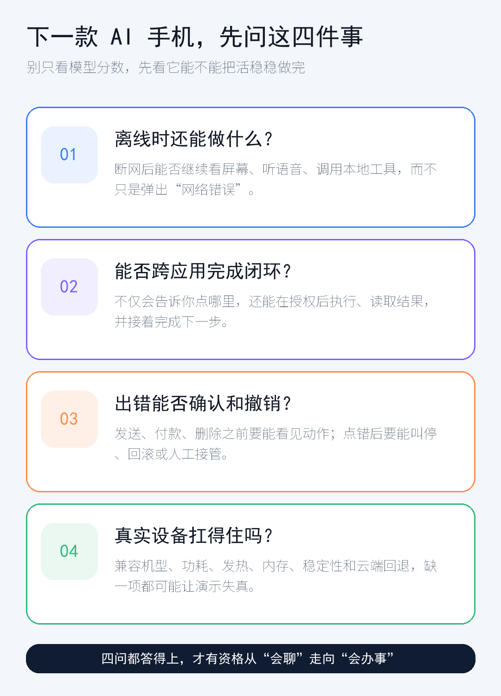

# AI 手机的下一仗：让 Agent 留在本地

*图：本文原创示意。手机里的“看、听、点、验”表示 Agent 工作闭环，不是任何产品的真实界面。*

你对手机里的 Agent——也就是能理解目标、调用工具并接着做下一步的程序——说：“把刚收到的地址填进打车软件。”如果它只在聊天框里教你点哪里，这还是一个聊天产品；如果它能找到输入框、填好地址，再等你确认，才开始像一个真正能办事的 Agent。

7 月 12 日，阶跃星辰公布了 Step Edge：一套想把 Agent 的部分感知和执行搬进设备本地的模型套件。

如果你没听过阶跃星辰，也很正常。它是一家 2023 年成立于上海的大模型创业公司，创始人姜大昕曾任微软亚洲研究院首席科学家；2026 年 1 月，公司完成了超过 50 亿元人民币的 B+ 轮融资，腾讯等老股东继续跟投。它不是手机厂商，Step Edge 也不是一部新手机，而是阶跃星辰为手机和车机准备的一套端侧模型。公司正在重押“AI 进入终端”，这条路线能不能走通，还是要看真机。

这次值得看的，是 Step Edge 把 Agent 的一部分工作明确往手机本地放。问题也随之变得具体：为什么 Agent 必须有一部分留在设备上，才可能从“会聊天”走到“能办事”？

## 60 秒事实卡：Step Edge 到底发布了什么

- **一套 `1 + N` 架构。** 中间是一个文本 + 视觉基础模型 Step Edge，外围连接 Audio、GUI、Gen 三类专用模型。
- **四个组件各有分工。** 基础模型负责看懂图像和界面、定位按钮、调用工具，并理解空间与视频；Audio 处理音频理解和语音识别；GUI 面向界面理解与动作执行；Gen 负责本地图像生成和编辑。
- **`100ms` 只对应一个局部动作。** 阶跃星辰称，本地 toolcall 低至 100ms。toolcall 可以理解为“让模型调用手机里的一个工具或功能”；这个数字不表示整项任务从听懂到交付只花 100ms。
- **端云有明确分工。** 官方设想让简单任务在本地响应，复杂任务交给云端，并没有主张所有工作都塞进手机。
- **目前数据主要来自厂商自测。** 官方写明，外部对比模型也由阶跃星辰内部测试，因此相关成绩不能当作独立评测的胜负结论。

*图：依据 [Step Edge 官方发布页](https://static.stepfun.com/blog/step-edge/)的厂商架构重绘。`100ms` 仅指官方自报的本地 toolcall；简单任务本地响应，复杂任务上云。*

## 为什么手机必须在本地留一手

“端侧”听着像工程术语，说白了就是模型直接在手机或车机这类设备上运行。对 Agent 来说，本地最适合接住的是那些频繁、短促、离用户数据很近的动作：听到一句指令，看清当前屏幕，找到按钮，调用一个本地功能，再检查结果有没有回来。

如果每一步都绕到云端，Agent 做一个跨应用任务时，就要反复上传上下文、等待响应，再把结果传回来。网络一抖，流程跟着停；没有信号，许多步骤直接做不了。数据离开设备的次数越多，用户也越需要知道哪些内容被送了出去。

本地模型的能力和手机资源都有限，复杂推理仍可能需要云端。更合理的形态是一条接力链：本地负责高频感知和小动作，云端处理较重的推理，本地拿回结果后继续执行和核验。Step Edge 所说的“简单任务本地、复杂任务上云”，正是这套分工思路。

真正麻烦的不是“上不上云”，而是谁来做决定：哪些任务留在手机，哪些数据要送上云，用户会不会提前收到提醒——这几点 Step Edge 这次都没有讲清楚。本地处理能减少等待和数据外发，但复杂任务仍会上云，隐私不能只靠一个“端侧”标签打包带过。

## 这条路线早就有人走，端侧 Agent 正在变成主战场

端侧模型、工具调用和本地 Agent 早已有之，并不是 Step Edge 的首创。

Apple 在 WWDC25 公布的 Foundation Models framework，已经让开发者调用 Apple Intelligence 的端侧大语言模型；该框架的 tool calling 还能让模型自主调用开发者在应用内定义的代码。这里的权限范围仍在应用和开发框架之内，不能把这理解成模型可以随意操作整台设备。

Android 的路线更像一组正在拼接的积木：Gemini Nano 提供端侧推理；AppFunctions 把应用能力暴露给系统级助手；ADK（Agent 开发工具包）可以让 Agent 在 Android 应用内运行。Agent 还能调用 Gemini Nano，从而在离线时继续工作；ADK 也支持把本地 Agent 与云端 Agent 组合成多 Agent 系统。Android 官方的 Hybrid inference 文档则把网络延迟、设备状态和任务复杂度都列进端云路由的考虑范围。

这些方案的接口和权限不同，测试方法也不一样，硬凑跑分没有意义。它们共同证明一件事：只把云端聊天模型接进手机，已经不够讲下一代 AI 手机的故事。Step Edge 的价值在于，把视觉、语音、界面执行、工具调用、生成和端云协同，一次性放进了同一张端侧产品图里。图已经清楚，但产品要站得住，还得过下面四关。

## 看一款 AI 手机，先问这四件事

*图：本文整理。判断 AI 手机 Agent 的四个问题：离线能力、跨应用闭环、安全恢复和设备耐力。*

### 离线时，它还剩下多少本事？

断网是最干脆的测试。此时 Agent 是只能整理一段已经在手机里的文字，还是仍能听懂指令、看见屏幕、调用本地工具？Step Edge 只说简单任务可以在本地响应，没有列出离线时到底能做哪些事。

用户真正该追问“离线”到什么程度：哪些步骤离线可做、做到哪一步会请求上云、上云前是否告知。只要复杂任务仍需云端，“本地”就不能被翻译成“所有数据永远不离开手机”。

### 它能不能跨应用把事情做完？

只会指出按钮在哪，只算完成了半截任务。一个办事型 Agent 至少要走完四步：看见当前状态，决定下一步，调用被授权的工具，再读取结果继续走。中间任何一环断掉，用户都得重新接手。

Step Edge 的基础模型覆盖界面定位和工具调用，GUI 模型面向界面理解与动作执行；Android 的 AppFunctions 也展示了让助手发现并调用应用能力的方向。可这些机制能不能在真手机上稳稳跑通，还是另一回事：应用界面会更新，权限有边界，动作执行后还要判断结果是否正确。现在缺的，正是独立第三方的实机性能和稳定性测试。

所以看演示时，别只盯着 Agent 有没有点中一次按钮。更关键的是：跨到第二个应用后，Agent 能否读回结果；遇到页面变化，它会停下来求助，还是带着错误一路点下去。

### 点错以后，能不能确认、撤销和接管？

Agent 一旦能在系统里执行操作，错误的代价就从“答错一句话”变成“真的做错一件事”。发送消息、付款、删除文件，或者执行与驾驶有关的操作，都需要更高的确认门槛。

阶跃星辰这次没有说明：哪些动作需要二次确认、已经执行的动作能否撤销、系统是否保留操作记录，以及用户该如何中途接管。也许这些设计已经在产品计划里，但发布页没有告诉我们。对一套会替人点按钮的系统来说，这不是边角料，而是能不能放心交出去的前提。

对用户来说，合格的系统能力应该让人随时知道 Agent 准备做什么、刚刚做了什么，以及如何叫停 Agent、让任务回到可控状态。如果这套系统只在成功演示里一路畅通，离“敢放手”还差最关键的一步。

### 手机能不能长期扛住？

能跑通一次是一回事，能不能每天持续运行是另一回事。速度之外，内存、功耗、发热、续航、兼容机型、长时间稳定性和云端回退都会改变体验。

参数也别急着打包看。阶跃星辰只公开了 GUI 模型的参数量：40 亿（4B）。基础模型、Audio 和 Gen 的参数规模分别是多少，官方没有说明，因此不能据此认定这三个组件的参数量也都是 40 亿。阶跃星辰还给出了端侧 AI 加速单元（NPU）上的自测成绩，却没有把测试所用的具体芯片、量产终端，以及功耗、发热、续航和长期稳定性数据一起摆出来。

那句“本地 toolcall 低至 100ms”同样要放回完整流程里看。Agent 还要感知、推理、执行、核验，复杂任务可能再跑一趟云端。一个局部调用很快，尚不能证明整条任务很快，更不能证明手机连续运行后依旧稳定。真实设备耐力，要等具体终端和第三方实测来回答。

## 架构已经发布，实机还没交卷

Step Edge 已经把端侧 Agent 的技术拼图摆上桌：一个文本 + 视觉底座，接上语音、GUI 执行和本地生成，再用端云路由处理不同复杂度的任务。这套架构解释了为什么 Agent 不能永远待在云端聊天框里。

但这套拼图还没有在真手机上交卷。具体芯片、终端适配、功耗与发热表现、确认与撤销机制、失败恢复能力，以及第三方实机表现，都是阶跃星辰接下来要补上的答案。在这些答案出来前，一张完整的架构图还不能当成一次量产验收。

AI 手机的下一仗，表面在比谁把模型塞进设备，实际要看谁能把本地感知、执行、端云路由和用户控制接成可靠闭环。谁先把本地执行做成用户敢放手的系统能力，谁才真正拿到 AI 手机的入口。

*注：本文信息截至北京时间 2026-07-12 20:23。文中 Step Edge 性能数据均为阶跃星辰自测，真实设备表现仍需独立测试。*
