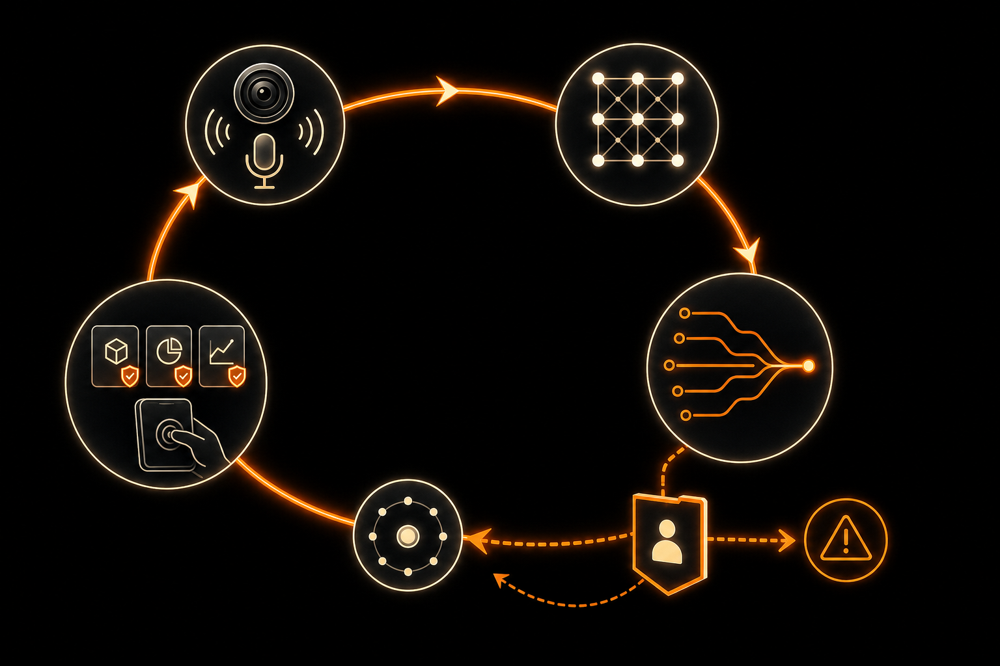

# 阶跃为什么要亲自做一台 Agent 手机？

*图：AI 生成的编辑示意。画面表达“模型—系统—终端”的执行链，不是 STEPX Neo 的产品图或真实界面。*

发布会结束后，阶跃星辰摆到桌面上的不是一个新模型，而是一整套新名字：终端品牌 STEPX、手机 STEPX Neo、智能体原生系统 Step AOS，以及内置的个人智能体 Amoo。

如果你没听过阶跃星辰，也很正常。它是一家 2023 年成立于上海的大模型公司，创始人姜大昕曾任微软亚洲研究院首席科学家。2026 年，印奇出任董事长后，公司进一步强化了“AI + 终端”的路线。它此前已经把模型能力接入手机和汽车，也发布了端侧模型套件，但亲自做一台面向用户的手机，还是第一次。

这一步跨得不小。阶跃这次没有停在给终端提供模型这一步，而是把模型、系统和硬件装进同一台设备，准备直接面对用户。

阶跃在发布会里反复讲“敢为”。我很喜欢这个表达。我理解它想说的不是凭一股冲动往前冲，而是想清楚以后，仍然选择坚定地往前走。

放在一台 Agent 手机上，这句话也可以换个问法：阶跃究竟想清楚了什么，才决定亲自下场？

## 先用一分钟说清楚，它发布了什么

- **STEPX**：阶跃的新终端品牌。发布会主视觉写作 `STEP X`，会后报道统一写作 `STEPX`；本文采用后者。
- **STEPX Neo**：这个品牌的第一款手机。它配有一块交互背屏，详细硬件配置尚未公布。
- **Step AOS**：阶跃称它为“智能体原生操作系统”。简单理解，按照阶跃的设想，这套系统从设计之初就要承接智能体的记忆、判断和操作，而不是只在普通手机系统上加一个聊天入口。
- **Amoo**：手机里的个人智能体。Agent 可以理解为一种不只回答问题，还能理解目标、调用工具并继续行动的软件。按照阶跃的介绍，Amoo 会把感知、记忆、决策和行动串成一条任务链。
- **生态伙伴**：首批名单包括美团、WPS、剪映、携程、高德、支付宝、百度、滴滴、京东、微博和百度地图等。
- **什么时候能摸到真机**：STEPX Neo 计划于 7 月 17 日在世界人工智能大会（WAIC）首次公开亮相。截至 7 月 13 日晚，售价、详细配置和上市时间都还没有公布。

还有一句容易让人兴奋，也最该冷静看待：阶跃称它是“全球首款大模型原生智能体手机”。几天前，努比亚也预告要在 WAIC 展示“全球首款 AI 智能体手机”。两个“首款”的口径并不相同，读者不必急着替厂商判奖。

真正值得看的，不是谁先把名字写进新闻标题，而是谁能让手机里的 Agent 靠谱地把事情做完。

## 大模型会思考，不等于手机能办事

今天的大模型已经很会规划。你让它安排一次出差，它可以列航班、酒店和日程，也能提醒你带什么。但能给出一份计划的助手，和能真正替你办完事的 Agent，是两种产品。

后者需要的不只是模型能力。它还要知道你是谁、现在在哪里、日历里有没有冲突；它要获得合适的系统权限，调用地图、打车、支付和办公软件；执行以后，它还得读回结果，确认订单到底有没有提交成功。

这些能力恰好都卡在手机这一层：传感器提供环境信息，系统管理权限，应用接口负责执行，屏幕把执行结果和风险提示呈现给用户。

只做模型，阶跃可以告诉合作伙伴“这个 Agent 应该怎么想”；亲自做终端，它才有机会决定 Agent 能看见什么、能调用什么，以及做错以后怎么停下来。

这就是 STEPX Neo 最有意思的地方。它不只是一台新手机，也是阶跃验证自己那套 Agent 方法的试验场。

*图：AI 生成的编辑示意。一个能办事的手机 Agent，不只要感知、记忆、决策和行动，还要在高风险动作前让用户确认，并在出错时能够停下或恢复。*

## Step AOS 想改的，是人和手机的分工

传统手机的基本逻辑是：用户打开应用，找到入口，一步一步完成操作。AI 助手通常悬在这套流程上方，能回答问题，也能把你送到某个页面，但最后几步往往还得自己点。

阶跃给 Step AOS 定下的目标，是从“过程交互”转向“结果交互”。说人话就是：你告诉手机想要什么结果，系统自己拆任务、找工具、执行，再把需要确认的地方和最终结果交给你。

为此，阶跃把 Step AOS 的能力概括成三类：记忆、决策与执行、安全。

记忆决定 Amoo 能不能持续理解你的习惯和偏好；决策与执行决定它能不能从一句话走到真实操作；安全则决定用户敢不敢把权限交给它。三者少一个，Agent 都很难从演示走进日常生活。

系统还采用端云协同架构，也就是让一部分步骤在手机本地完成，把更复杂的推理交给云端。这条路线和阶跃此前发布的 [Step Edge](https://static.stepfun.com/blog/step-edge/) 能接得上：本地接住频繁、短促、贴近个人数据的动作，云端承担更重的推理。

不过，“端云协同”并不等于数据永远不上云。哪些任务留在本地，哪些信息会被发送到云端，上云前是否提醒用户，仍要等更具体的产品说明。

## 生态名单很长，闭环还得一项一项验

美团、携程、高德、支付宝、滴滴、京东……首批合作伙伴几乎覆盖了吃饭、出行、旅行、购物和办公。这个名单解释了阶跃为什么要做系统：没有应用接入，再聪明的 Agent 也只能隔着玻璃看世界。

但“成为生态伙伴”和“任务已经稳定跑通”之间，还隔着很长的产品工作。

以一句“帮我订周五晚上去杭州的高铁，再把行程发给同事”为例，Agent 至少要理解时间和目的地、查询车次、处理账号状态、在付款前等待确认、拿到订单结果，再找到正确的联系人发送消息。中间任何一个接口变化、页面异常或权限不足，都可能让任务停住。

所以 7 月 17 日看真机时，我最想看的不是它能不能成功演示一次，而是它失败时怎么处理：

- 支付、发送、删除这类高风险动作，是否一定会等用户确认？
- 用户能不能看见 Amoo 准备做什么、已经做了什么？
- 中途发现不对，能不能立即接管或撤销？
- 应用页面变化、网络中断或者执行失败后，系统会重试、求助，还是带着错误继续往下走？

阶跃已经把“安全”列为 Step AOS 的三项核心能力之一，但发布会后的首批信息还没有把确认、撤销、操作记录和失败恢复讲清楚。手机真的交到用户手里，这些细节会比“能不能自动点几下”更重要。

## “敢为”真正难的部分，在发布会之后

阶跃星辰原本是一家做基础大模型的公司。过去几年，它把模型接入手机和汽车，也发布了端侧模型套件和桌面 Agent。现在亲自做终端，并不是毫无来由地换赛道，而是把原来分散在模型、系统合作和设备适配里的工作，集中到一台产品上。

这条路的诱惑很明显：如果手机成为个人 Agent 最稳定的入口，掌握终端就能更快地打通模型、系统权限、应用生态和硬件感知。

代价也同样明显。做模型可以用榜单和能力演示说话，做手机却要回答更琐碎、更残酷的问题：续航怎么样，系统稳不稳，应用会不会突然失效，出了错谁来负责，普通用户什么时候能买到。

截至目前，STEPX Neo 还没有公布芯片、内存、影像、续航、售价和上市时间。它将在 WAIC 第一次公开亮相，但从“现场能用”走到“用户每天敢用”，仍有很长一段路。

所以我愿意暂时把“全球首款”的争论放到一边。阶跃这次真正值得关注的，不是抢先给手机换了一个名字，而是它愿不愿意为 Agent 的最后一公里负责。

能理解目标，只是第一步；能调用系统、跨过应用、交付结果，是第二步；做错以后能停、能查、能让人接管，才是用户敢放手的那一步。

敢为不是莽撞。对一台 Agent 手机来说，真正的敢为，是想清楚每一步的后果以后，仍然把它做成一件能交到用户手里的产品。

*注：本文信息截至北京时间 2026 年 7 月 13 日 20:07。文中“全球首款”“模型、软件、硬件三位一体”等为厂商定位；STEPX Neo 的详细配置、售价和上市时间仍待公布。*

## 资料来源

- [每日经济新闻：阶跃星辰官宣推出大模型原生智能体手机](https://www.mrjjxw.com/articles/2026-07-13/4470020.html)
- [凤凰网科技：阶跃星辰发布 STEPX Neo](https://tech.ifeng.com/c/8ujTrdAh6Du)
- [阶跃星辰：Step Edge 官方发布页](https://static.stepfun.com/blog/step-edge/)
