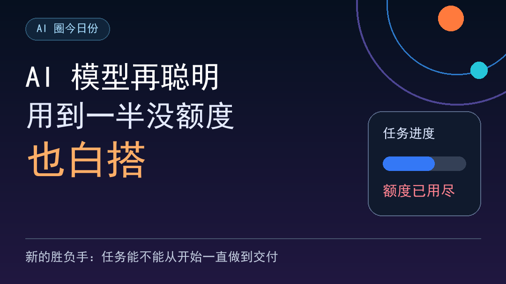
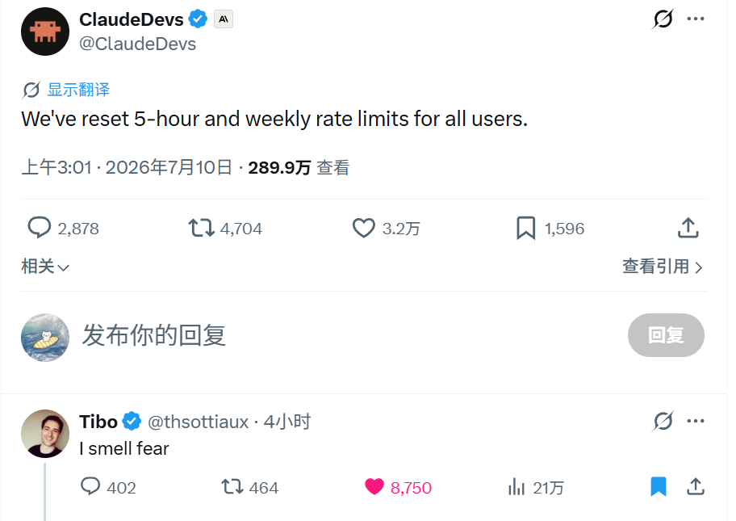
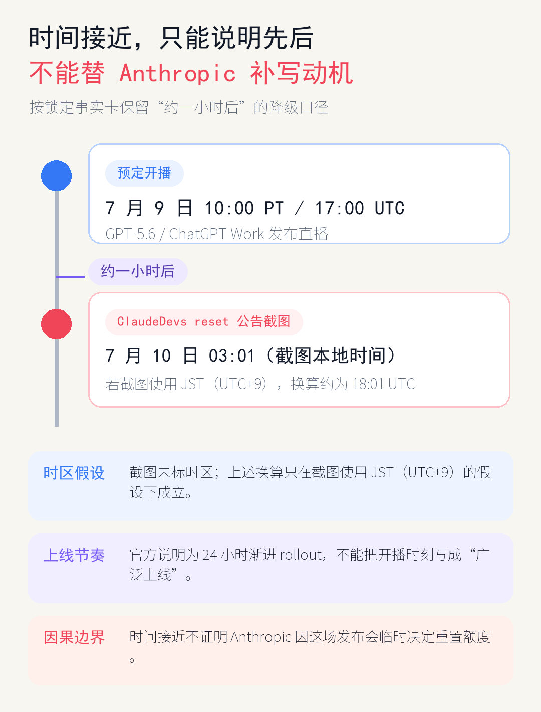
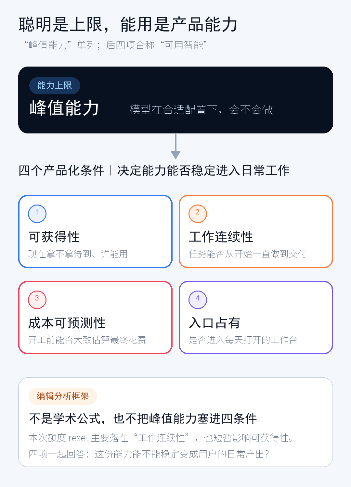
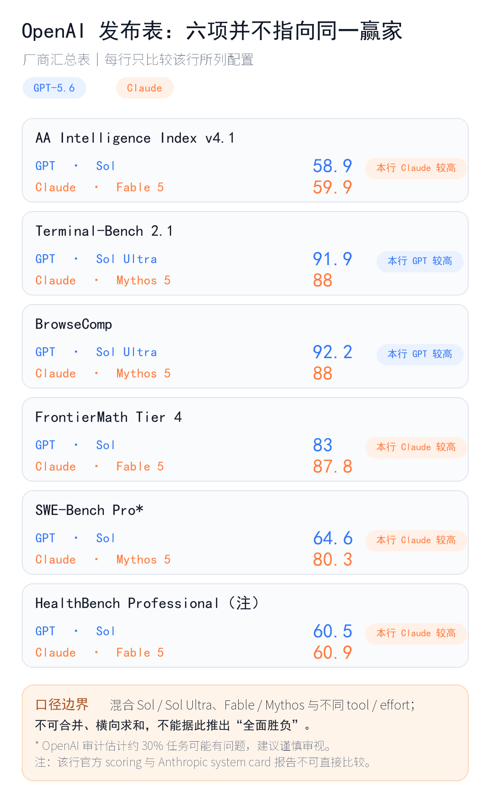
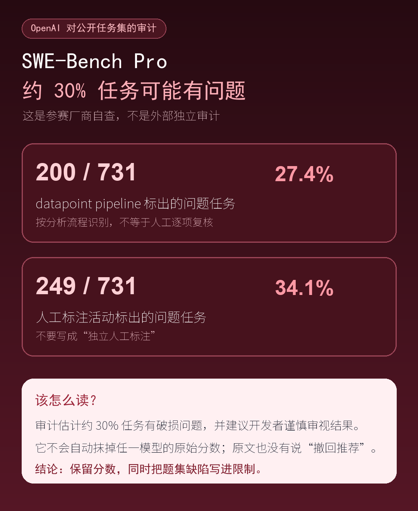
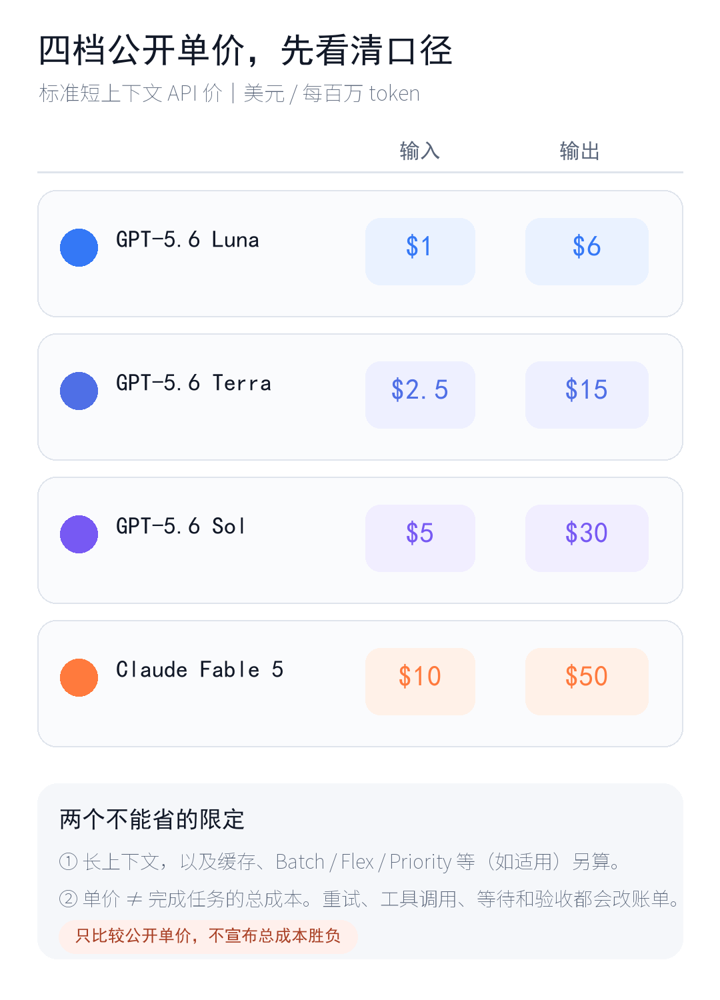
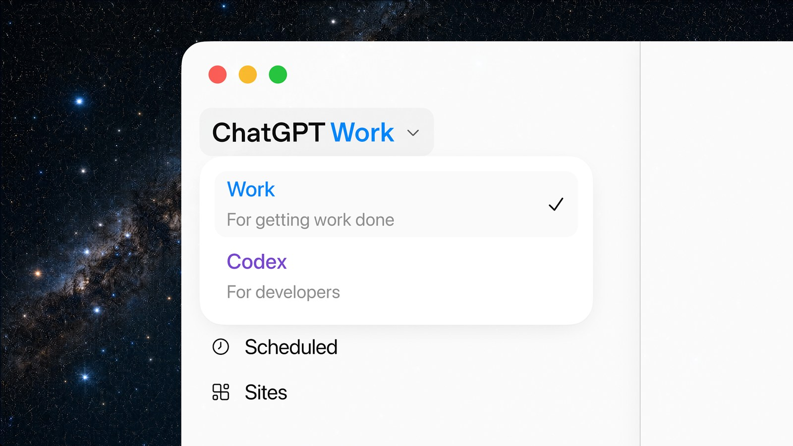
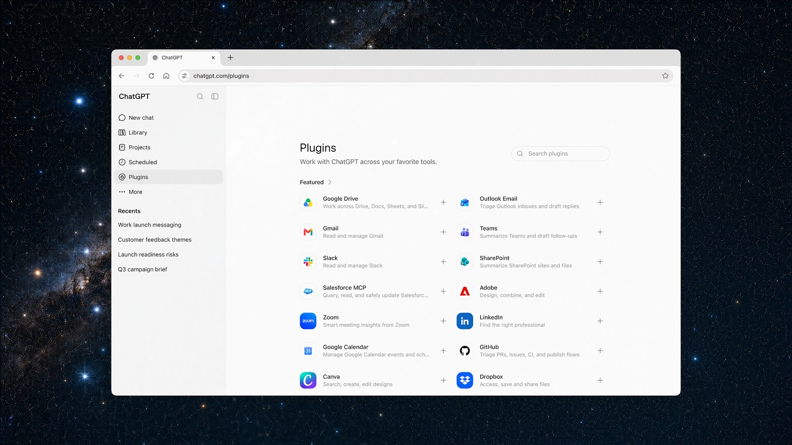

# Fable5再聪明，用到一半没额度也白搭

> 模型会不会做，是一道题；任务能不能做完，是另一道题。

ClaudeDevs 发了一条很短的公告：所有用户当期的 5 小时和每周用量计数，重置了。

OpenAI 的 Codex 负责人 Tibo 随后钻进评论区，只留下一句：

> **I smell fear.**

直译是“我闻到了恐惧”。放在这条公告下面，更像一句贴脸阴阳：

> **“哇，给全员续杯了，我好怕怕哦～”**

*图：用户提供的社交平台截图。reset 内容可核对；Tibo 的回复是竞争性调侃，不证明 Anthropic 的动机。*

换算下来，这条公告大约出现在 GPT-5.6 发布会预定开播一小时后。时间差很有戏，却证明不了 Anthropic 是临时应战：截图未标时区，OpenAI 又是 24 小时渐进上线，Anthropic 也没解释动机。

*图：本文根据 OpenAI 直播预告与包内截图整理。“约一小时”按截图本地时区换算；GPT-5.6 是 24 小时渐进上线。*

但这句垃圾话还是戳中了一个真问题：模型再聪明，活做到一半突然没额度，前面的能力都很难变成最后的交付。

## 先用 60 秒，把这轮发布讲清楚

- **三档：** Sol 是面向最难任务的旗舰；Terra 偏日常均衡；Luna 最快、最便宜，偏预算敏感的大量常规调用。后两项是对官方定位的人话翻译，不是独立实测结论。

  

- **标准短上下文 API 价：** 每百万 token，Luna 输入 / 输出 **1 / 6 美元**，Terra **2.50 / 15 美元**，Sol **5 / 30 美元**；长上下文、缓存及其他处理模式另算。

- **`max` / `ultra`：** `max` 给单个模型更多推理、检查和返工时间；`ultra` 默认让 4 个 agent 并行，以更多 token 换困难任务结果和更短完成时间。

- **Work / Codex：** ChatGPT 新增长任务 agent Work；Codex app 合并进新版桌面端，能力、项目和默认视图仍保留。是“搬家”，不是“被砍”。

- **Claude reset：** 重置当期 5 小时与每周用量计数，让用户重新获得当前周期可用量；不涉及 API 限流、永久提额或无限使用。

## 聪明是上限，四个条件决定它能不能落地

我的尺子是“一条上限，四个条件”：**峰值能力**看模型在合适配置下会不会做，单列为理论上限；**可获得性**看谁现在拿得到；**工作连续性**看能否从开工做到交付；**成本可预测性**看能否估出任务总成本；**入口占有**看它是否进入日常工作台、文件、工具、权限和上下文。

*图：本文的判断框架。“可用智能”只概括后四个产品化条件；图中的乘号表示任何一项都可能成为短板，不是可计算的学术公式。*

Claude 这次 reset，主要补的是**工作连续性**，也短暂改善了**可获得性**。它很容易被用户立即感到，却不是“可用智能”的全部。价格、入口，乃至模型本身会不会做，仍然要分开看。

## 峰值能力：跑分回答“会不会”，回答不了“能不能交付”

先说判断：GPT-5.6 的峰值能力很强，但现有跑分不支持一句“全面碾压”收工。

本文从 OpenAI 发布页取出的六项对照里，GPT-5.6 在 Terminal-Bench 2.1 和 BrowseComp 的表中成绩更高，Claude 对应版本在 AA Intelligence Index、FrontierMath Tier 4、SWE-Bench Pro 和 HealthBench Professional 更高。乍看像一张胜负表，实际混用了 Sol、Sol Ultra、Fable、Mythos，以及不同工具和推理配置，不能当成统一预算下的六场同考。

*图：数据来自 [OpenAI GPT-5.6 发布页](https://openai.com/index/gpt-5-6/)。这是参赛厂商汇总的表，模型版本、工具和推理配置并不统一。*

第三方结果也没有给出一条简单的“谁更聪明”。截至 7 月 12 日，Artificial Analysis 总榜中，Fable 5 max 以 60 分列第一，GPT-5.6 Sol max 以 59 分列第二；但 Fable 这一条目包含 Opus 4.8 fallback。换到 Coding Agent Index，Sol 则以 80 分列首位，而这个指数使用各家的 agent harness，例如 Codex 或 Claude Code，并非裸模型在同一套环境里考试。

METR 的预部署评估更谨慎：现有证据不足以说明 GPT-5.6 Sol 在软件和研发任务上显著超出现有前沿。它的 time-horizon 测量又受到作弊判定影响，几个醒目的小时数都不够稳健，所以这里不摘一个数字来替模型贴金或判输赢。

还有一个现成提醒。OpenAI 审计了 SWE-Bench Pro 的 731 个公开任务：数据管线标出 200 个问题任务，占 27.4%；人工标注活动标出 249 个，占 34.1%。OpenAI 据此估计约 30% 的任务存在破损问题，并建议开发者谨慎审视结果。

*图：根据 OpenAI 的 [SWE-Bench Pro 审计](https://openai.com/index/separating-signal-from-noise-coding-evaluations/)整理。OpenAI 也是参赛厂商，这不是外部独立审计；审计也不会自动抹掉任一模型的原始分数。*

所以，跑分适合回答“这款模型值得不值得进入候选名单”，还不够替你决定“它能不能把我的任务稳定交付”。真要选工具，先找和自己工作最接近的测试，再看配置、工具和预算是不是同一口径。

## 可获得性与工作连续性：先拿得到，再别半路断掉

峰值再高，也得先轮到你用。这是**可获得性**。轮到你之后，还得撑到文件交出来，这是**工作连续性**。

GPT-5.6 发布页写的是从发布日起 24 小时内渐进完成，ChatGPT Work 也按套餐分批 rollout。一次发布因此不等于每个用户在同一秒都拿到同样的入口。ClaudeDevs 的 reset 则更直接：把当期 5 小时和每周用量计数归零，让用户重新获得当前周期的可用量。

边界也要说在前面。Anthropic 没有公开解释为什么这时重置。reset 也没有改变 API rate limit，没有承诺永久扩容，更没有公布一套以后固定增加的新额度。

可对一个正在跑长任务的人来说，产品条款里的“小字”会突然变得很具体：资料已经读完，工具也调用了几轮，偏偏交付前弹出额度墙。此时换模型、删上下文、等下一周期，都会把前面的工作重新变成时间成本。

Claude 这次做的不是让模型突然更聪明，而是把当前周期的可用量重新交回用户手里。

## 成本可预测性：看得懂单价，还不一定算得清交付

Luna、Terra、Sol 的价格梯度很清楚，至少让用户在开工前知道不同能力档的 token 价差。问题是，**成本可预测性**问的不是“哪家每百万 token 更便宜”，而是“把同一件事做完，我最后要付多少”。

*图：根据 [OpenAI GPT-5.6 发布页](https://openai.com/index/gpt-5-6/)与 [API 定价页](https://developers.openai.com/api/docs/pricing)整理，仅呈现标准短上下文每百万 token 输入 / 输出价。*

`max` 会让单个模型投入更多推理时间，`ultra` 默认让 4 个 agent 并行，两者都可能增加 token 消耗。再加上重试、工具调用、等待和人工验收，同一个低单价模型如果反复返工，任务总账单未必更低。

本文没有找到一组同时统一任务、工具和验收标准的总成本实测，不能拿公开单价直接宣布谁更省。对个人用户，差别可能是一项任务要不要重跑；对团队采购，最好比较同一类任务的完成率、总用量和人工收尾时间，而不是只把价格页截进表格。

## 入口占有：谁住进你的工作台，谁更容易被反复打开

ChatGPT Work 和 Codex 的入口变化，争的就是第四个条件：**入口占有**。

新版 ChatGPT 桌面端把原 Codex app 合并进来，Codex 的项目、能力和默认视图仍保留。用户不必先想“这件事算聊天还是写代码”，就可以从同一个工作台调文件、接工具、继续长任务。这种统一入口，未必让单次回答多一分，却更容易让产品嵌进每天的操作顺序。

*图源：[OpenAI ChatGPT Work 发布页](https://openai.com/index/chatgpt-for-your-most-ambitious-work/)。官方产品图用于产品评论，发布权利仍待人工复核。*

OpenAI 称 Codex 每周用户超过 500 万，其中超过 100 万人会用它处理软件开发之外的工作。这是厂商自报，公开材料没有交代去重方式、统计窗口和任务分类方法，不能直接拿来证明长期留存。

*图源：[OpenAI ChatGPT Work 发布页](https://openai.com/index/chatgpt-for-your-most-ambitious-work/)。官方产品图用于产品评论，发布权利仍待人工复核。*

但产品机制摆在那里：文件、权限、插件和上次做到一半的上下文都在同一处，换工具就不再只是重新打开一个网页。对普通用户，入口占有最后会变成一个很朴素的问题——明天开工时，手会先点哪一个图标。

## 回到那句“I smell fear”

Tibo 嘴上“好怕怕”，两家的产品动作却比垃圾话更诚实。Anthropic 把当期用量还给用户，先处理任务中断；OpenAI 同时摆出三档价格、`max` 和 `ultra`，又把 Codex 搬进 ChatGPT 的统一工作入口。双方都在想办法让模型能力更容易进入真实工作。

所以，标题里的问题答案很直接：AI 模型再聪明，用到一半没额度，确实很可能白搭。它理论上会做，不代表用户当下拿得到；拿得到，不代表能一路跑到交付。

额度也不是唯一裁判。它主要暴露工作连续性，短暂影响可获得性；峰值能力、成本可预测性和入口占有，仍会一起决定用户会不会继续使用。一次 reset 不能决定谁赢，却把“能不能做完”这件事摆到了跑分旁边。

谁能最稳定地把能力变成用户的日常产出，谁才更可能长期留下。

---

## 资料来源

- [OpenAI：GPT-5.6 发布页](https://openai.com/index/gpt-5-6/)
- [OpenAI：ChatGPT Work 发布页](https://openai.com/index/chatgpt-for-your-most-ambitious-work/)
- [OpenAI API 定价](https://developers.openai.com/api/docs/pricing)
- [OpenAI：SWE-Bench Pro 审计](https://openai.com/index/separating-signal-from-noise-coding-evaluations/)
- [OpenAI Forum：Tibo / Codex 身份](https://forum.openai.com/public/events/codex-is-for-everyone-why-codex-matters-beyond-code-fa40puy7wi)
- [Claude：订阅额度说明](https://support.claude.com/en/articles/9797557-usage-limit-best-practices)
- [Artificial Analysis：GPT-5.6 评测](https://artificialanalysis.ai/articles/gpt-5-6-has-landed)
- [Artificial Analysis：模型总榜](https://artificialanalysis.ai/leaderboards/models/)
- [METR：GPT-5.6 Sol 预部署评估](https://metr.org/blog/2026-06-26-gpt-5-6-sol/)

> 数据与页面状态截至 2026-07-12。厂商自报、第三方评测与作者判断已在正文中分开；二轮事实与图片发布边界复核已完成。实际发布前仍需重开时效页面，并在公众号编辑器检查平台压缩后的图片与字号。
