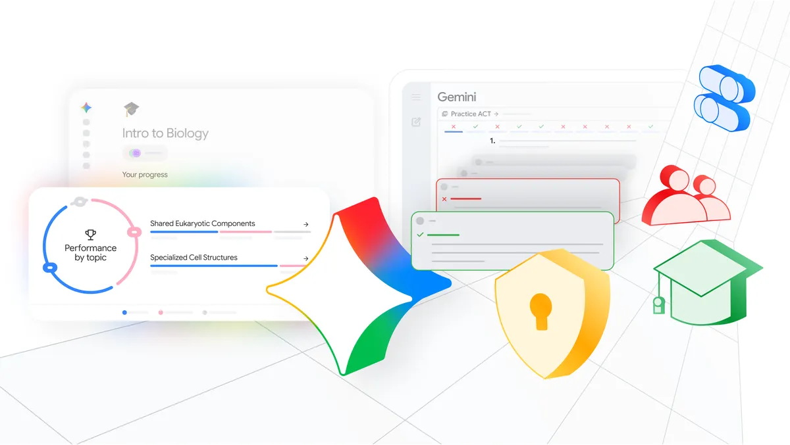
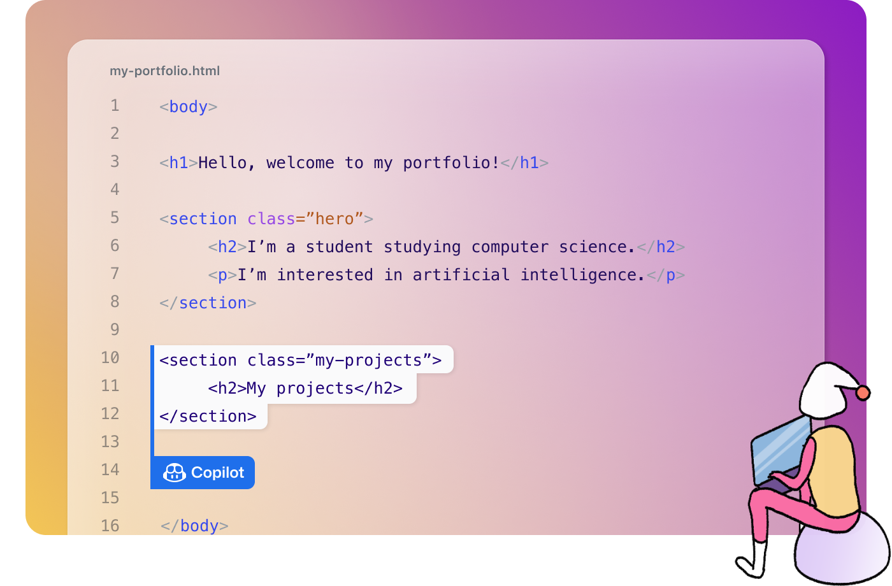
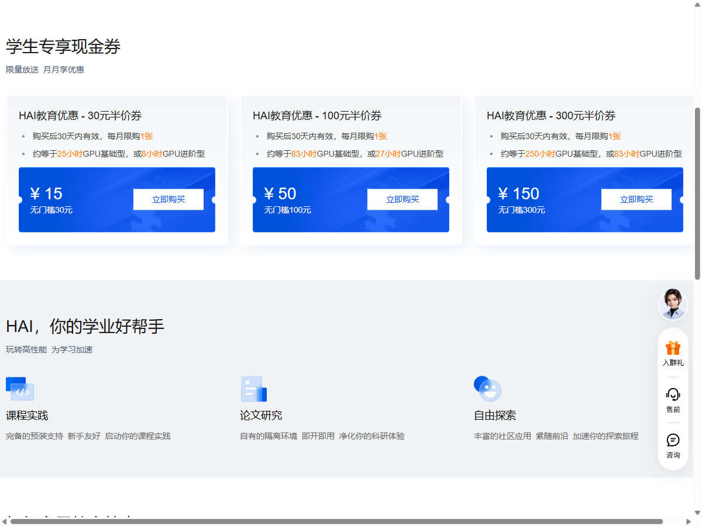

# 大学生的 AI 开学薅羊毛清单来了：有人送会员，有人直接送算力

新学期准备给 AI 续费之前，可以先别急着付款。

过去开学先看教材和电脑教育价。这年头，还得斟酌一下，这个学期要不要给 AI 开会员？

这几天，又有两项 AI 学生权益更新。8 月 12 日，豆包宣布了面向大学生的免费额度和会员优惠。8 月 19 日，Google 也更新了为期 12 个月的学生计划。

这些优惠分成了几类：聊天助手会员、编程额度，以及可以拿来租 GPU、调模型的优惠券。

下面咱们就来按照开学后真正会用到 AI 的场景，聊一聊有哪些羊毛可薅！安排！

## 日常学习，先用免费的

对多数大学生朋友来说，最常见的需求还是问问题、改文字、整理一份课件，或者在期末前快速理清知识点。

比如开学第一周，老师一次发来课程大纲、阅读清单和几十页课件。让 AI 先按周整理，再把不懂的名词单独问一遍，用到的主要是普通对话额度。

*用 AI 整理课件与周计划的日常场景。AI 生成*

按豆包最近公布的说法，大学生完成认证后，可以获得 2.5 倍免费额度。2.5 倍！豆包别的不说，额度是真的挺慷慨的了！

活动面向全国高校学生，领取入口在最新版电脑端的「工作任务」模式中。

不过，若是平时尚未碰到免费上限，先完成学生认证就行，没有必要给豆包姐姐冲会员。这钱，留着吃一顿火锅它不香吗？

真的频繁用到上限，再看付费版。

豆包学生 Pro 的标准价为 38 元／月，学生权益有效期为 6 个月。普通连续包月的标准价为 68 元／月。

付费主要买到的是更多额度、高峰期优先使用、更新的模型和更多功能。在同一个模型上，答案质量并不会因为账号付了费就自动提高。

豆包专业版的月度额度按开通日重置，不是每月 1 日。没用完的额度到期清零，不会结转。定时任务每运行一次，也会消耗额度。

如果真正的重度使用期在期末、比赛周或答辩前，可以临近再开。学生 Pro 属于连续包月，不准备续费的话需要提前关闭。

## Google 免一年，但不是每个学生都能领

Google 8 月 19 日更新的学生计划，看起来更大方。符合条件的学生在 12 月 31 日前兑换，可以免费使用 12 个月。美国符合条件的大学生获得 Google AI Pro，其他受支持市场的具体计划会随学校所在地变化。

中国大陆目前不在 Google AI Plus 的支持地区中，香港和澳门也被这轮学生优惠明确排除。

能领的同学，需要用个人 Google 账号接收订阅，学校邮箱只负责学生验证。领取还需要符合要求的付款方式。免费期结束后，订阅会自动续费，除非提前取消。

它更适合平时就用 Google 文档和邮箱整理课程资料的人。新学期收到的课程资料和笔记，可以在 Gemini 中整理，再放回 Gmail 或 Docs 中使用。

Google 今年 6 月推出过 Study Notebooks。它会根据学生提供的材料做一次小测，再把不熟的部分拆成课程，配上后续测验和进度记录。有需求的大学生友友们可以看看这个功能，其实还不错。

*Google 6 月展示的学生学习工具。图：Google*

读文献比较多的学生，还可以看看 Perplexity Education Pro。学生通过 SheerID 完成身份验证后，订阅价为 10 美元／月，包含 Learn Mode。这个模式会用逐步提问、闪卡和测验帮助理解材料。它是一项已在提供的学生订阅，也是一个不错的选择。

## 写论文的同学，还有几个冷门工具可以试试

如果你已经开始写课程论文、毕业论文，或者每天被导师催进度，AI 的用法就不只是整理课件了。

晚上改论文时，正文之外的麻烦也不少。公式刚改完，LaTeX 突然编译失败。参考文献少了一条。合作者又传来三个名字都带「最终版」的文件。

OpenAI 今年 1 月上线的 Prism，正好处理这些麻烦。它是一个免费的 LaTeX 论文工作台。AI 能看到整个项目，包括正文、公式、引用和图片。现有的 Overleaf 项目也可以打包导入。

遇到编译错误，可以直接让它对着报错找原因。白板上的公式或图，也能转成 LaTeX。导师和合作者可以在同一个项目里修改、评论。

Prism 目前向 ChatGPT Free、Go、Plus 和 Pro 的个人账号开放，不限制项目和协作者数量。

不过，中国大陆不在 OpenAI 当前支持地区名单内。尚未公开的论文、实验数据和其他敏感材料，也要先看学校或课题组是否允许上传到云端。它给出的参考文献，仍要打开原文一条条核对。

做系统综述的人，可以再看一个更小众的 AIM Review。

第一次从数据库里导出几千条搜索结果，光是判断哪些论文值得读就很费时间。AIM Review 可以导入 RIS、Excel 和文本文件，先去重，再根据已经标注的结果，把更可能相关的论文排到前面。它还能记录不同筛选者意见不一致的地方。

它是一个免费的网页工具，数据和算法都在本地浏览器运行。它主要用来给系统综述和 Meta 分析筛题名、摘要。只写一篇普通课程论文，没有必要专门折腾它。

国内的硕博和科研人员，还可以看看中国科技云。平台今年 2 月升级后，已经集成学术智能体、论文协同编辑、AI 图表和 AI 工作台。中科院 6 月的一场公开活动，把 MaaS、学术智能体和论文协同编辑列为三项免费服务。

普通高校师生能拿到哪些权限，公开页面没有完全写清楚。登录以后以实际显示为准。

最后还有一份刚更新的科研羊毛。OpenAI 7 月 29 日启动了 ChatGPT for Academic Researchers，计划向符合条件的科学、数学和工程研究人员免费开放前沿模型。第一批提供 1 万个席位，最终计划扩大到 10 万人。

截至 8 月 10 日，新申请者已经进入候补名单。项目只面向符合要求的研究型高校，申请者需要验证学校身份和科研用途。硕博、老师和科研人员可以检查一下自己的学校是否符合条件。这份权益的领取范围比较窄。

## 写代码的同学，有啥羊毛可以薅？

一般聊天助手能解释代码，但每周都在项目里写代码的人，需要的是开发环境里的工具。

写代码时，差别在于你不用把报错信息在编辑器和聊天窗口之间来回复制。Copilot 可以在编辑器里补代码、改测试，用在课程作业和实验项目里会更顺手。

GitHub Copilot Student 对通过 GitHub Education 认证的学生免费。当前计划包含无限次代码补全，以及每月 200 个 AI Credits。不过学生资格会每月重新检查，学生计划也不能像完整付费计划那样手动选择部分高级模型。

GitHub，这点你跟美国豆包和中国豆包多学学！瞧瞧人家多大方！

*GitHub Education 页面中的 Copilot Student 插画。图：GitHub*

不过，GitHub 学生包本身比这 200 个 AI Credits 大方。完成认证后，学生还可以获得 GitHub Pro、每月 3000 分钟 GitHub Actions 用量、180 小时 Codespaces 用量，以及 20 GB 的 Codespaces 存储空间。

Codespaces 可以理解成开在浏览器里的开发电脑。宿舍的轻薄本不方便配环境时，可以把课程项目放到云端开发。它不是训练大模型的 GPU 机器，但写网站、跑测试或让小组成员使用同一套开发环境都会更省事。

学生包里还有一项 Azure for Students。当前页面列出的权益包括 100 美元 Azure 额度和 25 项以上的云服务，面向 18 岁以上符合条件的学生，领取不要求信用卡。学校和地区能否通过验证，以实际页面为准。

OpenAI 给的是 Codex 专用额度。符合条件的学生需要就读于美国或加拿大可授予学位的高校，并且在领取时居住在美国或加拿大。验证后可以领取价值 100 美元的 2500 个 Codex credits。额度在发放 12 个月后过期。

这不是一年 ChatGPT Plus，也不是可以随意调用模型的 API 额度。它只能用于 Codex。

真能领的人，验证前先确认自己登录的是常用 ChatGPT 账号。学校邮箱只用来验证身份。要是用错误账号完成认证，OpenAI 目前不能重置 SheerID 验证，也不能把资格转到另一个账号。

对不在美国或加拿大居住的同学来说，这项权益就不用惦记了，官方条款明确不能领。

Cursor 目前不再提供统一的「学生免费一年 Pro」。网上仍能搜到旧攻略，但 Cursor 当前的学生页面已经没有这项权益。官方现在只提到，秋季开始会在校园和线上活动中提供部分促销。

## 要做毕业设计或比赛，有人直接给云资源

如果你要把模型接进一个小程序，或者为科研、竞赛和毕业设计跑一次实验，聊天会员就不够了。

阿里云的「高校 AI 通行证」面向通过学生认证的中国高校学生。每人可以领取一张 300 元无门槛优惠券，从领取日起有效期为 1 年。

说实话，太亏了，这个羊毛我之前一直没薅到，唉。

这张券不是千问 App 里的会员。它用在指定的阿里云公共云产品上，可以兑换与千问、万相等模型和 Agent 工具有关的资源。券不能与其他优惠叠加，超出额度的使用会继续计费。

*阿里云「高校 AI 通行证」活动页。截图日期：2026 年 8 月 20 日。图：阿里云*

300 元不用一次花完。只要单笔订单不超过券内余额，就可以反复使用，直到余额归零。

如果券里只剩 37 元，一笔 50 元的订单就不能拿它抵一部分。它也不能充当后付费产品的预留金额。

腾讯云给学生的是 HAI 半价券。当前活动页列出了 30 元、100 元和 300 元面额的券。

这些券购买后只有 30 天有效，每月限购一张。腾讯云给出的估算是，30 元券约等于 25 小时 GPU 基础型或 8 小时 GPU 进阶型，300 元券约等于 250 小时基础型或 83 小时进阶型。

*腾讯云 HAI 学生专享现金券页面。截图日期：2026 年 8 月 20 日。图：腾讯云*

HAI 可以简单理解成一台配有 GPU 的云端电脑。学生可以用它跑模型或者做开发实验，半价券只减掉部分费用。

云端电脑按使用量计费。任务跑完后，要回到控制台确认实例是否还在运行，也要看优惠券用完后是否继续按量扣费。

HAI 关机后，CPU、GPU 和内存会停止计费，但云盘不一定免费。默认的 80 GB 云盘在关机后的前 15 天免费，超过 15 天后会按 0.02 元／小时收取闲置费。手动扩容的云盘在关机后也会继续计费。

准备参加竞赛、做课程项目或毕业设计的人，可以用它们付掉项目的第一笔模型或算力成本。

唉，这个之前又没薅到，更亏了，亏了一个亿。

## 这些优惠，想让你先养成不同的使用习惯

Google 把优惠放在笔记、邮件和文档上，希望 Gemini 跟着学生进入每门课。豆包先加大免费额度，想让学生更频繁地打开一个通用助手。GitHub 和 OpenAI 的权益靠近代码库和开发环境。阿里云和腾讯云则想让学生在第一次调模型、租 GPU 时就进入自己的云平台。

这不足以证明每家都有一套已经确定的长期战略。开学季优惠也可能只是常规拉新。但优惠发在什么地方，至少能看出各家现在最想让学生先用哪一类产品。

*文档、代码、云算力和聊天助手，最后都会变成具体的使用入口。AI 生成*

学生价总会到期。毕业以后，你不一定还记得当年省了多少钱，但可能会继续打开最早用顺手的那个入口。

注：文中权益根据各家截至 2026 年 8 月 20 日的公开页面整理。资格、额度和价格可能调整，领取时以产品页面显示为准。

### 排版备注：配图来源链接（发布前删除）

- [Google 学生学习功能官方介绍](https://blog.google/products-and-platforms/products/education/iste-students-2026/)
- [OpenAI Prism 官方介绍与界面](https://openai.com/index/introducing-prism/)
- [AIM Review 免费网页工具](https://aim-review-app.web.app/)
- [AIM Review 论文与界面图](https://www.nature.com/articles/s44387-026-00080-8)
- [中国科技云门户升级介绍](https://cnic.cas.cn/jlhz/202602/t20260227_8146149.html)
- [ChatGPT for Academic Researchers 申请说明](https://openai.com/index/chatgpt-for-academic-researchers/)
- [GitHub Education 学生权益页](https://github.com/education/students)
- [阿里云「高校 AI 通行证」活动页](https://opc.aliyun.com/summer-2026)
- [腾讯云 HAI 学生优惠页](https://cloud.tencent.com/act/pro/hai-edu)
