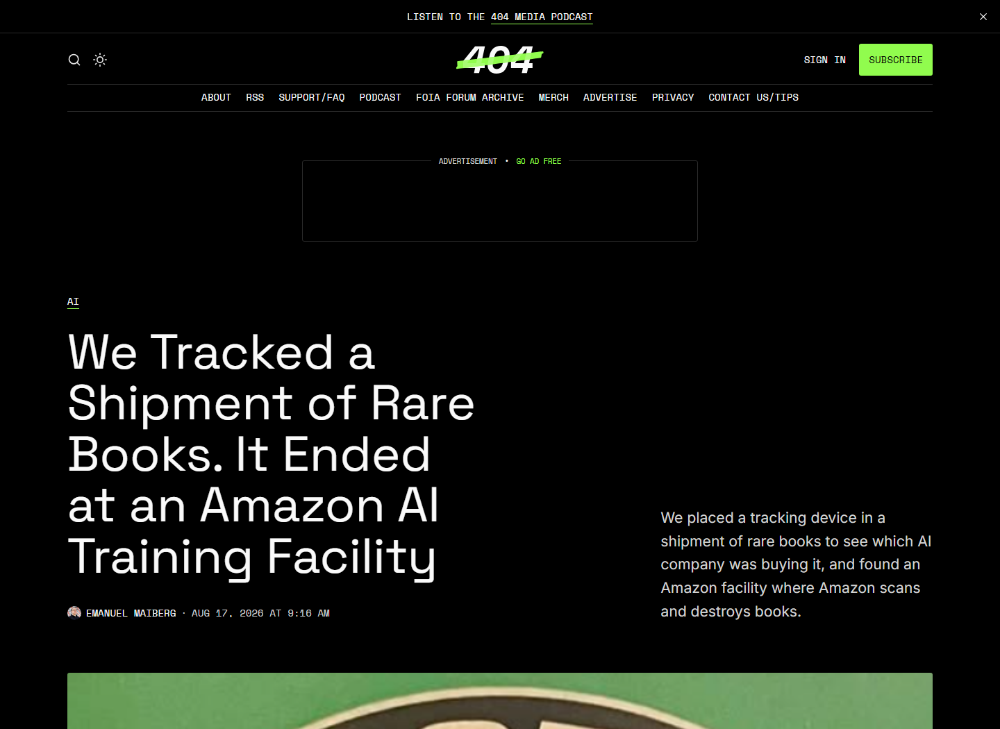
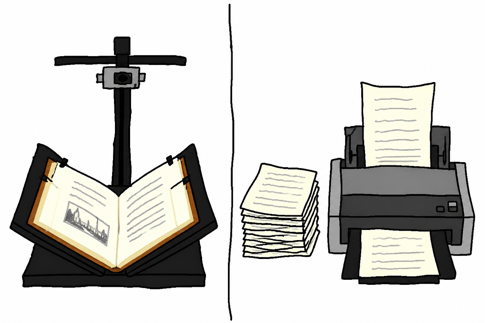
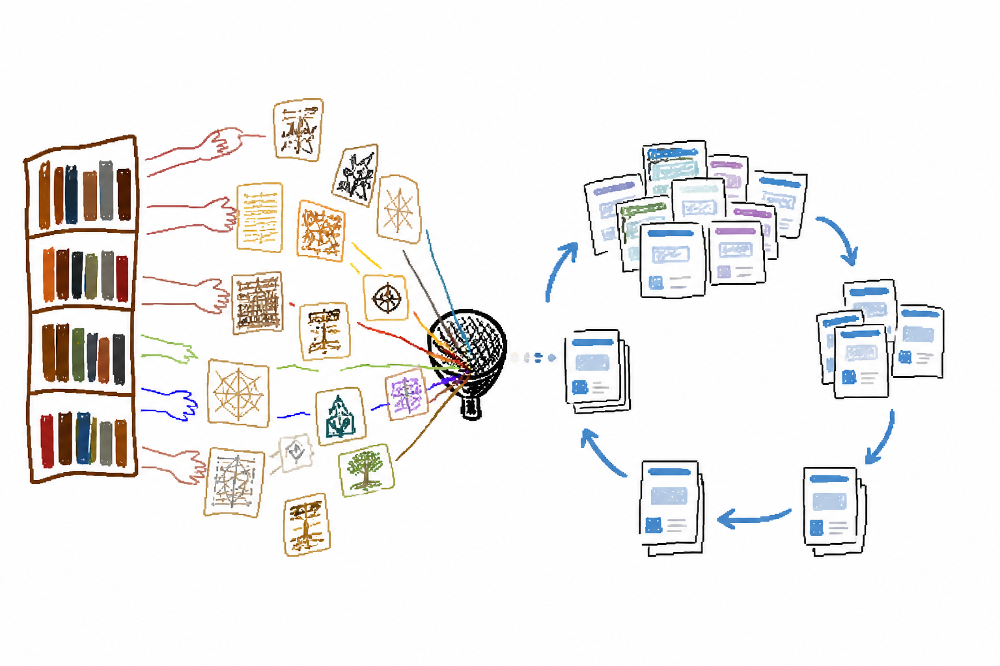
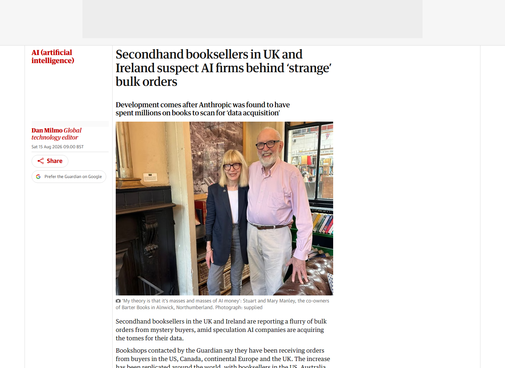
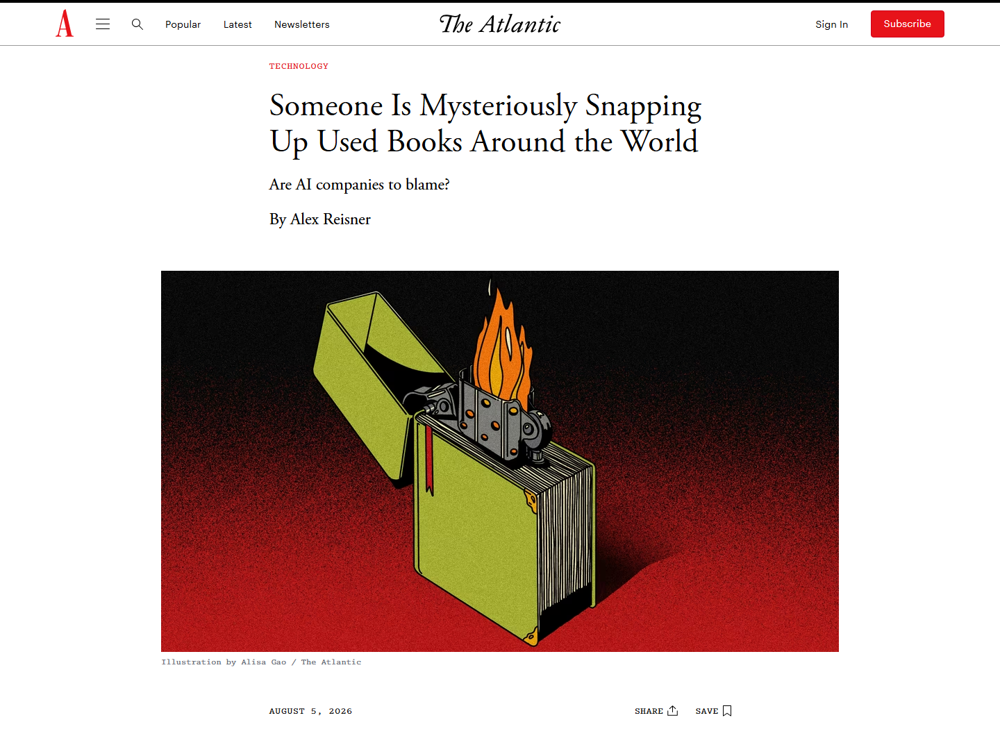
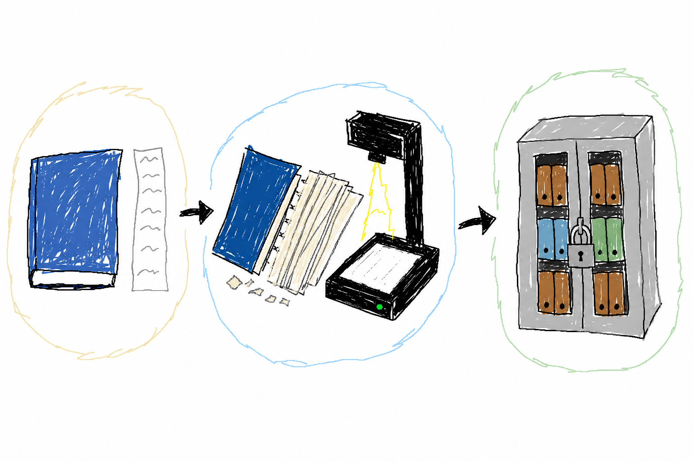
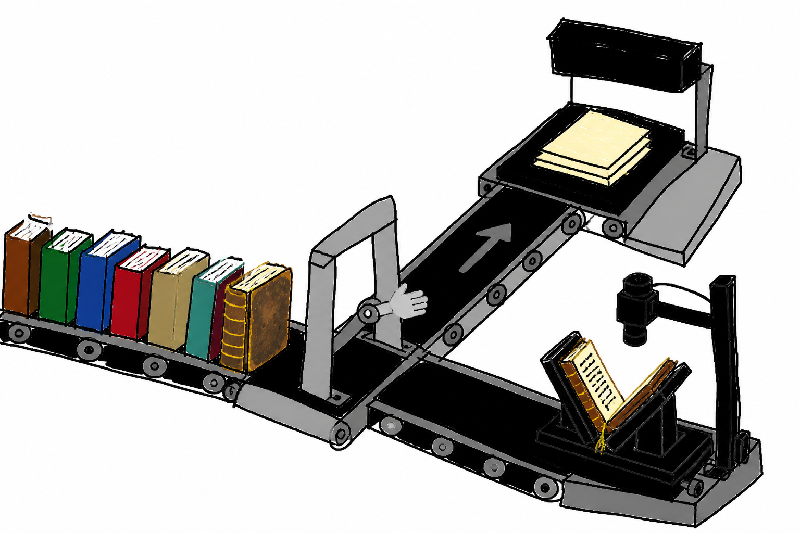

# 一本旧书被装上追踪器，最后追到了亚马逊的 AI 设施

一本旧书从书商手里寄出后，没有去收藏家，也没有进入图书馆。

藏在书里的追踪器显示，它一路到了拉斯维加斯的一座 Amazon 仓库。再往后的旅程，就很难保持完整了。

据 404 Media([1]) 调查，这批书进入的作业区名为 VGT3。员工向该媒体描述，他们收到纸质书后，会切掉书脊，再把散开的纸页送去扫描。

文本被留下，原来的书无法恢复。

Amazon 在回应中表示，公司通过商业渠道购买书籍，用于开发和改进客户使用的产品与服务。至于买了多少、挑选了哪些书、扫描件进入哪个产品或模型，它没有回答。

*404 Media 报道页面截图。标题与导语写明，记者把追踪器放进一批旧书，最终定位到一座由 Amazon 扫描并销毁书籍的设施。来源：404 Media。*

AI 公司已经能从互联网得到海量文本，为什么还要回来收购纸书？得到书以后，又为什么要先把它拆掉？

## 最快的扫描，从切掉书脊开始

一本装订完好的书，并不适合直接进入高速扫描流水线。

如果想保留原书，通常要把书放在书托上，用顶置相机逐页拍摄。扫描时还要照顾装订角度、纸张状态，以及文字是否被书脊遮挡。

美国国会图书馆的数字化保存指南([2])要求，脆弱或高价值的装订材料使用合适的支撑与扫描设备，避免在进纸过程中受损。

切掉书脊后，一本书就变成了几百张可以连续进纸的散页。扫描速度更快，也更容易在同一条流水线上处理不同尺寸的书。

拆书发生在模型训练之前。它解决的是怎样用更少的人工，把更多纸页变成机器可以处理的文件。

*AI 生成示意图：保留装订的逐页拍摄，与切脊后的散页连续进纸。*

公众第一次看清这种流程，来自 Anthropic 的版权诉讼。

法院裁定文件([3])记载，Anthropic 购买了大量纸质书，拆除装订、裁切纸页，再将扫描结果放进内部数字资料库。纸本随后被丢弃，一份实体副本对应一份数字副本。

Amazon 的规模仍然未知。公开信息只有一批书的追踪路径，以及员工对现场流程的描述。

## 互联网越像 AI，旧书越像数据

模型公司当然不缺网页。

它们缺的是来源清楚、质量稳定，而且能确认主要由人类写成的文本。

过去几年，生成式 AI 制造的文章、商品描述、问答和网站迅速增加。网页不会因此立即失去训练价值，合成数据也并非天然有害。

但如果训练材料不加甄别地混入上一代模型生成的内容，模型可能逐渐丢失原始数据中那些低频、少见的信息。

一项发表于《Nature》的研究([4])，将这种递归训练造成的退化称为「模型崩溃」。

*AI 生成示意图：左侧表示来源多样的旧书文本，右侧表示内容反复进入递归循环；不是实验数据图。*

出版时间较早的纸质书，则有一个很简单的优势：它们出现在生成式 AI 普及以前。

一本书通常还经历过作者写作、编辑加工和出版筛选，能够提供比零散网页更连贯的长文本。

那些没有电子版的专业书、小众出版物和绝版书尤其特殊。很多内容单靠网页抓取根本拿不到。

今年 7 月，404 Media 曾报道([5])，已经有服务商开始把旧书包装成适合 AI 训练的人类文本来源。

到了这次追踪调查，原本藏在匿名订单和中间商之后的采购链，第一次指向了一座 Amazon 设施。

对模型公司来说，一本尚未数字化的旧书，也是一份还没有进入互联网的数据。

## 以后和你抢旧书的，可能不只是另一个读者

这种采购目前还谈不上改变整个旧书市场。

但一些书商已经感受到了变化。

英国和爱尔兰多家旧书商最近告诉《卫报》([7])，他们收到过规模异常的订单。有人一次卖出数千本书，也有人从今年开始陆续接到数千本类似采购。

*《卫报》报道页面截图。图中为英国旧书店 Barter Books 的共同经营者 Stuart 与 Mary Manley；网页将原图标注为「supplied」。来源：《卫报》。*

这些订单和普通藏家的买法不太一样。

买家并不集中购买某位作者、某个题材或者某个年代的书。有些订单横跨完全没有关系的类别。

他们也很少议价。

一位书商提到，这些买家愿意直接支付网站上的价格。还有书商认为，大规模采购已经开始影响正常的二手书交易。

被买走的也不全是昂贵的珍本。

此前《The Atlantic》梳理这轮旧书采购时发现([6])，其中有不少只是几十年前出版的冷门书籍。它们可能已经绝版，但并不一定稀有到只有一两本存世。

*《The Atlantic》报道页面截图。原标题为「Someone Is Mysteriously Snapping Up Used Books Around the World」，网页配图作者为 Alisa Gao。来源：《The Atlantic》。*

这类书过去可能会在旧书网站上挂很久。

等待它的通常是某个刚好需要这本书的读者、研究者或者收藏者。

现在多了一类买家。

它并不一定在意书的品相，也不准备把它重新卖出去。它需要的是里面还没有被数字化的文字。

现在还没有证据表明 AI 公司的采购已经普遍推高了旧书价格。但对于供应量本来就很少的版本，只要实体副本不断退出流通，后来寻找它的人就会面对更少的选择。

## 有些书被数字化以后，反而更难读到了

过去我们很容易把「数字化」理解成另一件事。

图书馆扫描一本旧书，通常是为了保存它。条件允许的话，数字版本还会让更多人看到原本只能在馆内阅读的资料。

AI 公司做的数字化不一定如此。

在 Anthropic 的案例里，扫描产生的文件进入了公司的内部资料库。原来的纸质书则在拆解和扫描后被处理掉。

Amazon 也没有说明这些扫描得到的文本是否会对外开放。

*AI 生成示意图：实体副本、扫描转换与内部数字资料库是三个不同动作。*

于是可能出现一种情况。

一本原本可以在二手市场继续转卖的书，被人买走。

它被拆开，扫描成文件。

公司获得了其中的文本。但下一位想完整读到这本书的人，并不会因此多得到一个可以打开的电子版。

当然，一本书被拆掉，并不等于这部作品从世界上消失了。很多书还有其他副本，常见作品甚至有成千上万册。

真正值得注意的是那些本来就没有电子版、馆藏又很少的书。

一本八十年代的专业书，一本停刊已久的杂志，一本地方出版物，或者某个很小领域里的技术资料，都可能属于这一类。

它们过去没有被数字化，往往就是因为读者太少。

现在，没有被数字化本身成了它们被购买的理由。

## 买下一本书，能买到什么

购买纸书可以解释它为什么会被拆，却没有自动解决后面的版权问题。

买家拥有手里的这一本，可以转卖、收藏或丢弃。书中表达的版权仍然属于作者或其他权利人。

在 Anthropic 一案中，法官把几个动作分开处理。

一是合法购买纸书后，把它转换成内部数字副本。

二是使用文本训练模型。

三是此前从盗版书库取得文件。

至少在该案的具体事实下，前两项获得了有利的合理使用判断。盗版取得方式却没有因此被洗白。

与来路不明的下载文件相比，购买纸书能够留下交易记录。实体书转换成内部数字副本，也更接近法院在该案中接受的格式转换方式。

不过，这是一项针对 Anthropic 和特定事实的裁定，不是一张适用于所有公司、所有书目的训练许可证。

争议也不能简单压成「每拆一本书，就有一份文化遗产消失」。

大量普通旧书长期卖不出去，本来就可能被回收或打浆。若它们在退出流通前留下可检索的文本，结果未必比直接处理更坏。

问题更多落在那些难以替代的版本上。

「rare books」可能只是少见、冷门或已经绝版，并不意味着每一本都是孤本。

此前《The Atlantic》在调查这轮采购时也提醒([6])，外界并不清楚这些书究竟有多稀缺。

*AI 生成示意图：散页进纸与保留装订的书托拍摄，对应不同的保存选择。*

Amazon 至今也没有说明，进入扫描流水线前，是否有人检查版本的稀缺程度。

遇到难以替代的书，会不会改用非破坏性扫描，也没有答案。

扫描完成后，数字文本最终保存在哪里，谁可以使用，同样没有公开。

一个追踪器回答了一批书去了哪里。

至于以后还有多少人能读到它们，现在还不知道。

[1]: https://www.404media.co/we-tracked-a-shipment-of-rare-books-it-ended-at-an-amazon-ai-training-facility/
[2]: https://www.loc.gov/preservation/care/scan.html
[3]: https://storage.courtlistener.com/recap/gov.uscourts.cand.434709/gov.uscourts.cand.434709.231.0_1.pdf
[4]: https://www.nature.com/articles/s41586-024-07566-y
[5]: https://www.404media.co/ai-companies-are-buying-tons-of-old-books-because-theyre-free-of-ai-slop/
[6]: https://www.theatlantic.com/technology/2026/08/ai-companies-buying-used-books-for-data/688167/
[7]: https://www.theguardian.com/technology/2026/aug/15/uk-ireland-booksellers-suspect-ai-companies-bulk-orders-data-acquisition
