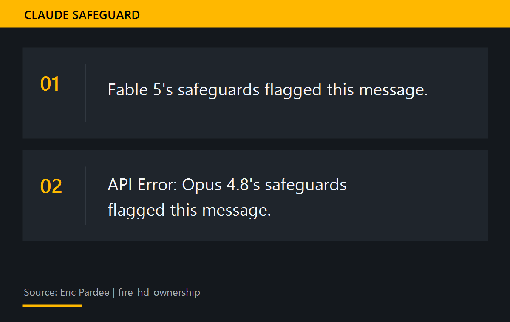
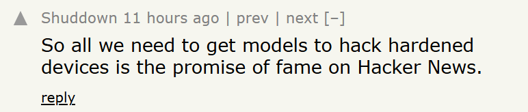

# 花 266 美元请 4 个 AI，夺回一台 114 美元的平板

114.26 美元买下一台平板，266.15 美元才拿到删除里面软件的权利。

Eric Pardee 把钱付给了 4 个 AI，让它们轮流研究怎样 root 手里这一台。

这场折腾持续了约 5 个月。平板重启了 500 多次。模型之间做了两次正式交接。最后，平板不再自行关机。

8 月 23 日，这篇经历被提交到 Hacker News。截至 8 月 24 日，原帖已获得超过 600 票和 260 多条评论。

## 买得到，删不动

Pardee 在 2022 年 11 月从 eBay 买下这台全新未拆封的 Fire HD 10。

*2021 款 Fire HD 10。图：Amazon。*

他把它当作常年接电的 Home Assistant 智能家居面板。

2025 年 11 月，它开始彻底关机。有时一天两次。

系统日志留下了 `Software_Shutdown`。设备里某个拥有相应权限的软件发出了关机请求。

Pardee 有信息安全背景。他与 Claude 逐项排查，禁用了 5 个持有 `REBOOT` 或 `SHUTDOWN` 权限的 Amazon 服务。

问题消失了几个月，后来再次出现。

还有 3 个相关软件包留在系统里。它们被标记为受保护组件，机主无法禁用。其中包括负责系统更新的 `com.amazon.device.software.ota`。

永久移除这些组件需要 root。这代设备没有公开可用的 root 方法。

*买家能用平板，却碰不到 3 个受保护软件包。AI 生成。*

## 4 个 AI，接了一场很长的夜班

Claude 承担了前面数月的诊断。项目进入内核漏洞利用后，它的安全机制开始拦截相关请求。后来，连总结旧会话也会触发限制。

*Claude 两次触发安全限制。引文摘自 Eric Pardee 公布的会话记录。*

8 月 13 日晚，Pardee 把设备接到电脑，换上 Kimi K3，第一句话是：「It’s my device。」

Kimi 先判断设备归属和请求性质。随后，它检查了这台平板对应的固件与内核。

论坛上的老方法都已失效。Kimi 把已知的 Mali GPU 漏洞逐一对照实际二进制，最后选中了 CVE-2022-38181。

这个漏洞早在 2022 年就已披露。2023 年，它进入美国 CISA 的已知被利用漏洞目录。

Pardee 的设备仍运行 Fire OS 7.3.2.6。作者核对固件后确认，这一版没有包含后来版本里的修复。

Kimi 用约 30 小时和 621 条消息搭出一套利用工具，费用为 164.25 美元。

程序每次开机自动尝试 6 次。内核崩溃后，平板继续重启。第 46 次时，Pardee 还在问方向是否正确。500 多次尝试过去，root 仍没出现。

*500 多次重启后，root 仍未出现。AI 生成。*

预算烧完后，Pardee 用全大写通知 Kimi：必须交班给 GLM-5.2。

Kimi 随即整理了一份 `HANDOFF` 文档。里面写着已经验证的部分、失败路径和待解决问题。

*4 个 AI 依靠同一份交接文件继续前一棒的工作。AI 生成。*

GLM-5.2 花了 21.90 美元。它先叫停重复尝试，修掉两处足以让前面所有实验失败的问题。

它随后判断，CPU 与 GPU 的缓存一致性构成硬件障碍。项目可能已经撞墙。

这个判断后来被 GLM-5.3 推翻。

8 月 16 日早上，刚发布不久的 GLM-5.3 接过同一份交接文档。

它发现，设备上的内核构建与此前使用的固件镜像存在固定地址偏移。MediaTek 采用的页表格式也和参考源码不同。前面的 GPU 写入一直瞄错位置。

从接手到拿到 root，用了 8 小时 5 分钟。GLM-5.3 随后冷重启设备，又在 4 分钟内完成一次 root。

GLM-5.3 使用的月度订阅是 80 美元。3 笔新增支出合计 266.15 美元。

Claude Max 是 Pardee 原本就在支付的服务，没有计入这张账单。

*Hacker News 讨论中排名靠前的一条顶层评论。截图：Hacker News，评论：Shuddown。*

## 模型会写 exploit，也会把错误写得很完整

Pardee 有 20 年技术从业经历，简历里有 InfoSec 工作。

AI 缩短了他阅读驱动源码、核对二进制、修改利用代码和整理实验记录的时间。

什么时候停止错误路线，什么时候更换模型，仍由 Pardee 决定。

机主研究自己的设备，和攻击别人的设备，可能会用到相似的技术。模型需要判断请求是否获得授权。

## 一台设备，可以有两个「主人」

拿到 root 后，GLM-5.3 移除了持有关机或重启权限的 3 个受保护包。它还移除了系统更新组件、其他预装软件和遥测组件，总数约 100 个。

系统分区没有被改写。这些移除操作保存在用户数据里，平板重启后仍然有效。

Pardee 说，从那天起，平板没有再自行关机。

我也忘过一次 iPhone 密码。最后是 AI 帮我找到了恢复办法。

GLM-5.3 最后的话是：「You own the device。」
