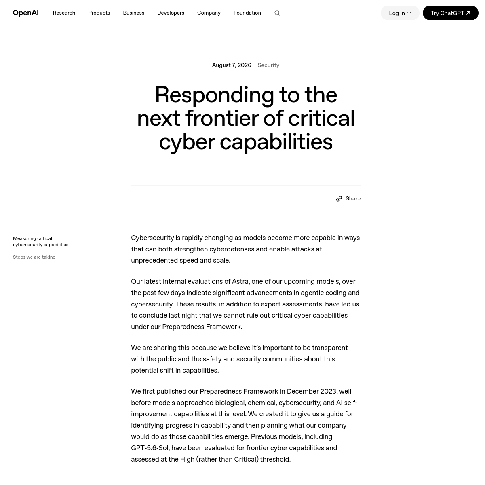
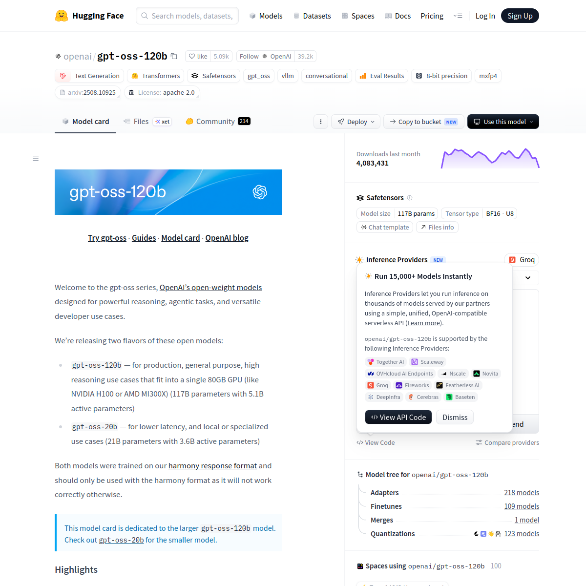
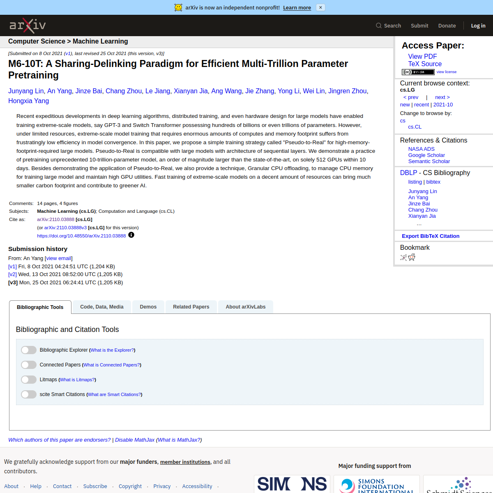
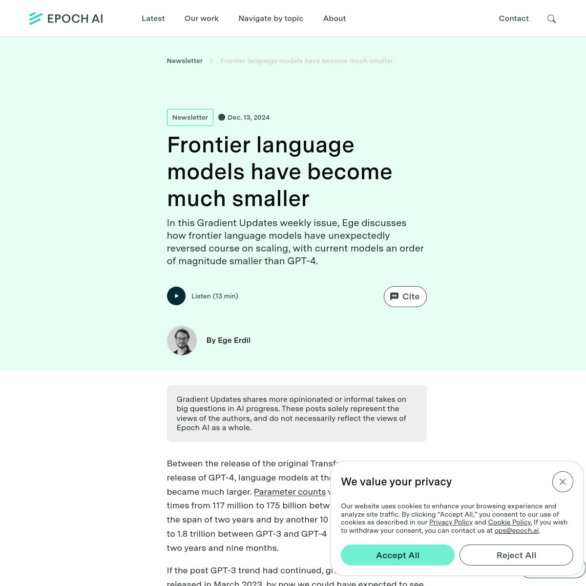
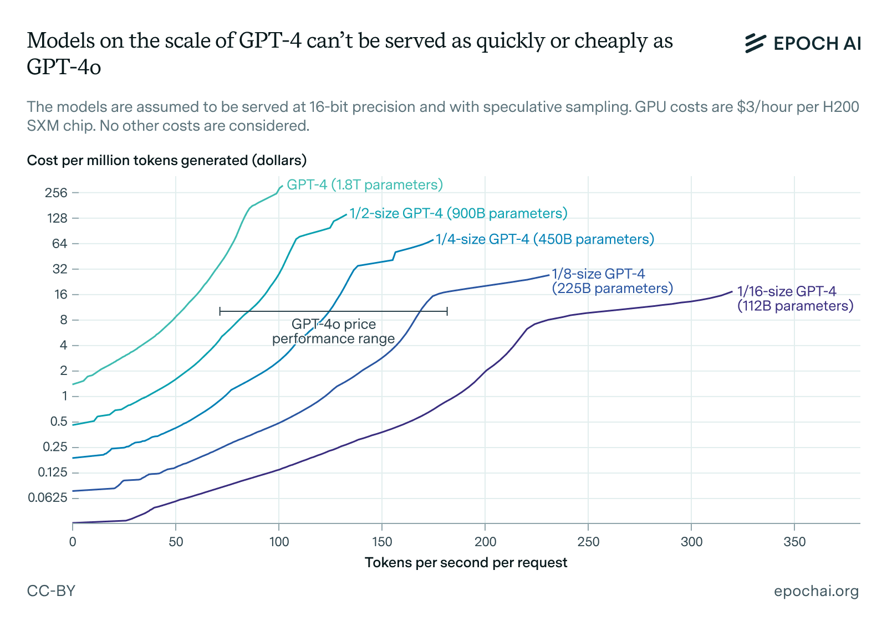
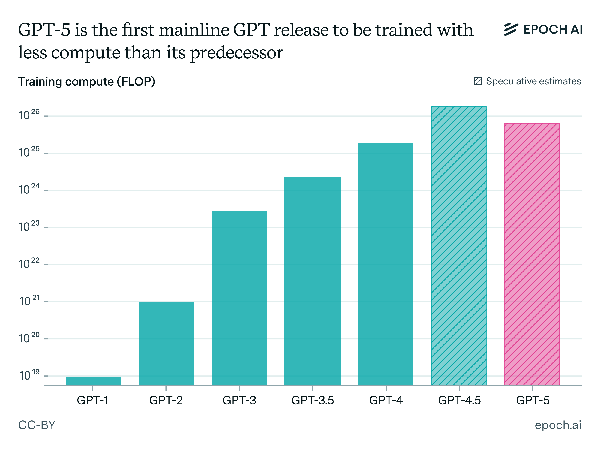
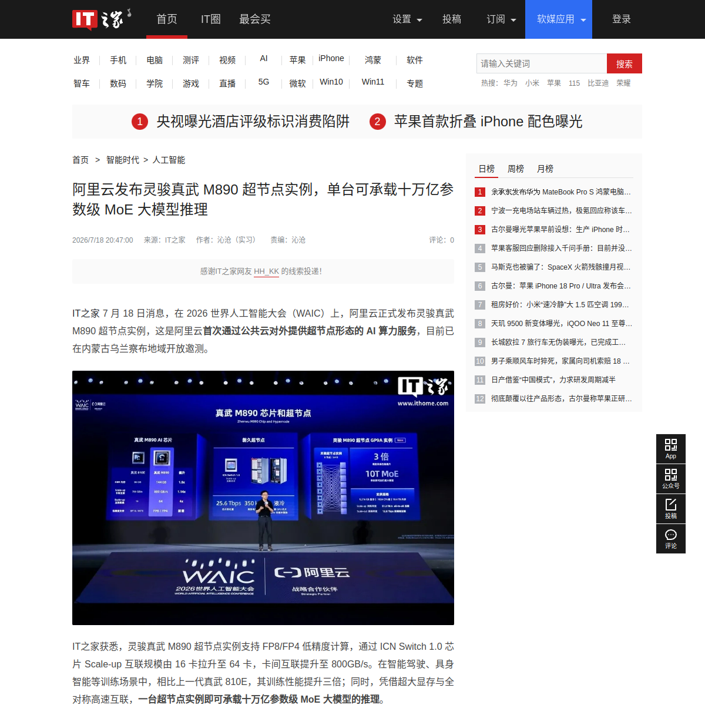

# 同一天，两条「10 万亿参数」消息撞在一起：它们可能不是同一种机器

同一个「10 万亿参数」，一条找不到官方出处，另一条连最终规模都没定。它们却在同一天被拼成了一场「OpenAI 对字节」的模型竞赛。

OpenAI 在 2026 年 8 月 7 日确实宣布暂停部分涉及 Astra 的内部活动，但公告没有公布参数量。社交平台给它贴上的「10 万亿」标签，目前找不到可追溯的官方出处。字节的数字来自 Financial Times 报道，并由 Reuters 转述：三名知情人士称，新模型处于预训练早期，最终规模最高可能达到 10 万亿参数；规模尚未确定，公司也未置评。

这还不是两个已经存在的「10 万亿产品」同台亮相。前者是官方事件外加一层未经证实的数字，后者是带有信源和明确限定的媒体报道。我们把它们放在一起，只做一个思想实验：哪怕两条消息最终都押中了，同一个「10 万亿」也可能在描述两台很不一样的机器。

*图：OpenAI 的 Astra 暂停公告。它能证明暂停事件存在，不能证明 Astra 的参数量。*

## 先把两个「10 万亿」放回各自的证据等级

OpenAI 公告说得很具体：公司暂停了部分涉及 Astra、尚未达到加强后安全控制要求的内部活动。原因是最新内部评估无法排除它达到 Preparedness Framework 中「关键网络能力」阈值的可能。公告没有说 Astra 就是 GPT-6，也没有给出它有多少参数。

这两个缺口很重要。把「暂停」自动补成「GPT-6 被叫停」，再把网上流传的参数数字接上去，一条有官方来源的新闻就会在转发中长出两层官方从未确认的结论。

字节那条消息的证据链更完整一些，但语气也远没有标题那么笃定：项目还在预训练早期，最终规模「最高可能」到 10 万亿，数字尚未敲定。它值得关注，仍不能写成字节已经训练完成一个 10 万亿模型。

手机屏幕会把这些限定压扁。最后留下的往往只有「OpenAI，10 万亿」和「字节，10 万亿」，看起来像一张新鲜出炉的体重榜。可事实核查只是第一道门。即使以后两家公司都确认了这个数字，我们仍然不知道：这 10 万亿参数，是不是每处理一个 token 都要用上？

这正是要先处理消息等级的原因。一个没有官方出处的社交数字，和一个由知情人士提供、仍带着「最高可能」限定的数字，不能互相替对方壮胆。前者不会因为碰巧遇到后者，就自动变得更可信；后者也不会因为登上新闻，就提前变成已经完成的产品。把不确定性保留下来，反而能让后面的技术问题摆脱押宝：传闻将来无论证实还是落空，参数口径的差别都仍然存在。

## 总参数是整栋楼，每次亮起的只是其中一部分灯

要回答这个问题，得先把「参数量」拆成两栏。

总参数，是模型全部可训练权重的数量，它描述了模型持有的总容量，也影响需要存放多少权重。激活参数，则是模型处理一个 token 时，实际参与这次前向计算的参数子集。对于 MoE，也就是「混合专家」架构，路由器会为每个 token 选择一部分专家，不必把所有专家同时叫来工作。

可以把它想成一栋有 10 万亿盏灯的大楼：总参数是整栋楼装了多少盏灯，激活参数是这一次亮起多少盏。这个类比只说明「全部」与「本次调用」的区别；灯并不继续对应模型的记忆、知识或思考深度。

[gpt-oss-120b 的官方模型卡](https://huggingface.co/openai/gpt-oss-120b)给了一个很直观的样本。它有约 117B 总参数，每个 token 激活 5.1B，只占约 4.4%。换句话说，型号里的「120b」接近整栋楼的规模，不是每次推理都要点亮的部分。

*图：gpt-oss-120b 官方模型卡列出的约 117B 总参数与 5.1B 每 token 激活参数。*

Kimi K3 的差距同样明显。[官方模型卡与配置](https://huggingface.co/moonshotai/Kimi-K3)写的是 2.8T 总参数、每 token 激活 104B，激活占比约 3.7%。它有 93 层；每个 MoE 层设置 896 个路由专家，一个 token 选择其中 16 个，另有 2 个共享专家。

这里还有一个很容易制造「精确幻觉」的坑：不能用 `2.8T ÷ 896` 去算一个专家有多大。2.8T 是跨全部层累计的总参数，896 却是每个 MoE 层的路由专家数量，两个数字不在同一层级。连一道看似简单的除法都需要先知道架构口径，也说明总参数离完整的机器说明还很远。

这两份公开配置里，总参数与激活参数都相差二十多倍。于是，「10 万亿总参数」最先告诉我们的，是可训练权重的总盘子有多大；它没有直接告诉我们一次推理调用多少权重。两个同为 10 万亿总参数的模型，可以采用不同的层数、宽度、专家组织和路由方式，也可以有完全不同的激活预算。

激活参数更接近每 token 的计算量，却也不是新的万能分数。实际延迟和价格还受序列长度、硬件、并行、量化、缓存与实现影响；能力则离不开训练和评测。MoE 让总容量与每次计算可以分开扩展，但权重仍要存放，专家之间仍要通信，路由和负载均衡也都要付成本。

同样是 104B 激活参数，放在更深或更宽的网络里，采用不同路由与训练方法，结果仍可能不同。激活规模回答的是「这一次有多少权重参与计算」，没有回答这些权重学到了什么、路由能否稳定选对、输出在公开任务上表现如何。于是我们还需要一个已经公开的 10 万亿案例，看看这个最大号标签究竟独自证明过什么。

这时再回头看「10 万亿」，它就从一张能力成绩单，变成了一项仍缺少许多栏目的规格。更有意思的是，这个规格甚至不新鲜。

## 2021 年，10 万亿已经被训练出来了

2021 年 10 月 8 日提交的 [M6-10T 论文](https://arxiv.org/abs/2110.03888)，已经把总参数推到 10 万亿。团队使用 512 张 NVIDIA V100，在约 10 天内完成训练。10T 配置有 48 层，每个 MoE 层设置 10240 个专家；从训练工程看，这是一块很实在的里程碑。

*图：M6-10T 论文摘要中的 10 万亿参数、512 张 GPU 与约 10 天训练信息。*

但这项工作恰好也能检验「总参数能否单独说明能力」。对 M6-10T 本体，论文展示的是训练 loss 和 log perplexity，也就是训练过程中的拟合指标；它明确把 10T 模型能否改善不同下游任务留作开放问题。论文中较小模型的下游实验，不能搬过来当作 10T 本体的成绩。

训练指标有它们自己的用途：研究者可以据此观察训练是否推进、模型对训练数据的预测是否改善。但从这些曲线走到一个面向用户的能力结论，中间还隔着任务设计、评测结果与部署验证。论文作者把这一步留作问题，读者也就不能替论文把答案补上。限制说清楚，并不会抹掉 M6-10T 的工程价值，只是把价值放回它真正证明的地方。

因此，M6-10T 证明的是 10T 训练在当时已经可行，没有证明「只要总参数到 10T，产品能力就会自动跨过一道门槛」。这也解释了为什么今天再出现两条 10 万亿消息时，我们不能仅凭数字判断谁更聪明、谁更贵，甚至不能判断两者每次推理的计算量是否接近。

可问题又绕了回来：如果 10 万亿早在 2021 年就能堆出来，总参数也不是能力排行榜，行业为什么现在又开始为更大的模型准备算力和机器？

## 模型曾经缩小，现在扩大的可能是「容量余量」

先看中间发生过什么。Epoch AI 的 Ege Erdil 在 2024 年 12 月 13 日分析，GPT-4 约为 1.8T 参数，而 GPT-4o 约为 200B、Claude 3.5 Sonnet 约为 400B。后两个数字不是厂商披露，而是根据输出速度、API 价格和硬件经济学得到的估算，作者提示可能有约 2 倍误差。

*图：Epoch AI 2024 年分析的题目、作者与日期；文中参数数字包含估算。*

*图：Epoch AI 对模型规模变化与推理经济性的分析图表，CC-BY。*

这段变化提醒我们，模型设计不只追求把总数写大。面向大量用户时，输出速度、服务价格和硬件利用率会反过来约束架构。总容量再漂亮，如果每次调用都过于昂贵，也很难变成好用的产品。

但收缩未必会一直持续。Epoch AI 的 Yafah Edelman、Jean-Stanislas Denain、Jaime Sevilla 和 Anson Ho 在 2025 年 9 月 26 日分析，GPT-5 是首个训练算力低于上一代的主线 GPT 模型；如果后训练扩张难以继续，他们判断 GPT-6 很可能需要远多于 GPT-5、也可能超过 GPT-4.5 的训练算力。这里说的是训练算力，不能直接换算成参数一定增长，却说明前沿训练的投入可能再次抬头。

*图：Epoch AI 对历代 GPT 训练算力的估算及 GPT-6 方向判断，CC-BY。*

硬件也在为更大的稀疏模型留接口。IT之家 2026 年 7 月 18 日报道阿里云发布灵骏真武 M890 超节点，并转述官方表述：「一台超节点实例即可承载十万亿参数级 MoE 大模型的推理。」这只能证明硬件准备承载这一量级，不能倒推出某个具体 10T 模型已经存在。

硬件信号和模型消息之间，也要保留同样的证据距离。能承载某个量级，说明供应侧正在为相关存储、通信与部署条件做准备；它没有告诉我们哪家公司会采用哪套架构，更没有给任何未发布模型补上一张出生证明。它的意义在于让「容量继续变大」具备现实工程背景，而不是替传闻盖章。

*图：IT之家报道截图，画面与文字用于支撑 M890 面向「10T MoE」承载能力的公开表述。*

把这些信号连起来，更稳妥的判断是：这一轮「变大」可能更像扩大模型可用的总容量，同时借助 MoE 控制每个 token 的激活预算。这是依据公开架构、训练趋势与硬件信号作出的分析，不是 OpenAI、字节或任何厂商已经公布的路线图。

总参数当然没有失去意义。它仍影响容量上限、权重存储和训练负担；更多容量与训练算力也可能带来能力提升。只是它必须和激活规模、层宽与深度、路由方式、训练过程、公开评测以及真实部署成本一起读。若只把注意力从总参数移到激活参数，我们不过是给旧的数字崇拜换了一块新招牌。

所以下次再有两条「10 万亿」在同一天撞进信息流，先别急着排座次。先问它来自官方、媒体信源还是社交平台，再问这个数字统计了整台机器的什么部分、一次实际亮起多少、经过了怎样的训练与评测。10 万亿不是答案，它只是那张模型说明书里最容易被标题放大的一格。

<!--
fact_boundary_check: pass
skeleton_independence_check: pass
  scene: 以「同一个 10T 对应两种证据等级」的冲突开场，日期随后作为 Astra 公告的证据进入。
  reveal_order: 先区分 Astra 官方公告、社交传言与 FT/Reuters 报道的证据等级；再拆总参数和每 token 激活参数；随后用 M6-10T 检验总参数能否代表产品能力；最后以 Epoch AI 与 M890 信号解释容量扩张趋势并回应总参数仍然重要。
  technical_compression: 只使用一次「整栋楼的灯／本次亮起的灯」类比，紧跟字面定义；以 gpt-oss-120b 和 Kimi K3 两组总参数／激活参数对照压缩 MoE 解释，不把专家映射成能力部门。
fact_map:
  - F1: 2026-08-07 Astra 暂停公告、关键网络能力阈值、未确认 GPT-6 与参数量；FT/Reuters 同日报道字节项目处于预训练早期、最高可能 10T、规模未定且公司未置评。
  - F2: gpt-oss-120b 约 117B 总参数、每 token 激活 5.1B、约 4.4%、MoE。
  - F3: Kimi K3 2.8T 总参数、每 token 激活 104B、约 3.7%、93 层、896 个路由专家、每 token 选择 16 个路由专家并有 2 个共享专家。
  - F4: M6 论文于 2021-10-08 提交；512 张 NVIDIA V100、约 10 天、10T；48 层、每个 MoE 层 10240 个专家；10T 本体仅展示训练 loss/log perplexity 并把下游效果留作开放问题。
  - F5: Epoch AI 2024-12-13 分析中的 GPT-4 约 1.8T、GPT-4o 约 200B、Claude 3.5 Sonnet 约 400B；后两项为估算且可能有约 2 倍误差。
  - F6: Epoch AI 2025-09-26 分析称 GPT-5 为首个训练算力低于上一代的主线 GPT 模型，并判断在给定条件下 GPT-6 训练算力可能明显回升；正文明确未把算力增长等同于参数增长。
  - F7: IT之家 2026-07-18 报道阿里云 M890 可承载十万亿参数级 MoE 推理；正文只据此判断硬件承载准备，不证明具体模型存在。
image_map:
  - ../../../assets/openai-astra-announcement-screenshot.png: 只支撑 OpenAI 确有 Astra 暂停公告，不支撑参数量。
  - ../../../assets/gpt-oss-120b-modelcard-screenshot.png: 支撑约 117B 总参数与 5.1B 每 token 激活参数。
  - ../../../assets/m6-10t-arxiv-screenshot.png: 支撑 M6-10T、512 张 GPU 与约 10 天的论文摘要信息。
  - ../../../assets/epoch-smaller-article.png: 支撑 2024 年 Epoch AI 分析的题目、作者与日期。
  - ../../../assets/epoch-token-economics.png: 支撑模型缩小与推理经济学图表，CC-BY。
  - ../../../assets/epoch-gpt6-compute-forecast.png: 支撑历代 GPT 训练算力估算与 GPT-6 方向判断，CC-BY。
  - ../../../assets/aliyun-m890-ithome-screenshot.png: 支撑 M890 新闻页面及「10T MoE」承载表述，标注为 IT之家报道截图。
-->
