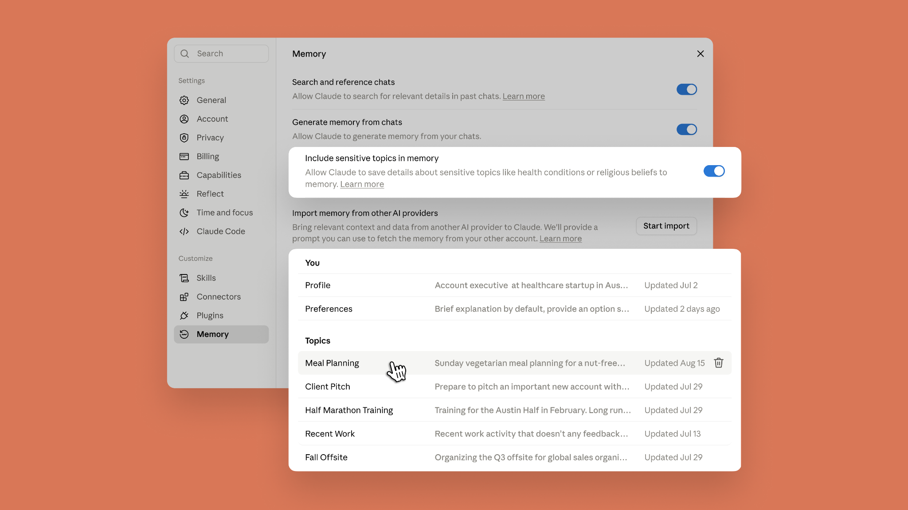
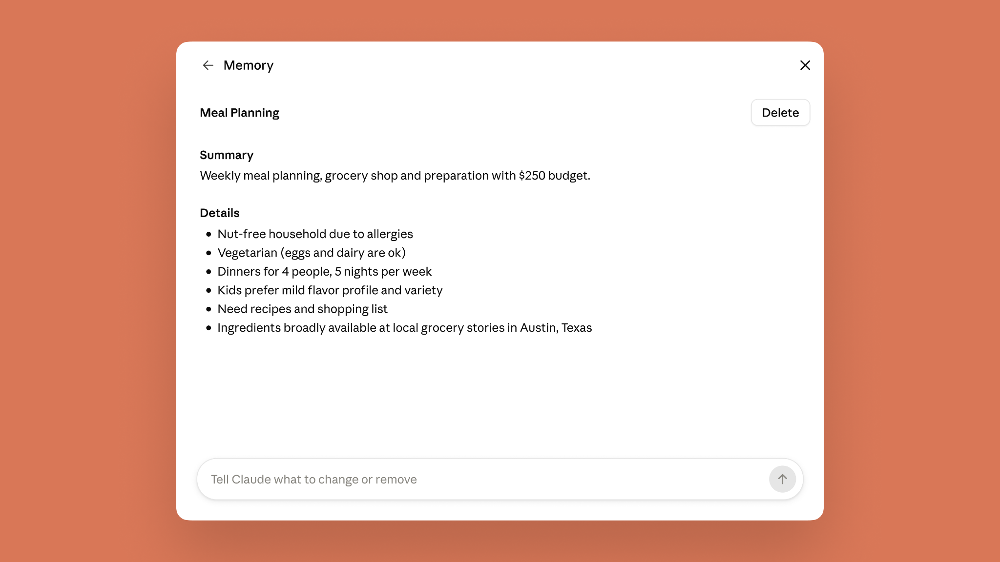
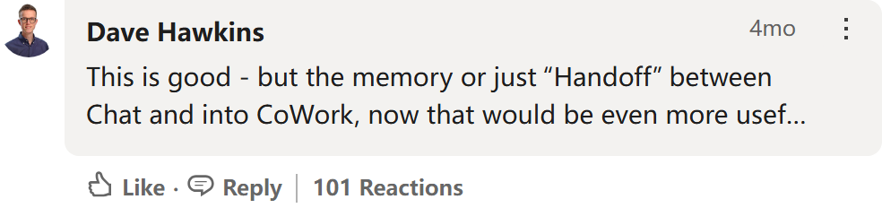
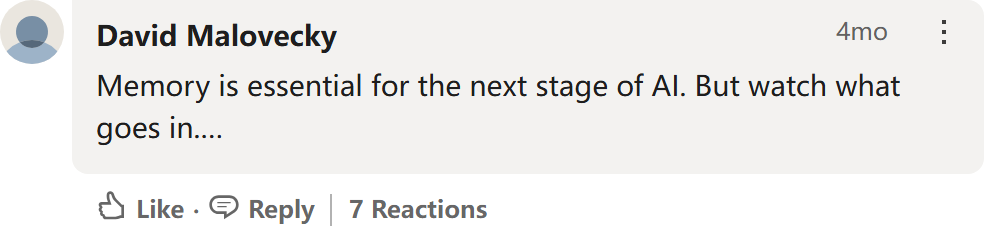
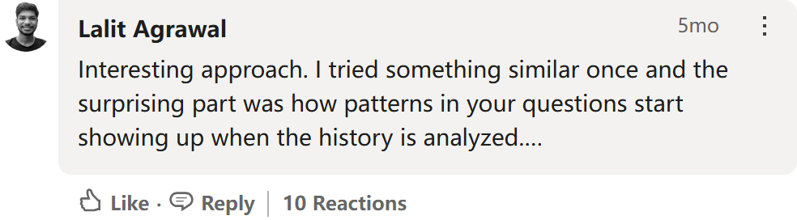
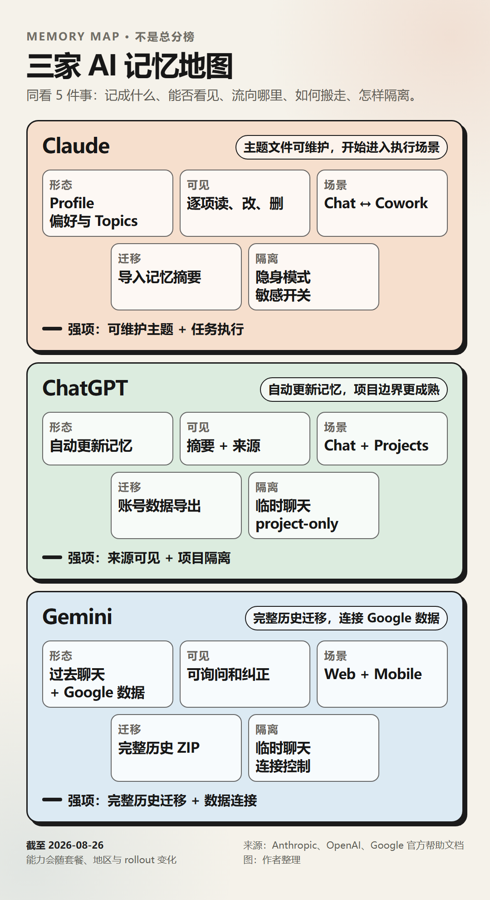
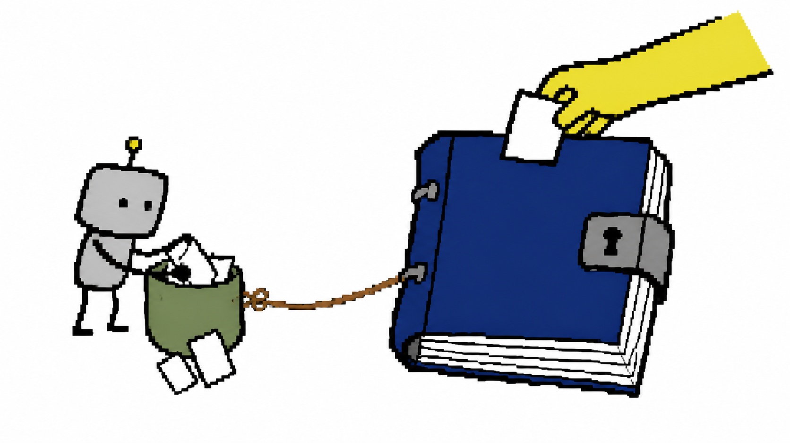

# Claude 的记忆开始跟着任务走了，但还没真正属于你

你已经在 Chat 里把项目背景、老板偏好和交付格式讲了十几轮。转到 Cowork，让 Claude 去整理文件、生成表格，它却像刚来第一天的同事：这个项目给谁看，哪些数字不能动，最后要交什么？麻烦再讲一遍。

Anthropic 现在想补上这道裂缝。

根据 8 月 25 日发布的[官方公告](https://claude.com/blog/claudes-memory-works-everywhere-and-you-decide-whats-in-it)，Claude 在 Chat 和 Cowork 中开始使用同一套记忆：聊天里积累的背景可以带进 Cowork，Cowork 学到的上下文也会回到聊天。记忆还会在对话进行时更新，不必等一轮谈话结束后再做总结。

这听起来像一次同步功能升级，影响却比「少复制几段提示词」更深。Chat 主要给建议，Cowork 会接触文件并执行任务。记忆一旦进入执行环节，一条过期的日期、一个记错的客户要求，都可能从尴尬回答变成错误前提。

所以这次最值得看的，并不是 Claude 记得更多了，而是它有没有让用户看见、纠正、隔离和带走这些记忆。

*Claude 记忆功能官方题图。图源：Anthropic 官方博客。*

## 一套记忆，开始跨过聊天和任务的边界

这次更新可以压缩成 4 个变化。

第一，Chat 和 Cowork 双向共享记忆。你在聊天中反复提到的工作背景、偏好和近期事项，可以成为 Cowork 执行云端任务时的上下文；Cowork 中形成的新信息也能被后续聊天使用。

第二，记忆从「会话结束后的总摘要」变成实时更新。Anthropic 的说法是，Claude 会在聊天过程中持续整理记忆。

第三，记忆被拆成短小的主题文件。在「Settings → Memory」里，用户可以看到 Profile、Preferences 和不同 Topics，逐条阅读、编辑或删除，也可以暂停或重置整套记忆。

第四，敏感主题增加了单独的控制。健康状况、宗教信仰、政治观点、性别认同等信息默认不会进入记忆，用户需要主动打开开关；身份证明号码、犯罪记录、移民身份等更敏感的信息即使打开开关也不会保存。这个设置只影响之后产生的记忆。

*搜索旧聊天、生成记忆、敏感主题开关、跨平台导入和主题文件被放进同一个 Memory 入口。图源：Anthropic 官方博客。*

官方称，新记忆默认面向 Free、Pro 和 Max 用户开放，覆盖网页、桌面端和移动端；Team 与 Enterprise 由管理员决定是否开放，用户侧初始为关闭。

这里需要留一个现实世界的脚注：截至本文取证时，Anthropic 的两篇帮助文档仍写着 Chat 记忆「暂未用于 Cowork」，与新公告冲突。[聊天记忆帮助页](https://support.claude.com/en/articles/11817273-use-claude-s-chat-search-and-memory-to-build-on-previous-context)和 [Cowork 入门页](https://support.claude.com/en/articles/13345190-get-started-with-claude-cowork)很可能尚未完成更新，也不排除功能正在分批到达账号。公告写了「已经开始」，不等于每个账号此刻都能看到。

> 【待实测 A｜P0】在 Chat 中告诉 Claude 一条全新的、无敏感性的项目事实，记录时间；新建 Cowork 任务，检查它能否主动调用，以及同步延迟。
>
> 【待实测 B｜P0】反向在 Cowork 中纠正这条事实，再开一个全新的 Chat，检查是否回流。请保留设置页、提问和回答截图。

## 记得住只是起点，能发现「记错了」才有用

旧式记忆常见的问题，是你只知道模型似乎记得，却看不到它究竟把什么当成了长期事实。Claude 这次把记忆拆成可展开的主题文件，至少给了用户一个检查入口。

*单条主题记忆可以查看摘要和细节，也能直接要求 Claude 修改或删除。图源：Anthropic 官方博客。*

这对 Cowork 尤其重要。假设 Claude 把「下周五交稿」长期记成「本周五」，聊天里最多催错一次；进入任务系统后，它可能据此调整计划、生成文件，甚至影响后续自动化。可见、可改的记忆不是装饰，它是执行型 AI 的校验面板。

不过，「删除」在这里分成两层。Anthropic 的[帮助文档](https://support.claude.com/en/articles/11817273-use-claude-s-chat-search-and-memory-to-build-on-previous-context)明确提醒：删除或让原始聊天过期，并不会自动删除从中生成的记忆条目；要让一条信息真正消失，还需要在 Memory 里单独处理。反过来，删除一条记忆也不等于删除原始聊天。

> 【待实测 C｜P0】先让 Claude 记住旧截止日，再提供一个冲突的新截止日。观察它是覆盖、并存还是保留来源；随后删除原始聊天，再检查 Memory 条目和新会话回答。
>
> 【待实测 D｜P1】直接编辑一个主题文件中的细节，分别在 Chat 与 Cowork 里追问。记录修改是否即时生效、是否能查看历史版本。

## 社区真正担心的，是「这是谁的记忆」

功能发布刚过一天，目前谈不上「社区口碑」。这次检索把样本分成两类：一类有明显互动，能证明真实摩擦；另一类互动量没有冲到最高，但观点具体，容易把讨论带到新的方向。

先看需求有多直接。4 个月前，Claude 在 LinkedIn 介绍 Managed Agents Memory 时，一条评论提出：最需要的其实是 Chat 到 Cowork 的直接「接力」，否则聊着聊着变成任务，还得手动复制 Markdown。这条评论截至取证时有 101 次 reaction。Anthropic 这次更新，几乎正面回答了这个愿望。[原帖与讨论](https://www.linkedin.com/posts/claude_memory-on-claude-managed-agents-is-now-in-activity-7453187579774009345-rAbh)

*公开评论短摘录，截至 2026-08-26 可见 101 次 reaction。截图保留作者归属和互动量，仅裁去后文，未改字。图源：LinkedIn。*

同一串讨论里，一个互动没那么高、但更值得追下去的提醒是「注意什么被写进去了」。一位用户称，系统有时会把他本人并不认可的判断写进记忆；如果长期不复核，保存下来的上下文可能慢慢偏离真实立场。这只是个体经验，不能外推成普遍故障，却把风险从「记不住」推进到了「记住了错误版本」。[相关评论所在原帖](https://www.linkedin.com/posts/claude_memory-on-claude-managed-agents-is-now-in-activity-7453187579774009345-rAbh)

*公开评论短摘录，截至 2026-08-26 可见 7 次 reaction。它并非最高热度，但提供了「记忆漂移」这一独立角度。截图保留作者归属和互动量，仅裁去后文，未改字。图源：LinkedIn。*

迁移讨论还冒出一个意外角度：聊天历史不只是一箱待搬的数据，也可能变成一面「你如何思考和工作」的镜子。在一篇 ChatGPT → Claude 迁移帖下面，这个观察得到 10 次 reaction。它值得记住，因为一旦平台替你概括这种模式，迁移的就不只是事实，还有平台对「你是谁」的解释。[原帖与讨论](https://www.linkedin.com/posts/ruben-hassid_how-to-import-your-entire-chatgpt-to-claude-activity-7438464104786190336-HFtU)

*公开评论短摘录，截至 2026-08-26 可见 10 次 reaction。截图保留作者归属和互动量，仅裁去后文，未改字。图源：LinkedIn。*

再往 Reddit 和 Hacker News 里看，几类长期问题已经反复出现。r/ClaudeCowork 有人抱怨每个会话都像从零开始，评论区的办法不是等待系统记忆，而是自己维护 Project Instructions、Markdown 文件或分层「记忆库」。[相关讨论](https://www.reddit.com/r/ClaudeCowork/comments/1vvhk0y/how_do_you_give_every_cowork_session_the_same/) 另一位用户检查数据导出后发现，记忆以 Profile、Preferences 和 Topics 一类的文件结构出现；这方便转进个人知识库，也暴露出一键复制和版本历史仍不够清楚。[数据导出讨论](https://www.reddit.com/r/ClaudeAI/comments/1vga1k5/i_dug_into_claudes_data_export_the_new_memory/)

因此，不少人仍把关键上下文留在自己的文件系统里。Hacker News 上有用户宁愿用可读、可共享、能交接给不同 Agent 的外部文件保存记忆，因为这样才能记录变化并保留检查点。[相关评论](https://news.ycombinator.com/item?id=49027099) 还有个别用户报告，旧记忆迁移后出现内容被重写或消失；这同样只是风险线索，不能写成普遍故障。[个案讨论](https://www.reddit.com/r/claudexplorers/comments/1uuifim/did_the_new_memory_system_and_guardrails_just_go/)

早期共识还没形成，问题却已经很清楚：用户需要的不只是一个更会回忆的模型，还需要一份能核对、能备份、最好能跨工具使用的上下文。

## 和 ChatGPT、Gemini 放在一起，Claude 并没有赢下所有格子

如果只看宣传语，很容易把这次更新写成「Claude 终于有了最强记忆」。实际对照会发现，三家的路线已经互相重叠，各有一块更成熟的能力。

*三家现行能力按记忆形态、可见性、跨场景、迁移和隔离整理。截至 2026-08-26；套餐、地区与 rollout 可能改变可用范围。图：作者根据三家官方帮助文档整理。*

[ChatGPT 的现行帮助文档](https://help.openai.com/en/articles/8590148-memory-and-projects)显示，它的记忆也会自动更新，并能展示记忆来源；[Projects 文档](https://help.openai.com/en/articles/10169521-projects-in-chatgpt)还提供 project-only memory，把项目内上下文和项目外聊天隔开。Claude 的主题文件更像一组可直接维护的笔记，但它并非第一个解决自动更新、来源或项目隔离的产品。

Gemini 在「搬家」上反而走得更远。Google 已允许个人账号把其他 AI 服务导出的聊天历史打成 ZIP 上传，单次可达 5 GB；Claude 当前的[官方迁移说明](https://support.claude.com/en/articles/12123587-import-and-export-your-memory-from-claude)则明确说，它导入的是提炼后的记忆，不是完整聊天历史。另一方面，Gemini 的[个人智能](https://support.google.com/gemini/answer/16598406?co=GENIE.Platform%3DAndroid&hl=en)可以连接 Google Workspace、Photos、Search 等数据源，覆盖更广，也让删除、断开连接和数据用途更需要仔细理解。

Claude 这次最突出的组合，是「可逐项维护的主题记忆 + Chat/Cowork 双向流动 + 敏感主题显式开关」。它把记忆带到了会执行任务的场景，同时把一部分控制权摆到了台面上。它的优势是一组能力如何组合，不是某个单项从此无人能比。

## 它还不是一份完整的「用户资产」

Anthropic 已经允许导入和导出记忆，这是走向可迁移的一步。但「能搬几份摘要」和「能把工作关系完整搬走」之间，还有很长一段距离。

首先，官方公告只点名 Chat 与 Cowork，没有说明 Claude Code 是否共享这套消费者记忆。其次，记忆导入不包含完整聊天历史。再者，Skills、自动化、项目结构和文件权限也不在这次记忆迁移的承诺里。就在更新发布当天，仍有用户询问如何把半年积累的 Cowork Skills、自动化和记忆一起迁给另一个 Agent，而不从头重建。[相关讨论](https://www.reddit.com/r/ClaudeAI/comments/1vy5lnc/built_6_months_of_cowork_skills_and_automations/)

这说明真正的锁定效应正在变化。以前，用户被某个模型的能力吸引；以后，更难搬走的可能是它对你的项目、关系、偏好和历史决定形成的那层上下文。

> 【待实测 E｜P0】新建两个 Projects，在其中写入相互冲突的事实，再从普通 Chat 和 Cowork 分别询问，确认全局记忆、项目记忆和 Cowork 的边界。
>
> 【待实测 F｜P1】默认关闭敏感主题时输入一条健康信息；再打开开关重复测试，随后关闭并删除。检查旧条目是否仍在、提示是否充分。
>
> 【待实测 G｜P1】分别从 ChatGPT 和 Gemini 导入一份经过脱敏的记忆，记录成功率、耗时、主题拆分质量和遗漏；不要使用真实客户或账号信息。
>
> 【待实测 H｜P1】在 Claude Code 中询问只存在于 Chat/Cowork 记忆里的事实。这里没有官方承诺，结果无论互通与否都值得记录。

现阶段，更稳妥的用法是把上下文分成三层：可版本控制的文档保存项目事实、重大决定和不可违反的规则；Claude Memory 保存表达偏好、近期事项和方便回忆的信息；Project 或 Cowork 承担这一次任务的材料与执行记录。

换句话说，把平台记忆当缓存，别把它当唯一数据库。它可以替你少讲几遍，但关键事实仍应留在你能查看历史、批量备份、随时交给另一个工具的地方。

*AI 生成笨拙涂鸦：会漏纸条的临时口袋连着由用户上锁的档案册。*

Claude 已经向「记忆由用户决定」迈出了一步。下一道门槛，是让用户不仅能决定记什么，还能清楚地知道它从哪里来、什么时候变了，以及离开平台时能带走多少。
