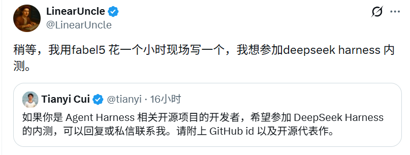
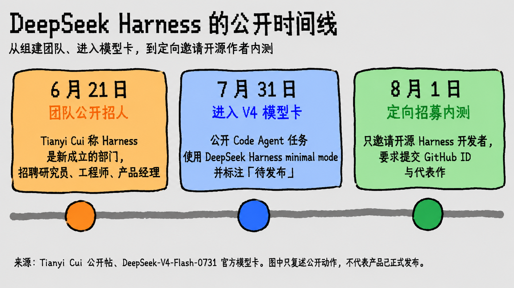
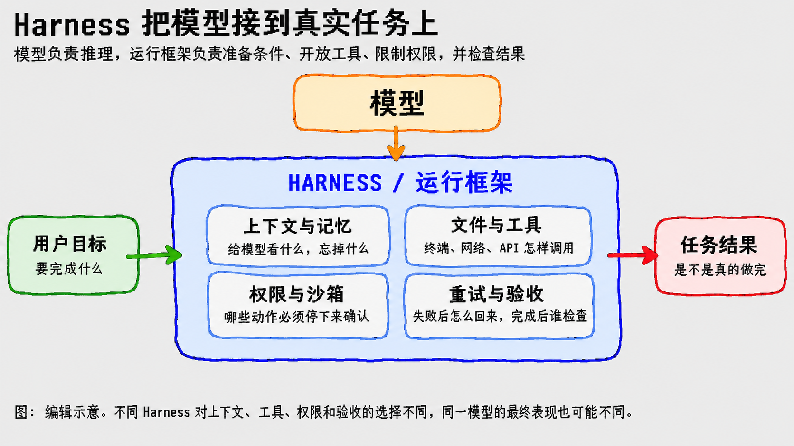

# DeepSeek Harness 开内测，Fable 5 现搭一个还来得及吗？

## 点开报名条件，我的仓库名白想了

我看到那条转发时，第一反应不是分析，是笑。

DeepSeek Harness 开始招募定向内测。LinearUncle 转发后开了个玩笑：让 Fable 5 这个 AI 花一个小时，现场搭一个出来报名。我脑子跟得比模型还快，已经替这个不存在的仓库想起了名字，连 README 上那句「built in one hour」都安排好了。

现在让 AI 在一小时里攒出一个能跑的项目，听上去真不离谱。页面搭起来，命令跑起来，演示录下来，报名材料这不就有了？

然后我点开 DeepSeek Harness 团队成员 [Tianyi Cui](https://x.com/tianyi/status/2083519855203078320) 的原帖，笑容停在加载完成的那一秒。

招募对象是做过 Agent Harness 相关开源项目的开发者。这里的 Harness，可以先理解成 AI 干活时用的工作台：它把文件、终端和结果检查接起来。

报名要交 GitHub ID，还要附已经做过的开源代表作，可以回复或私信联系。GitHub ID 我有，刚出生 60 分钟的仓库也可以有；可它很难叫「代表作」。

项目名白想了。

*LinearUncle 转发内测帖时开玩笑，准备让 Fable 5 花一小时现场搭一个。截图：@LinearUncle、@tianyi / X*

好笑归好笑，门槛留下一个很实在的问题：AI 都能临时搭项目了，DeepSeek 为什么还盯着那些慢慢做出来的旧作品？

## 这套 Harness 还没发布，已经先陪 V4 跑过评测

我不死心，又顺着线索往回翻，想看看这东西到底走到了哪一步。结果在 [DeepSeek-V4-Flash-0731 的官方模型卡](https://huggingface.co/deepseek-ai/DeepSeek-V4-Flash-0731)里，翻出了一个反常的顺序：公开 Code Agent 任务使用的，正是待发布的 DeepSeek Harness minimal mode。

产品还没正式亮相，它已经进入 DeepSeek 的评测流程；现在团队又开始找外部开发者来试。

*从团队公开招人，到进入 V4 模型卡，再到定向招募内测。图中只复述公开动作，不代表产品已经正式发布。图：作者根据公开资料整理*

我倒回模型卡，只想确认 V4 当时用的是哪套工作台。

*Harness 位于模型与真实任务之间。通用编辑示意，不代表 DeepSeek 已公开架构。图：作者绘制*

模型卡里的结果是 DeepSeek 自报。它只能证明这套 Harness 被使用过，不能证明分数是它带来的。

于是，招募帖泄露出的产品信号变得更有意思：DeepSeek 没有先展示功能表，却先告诉我们，它想找什么样的人来试。

## 一个小时能搭出 Demo，搭不出「踩坑史」

到这里，那句玩笑终于可以认真回答了。

假设 Fable 5 真能在一小时里搭好一个代码助手，示例仓库一路绿灯，这当然很厉害。可换到一个维护多年的旧项目，它可能刚修掉一处报错，另一个功能又坏了。开发者得回退、找原因、补测试，再证明这次没有修出新的坑。

一个小时能生成一份修复，生成不了这段失败、追问和验证。

这些经历散在 Issue、提交记录、测试和讨论里。新仓库可以展示 AI 此刻造得有多快；旧项目更有机会展示一个人在真实限制里做过什么取舍，又拿什么证明结果可靠。

DeepSeek 没说会不会逐项查看这些痕迹。我更愿意把 GitHub ID 和开源代表作理解成一份可检查的经验记录。AI 把「从空白到能跑」压得越来越短，项目跑起来以后的那段经历，反而更难临时补齐。

## DeepSeek 找来的，可能是一群专业拆台的人

再把招募对象放进内测现场，画面就具体了。

维护过开源项目的人拿到新工具，通常不会满足于看一遍顺利演示。他们会换个仓库、换种用法，盯住那个「怎么又卡了」的瞬间，再把偶发怪事整理成别人可以复现的问题。

说直白点，这群人很适合专业拆台。

*开源 Harness 开发者带着各自踩过的坑进入测试。AI 生成的编辑涂鸦，不代表正式合作关系*

这种拆台的目标很实际：尽早找到演示里碰不到的边角。做过真实项目的人更可能说清楚问题在什么条件下出现、改完该怎样验证。内测需要这样的反馈，单留一句「看起来不错」没多少用。

当然，这仍然是我的判断。DeepSeek 没有公开说明筛选动机；收集高质量 bug、测试兼容性，或者顺便发现合适的人才，都可能成立。

所以，Fable 5 现搭一个还来得及吗？

代码来得及，经历来不及。

仓库名可以一小时现想，代码也会越来越快。代表作真正值钱的部分，只能在一次次真实任务里留下来。
