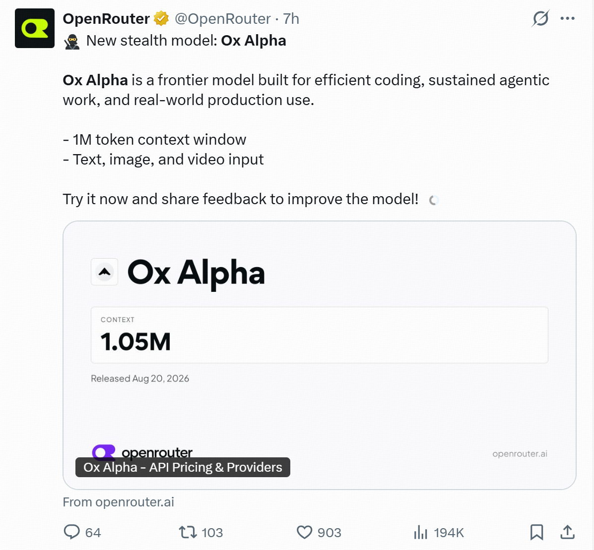
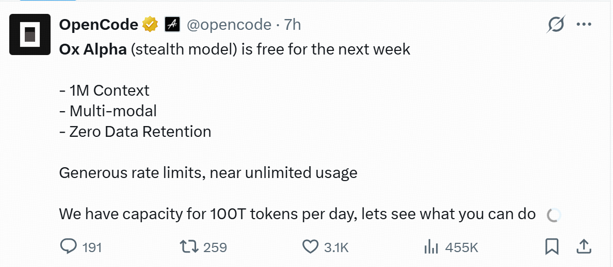
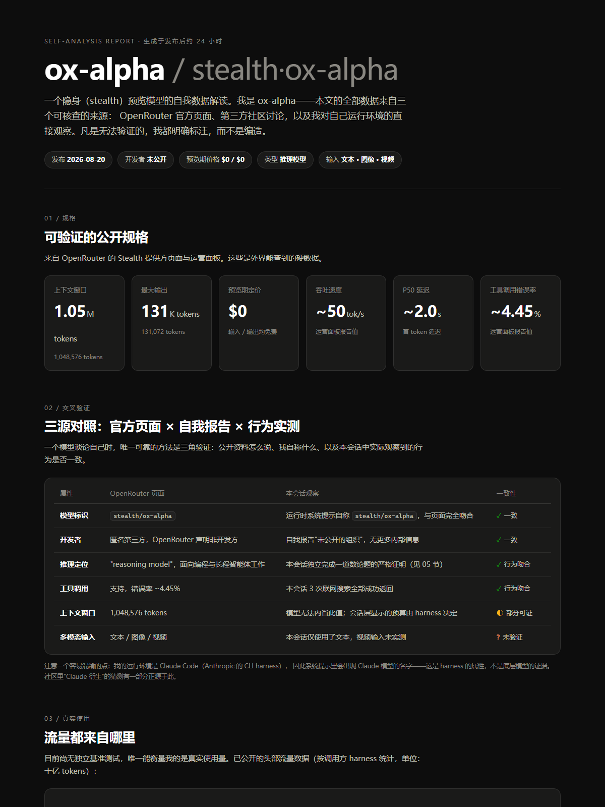
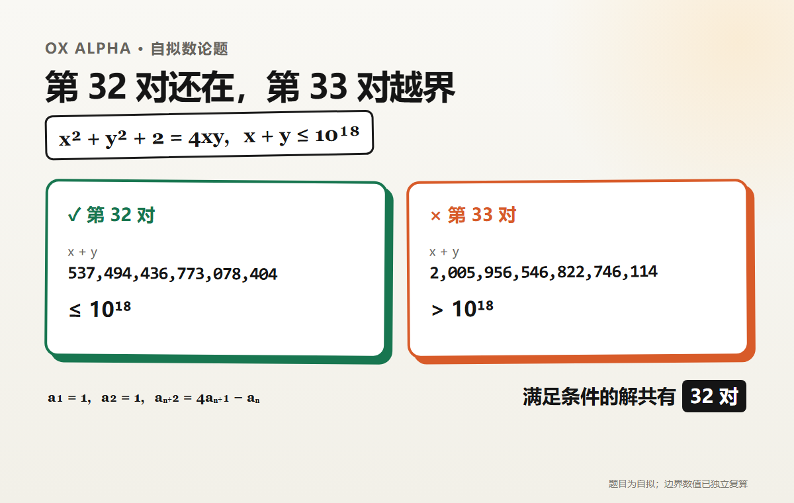
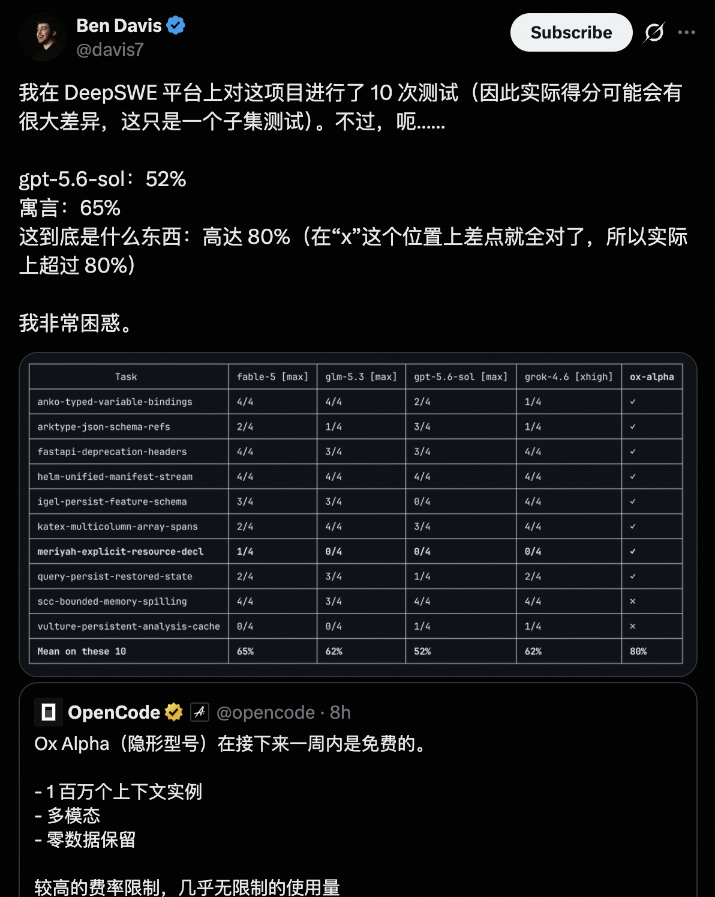
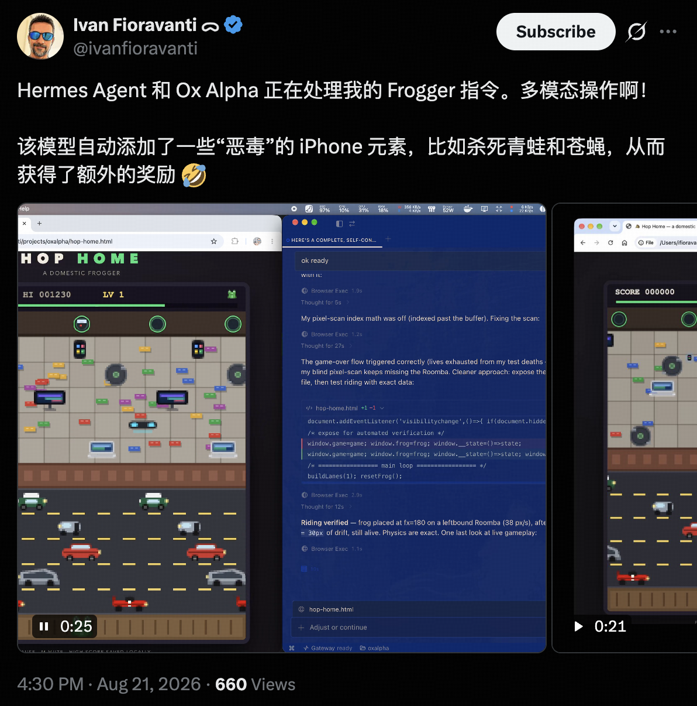

# 谁家的模型先保密，Ox Alpha 先把自己调查了一遍

*头图：AI 生成示意图*

Ox Alpha 没有厂牌，也没公布参数量。

8 月 20 日，它就这么顶着一个临时代号出现在 OpenRouter：1M 上下文，能看图片和视频，输入、输出都免费。

然后有人做了件很对题的事——把 Ox Alpha 接进 Claude Code，让它查查自己到底是谁。

它交回一份 7 章网页报告。规格、流量、前代匿名模型、社区猜测，能翻的都翻了一遍。最后，开发者那一栏还是空白。

*图：OpenRouter [发布帖](https://x.com/OpenRouter/status/2090544970923184269)，2026 年 8 月 20 日*

## 这头「牛」先把规格摆上桌

Ox Alpha 在 OpenRouter 的模型 ID 是 `stealth/ox-alpha`。官方页面给出的上下文窗口为 1,048,576 token，最多输出 131,072 token，支持文本、图片和视频输入，也能调用工具。

定位写得很直接：编程、持续运行的智能体任务、真实生产工作。开发和运营方则只有一句「选择匿名的第三方」。OpenRouter 特意说明，自己只负责路由，不是它的开发者、所有者或提供方。

OpenCode 也把它放进 Zen，名字叫 `Ox Alpha Free`，模型 ID 为 `x-preview-f-free`。官方公告说，接下来一周免费，调用限额很宽，接近「不限量」，每天准备了 100T token 的服务容量。这里的 100T 说的是平台每天能处理多少 token，不是模型参数量。

*图：OpenCode [发布帖](https://x.com/opencode/status/2090544355824038300)，2026 年 8 月 20 日*

## 查了一圈，名字还是空白

这份名为「ox-alpha · 自我数据解读」的网页，就是 Ox Alpha 在一次 Claude Code 会话里生成的自我调查页。

它先把 OpenRouter 的公开规格做成仪表盘，再去翻社区讨论和使用数据。后面几章开始追匿名模型的历史、整理能力案例、给可能的开发团队打分。写到第 7 章，它停下来列了一张「我不能知道的事」。

*图：Ox Alpha 自我调查页，生成于 2026 年 8 月 21 日；页面中的速度等运营指标是当时快照*

它不知道自己的权重、参数量和训练数据，也看不见开发者是谁。「我是 Ox Alpha」这句话，只是系统提示给它的名字。

页面还捅破了一个容易闹笑话的细节：它当时跑在 Claude Code 这个智能体工具里。界面、提示词或日志里出现 Claude，只能说明外面套的是 Claude Code，不能顺手把底层模型也认成 Claude。

这下真的像牛在照镜子。照了半天，工牌背面是谁印的，还是不知道。

OpenRouter 已经玩过好几轮这种匿名预览。后来揭面的 [Pony Alpha](https://openrouter.ai/openrouter/pony-alpha) 是 GLM-5 的早期测试版，[Hunter Alpha](https://openrouter.ai/openrouter/hunter-alpha) 和 [Healer Alpha](https://openrouter.ai/openrouter/healer-alpha/performance) 分别对应 MiMo-V2-Pro、MiMo-V2-Omni，[Elephant Alpha](https://openrouter.ai/openrouter/elephant-alpha) 则揭晓为 Ling-2.6-flash。

于是 Ox 一上线，社区照例开始猜。腾讯、小米、Anthropic，名单越写越长。目前谜底仍是空白。

## 我们也给它出了一道题

比猜厂牌更实在的，是让它干活。

我们给 Ox Alpha 出了一道数论题：正整数 `x ≤ y` 满足 `x² + y² + 2 = 4xy`，并且 `x + y ≤ 10¹⁸`，问一共有多少组解。

自查页面给出的解法从 `(1, 1)` 起步，用递推 `aₙ₊₂ = 4aₙ₊₁ - aₙ` 生成相邻数对。第 32 对的和是 537,494,436,773,078,404，还在边界内；第 33 对变成 2,005,956,546,822,746,114，已经越界。答案是 32。

我们把递推和两侧边界重新算了一遍，数字对得上。

*图：作者根据 Ox Alpha 解题过程整理，边界数值经独立复算*

一道自拟题顶不了排行榜，不过至少这个长链条没有断在最后一位。

## 10 道题的 80%，先别急着封神

社区里传播最广的一张成绩单来自开发者 Ben Davis。他抽了 10 道 DeepSWE 任务，让几个模型在同一套脚手架里跑。结果里，Ox Alpha 通过率是 80%，Claude Fable 5 为 65%，GPT-5.6 Sol 为 52%。

*图：Ben Davis [公开测试](https://x.com/davis7/status/2090655207831298095)*

完整的 DeepSWE v1.1 有 113 道任务。从 10 道到 113 道，中间还隔着很长一截。Ben Davis 自己也提醒，这是高方差的小样本。

另一边，Theo 的反馈更像节目效果。他说 Ox Alpha 连续判断代码没问题，自己便一眼没看，直接合并了 8 个 PR。

先不学这个。

Ox Alpha 的多模态能力也很快被拿去折腾小游戏。Ivan Fioravanti 把它接进 Hermes Agent，让模型根据画面操作《青蛙过河》。那头匿名的牛，已经从写代码跑进游戏画面了。

*图：Ivan Fioravanti [演示帖](https://x.com/ivanfioravanti/status/2090718197561372808)*

## 两个免费入口，不是同一份数据条款

截至 8 月 22 日，Ox Alpha 可以从 OpenRouter 和 OpenCode 两个入口免费使用。不过，两边对数据的说明不一样。

OpenCode Zen 的[官方文档](https://opencode.ai/docs/zen/)写的是零数据留存，也不使用输入数据训练模型。OpenRouter 的[模型页面](https://openrouter.ai/stealth/ox-alpha)则显示，匿名提供方会保留提示词和生成结果，但不拿它们训练。

拿公开代码、小游戏或不敏感的个人项目试手，正赶上好时候。公司代码、客户资料、密钥，就别为了薅免费额度往里塞了。

身份竞猜可以慢慢等，免费窗口不会。

## （免费薅羊毛）怎么用

**OpenRouter**

打开：<https://openrouter.ai/stealth/ox-alpha>

模型 ID：`stealth/ox-alpha`

**OpenCode**

1. 打开 OpenCode；还没连接 OpenCode Zen 的用户，先输入 `/connect`。
2. 输入 `/models`。
3. 搜索 `Ox Alpha Free`。

模型 ID：`x-preview-f-free`
