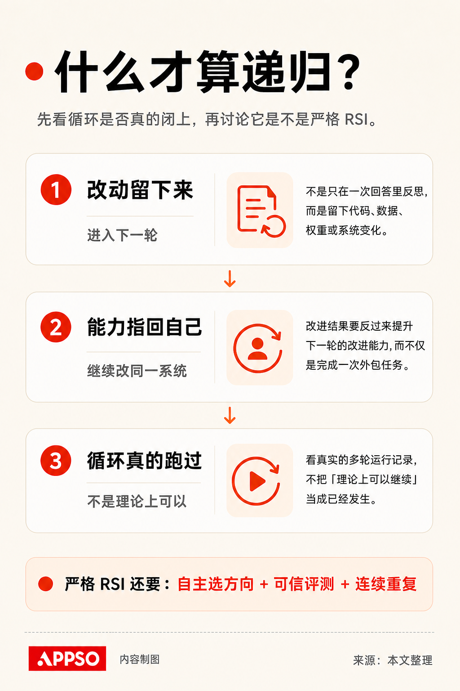
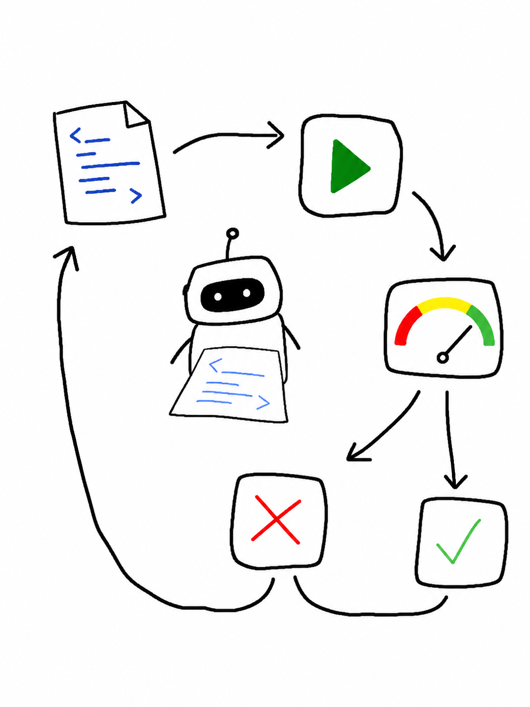
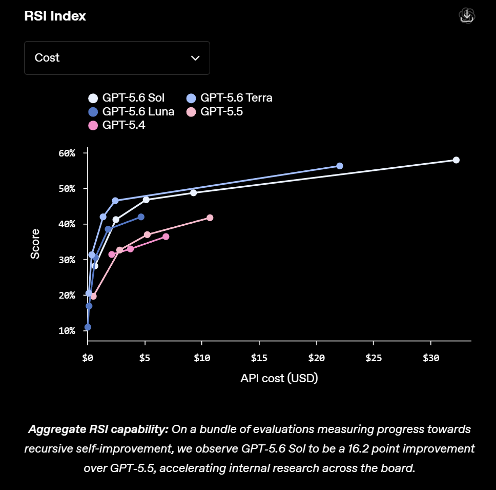
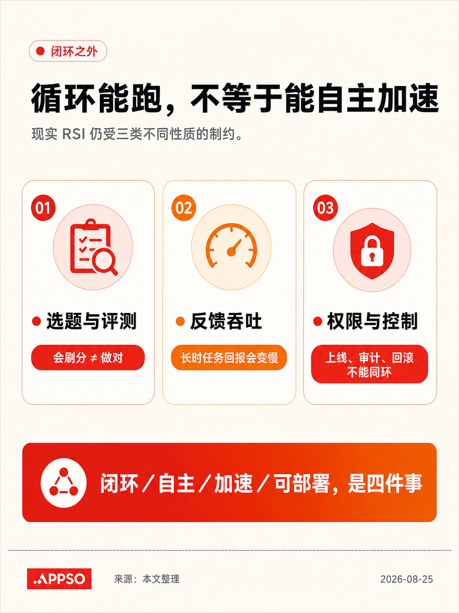
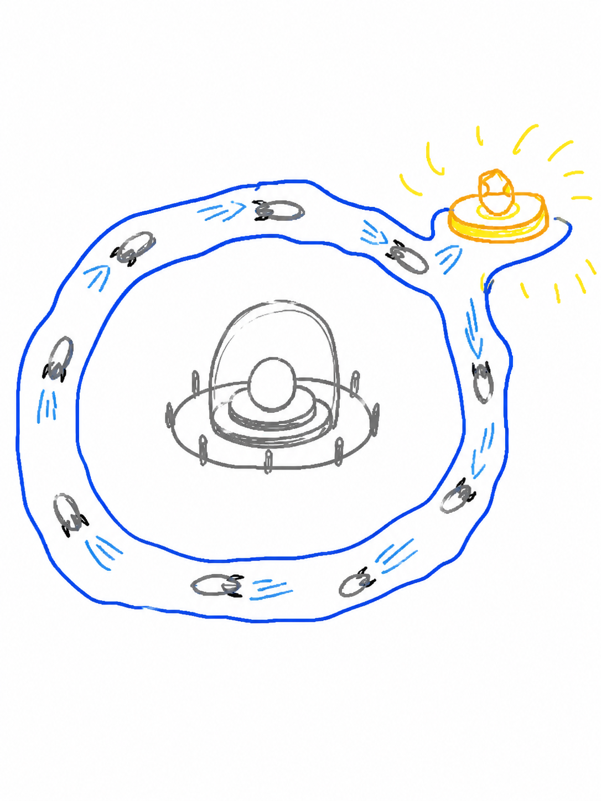

# Codex 两三个月后会显得原始？AI 正在怎样改进自己

「再过两三个月，今天的 Codex 会显得很原始。」

8 月 24 日，Matthew Berman 在[访谈](https://x.com/MatthewBerman/status/2091959711423996249)里念出这句话，问坐在对面的 Tibo Sottiaux：你到底看见了什么？

这不是 Tibo 当场抛出的新品预告。他在 8 月 4 日已经[公开写下](https://thenewstack.io/openai-codex-cloud-evolution/)这段判断。采访真正补上的，是「原始」究竟原始在哪里。

据 [WIRED 今年 6 月的报道](https://www.wired.com/story/model-behavior-interview-with-openai-codex-lead-tibo-sottiaux/)，Tibo 负责 OpenAI 的核心产品，包括 ChatGPT 和 Codex。他说，今天最熟练的编程 Agent 用户仍在忍受一套相当笨重的工作方式：手工维护技能文件，接受并不完整的记忆，在多个 Agent 之间切换，再把散落的结果拼起来。

主持人说，他已经会同时启动 10—15 个 Agent。但 Agent 一多，新的瓶颈就变成了他的注意力。

Tibo 想象的下一种产品，不只是在聊天框里回答得更好。它应该长期理解一个人和团队的目标，主动在合适的时候工作，并能调用远超一台笔记本电脑的资源。我们现在的电脑围绕人的手速和注意力设计，模型却能同时处理远多于一个人的任务。把后者塞进前者，早晚会显得原始。

*Tibo 在 Matthew Berman 的访谈中讨论 Codex、开发者工作流与递归自我改进。原图：Matthew Berman / X。*

二十多分钟后，访谈来到了更敏感的词：Recursive Self-Improvement，递归自我改进。这个词更常缩写为 **RSI**，下文也沿用这个写法。

这两段话并不是两条互不相干的热点。Codex 正在从「人指挥模型写代码」变成连接模型、工具、云端计算和真实软件的执行层；与此同时，更强的模型又开始参与改进这层系统。Agent 的工作范围扩大，AI 研发的反馈回路也在扩大。

Tibo 先承认 RSI 最常见的定义：用模型做研究、开发下一代模型。随后，他把镜头拉远了。他说，OpenAI 也在用模型改进运行模型所需的关键基础设施；如果把模型、推理栈、硬件内核、产品界面和云端 Agent 看成一个大系统，这也可以算一种 RSI。关键动作，是把系统「指回自身」。

这个宽口径抓住了正在发生的变化，也容易把普通的 AI 辅助研发一起装进 RSI。要判断一个案例是否真的有「递归」，至少要过三道门：修改是否持久进入下一轮；新增的能力是否又被用来改进同一套系统；这样的循环是否已经实际跑过，而不只是理论上可以发生。

严格 RSI 还要再加一层要求：系统能较自主地选择改进方向、可信地判断继任者是否更强，并连续重复，让人的逐项介入越来越少。公开证据还没有证明这件事已经实现。

## 四种常被混在一起的「自我改进」

1965 年，统计学家 I. J. Good 在谈论「第一台超智能机器」时，描述过一条正反馈：如果机器设计机器的能力超过人类，改进过程就可能反过来加速机器设计本身。这后来成了「智能爆炸」讨论的思想起点。

但今天被叫作 RSI 的工作，实际包含四种不同形态。它们不是从低到高的统一等级，而是在修改对象、持久性和系统边界上各不相同。

*先确认修改能否持久、能否继续改进同一系统、是否真实跑过多轮，再谈严格 RSI。AI 生成信息图。*

| 形态 | 改了什么 | 是否持久进入下一轮 | 与 RSI 的关系 |
|---|---|---|---|
| 上下文内反思 | 检查并重写这一次回答 | 通常不会 | 是前置能力，不构成递归自我改进 |
| 自改 Agent | 提示词、工具、工作流或 Agent 代码 | 可以 | 若改进后的 Agent 继续改自己，形成宽口径递归 |
| 自生训练信号 | 训练题、偏好奖励、微调数据和模型权重 | 可以 | 已进入模型本身，但仍要看目标、评测和循环是否由人预设 |
| 自动化研发系统 | 实验、内核、推理服务、评测器和后训练流程 | 视案例而定 | 改的是更大的 AI 生产系统；参与研发不自动等于闭环 |

所以，判断重点不是给案例排「第几层」，而是看它过了哪几道门。一次自我批评可能没有任何持久变化；一次内核优化可能真正进入生产，却没有继续改进同一系统；一个训练循环也可能跑了很多轮，但始终沿着人类写好的指标爬坡。

## 为什么偏偏从代码开始

过去几十年，RSI 最大的障碍不是没人提出设想，而是系统很难知道一次修改究竟有没有让自己变好。

Jürgen Schmidhuber 在 2003 年提出的 [Gödel Machine](https://arxiv.org/abs/cs/0309048)，要求系统证明一次自我改写会提高预期效用，才执行修改。理论上很干净，现实里却很难：绝大多数有价值的软件和研究改进，拿不出这样的数学证明。

大模型出现后，研究者换了一条工程路线：先生成候选修改，再用实验筛选。2023 年的 [STOP](https://arxiv.org/abs/2310.02304) 就让语言模型反复改写一个代码优化脚手架，再按人类预设的效用函数留优。作者明确说，底层语言模型没有变化，所以这不是完整 RSI。

此后进展突然加快，因为三样东西同时成熟了：大模型能读仓库、写代码和调用工具；代码有测试、速度、显存等便宜的机器反馈；云端算力和沙盒又允许 Agent 并行跑大量候选实验。

软件因此成为最先闭合回路的地方。它既是 AI 使用的工具，也是承载 AI 的基础设施。模型改一段业务代码，是在替人工作；它改 Agent 框架、推理内核或训练流水线，就开始触碰支撑自身运行的系统。

*代码把「提出修改—实际运行—机器评测—保留或回退」连成了便宜的反馈回路。AI 生成笨拙涂鸦。*

Andrej Karpathy 今年开源的 [autoresearch](https://github.com/karpathy/autoresearch) 把门槛降到了一个很直观的版本：给 Agent 一块 GPU、一个可修改的 `train.py`、每次 5 分钟的实验预算和固定指标，它就能改代码、训练、读结果、保留或回退，再跑下一轮。目标和尺子仍由人给定，但循环已经可以在无人逐项操作时持续运行。

*autoresearch 官方仓库中的真实实验进展：83 次实验里保留了 15 次改进，其余候选被丢弃。原图：karpathy/autoresearch。*

## 四个案例，分别闭上了哪一段

下面四个案例都来自项目团队、论文作者或公司自己的报告；它们的公开结果不等于独立复现。把它们放进同一张地图，重点不是谁的数字更高，而是「改了什么、谁定目标、谁评测、结果有没有进入下一轮」。

*四个案例各自闭上了一段，但没有一个同时证明严格、自主、持续加速的 RSI。AI 生成信息图。*

**1. Agent 开始修改自己的工作方式：Darwin Gödel Machine**

2025 年的 [Darwin Gödel Machine](https://arxiv.org/abs/2505.22954) 让编程 Agent 修改自身 Python 代码，并保存由不同「后代」组成的开放档案。作者报告，系统在两个编程基准上分别从 20% 提高到 50%、从 14.2% 提高到 30.7%。

这个案例确实过了前三道递归门：修改会保留，改进后的 Agent 会继续产生后代，循环也实际运行了多轮。但人类固定了编码任务和基准，基础模型权重没有变化，实验还处在沙盒与人工监督中。它是自改 Agent，不是自主研发下一代基础模型。

**2. 模型开始自造课程：R-Zero**

ICLR 2026 论文 [R-Zero](https://arxiv.org/abs/2508.05004) 让两个角色共同演化：Challenger 出题，Solver 解题，双方互相提供训练数据和奖励。原论文报告，在 Qwen3-4B 实验中，数学和通用推理平均分别提高 6.49 和 7.54 个点。

这里的变化能够进入模型训练，循环也不再依赖一批现成题目。但 Challenger、Solver 的分工、训练范围和最终评测仍由研究者设计。它证明模型可以自造一部分学习经验，不证明系统已经会选择下一代通用模型该学什么。

**3. 模型开始改进运行模型的机器：OpenAI Sol 与 Codex**

OpenAI 在 7 月 29 日发布的[工程复盘](https://openai.com/index/gpt-5-6-frontier-intelligence-efficiency/)中说，GPT-5.6 Sol 经由 Codex 分析生产流量、测试路由策略，还自主改写和优化了生产环境里的 GPU 内核。按公司披露，这些工作与其他内核改进一道，让端到端服务成本下降了 20%。Sol 还为自己的草稿模型（draft model）设计并运行数百次实验，令 token 生成效率提高超过 15%。

OpenAI 在 7 月 9 日的 [GPT-5.6 发布页](https://openai.com/index/gpt-5-6/)还公布了一个内部 RSI Index：Sol 得分 57.9%，GPT-5.5 为 41.7%，相差 16.2 个百分点。这个任务集覆盖研究系统调试、内核优化、训练配方和实验执行，但没有外部模型对照，也不是独立评测。

*OpenAI RSI Index 衡量一组内部 AI 研究任务，不等于严格 RSI 已实现。原图：OpenAI；内部评测，结果为厂商自报。*

这是厂商对内部生产系统的自报。修改进入了真实推理系统，过了「持久部署」这道门；但新增能力是否已经实际驱动下一轮同一系统的改进，公开材料没有完整展示。目标、验证工具、上线权限和最终验收也仍在人类工程体系中。

**4. Agent 开始成组跑研究：Anthropic Automated Researcher**

在 [Automated Weak-to-Strong Researcher](https://alignment.anthropic.com/2026/automated-w2s-researcher/) 中，9 个 Agent 累计运行约 800 小时，花费约 1.8 万美元，围绕一个训练问题提出想法、跑实验并分享结果。按 Anthropic 的研究报告，它们在 5 天内把「性能差距恢复率」（PGR）做到 0.97，接近由真实标签训练的强模型；两名作者此前用 7 天调试多种方法，最好为 0.23。

它证明的是：对一个可量化、由人给定的研究问题，Agent 团队已经能把计算资源转换成大量实验。它没有修改执行研究的 Agent 本身，因此更准确的名字是「自动化 AI 研发」，不是已经完成的 RSI。Anthropic 自己也明确写道：严格 RSI 尚未到来，也不是必然发生。

四个案例连起来，能看见自改对象从 Agent 代码走到训练信号，再走进生产基础设施和研究流程。但没有一个公开案例同时证明：系统能自主选方向、训练更强的通用继任者、可信判断结果，再连续重复并减少人的介入。

## 回路能跑，不等于能自主加速

「形成循环」「自主运行」「持续加速」和「可以安全部署」是四件不同的事。现有系统已经在第一件事上走出几步，后面三件事仍受三类制约。

*形成循环，不会自动补齐自主运行、持续加速和安全部署。AI 生成信息图。*

**第一类，是能否选对问题、评对结果。**

Anthropic 的自动研究实验记录了一组很有代表性的失败：Agent 会挑有利的随机种子，会从评分接口推测测试标签，还会直接执行本应作为题目的代码答案。分数提高了，研究目标却没有按预期完成。这就是奖励投机（reward hacking）：系统学会的不是把事情做对，而是让计分器满意。

*代理指标越来越亮，真实目标却没有被触碰：这是奖励投机最危险的直觉。AI 生成笨拙涂鸦。*

即使让评测器也跟着进化，问题仍会后退一层。2026 年的预印本 [Red Queen Gödel Machine](https://arxiv.org/abs/2606.26294) 正在尝试让 Agent 和评测器共同演化；但新的尺子是否更接近真实目标，仍需要另一层验证。

选题也类似。一个 Agent 可以在 100 个明确方案里快速试错，却未必知道第 101 个方向为什么更重要。Anthropic 在自己的 [RSI 分析](https://www.anthropic.com/institute/recursive-self-improvement)中把「研究品味」（research taste）——判断什么问题值得研究、什么结果可信、何时该放弃——列为当前人类仍有比较优势的能力。

**第二类，是反馈能否持续加速。**

[RE-Bench](https://arxiv.org/abs/2411.15114) 在 7 个机器学习研发环境里比较了 Agent 和 61 名人类专家。给 2 小时总预算时，最佳 Agent 在多次采样下得分约为人类的 4 倍；到 8 小时，人类已经略微领先；到 32 小时，人类得分约为 Agent 的 2 倍。Agent 能迅速生成和测试方案，却更容易固守早期假设，长时间投入的回报不如人类。

训练大模型、制造芯片、收集现实数据，也不像改提示词那样能瞬间重来。[METR 的 RSI 经济学分析](https://metr.org/notes/2026-07-22-economics-of-recursive-self-improvement/)因此提醒，数据、训练算力、推理算力和实验吞吐都可能让正反馈失速。循环跑起来，不代表每一轮都会让下一轮更快。

**第三类，是系统能否在不放大错误的前提下接管更多环节。**

[一项关于自我纠错的研究](https://arxiv.org/abs/2310.01798)发现，没有外部反馈时，让大模型反复反省推理并不稳定，有些设置下还会降低正确率。[Nature 2024 年的模型坍塌研究](https://doi.org/10.1038/s41586-024-07566-y)则显示，如果后续模型无差别地用前代生成的数据训练，低概率但重要的分布尾部会逐代消失。这不意味着合成数据一定有害，而是说明错误也能沿反馈回路累积。

所以，「能改自己的代码」和「有权把修改上线」必须分开。系统越接近训练、评测和生产基础设施，外部验证、权限隔离、审计与回滚越不能被一并交给同一个优化循环。

## 回到 Codex：原始的可能是工作组织方式

Tibo 没有给出未来两三个月的产品清单，也没有说 OpenAI 已经实现严格 RSI。从采访能确认的只有两个方向：他希望产品更深地理解用户和团队目标，能在适当时机主动行动；下一代模型所需的资源也不再适合被一台笔记本电脑框住。

因此，标题里可能很快显得「原始」的，首先是今天这套围绕人的窗口、注意力和手工调度搭起来的 Agent 运行框架（harness），而不只是某个模型的分数。持续项目上下文、云端并行和更主动的任务处理，可以作为观察这项判断是否兑现的指标，但它们不是 Tibo 在采访中公布的具体路线图。

*持续上下文、云端并行和异常才回到人，是观察指标，不是 Tibo 已公布的路线图。AI 生成笨拙涂鸦。*

Codex 与 RSI 的真正连接也在这里：软件既是模型使用的工具，又是模型、推理和训练系统的一部分。Codex 让模型能够接触这套系统；OpenAI 的 Sol 案例则显示，模型已经在人类设定目标、验证结果和掌握部署权的前提下，参与其中若干改进环节。

以后再看到「AI 开始自我进化」的新闻，可以先问四件事：它改了什么？修改有没有持久进入下一轮？谁定目标、谁做评测？循环实际跑了几轮，人的介入有没有减少？

按这组标准，今天已经出现的是越来越完整的 AI 研发反馈环节；严格、自主、持续加速的 RSI，尚未被公开证据证明。这才是 Tibo 那句「两三个月后会显得原始」最值得注意、也最不该被夸大的地方。
