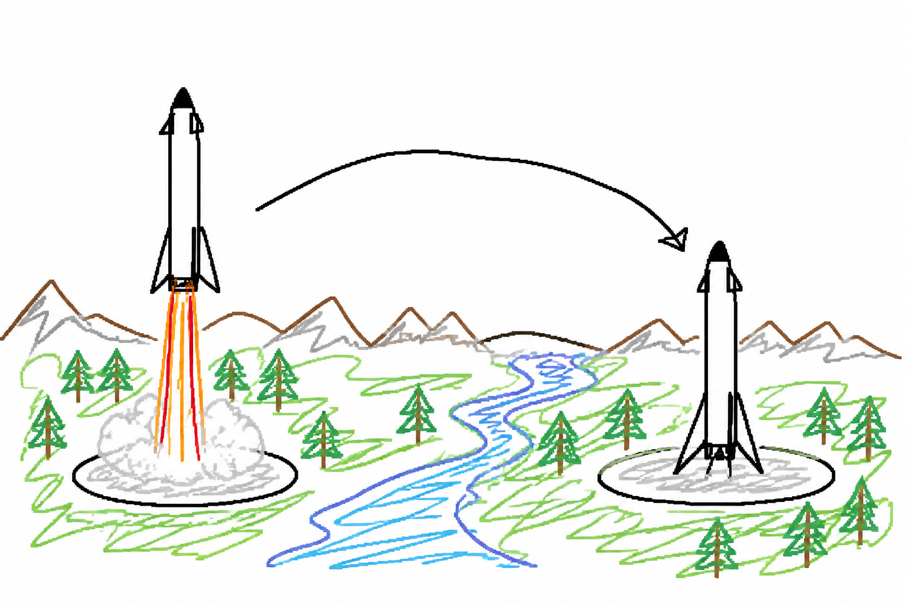
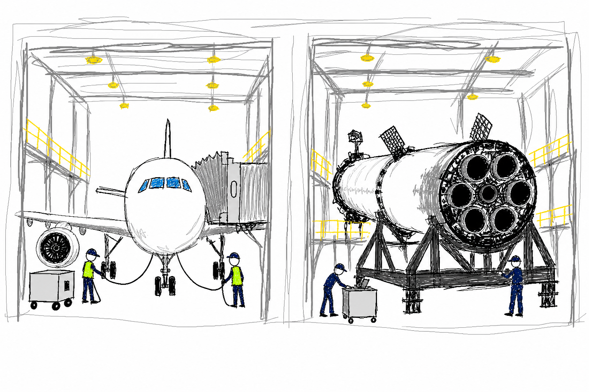
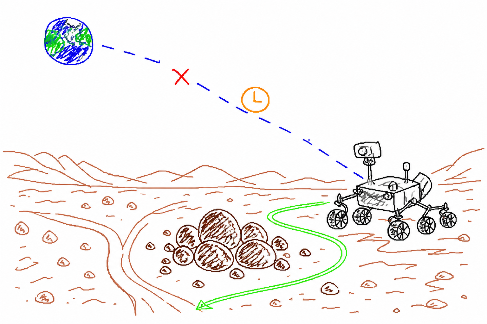
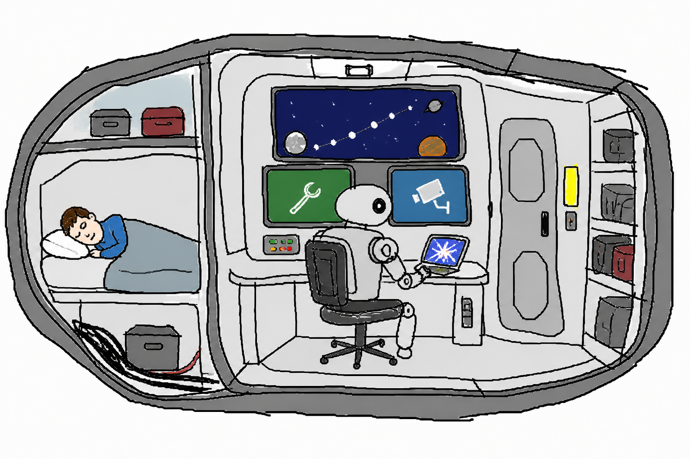

# 朱雀三号落在 300 公里外，火箭也开始有「车站」了

朱雀三号一级落地时，距离发射场还有 300 多公里。它没有回到起飞的位置。甘肃民勤的一块边长 60 米的场坪接住了它。

直播镜头里，火箭像是「回家」了。把两地放到地图上看，它到达的是另一站。

去年 12 月，朱雀三号遥一也飞到了这块场坪附近。它最后坠毁在场坪边缘，距离中心约 40 米。项目总指挥戴政后来形容：「最后一脚刹车没有踩好。」

8 月 19 日 7:35，遥二从东风商业航天创新试验区起飞。大约 6 分钟后，一级在民勤软着陆。蓝箭航天称，这是我国首次使用着陆支腿回收火箭，也是首次完成入轨级运载火箭一级陆地回收。

为什么要在 300 多公里外，专门给一枚火箭准备落脚的地方？

*AI 生成示意图：同一枚火箭从一个场站起飞，在下游另一个场站落下。*

## 火箭不一定每趟都回到起点

客机到达另一座城市后，会在当地接受检查，再进入新的航班安排。它下一趟可以继续飞往别处，也可以以后再回始发机场。

火箭一级和二级分离时，已经带着很高的水平速度飞向下游。如果要返回发射场，它必须再次点火，先减掉向前的速度，再把轨迹拉回起点附近。SpaceX 把这段动作称为 boostback burn，也就是回推点火。

让一级继续飞向下游，可以省掉这段回推。蓝箭当前产品页给出的标称运力中，航区回收的近地轨道运力为 18.3 吨，返回场回收为 12.5 吨。两者相差 5.8 吨。

这是产品页的标称数字，不是遥二这次任务的实际载荷成绩。

从 SpaceX 的公开任务时间线可以看到两种安排。返回陆地着陆区的 NROL-105 进行了回推点火。落在海上平台的 Starlink 17-34 没有安排这一步。

SpaceX 的美国发射场临海，合适的下游落点经常位于海上。无人回收平台由拖轮送到预计落区。一级落稳并完成安全处置后，平台再被拖回港口。

民勤场坪是一个固定的陆地落点。使用它不用布放海上平台，但场坪也不能随着每次任务改变位置。两种安排都要服从火箭的飞行方向、剩余推进剂和地面保障条件。

*AI 生成示意图：飞机和火箭落地后，都需要地面人员检查与维护。*

## 接住火箭以后，还要转运和检修

机场里最显眼的是飞机。飞机落地以后，还要检查、加油、清洁，再排入下一趟航班。

火箭经历发射、再入和着陆后，也要接受检查。工程人员要查看发动机、贮箱、热防护和箭体结构的状态。需要维修和更换的部分，要在下一次起飞前处理。

蓝箭把遥二之后的阶段称为「工程化复用验证」。公司通报提到了检查、维护和后续复飞，目前没有宣布这枚一级何时再次起飞。

民勤场坪先负责接住一级。回收后的转运、检查和维护，决定它能否进入下一次任务。这里所说的「车站」，更接近机场机坪和维修区的组合。

把这条线路继续延伸到火星，调度方式也会发生变化。地球无法一直充当实时在线的塔台。

## 飞到火星，等一句回复可能要 40 多分钟

NASA 对载人火星任务的分析显示，单程通信延迟最长可能达到 21—23 分钟。部分任务还可能遇到持续数周的通信中断。

火星车前方出现危险地形，或者飞船发现一个异常，不能每次都停下来等待地球回复。更多规划、诊断和临场处理会留在飞船、车辆和乘组这一端。

*AI 生成示意图：通信有延迟时，火星车要先在本地选择绕开障碍的路线。*

2025 年 12 月，NASA 让生成式 AI 参与规划毅力号的两次火星行驶。AI 分析火星轨道器拍摄的图像和坡度数据，再生成路线与航点。

AI 生成的路线没有直接发给火星车。工程团队先用数字孪生检查了超过 50 万项遥测变量，确认指令与飞行软件兼容，随后才把它们发往火星。

## 科幻里的 AI，已经开始上班了

2026 年上映的电影《Project Hail Mary》改编自 Andy Weir 的同名小说。故事把主人公送上一段星际旅程。NASA 还为电影拍摄提供过专业建议。

主人公离最近的人类也有数光年，任何求助都无法得到即时回应。

Martha Wells 的「Murderbot」系列写了一台破解自身控制程序的安保机器人。它在危险星球上保护科学考察队，空下来只想一个人追剧。Apple TV 的改编剧集已经续订第二季。

*AI 生成示意图：人在休息时，飞船里的机器继续照看导航、设备和安全。*

到了那样的太空生活里，AI 处理的可能是导航、安保、设备检查和任务安排。

可回收火箭改善的是进出太空的运输和周转，尚未解决恒星之间的推进问题。今天的 AI 也不能接管整艘飞船。

有一天，发射、落地、检修和再次起飞可能会写进同一张排班表。远处的机器还要在等不到地球回复时继续工作。
