<!-- 编辑状态：以作者最新更正为准：10-54-51 小妖录屏来自 Astra；12-03-11 和 12-03-51 来自 Fable 5.1。画面偏好与方向疑似反转反馈仍属于 Fable。耗时、轮次、额度没有完整记录，不作结论。 -->

GPT-6 Astra 今天全量开放了。Plus 和 Business 用户也都能用上了。[开放公告](https://x.com/thsottiaux/status/2096002992046796932)

看完 X 上那些演示，很难不想自己试试。糖豆人式的闯关游戏、铺满楼房和道路的模拟城市，已经有人用 Astra 做出来了。[游戏原帖](https://x.com/MatthewBerman/status/2095616764793270705)、[城市原帖](https://x.com/MatthewBerman/status/2095595893991129444)

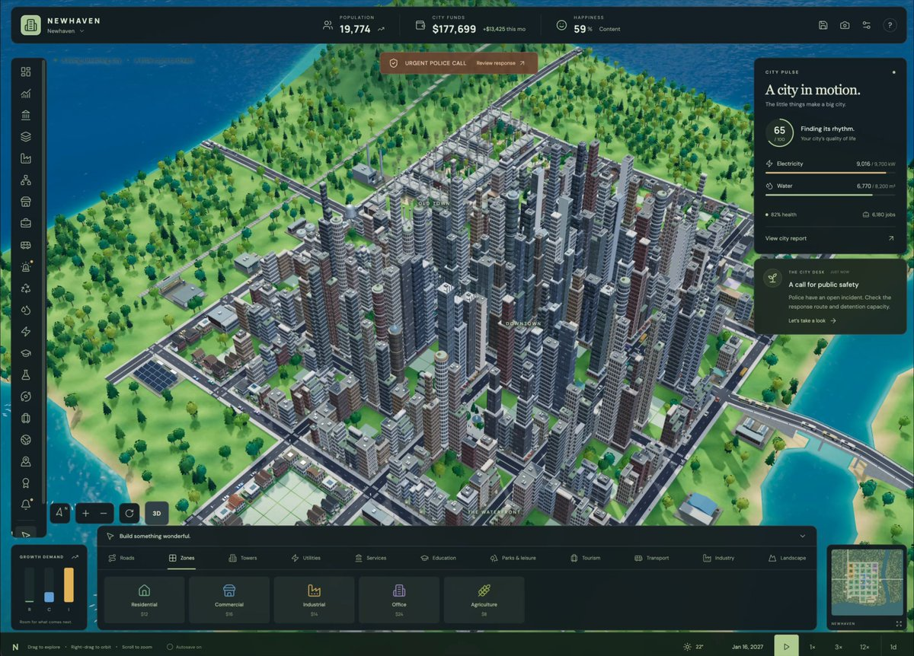

*图源：Matthew Berman / X。作者展示的是仍在开发中的原型。*

Astra 这么热闹，A 社今天给所有 Claude Max 用户重置周额度，就很应景了。[Claude Max 公告](https://x.com/lydiahallie/status/2095967323412930677)

这架势，很有点「再不送点额度，大家就去隔壁了」的意思。

OpenAI 这边也在送。Tibo 宣布，Plus、Pro 和 Business 用户还会再拿到一次可留存的完整重置机会。[OpenAI 重置公告](https://x.com/thsottiaux/status/2096035437299237298)

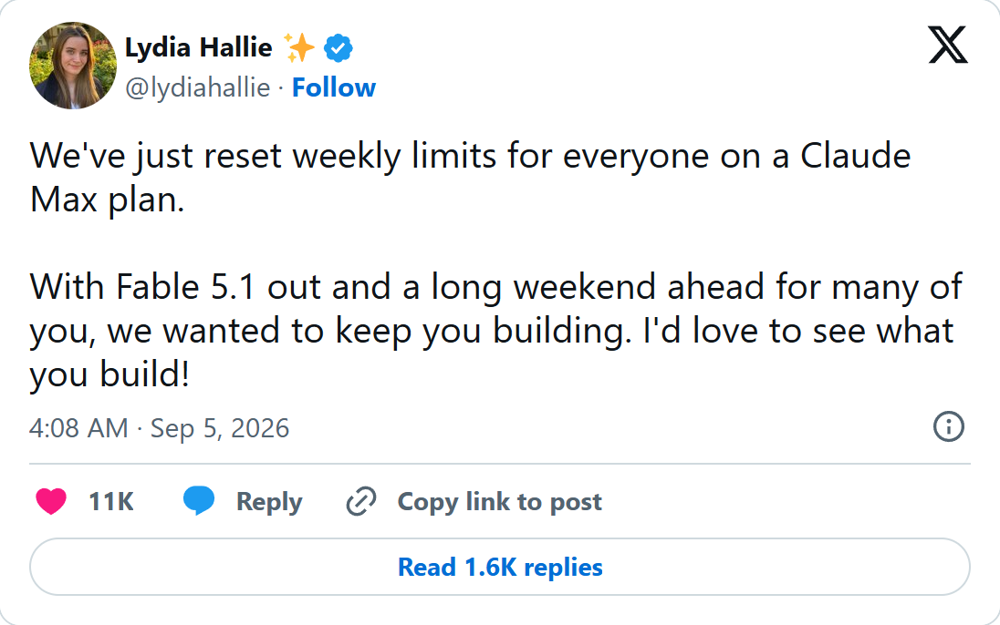

*图源：Lydia Hallie / X，截图显示北京时间。本轮重置针对 Claude Max 的周额度。*

两家忙着抢用户，AI 玩家的「黄金周」又来了。

我们也把 Astra 和 Fable 5.1 拉来试了一轮。开唱片店、做小游戏，顺手还把 APPSO 的 Logo 发给了 Astra。

## 先让 Logo 动起来

第一道题，就是把 APPSO 这几个字母做成一款能玩的 3D 游戏。A 左下角那颗独立的白点变成小球，由玩家控制，穿过字母组成的关卡，最后滚进 O。

*本次测试的输入图：APPSO Logo。*

Fable 5.1 用同一张图、同一份要求。两边各有一个独立文件夹。

A 有斜面，两个 P 都有一段圆弧，S 可以做弯道，O 可以做环形终点。我把这些想法写进提示词，具体怎么连接，交给模型。

红白配色和字形都得保留。尤其是 A，它和左下角的圆点分开，不能拿普通字体重新打几个字来代替。

我要求用 WASD 或方向键控制小球，有障碍、有碰撞，掉下去可以从检查点继续。最后滚进 O，镜头拉远，再看一遍整座 Logo。

Astra 交回来的页面叫「APPSO PLAY LAB」。白色字母有了厚度，落在一块红色底板上。字母之间用透明小桥连接，沿途铺着红色圆点。两个 P 的圆洞、A 左下角的独立圆点，都还在。

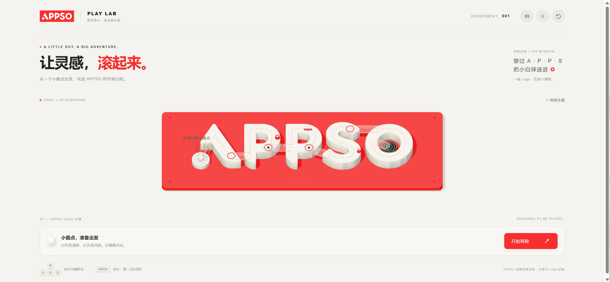

*Astra 生成游戏，作者实际截图。*

我比较喜欢它对连接处的处理。桥用了透明材质，既把断开的字母接起来，又没有用一整块白色平台盖住原来的字形。终点放在 O 的圆心，也很容易认。

它还给页面写了「让灵感，滚起来」，把玩法带进了标题。红白配色从关卡延续到按钮，页面周围留了不少空白。

点下「开始冒险」，就能控制那颗小白球。录下的这段试玩里，下方进度从 A 走到了第一个 P，途中也掉下去过几次。界面会提示「掉下去也没关系，马上回到检查点」。

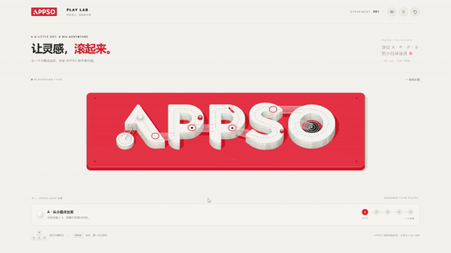

*作者真人试玩，原速节选。这段录屏没有录到通关。*

<!-- Fable Logo 暂无交付截图，不把未收到的结果写成失败，不据此比较胜负。 -->

## 开同一家唱片店，装修完全不同

除了改 Logo，我们也让两边做了网页。

第一家店叫「凌晨一点」。两边都摆着《雨停以前》《便利店凌晨三点》《没有人的舞池》等唱片，做出来的感觉却差得很远。

Astra 用了米白底和大块红色。首屏左边写着「把夜晚，放慢一面」，右边是一张露出黑胶的红色唱片封套。下面的商品封面各有颜色，标题和价格都比较醒目。

*Astra 生成页面，作者提供的实际截图。*

Fable 5.1 把店里的灯调暗了。背景接近黑色，首屏放了一台唱机，文案是「推门进来，灯一直亮着」。顶部还显示了「现在 09:50，天亮了，我们还没走」。

*Fable 5.1 生成页面，作者提供的实际截图。*

它画的封面也更贴着唱片名字走。《便利店凌晨三点》有灯管和货架，《没有人的舞池》是一束灯光照着空地，《夜航信号》则画成雷达。

只看这两张页面，我更喜欢 Fable 的封面。Astra 的页面更亮，商品信息更容易扫到。Fable 的小字偏暗，缩到手机上看会费力一些。

## 放开题目，Astra 选了海，Fable 选了节气

另一道题更自由：做一个自己认为最有美感的动态 HTML 页面，内容不限。

Astra 做了「月屿 LUNÉ」。左边是大幅英文排版，右边是一片海，光从海平面一直照到近处。页面下方有「月夜」「蓝调」「破晓」三个选项，还有一条潮汐滑杆。

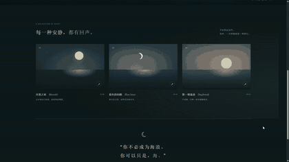

*作者实际录屏节选，Astra 生成页面。*

录屏里从暖色的破晓切到蓝调，太阳换成了弯月，水面的反光也跟着变冷。拖动潮汐滑杆时，水面仍然在动。暂停按钮按下后，旁边的文字变成「让此刻停留」。

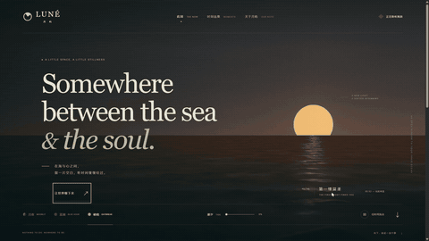

*原速节选。完整操作见配套 MP4。*

它还做了一个隐藏大部分文字的沉浸画面。只留下月亮、海和一句「Breathe in. Breathe out.」。

下面是月屿的完整页面，可以在框内上下滑动。

Fable 5.1 选了二十四节气。页面是浅灰蓝底，大号的「立冬」竖着放在左边，右边画了一圈节气刻度。往下是三候和全年节气表。

*Fable 5.1 生成页面，作者提供的实际截图。*

它的留白和细线很好看。不过，「交节时刻」旁边把同一个时间用两种格式挤在了一起，表格里也有类似情况。

月屿更适合用录屏看。海面的变化很慢，点一下按钮，整页的颜色才逐渐变过去。节气页目前收到的是截图，动态效果还不能放在一起比较。

## 写作这边，也有人交了作业

Every 的作者 Katie Parrott 分享了一件事：她让 Astra 用一条提示词写了那篇测评的初稿。把稿子发给联合创始人 Dan Shipper 后，对方以为是她自己写的。[Every 原文](https://every.to/vibe-check/gpt-6-astra-vibe-check)

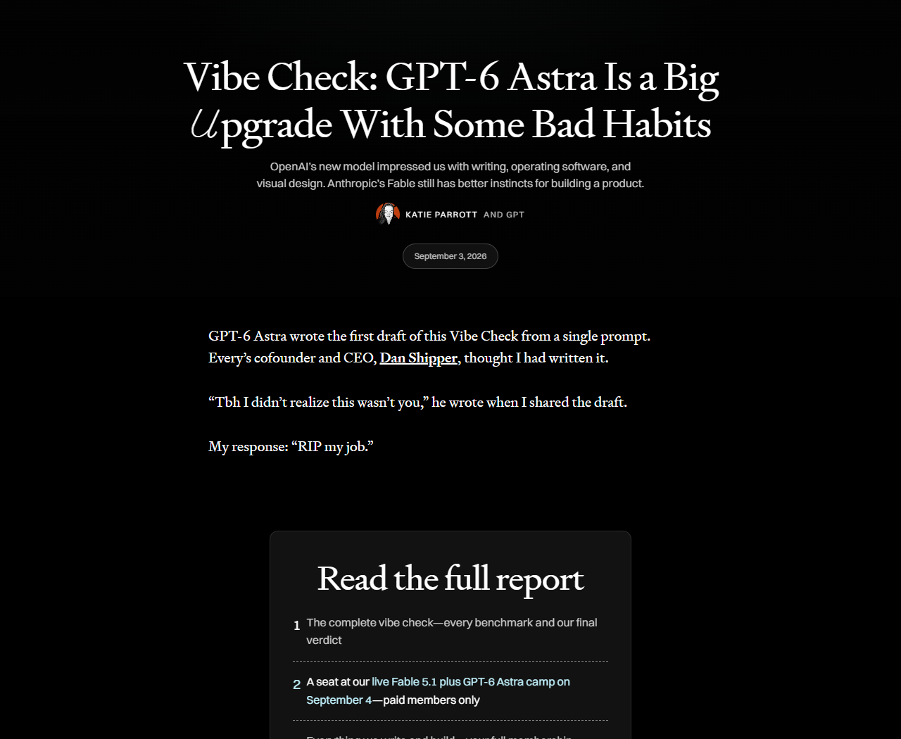

*图源：Every，公开页面截图。*

Every 在导语里肯定了 Astra 的写作、软件操作和视觉设计。不过，他们仍然认为 Fable 更懂得怎么把一个产品做出来。

X 上也有人把测试做成了玩具。Claire Vo 拿来一台迷你电脑，把自己的实验叫作「Tiny Computer Bench」。这个一本正经的名字是她开的玩笑，不是正式榜单。[Claire 原帖](https://x.com/clairevo/status/2095625355231142079)

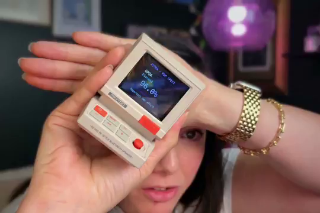

*图源：Claire Vo 的 X 视频，实际画面节选。*

## 再做一款「阴间糖豆人」

另一道题是「小妖快跑：鬼门关淘汰赛」。

Matthew Berman 在 X 上发过一个糖豆人式闯关游戏，说用了两条提示词。我也想试一款闯关游戏，把场景换成中式鬼怪世界。[Berman 原帖](https://x.com/MatthewBerman/status/2095616764793270705)

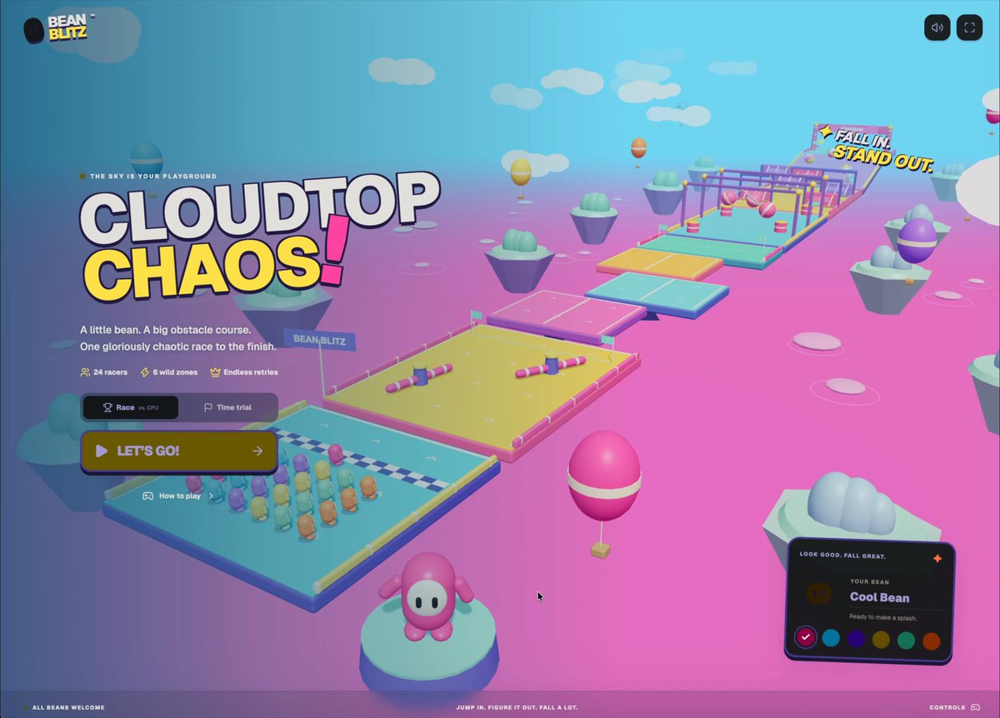

*图源：Matthew Berman / X，原视频封面。*

主角是一只提着灯笼的小妖。它从云海里的断桥起跑，先躲开摆动的铜钟，再跳过旋转的八卦台，最后穿过定时开合的鬼门。

周围可以有浮岛、石像和红灯笼。远处的青铜门要够大，玩家一开始就能看见自己要去哪里。

这道题没有给参考图。角色长什么样，云海铺在哪里，灯笼和石像怎么摆，都要模型自己安排。除了画面，我还要求有其他小妖一起跑，让这条赛道热闹一点。

控制方式仍然简单：移动、跳跃，掉落后重来。镜头跟着角色走，要能看清起跳点和落脚处。

先看 Astra 做的这一版。小妖戴着黑帽子，提着灯笼，不同颜色的围巾能把角色区分开。桥头是青绿色屋顶和红色立柱，石桥两侧挂着铜钟，远处的山石隐在雾里。

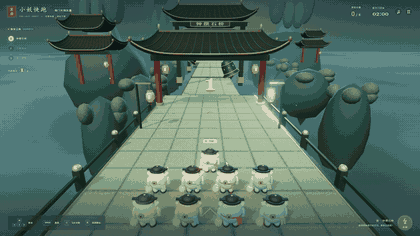

*Astra 生成的「小妖快跑」，作者实际试玩录屏。*

这局画面里有 9 只小妖，晋级名额只有 6 个。出发时大家挤在桥头，没多久，其他小妖就跑到了前面。途中出现过「小妖不服，再跑一次」的提示，角色回到前面的路段继续跑。

到了第二段，石桥变成一连串圆形八卦台。红色横杆在台面上旋转，其他小妖也会从旁边经过。

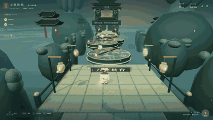

*Astra 版本，原速试玩节选。*

最后一段是开合的鬼门。这局跑到终点时，画面显示第 4 名，已经占了一个晋级位置。终点亮起一片金光，几只先到的小妖留在那里庆祝。

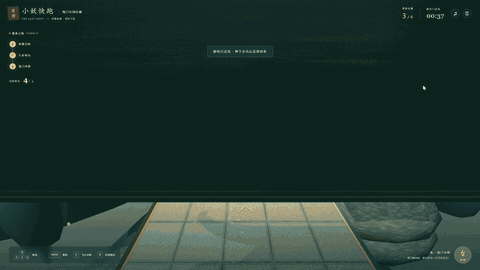

*Astra 版本，实际录屏中的到达终点画面。*

Fable 5.1 的版本先用一段镜头带着我看赛道。红色门板一扇接一扇，暖黄色的灯笼沿着石桥排开。浮岛下面是青色的雾，石砖和铜钟上的纹理也更显眼。

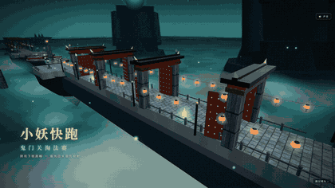

*Fable 5.1 版本，12:03:11 录屏的原速开场节选。*

它把小妖做成了不同颜色的圆团子，起点排着 6 只。石桥边的灯笼有很明显的光晕，远处的岩石轮廓藏在雾里。这道题里，我更喜欢 Fable 的画面。

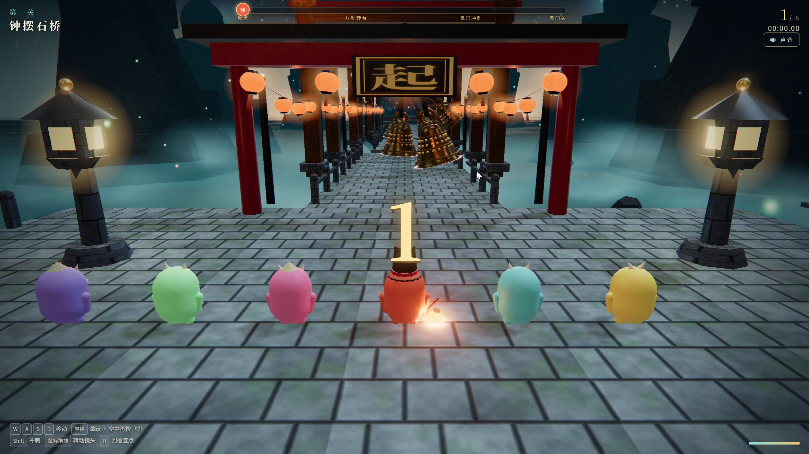

*Fable 5.1 版本，原始录屏画面。*

不过，试玩时感觉左右方向好像设反了。录屏里也能看到小妖掉到桥下，镜头跟着往下走。这两段没有录到通关。

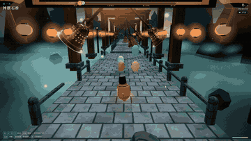

*Fable 5.1 版本，12:03:51 录屏的原速试玩节选。掉落原因没有独立核实。*

<!-- 最新归属由作者按三个文件名明确更正。画面偏好和方向疑似反转仍为作者对 Fable 的反馈；未独立复现按键映射，不将掉落归因于此，也不把短录屏未通关写成无法通关。 -->

这轮试下来，如果继续打磨小妖游戏，我会先留下 Fable 这版画面，把方向和镜头的问题处理好。Astra 这边，我更想给 APPSO Logo 乐园加一关，看看它能不能沿用已有的字形和透明小桥。

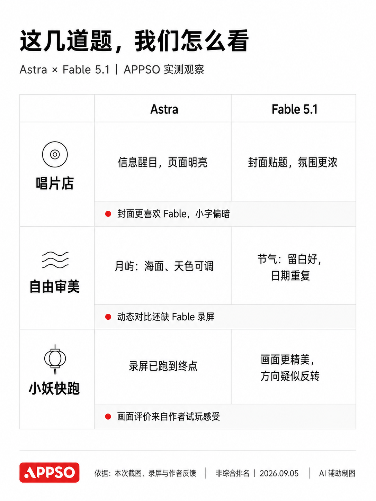

*APPSO 整理，AI 辅助制图。根据本次截图、录屏与作者反馈，不是综合排名。*

回到跑分表现上，APPSO 特意整理了六个维度的指标，把 Astra 和 Fable 5.1 放在一起对比一下。

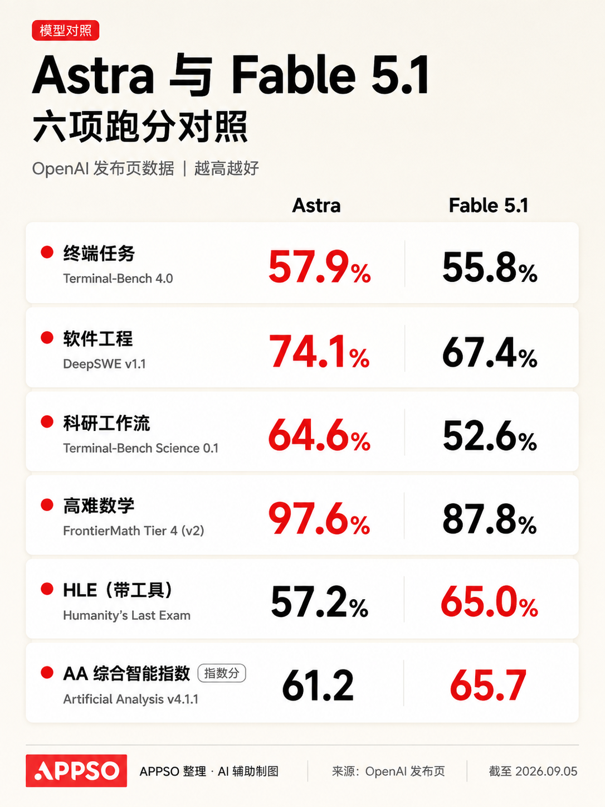

*APPSO 整理，AI 辅助制图。[数据来自 OpenAI 发布页](https://openai.com/index/gpt-6-astra/)，截至 2026 年 9 月 5 日。各项取不同推理档位下的最高成绩，测试环境可能与实际产品不同。*

## 还有一些进步，截图看不出来

刷多了这些演示，其实也会有点眼熟。又是一个小游戏，又是一个漂亮网页。连我们自己，这次也没少做。

因为它们确实好展示。画面够不够漂亮，放一张 GIF 就有感觉。但一个要做很久的任务，模型能不能记住前面的要求，遇到问题能不能接着往下做，就很难用十秒钟讲清楚。科学推理也是如此，一段解答到底有没有推进问题，需要懂这个领域的人仔细看。

榜单能提供一些参照。至于这些进步跟自己有什么关系，还是得把手里的事交给它试试。

我手头还有一个叫 Paperweave 的项目，是自己搭的研究工作台。读论文、梳理文献关系、记笔记和写作，都放在了同一个地方。

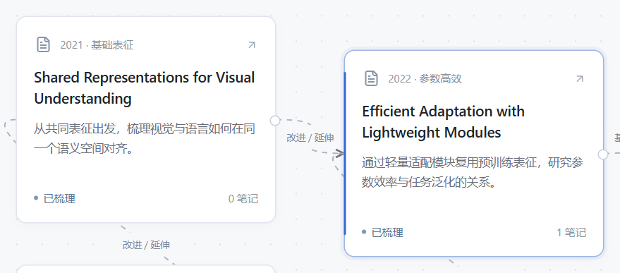

*作者项目 Paperweave，实际画布局部。图中论文和关系为项目自带的虚构演示数据。*

比如读到一篇不太懂的论文，可以把选中的段落交给旁边的 AI 解释。讨论完留下笔记，再把它和其他论文连起来。画布上的卡片可以直接拖动，连线时也能补上关系和依据。

但两篇论文到底是什么关系，还是要回到原文里看。它们用了不同的实验条件，一张对比图再整齐，也不能直接拿来判断谁更好。

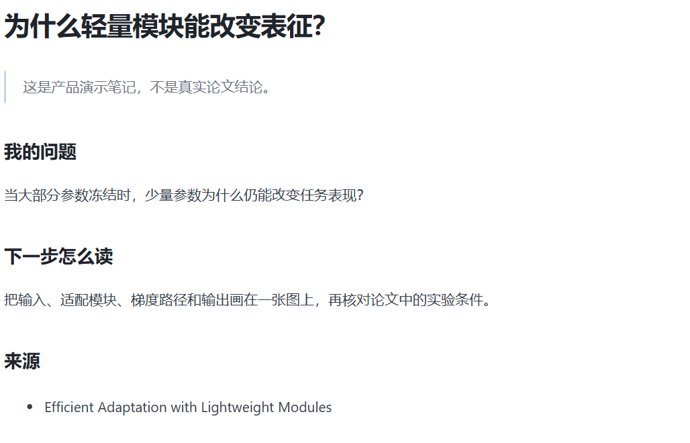

*Paperweave 笔记界面的局部截图，内容为功能演示，不是真实研究结论。*

Google DeepMind 联合创始人 Demis Hassabis 在今年 2 月的一场校园对谈里，被问到怎么借助 AI 加深理解，同时保留自己思考的过程。

他给学生的建议是「学会学习」，先弄清楚自己在什么环境、用什么方式学得最好。[对谈实录](https://eecs.iisc.ac.in/fireside-chat-sir-demis-hassabis-and-prof-govindan-rangarajan/)

了解一个领域多一点，问题往往也会具体一点。遇到没学过的东西，也可以边问边读。AI 解释完，再拿原文对照一遍。

OpenAI 这次也把分析科研数据、操作专业软件列进了 Astra 的应用介绍。[官方介绍](https://openai.com/index/gpt-6-astra/) 这些用途不像小游戏那样，一打开就能吸引人。

如果 AI 能帮研究者更快查清已有工作，把一个想法写成可运行的实验，就有机会更早验证新的问题。至于能否带来科学发现，要看后面的实验和证据。我们这个工作台目前也只是把阅读和研究工具放在一起，离那一步还远。

## 这就到 AGI 了吗？

这次发布，OpenAI 已经开始谈 AGI，也就是通用人工智能。总裁 Greg Brockman 表示，他个人认为已经到了这个阶段。TechRepublic 也把「AGI 时代」放进了报道标题。[相关报道](https://www.techrepublic.com/article/news-openai-gpt-6-astra-agi-era-2026/)

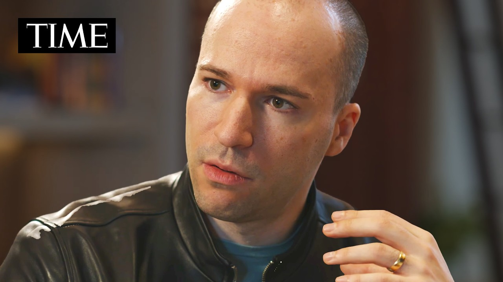

*图源：[TIME 对 Greg Brockman 的 AGI 专访](https://www.youtube.com/watch?v=dnSpKF5pWNQ)，官方视频封面。*

我还不急着点头。做出这几个网页和小游戏，确实有惊喜，但这轮体验还撑不起那么大的结论。

画面喜欢哪一版、操作哪里不对，还是得我们自己上手判断。以后再加一关、换一个要求，它能不能接着做好，也要继续试。

OpenAI 在这次介绍里，专门写到了一个改进：用户中途补充要求或改变方向，Astra 要能接着做原来的任务，保留之前的要求。[OpenAI 发布介绍](https://openai.com/index/gpt-6-astra/)

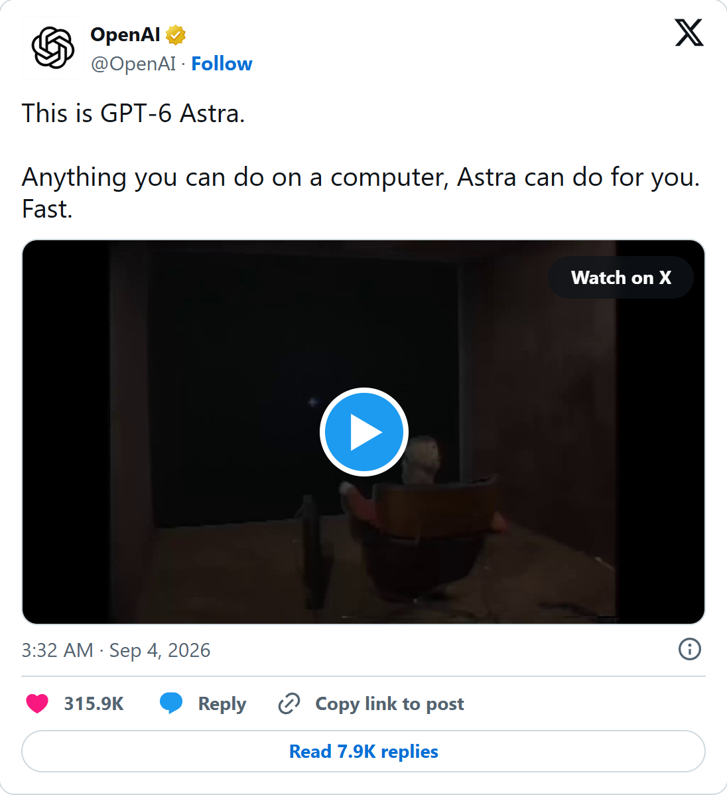

*图源：[OpenAI 发布原帖](https://x.com/OpenAI/status/2095595741528125780)。保留官方宣传原文，视频封面为静态截图。*

接下来，我想继续用这个工作台读论文，把没弄懂的问题追问下去。有些方法光看文字还是抽象，那就让 AI 帮忙写个小实验，自己跑一遍。

这轮重置的额度，除了拿来做游戏，也有别的地方可以花了。

<!-- 编辑待办：Fable Logo 对照仍缺；Astra Logo 真人试玩已补入，未录到完整通关。不写未记录的生成时长、一次成功、额度消耗或总榜胜负。配套完整 MP4 与节选索引见 research/media-handoff.md。 -->
